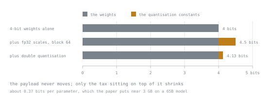

# 第 15 课：NF4 与双重量化

**使命关联:** 这是 QLoRA 贡献的两个想法。懂得它们，才算理解了这篇论文，而不只是读过摘要。
**主要来源:** [论文：“QLoRA: Efficient Finetuning of Quantized LLMs”，Dettmers 等，arXiv:2305.14314](https://arxiv.org/abs/2305.14314)
**前置知识:** [第 14 课](0014-quantisation-from-first-principles.md)

## 热身

1. ▢ 为什么用分块量化，而不是整张量量化？

<details markdown="1"><summary>检查</summary>

离群值只决定它自己那个块之内的缩放因子，把损害限制在 64 或 128 个值之内，而不是整个张量。

</details>

2. ▢ 4 位权重配 fp32 缩放因子、块大小 64，每个参数的真实字节数是多少？

<details markdown="1"><summary>检查</summary>

0.5625，也就是 4.5 位，其中有 0.5 位是纯粹的记账开销。

</details>

3. ▢ 对于 4 位的基础模型，矩阵乘法在什么精度下进行？

<details markdown="1"><summary>检查</summary>

更高的精度，通常是 bf16。块被即时反量化，反量化出来的副本随即丢弃。

</details>

## 要点

QLoRA 贡献了三样东西：NF4、双重量化和分页优化器。前两个是关于表示方式的想法，也是有意思的部分。第三个是工程上的缓解措施，在第 16 课里讲。

### NF4，即 NormalFloat

4 位给你 16 档。该把它们放在哪里？

均匀间隔，就像普通的 int4 那样，把它们等距地放在整个范围上。如果数值是均匀分布的，这是最优的。**神经网络的权重不是均匀分布的。** 它们大致以零为中心，呈正态分布，所以大多数值聚集在零附近，靠近两端的很少。

因此均匀的档位浪费了分辨率：许多档位落在几乎没有权重的尾部，而零附近的密集区域却分到太少。

NF4 的回答是：把 16 个档位放在**标准正态分布的分位数**上，这样每一档覆盖的是等量的*概率质量*，而不是等量的范围。档位在零附近密集，在尾部稀疏，与权重实际所在的位置吻合。论文称，对于零均值、正态分布的数据，这在信息论意义上是最优的。

要做到这一点，每个块必须先除以它的 absmax，归一化到 `[−1, 1]` 之内，而这恰恰是分块量化本来就要存下的东西。所以 NF4 不是额外的机制；它是在第 14 课那套方案之内，对 16 个档位的更好选择。

```text
int4:  levels evenly spaced        → resolution wasted in empty tails
nf4:   levels at normal quantiles  → resolution where the weights are
```

结果是，在相同位宽下，NF4 免费就胜过 int4。没有额外的存储，只是一本更好的码本。

两点坦率的限制：

- 这个增益取决于权重确实接近正态。经过预训练之后，按块来看它们通常如此。这是一个经验性质，而不是保证。
- NF4 是一种*权重*格式。它不是用于激活值的合适工具，激活值的分布不同，也更不规整。

### 双重量化

回到第 14 课里的开销。每个参数，块大小 64、fp32 缩放因子：

```text
weights            0.5     bytes
scales   4/64  =   0.0625  bytes
                  ────────
                   0.5625  bytes  (4.5 bits)
```

这些缩放因子本身也只是张量里的数，而且数量很多。那就把它们也量化。

双重量化取 fp32 的块缩放因子，把它们分组（论文用的是 256 一块），用 8 位存储，并配上它们自己的二级缩放因子。结果是：

```text
first-level scales at 8 bits:   1/64      = 0.015625 bytes/param
second-level scales:            4/(64·256) ≈ 0.000244 bytes/param
weights:                                     0.5      bytes/param
                                            ──────────
                                             0.5159   bytes/param  (~4.13 bits)
```

论文报告平均节省约 **0.37 位每参数**，对于 65B 的模型，大约是 3 GB。这是从纯粹的记账里找回来的、实实在在的一笔内存。



注意这个想法的形状：量化常数是这个方案上固定的一笔税，而双重量化减少的是税，而不是负载本身。

这些条形不用算术就说明了同样的事。灰色的那一段，三条里一样长，因为权重本身没有任何变化；4、4.5 和 4.13 位之间的每一点差别，都是末端那一小块带强调色的部分。要是有方案减少的是负载，那么动的就是灰色的那一段。这是一个小巧、聪明、完全机械的胜利，也是 4 位 QLoRA 实际落在每参数约 4.1 位，而不是 4.5 位的原因。

### 内存方面的结果

用 4 位的基础模型，重新计算第 6 课的例子。一个 7B 模型加一个 20M 参数的适配器：

| | bf16 基础模型 | 4 位基础模型 |
|---|---|---|
| 冻结的基础权重 | 14.0 GB | ~3.6 GB |
| 适配器状态（16 B/参数） | 0.32 GB | 0.32 GB |
| **小计** | **14.3 GB** | **3.9 GB** |

对比全量微调的 112 GB，4 位适配器运行的固定开销不到 4 GB。激活值（第 7 课）现在毫无疑问是主导项，这意味着梯度检查点在这里比工作区里任何别的地方都更重要。

这个结果，正是让 QLoRA 意义重大的原因：它把大模型的微调，从集群搬到了单台设备上。

### 配置

```text
quant_config := {
    load_in_4bit: true,
    quant_type: "nf4",            # not "fp4"
    use_double_quant: true,       # the 0.37 bits/param saving
    compute_dtype: "bfloat16",    # storage is 4-bit; compute is not
}
```

四个设置，每个都对应本课里的某样东西。`bnb_4bit_compute_dtype` 是人们留着默认值不动、而本不该如此的那个：它是反量化后的块相乘时所用的精度，留在 fp32 上，会丢掉大部分速度上的好处。

一如既往，要对照所安装版本的文档确认这些名称。

## 练习

1. ▢ 为什么在相同位宽下，NF4 胜过 int4？

<details markdown="1"><summary>检查</summary>

它把 16 个档位放在正态分布的分位数上，而不是均匀的间隔上，所以分辨率集中在权重真正聚集的地方，也就是零附近，而不是浪费在空空的尾部。

存储相同，码本更好。前提条件是先把每个块归一化到 `[−1, 1]` 之内，而分块量化本来就是这样做的。

</details>

2. ▢ 双重量化究竟压缩的是什么，大约能节省多少？

<details markdown="1"><summary>检查</summary>

一级的块缩放因子，也就是量化常数，而不是权重。它们以 256 个为一组，用 8 位存储，并配一个小的二级缩放因子。

论文报告平均每参数约节省 0.37 位，对于 65B 的模型大约是 3 GB。它把“带开销的 4 位”从约 4.5 位降到了约 4.1 位。

</details>

3. ▢ 计算一个 13B 的基础模型，用 NF4 加双重量化，再加一个 30M 的适配器，总的固定内存。

<details markdown="1"><summary>检查</summary>

基础模型：13e9 × 0.5159 ≈ 6.7 GB。适配器：3e7 × 16 = 0.48 GB。固定部分约 7.2 GB。

对比 bf16 基础模型加适配器的 26 GB，以及全量微调的 208 GB。激活值则叠加在这 7.2 GB 之上。

</details>

4. ▢ QLoRA 的哪个组成部分节省的内存最多？

    - a) 用 NF4，而不是普通的均匀 int4 量化
    - b) 以 4 位而不是 bf16 存储冻结的基础模型
    - c) 对一级块缩放因子做双重量化
    - d) 分页优化器在内存尖峰时转存状态

<details markdown="1"><summary>检查</summary>

**b)** 以 4 位而不是 bf16 存储冻结的基础模型，在最大的固定项上缩小为四分之一。

NF4 在存储相同的情况下提升质量。双重量化每参数节省约 0.37 位。分页优化器防止的是峰值处的崩溃，而不是降低稳态的使用量。

</details>

5. ▢ 为什么 NF4 不适合用来量化激活值？

<details markdown="1"><summary>检查</summary>

它的档位布置，源自一个假设：数值是零均值、近似正态的。预训练之后的权重大体符合这一点；激活值则不然，因为它们带有系统性的大幅度离群特征，所以正态分位数对它们来说是错误的码本。

</details>

6. ▢ 你设了 `load_in_4bit=True`，却让 `bnb_4bit_compute_dtype` 保持默认值。你多半放弃了什么？

<details markdown="1"><summary>检查</summary>

速度。存储仍然是 4 位，内存仍然节省了，但如果计算的数据类型默认是 fp32，那么每个反量化后的块都以全精度相乘，丧失了吞吐上的大部分优势。

要有意识地把它设成 bf16。存储精度和计算精度是两个独立的决定。

</details>

## 实战练习

- [ ] 在纸上算出块大小为 64 时，有和没有双重量化的 4 位每参数字节数。确认差值接近 0.37 位。
- [ ] 分别以 bf16 和 NF4 加载同一个模型，两次都测量内存。与你的预测比较。
- [ ] 明天：对两者用贪心方式生成同一个提示词，把输出并排阅读。对质量代价形成第一印象；第 17 课会把它变成度量。

## 延伸阅读

- [论文：“QLoRA: Efficient Finetuning of Quantized LLMs”，Dettmers 等，arXiv:2305.14314](https://arxiv.org/abs/2305.14314)：第 3 节和第 4 节就是这一课
- [文档：bitsandbytes quantization，Hugging Face Transformers](https://huggingface.co/docs/transformers/main/en/quantization/bitsandbytes)
- [内存预算](../reference/memory-budget.md)

---

没学明白？请重读顶部的主要来源，因为本课是对它的压缩，而理解正是在压缩中流失的。如果有哪个术语觉得含糊，可以查看[术语表](../GLOSSARY.md)。

如果问题出在课程本身，而不是学习材料，那就是一个缺陷：[提交 issue](https://github.com/TokenCemetery/teach/issues)。
