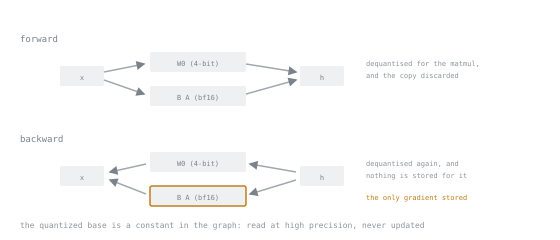

# 第 16 课：穿过量化基础模型进行训练

**使命关联:** QLoRA 的实践。这也是唯一一课，你手头的硬件真正改变了你能用的东西。
**主要来源:** [文档：bitsandbytes quantization，Hugging Face Transformers](https://huggingface.co/docs/transformers/main/en/quantization/bitsandbytes)
**前置知识:** [第 15 课](0015-nf4-and-double-quantisation.md)、[第 11 课](0011-your-first-adapter.md)

## 热身

1. ▢ NF4 把什么放在正态分位数上，为什么？

<details markdown="1"><summary>检查</summary>

它的 16 个可表示的档位，这样每一档覆盖的是等量的概率质量，而不是等量的范围，与正态分布的权重实际聚集的位置吻合。

</details>

2. ▢ 双重量化压缩的是什么？

<details markdown="1"><summary>检查</summary>

一级的块缩放因子，而不是权重。大约每参数 0.37 位。

</details>

3. ▢ 对于带适配器的 4 位基础模型，哪一项内存占主导？

<details markdown="1"><summary>检查</summary>

激活值。基础模型已经降到几 GB，适配器状态还不到一 GB，所以现在是批大小和序列长度，决定这次运行放不放得下。

</details>

## 要点

### 梯度如何穿过冻结的量化基础模型到达适配器

表面上的悖论：基础权重是 4 位整数，而你没法对一个 4 位整数求出有意义的梯度。那训练是怎么进行的？

它之所以行得通，是因为**基础权重并没有被训练。** 追踪一个被适配的层：

```text
forward:   h = W₀_dequant(x) + (α/r) · B A x
```

`W₀` 被反量化成 bf16 来做矩阵乘法，反量化出来的副本随即丢弃。反向传播需要损失对 `A` 和 `B` 的梯度，而要算出它，需要流经这一层的*激活值*（是 bf16），以及从上面传下来的梯度（也是 bf16）。

冻结的权重参与反向传播，只是**把梯度传递**给更早的层。这需要乘以 `W₀`，也就需要再反量化一次，而不是对它求导。没有任何梯度会为基础权重存下来，因为根本没有人要它。



两幅图里，方框相同、位置相同，反向的边就是前向的边反过来。基础模型在两幅图里都出现，在两幅图里都在干活，却在两边都什么也没留下。

所以这里没有什么奇特的东西。量化的基础模型是计算图里的一个常量。它必须以高精度被读取，却从不需要被更新，而更新才是昂贵的部分。

代价是计算：每一步的每次前向传播，以及反向传播中，都要再做一次反量化。QLoRA 用速度换内存，每一步都明显比 bf16 基础模型要慢。

### 准备模型

```text
quant_config := {
    load_in_4bit: true,
    quant_type: "nf4",
    use_double_quant: true,
    compute_dtype: "bfloat16",
}

model := load_model("<base model>", quantization: quant_config)
model := prepare_for_quantized_training(model, gradient_checkpointing: true)

adapter_config := {rank: 32, alpha: 64, target_modules: "all-linear"}
model := attach_adapter(model, adapter_config)
print(model.trainable_parameter_count())
```

`prepare_model_for_kbit_training` 做了几件小而必要的事：把层归一化和输出头转成稳定的精度，启用梯度检查点和对输入梯度的要求，并确保没有哪个必须保持高精度的东西被量化。跳过它，会得到不稳定的运行，或者因梯度错误而失败，而且从报错信息上看不出原因。

### 其他一切都不变

秩、alpha、目标模块、学习率、调度、留出的划分、生成探针、第 11 课的四项检查：全都一样。**QLoRA 就是基础模型更便宜的 LoRA。** 它不是另一种方法，也没有自己那套超参数的民间经验，把它当成另一种方法，是造成混淆的常见来源。

唯一值得一提的调整：由于基础模型的噪声更大，有些从业者会比用 bf16 基础模型时稍微多给一点秩，理由是适配器除了要学任务，还得补偿量化误差。把它当作需要在你的任务上检验的假设，而不是规则。

### 后端：实际情况是什么

这一点需要小心对待，因为被广泛重复的那个版本已经过时了。

`bitsandbytes` 最初只支持 CUDA，好几年里，“QLoRA 需要 NVIDIA GPU”就是一句准确的话。此后这个库转向了多后端架构，分派到 **CUDA（同样涵盖 AMD ROCm）、CPU、Intel XPU、Intel Gaudi 和 Apple MPS**，另有纯 PyTorch 的回退路径。4 位运算，即量化、反量化和 4 位矩阵向量乘法，在 CUDA 之外也有后端实现，当块大小是已编译内核所支持的大小时就分派过去，否则退回到较慢的通用路径。

对你而言，由此得出的是：

- **CUDA 仍然是最完整、优化得最好的路径。** 如果你有它，就用它，并预期发表的数字可以复现。
- **其他后端是可行的，而且在改进，但有保留条件。** 覆盖情况因运算、块大小和库版本而异。预期每一步会更慢，并预期要去检查某个具体的配置用到的是优化的内核还是回退路径。
- **分页优化器是真正特定于 CUDA 的部分。** 它们依赖 NVIDIA 的统一内存，在短暂的尖峰时把优化器状态转存到主机内存，避免在峰值处内存不足而崩溃。那是一个硬件特性，而不是可移植的算法。它在适配器训练里也最不重要，因为那里优化器状态很小；它最初的用途是全量微调规模的状态。
- **要对照你所安装的版本来验证，而不是任何文档。** 这一块反复变过，还会再变。`bitsandbytes` 也不是通往 4 位的唯一路线；还有别的量化后端，硬件覆盖各不相同。

第 14 课和第 15 课里的概念，也就是分块缩放因子、正态分位数档位、对常数做量化，以及存储精度与计算精度，都是算术，在每个后端上都一样。不同的只是内核是否可用和速度。

### 这次运行会是什么样

| 相对于 bf16 基础模型 | 效果 |
|---|---|
| 固定内存 | 基础模型部分大约低 4 倍 |
| 每步用时 | 更慢，每次前向和反向都要反量化 |
| 损失曲线的形状 | 非常相似；可能略高一点 |
| 最终质量 | 略低，因任务而异，所以要度量（第 17 课） |

第 13 课里的合并规则仍然成立，而且比以往任何时候都更重要：**合并进全精度的基础模型，而不是量化的那个。** 针对 4 位训练，然后以 bf16 加载基础模型，应用适配器，在那里合并。合并进量化权重，会额外增加一份重新量化的损失，你没有任何理由接受它。

## 练习

1. ▢ 当基础权重是 4 位整数时，梯度怎么流动？

<details markdown="1"><summary>检查</summary>

从来没有对基础权重求梯度：它们是冻结的常量。梯度是对 `A` 和 `B` 求的，它们是高精度的。

冻结的权重是用来向更早的层*传递*梯度的，这需要为了做乘法而把它们反量化，而不是对它们求导。

</details>

2. ▢ `prepare_model_for_kbit_training` 做了什么，跳过它会怎样？

<details markdown="1"><summary>检查</summary>

它把需要稳定性的模块，比如层归一化和输出头，转成更高的精度，启用梯度检查点和输入梯度，并确保没有哪个必须保持高精度的东西被量化。

跳过它，通常会得到不稳定的运行，或者一个关于“不要求梯度”的错误，而报错信息并没有指向原因。

</details>

3. ▢ QLoRA 里哪一部分是特定于 CUDA 的，它对适配器训练有多重要？

<details markdown="1"><summary>检查</summary>

分页优化器，它用 NVIDIA 的统一内存，在尖峰时把优化器状态转存到主机内存。

它对适配器训练几乎无关紧要，那里优化器状态只有几兆字节。它是为全量微调规模的状态设计的，那时一个短暂的尖峰真的会终结整个运行。

</details>

4. ▢ 一篇 2023 年的教程说，4 位 NF4 需要 NVIDIA GPU。这仍然正确吗？

<details markdown="1"><summary>检查</summary>

作为绝对的说法，不对。`bitsandbytes` 现在把 4 位运算分派到 CUDA/ROCm、CPU、Intel XPU、Intel Gaudi 和 Apple MPS，在没有已编译内核的地方用 PyTorch 回退路径。

CUDA 仍然是最完整、最快的路径，其他后端上的覆盖情况因运算、块大小和版本而异。所以正确的说法是“CUDA 是支持得最好的路径”，而不是“CUDA 是唯一的路径”，并且你要对照所安装的版本来验证，而不是任何教程。

</details>

5. ▢ 从 LoRA 换到 QLoRA 时，你必须重新考虑哪个超参数？

    - a) 学习率，必须大幅调低
    - b) alpha 值，必须调高来补偿
    - c) 一个都不用，基础模型的精度是另一回事
    - d) 批大小，必须调大才能保持稳定

<details markdown="1"><summary>检查</summary>

**c)** 一个都不用。基础模型的精度是另一回事。

QLoRA 就是基础模型更便宜的 LoRA。有些从业者会试着多给一点秩，来吸收量化噪声，但那是需要检验的假设，不是必须的改动。

</details>

6. ▢ 你针对 4 位的基础模型训练，想得到一个单一的可部署模型。按顺序给出步骤。

<details markdown="1"><summary>检查</summary>

以 bf16（而不是 4 位）加载基础模型，应用训练好的适配器，合并，连同分词器一起保存，只有当你需要一个量化的产物来部署时，才在之后把合并的模型量化。

合并进 4 位的基础模型，需要反量化、相加、再重新量化，白白损失质量。

</details>

## 实战练习

- [ ] 分别以 bf16 和 NF4 加载同一个基础模型。记录各自的内存，并算出比值。
- [ ] 对两个基础模型运行同一个简短的训练任务。记录每步秒数和损失曲线，并注意哪个更慢、慢多少。
- [ ] 检查你安装的 `bitsandbytes` 实际用的是哪个后端，以及你的块大小用到的是优化的内核还是回退路径。
- [ ] 明天：把用 4 位训练出来的适配器合并进 bf16 的基础模型，并对着你的探针用贪心解码验证。

## 延伸阅读

- [文档：bitsandbytes quantization，Hugging Face Transformers](https://huggingface.co/docs/transformers/main/en/quantization/bitsandbytes)
- [代码：bitsandbytes，bitsandbytes-foundation](https://github.com/bitsandbytes-foundation/bitsandbytes)：后端目录是覆盖情况的权威
- [论文：“QLoRA: Efficient Finetuning of Quantized LLMs”，Dettmers 等，arXiv:2305.14314](https://arxiv.org/abs/2305.14314)
- [第 17 课：QLoRA 的真实代价](0017-what-qlora-costs.md)

---

没学明白？请重读顶部的主要来源，因为本课是对它的压缩，而理解正是在压缩中流失的。如果有哪个术语觉得含糊，可以查看[术语表](../GLOSSARY.md)。

如果问题出在课程本身，而不是学习材料，那就是一个缺陷：[提交 issue](https://github.com/TokenCemetery/teach/issues)。
