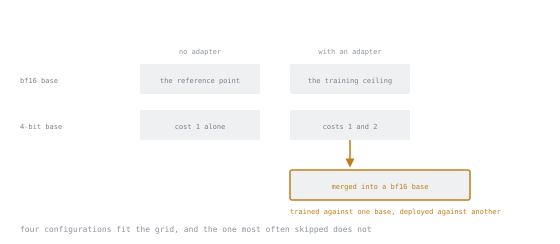

# Урок 17. Сколько на самом деле стоит QLoRA

**Связь с целью курса:** Цель курса говорит: «объяснить измеренные различия, а не заявленные». Этот урок и есть измерение.
**Первоисточник:** [Научная статья: "QLoRA: Efficient Finetuning of Quantized LLMs", Dettmers et al., arXiv:2305.14314](https://arxiv.org/abs/2305.14314)
**Предварительные требования:** [Урок 16](0016-training-through-a-quantized-base.md)

## Разминка

1. ▢ Почему замороженная 4-битная база всё же может пропускать градиенты?

Проверка

Она константа в графе. Чтобы пропустить градиент, нужно прочитать её в высокой точности, а не дифференцировать по ней, и градиент для неё не хранится.

2. ▢ Какой компонент QLoRA действительно специфичен для CUDA?

Проверка

Страничные оптимизаторы, которые зависят от унифицированной памяти NVIDIA. И они меньше всего важны при обучении адаптера, где состояние оптимизатора невелико.

3. ▢ Куда вы сливаете адаптер, обученный против 4-битной базы?

Проверка

В базу полной точности, затем квантизуете после, если нужно.

## Что нужно знать

### Заявление статьи, сформулированное точно

Главный результат QLoRA в том, что 4-битное адаптерное дообучение в NF4 может достичь той же производительности, что и 16-битное, на измеренных задачах. Это сильный результат, и он настоящий.

Но это также утверждение о **конкретной постановке на конкретных бенчмарках**. Чего оно не устанавливает:

- Что NF4 бесплатен на *вашей* задаче. Бенчмарки следования инструкциям это не ваше продакшен-распределение.
- Что квантизация бесплатна в любом масштабе. Ошибка квантизации это фиксированное относительное возмущение, а у малых моделей меньше избыточности, чтобы его поглотить, поэтому деградация обычно заметнее на малых моделях, чем на больших.
- Что любая 4-битная реализация эквивалентна. Тип квантизации, размер блока, включена ли двойная квантизация, тип вычислений и качество ядра всё различается.

Прочитать утверждение статьи как «квантизация бесплатна» это ровно тот режим отказа, на который нацелена фраза цели курса *измеренные, а не заявленные*.

### Разделение двух цен

Есть два отдельных вопроса о качестве, и их смешение делает результаты непригодными для интерпретации.

**Цена 1. Квантизованная база это худшая модель ещё до какого-либо обучения.** Чисто свойство представления.

**Цена 2. Обучение против квантизованной базы даёт худший адаптер.** Свойство процесса обучения поверх цены 1.

Измеряйте их по отдельности:

| Конфигурация | Что изолирует |
|---|---|
| База в bf16, без адаптера | Точку отсчёта |
| 4-битная база, без адаптера | Цену 1, один только ущерб от квантизации |
| База в bf16 + адаптер | Потолок обучения |
| 4-битная база + адаптер | Цены 1 и 2 вместе |
| Адаптер, обученный в 4 битах, слитый в базу в bf16 | Доходит ли цена 1 до артефакта |

Четыре из пяти конфигураций это ячейки одной сетки. Пятая нет, потому что для обучения она использует другую базу, чем для развёртывания, а конфигурацию, которой негде сидеть в ячейке, легко забыть запустить.

Последняя строка самая интересная, и её регулярно пропускают. Вы обучали против испорченной базы, но *развернуть* можете против базы полной точности. Научился ли адаптер компенсировать ошибку квантизации и потому не подходит, когда ошибка исчезает, это эмпирический вопрос с реальным ответом для вашей задачи. Измерьте, а не предполагайте в ту или иную сторону.

### Как измерить честно

**Держите всё остальное фиксированным.** Те же данные, то же разбиение, то же зерно, те же ранг, альфа, скорость обучения, расписание и шаги. Одна переменная: точность базы. Сравнение с двумя изменениями в нём не сравнение.

**Используйте метрику задачи, а не потери.** Потери между конфигурациями несопоставимы так, как вам нужно, и это не то, что вас волнует. Выбор метрики разбирает урок 23.

**Сообщайте разброс, а не точку.** Запустите каждую конфигурацию с тремя зёрнами. Если вариация от зерна к зерну 2 пункта, а ваш эффект квантизации 1 пункт, вы ничего не измерили, и это происходит постоянно. Сравнение двух конфигураций по одному зерну это анекдот.

**Измеряйте также скорость и память.** Именно из-за них вы вообще рассматриваете квантизацию, поэтому им место в той же таблице, что и качеству.

### Таблица результатов, которую стоит составить

| Конфигурация | Метрика задачи | Пиковая память | Сек/шаг |
|---|---|---|---|
| База в bf16 + адаптер | | | |
| База в NF4 + адаптер | | | |
| NF4 без двойной квантизации | | | |
| int4 вместо NF4 | | | |
| NF4, слитая в bf16 для оценки | | | |

Один раз заполнить это на задаче, которая вам важна, ценнее любого количества чтения о квантизации. Именно последняя строка расскажет вам то, что нигде не посмотреть.

### Чего ждать, чтобы можно было удивиться

Грубые ожидания из литературы и общей практики, как априорное мнение, которое нужно обновлять, а не как результат:

- **Память:** примерно 4-кратное сокращение для весов базы. Надёжно, это арифметика.
- **Скорость:** медленнее на шаг, часто заметно. Деквантизация это настоящая работа.
- **Качество:** небольшая деградация, часто в пределах шума зёрен на больших моделях, заметнее на малых и на задачах с узкими запасами.
- **NF4 против int4:** NF4 лучше при том же хранении.
- **Двойная квантизация:** экономия памяти с пренебрежимым влиянием на качество.

Если ваши измерения резко расходятся с этим, это стоит расследовать, а не отбрасывать. Самая частая причина это неоптимизированный путь ядра на вашем бэкенде или сравнение, в котором изменилось больше одной вещи.

### Когда прибегать к QLoRA

**Используйте её, когда память это ограничивающий фактор**, то есть когда база в bf16 плюс активации не помещаются, а альтернатива это не обучать вообще или обучать модель поменьше. 4-битная большая модель обычно превосходит малую в bf16.

**Не используйте её, когда память не ограничение.** Если bf16 помещается, квантизация стоит вам скорости и немного качества ни за что. Рефлекс туториалов всегда загружать в 4 бита это затраты без выгоды, когда памяти и так хватало.

## Практика

1. ▢ Сформулируйте главное заявление QLoRA, затем скажите, чего оно не устанавливает.

Проверка

Заявление: 4-битное адаптерное дообучение в NF4 может достичь той же производительности, что и 16-битное, на измеренных бенчмарках.

Не устанавливает: что это верно на вашей задаче и распределении, что это верно в равной мере в малом масштабе моделей или что любая 4-битная реализация эквивалентна реализации из статьи.

2. ▢ Назовите две отдельные цены в качестве и как их изолировать.

Проверка

Цена 1: квантизованная база это худшая модель до обучения, поэтому измерьте базу без адаптера, квантизованную и нет.

Цена 2: обучение против квантизованной базы даёт худший адаптер, поэтому сравните адаптеры, обученные на квантизованной и на полноточной базах, при прочих равных.

3. ▢ Вы измеряете 71,2 для bf16 и 70,8 для NF4. Стоит ли вам квантизация 0,4 пункта?

Проверка

Неизвестно. Без разброса по зёрнам нельзя отличить 0,4 от шума, а вариация от зерна к зерну в запуске дообучения часто её превосходит.

Запустите по три зерна на конфигурацию и сравните распределения. Разница такого размера по одному зерну не результат.

4. ▢ Какое сравнение чаще всего пропускают и что оно вам говорит?

Проверка

Оценка адаптера, обученного в 4 битах и слитого в базу полной точности.

Оно говорит, обязана ли цена квантизации вообще дойти до вашего развёрнутого артефакта. Вы обучали дёшево, но ничто не заставляет вас и обслуживать дёшево. Оно также показывает, адаптировался ли адаптер к самой ошибке квантизации.

5. ▢ Ваш запуск в bf16 спокойно помещается в память. Стоит ли всё равно переключиться на 4 бита?

Проверка

Нет. Вы заплатили бы медленными шагами и небольшим риском для качества, чтобы сэкономить память, которой вам не недоставало.

Квантизация это ответ на ограничивающее ограничение по памяти. Применять её по рефлексу, потому что так делал туториал, это затраты без соответствующей выгоды.

6. ▢ NF4 заметно ухудшает вашу задачу на модели в 1 млрд, но статья не сообщала о деградации. Противоречите ли вы статье?

Проверка

Нет. Ошибка квантизации это фиксированное относительное возмущение, а у малых моделей меньше избыточности, чтобы его поглотить, поэтому деградация обычно заметнее в малом масштабе. Ваша задача и метрика к тому же отличаются от измеренных бенчмарков.

Оба результата могут быть верны. Именно поэтому цель курса требует измеренных, а не заявленных различий.

## Практика в реальной работе

- [ ] Заполните таблицу сравнения из пяти строк на задаче, которая вам важна. Три зерна на строку.
- [ ] Измерьте пиковую память и секунды на шаг для каждой строки рядом с числом качества.
- [ ] Оцените адаптер, обученный в 4 битах и слитый в базу в bf16. Запишите, превзошёл ли он 4-битный вариант для обслуживания, сравнялся с ним или проиграл.
- [ ] Завтра: напишите один абзац о том, чего квантизация стоила *вам*, с числами, и чем это отличается от ожидаемого.

## Что почитать дальше

- [Научная статья: "QLoRA: Efficient Finetuning of Quantized LLMs", Dettmers et al., arXiv:2305.14314](https://arxiv.org/abs/2305.14314): прочитайте раздел об ограничениях
- [r/LocalLLaMA](https://www.reddit.com/r/LocalLLaMA/): самый большой пул измерений практиков на потребительском оборудовании, и с ним стоит сверять свои числа
- [Урок 23. Метрики, которые что-то значат](0023-metrics-that-mean-something.md)

---

Не доходит? Перечитайте первоисточник в начале: этот урок его сжимает, а при сжатии понимание как раз и теряется. Загляните в [глоссарий](../GLOSSARY.md), если какой-то термин показался скользким.

Если неясен сам урок, а не материал, это дефект: [откройте issue](https://github.com/TokenCemetery/teach/issues).
