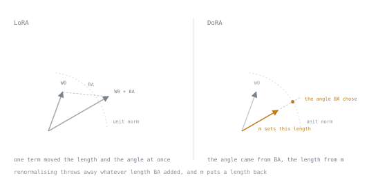

# 第 18 课：DoRA：幅度与方向

**使命关联:** 使命里点名的第三种方法，也是它的机制最常被描述错的一种。
**主要来源:** [论文：“DoRA: Weight-Decomposed Low-Rank Adaptation”，Liu 等，arXiv:2402.09353](https://arxiv.org/abs/2402.09353)
**前置知识:** [第 8 课](0008-the-low-rank-idea.md)、[第 9 课](0009-rank-alpha-and-initialisation.md)

## 热身

1. ▢ 写出 LoRA 的更新，并说明哪些因子是可训练的。

<details markdown="1"><summary>检查</summary>

`h = W₀x + (α/r)BAx`。只有 `A` 和 `B` 可训练；`W₀` 冻结。`B` 从零开始。

</details>

2. ▢ 在 `r = 8` 时，LoRA 更新的最大秩是多少？

<details markdown="1"><summary>检查</summary>

八。`BA` 的秩不能超过它内部维度的秩，这限定了适配器能表达哪些更新。

</details>

3. ▢ 为什么量化在小模型上不是免费的？

<details markdown="1"><summary>检查</summary>

量化误差是一个固定的相对扰动，小模型能用来吸收它的冗余更少。

</details>

## 要点

### 观察

任何权重矩阵，都可以分解为一个**幅度**和一个**方向**。逐列来看：

```text
W = m · (V / ‖V‖_c)
```

其中 `‖·‖_c` 是逐列的范数，`V / ‖V‖_c` 是一个列向量都是单位范数的矩阵，即纯粹的方向，而 `m` 是每列一个标量的向量，承载幅度。

DoRA 的作者分析了在训练中，全量微调和 LoRA 分别如何移动这两个量，发现模式并不相同。全量微调倾向于做出相对较大的方向变化，而幅度变化相对温和，并呈现出两者之间一种独特的关系。LoRA 的更新则以更耦合的方式，同时移动幅度和方向，因为单一的低秩加性项一次同时改变了两者，却没有办法独立地调整它们。

假设是：这种耦合是一个局限，把两者解耦，应该能让 LoRA 的学习行为更接近全量微调。

### 方法

把冻结的 `W₀` 分解成它的幅度和方向。然后：

- 让**幅度向量 `m` 直接可训练。** 它每列一个标量，所以是 `d_out` 个参数，可以忽略。
- 把**低秩更新作用于方向**，之后再重新归一化。

```text
W' = m · (W₀ + BA) / ‖W₀ + BA‖_c
```

仔细读这一行，因为描述出错的地方就在这里。`BA` 被加到权重上，然后结果被**重新归一化成单位列**，这就把 `BA` 引入的任何幅度变化都剥掉了。幅度随后由可训练的 `m` 单独、显式地提供。

所以 `BA` 再也不能改变幅度，哪怕是无意中，因为它只引导方向，而 `m` 负责尺度。这就是解耦，也是它全部的贡献。



两幅图用的是同一个 `W0` 和同一个 `BA`。左边，一个项同时移动了两个量；右边，角度就是 `BA` 贡献的全部，而长度是 `m` 说了算。

### 它的代价

**参数：** 每个被适配的层多一个长度为 `d_out` 的向量。对于 4096 宽的层，是 4096 个数，而秩为 16 的适配器是 131,072 个。基本上是免费的。

**计算：** 不是免费的。必须计算 `W₀ + BA` 的列范数，而它取决于 `BA`，所以每一步都会变，无法跨更新缓存。这使 DoRA 每步比 LoRA 明显更慢，通常在几十个百分点的量级，随实现以及库能融合或缓存多少工作而不同。

**复杂度：** 合并更复杂。合并后的权重是 `m · (W₀ + BA)/‖W₀ + BA‖_c`，仍然是一个普通的矩阵，所以合并后的 DoRA 是精确的，推理开销为零，与 LoRA 完全一样。但要得到它的算术不是简单的加法，实现很关键。

### 使用它

在 PEFT 里，DoRA 是 LoRA 配置上的一个开关，而不是单独的方法：

```text
config := {
    use_dora: true,
    rank: 8,
    alpha: 32,
    target_modules: "all-linear",
    dropout: 0.05,
    adapt_bias: false,
}
```

你对秩、alpha、目标模块和学习率所知道的一切，都照样适用。它是对更新应用方式的修改，而不是一套新的决策。一如既往，对照所安装的版本确认开关的名称。

DoRA 也能与量化组合：量化的基础模型加 DoRA 适配器，有时叫作 QDoRA。这种相互作用值得去测量，而不是想当然：重新归一化现在是作用在带着量化误差的反量化权重上的，这显然不一定无害。

### 坦率的总结

DoRA 是一个动机充分的改进，机制清晰，报告的增益集中在低秩，并带有真实的速度代价。它不是 LoRA 的替代品，也不是在每种设置下都有很大的效应。第 19 课讲的是预测它何时物有所值。

## 练习

1. ▢ 写出 DoRA 的公式，并指出每个可训练的量。

<details markdown="1"><summary>检查</summary>

`W' = m · (W₀ + BA) / ‖W₀ + BA‖_c`。

可训练的：幅度向量 `m`，加上 `A` 和 `B`。冻结的：`W₀`。

</details>

2. ▢ 重新归一化达成了什么？

<details markdown="1"><summary>检查</summary>

它去掉了 `BA` 引入的任何幅度变化，让 `BA` 只能影响方向。幅度随后由可训练的 `m` 显式设定。

这种分离，就是这个方法得名的那种解耦。

</details>

3. ▢ 为什么 DoRA 几乎没增加什么参数，却比 LoRA 慢？

<details markdown="1"><summary>检查</summary>

必须计算 `W₀ + BA` 的列范数，而因为它取决于 `BA`，所以每一步都会变，无法跨更新缓存。多出来的参数可以忽略；多出来的算术则不能。

</details>

4. ▢ DoRA 给一个 4096 × 4096 的层增加多少参数，与那里秩为 16 的 LoRA 相比如何？

<details markdown="1"><summary>检查</summary>

4096 个，每个输出列一个幅度标量。

那一层上秩为 16 的 LoRA 是 16 × (4096 + 4096) = 131,072。所以 DoRA 增加的部分，约占其上的 3%，这不是让人犹豫的原因。步骤用时才是。

</details>

5. ▢ 合并后的 DoRA 有推理开销吗？

<details markdown="1"><summary>检查</summary>

没有。合并后的结果 `m · (W₀ + BA)/‖W₀ + BA‖_c` 是一个普通的权重矩阵，所以合并后的 DoRA 在推理时与任何其他模型没有区别。

要产出它的算术，比 LoRA 简单的加法要复杂，但产物是同一类东西。

</details>

6. ▢ 哪个陈述正确地描述了 DoRA？

    - a) 它给幅度项增加了第二个低秩更新
    - b) 它直接训练幅度，并对方向做低秩更新
    - c) 它用满秩的缩放取代低秩更新
    - d) 它归一化的是梯度，而不是权重矩阵

<details markdown="1"><summary>检查</summary>

**b)** 它直接训练幅度，并对方向做低秩更新。

没有第二个低秩因子。更新不是满秩的。归一化是作用在权重上的，而不是梯度上。

</details>

## 实战练习

- [ ] 亲手实现这个分解：取任何一个权重矩阵，计算逐列的范数，拆成 `m` 和单位范数的 `V`，并验证 `m · V` 能重构出它。
- [ ] 用 `use_dora=True` 和 `False` 训练同一个配置。记录两者的每步秒数，并算出开销。
- [ ] 明天：阅读 DoRA 论文的第 4 节，其中给出了全量微调与 LoRA 的幅度与方向分析。那个分析就是论证本身。

## 延伸阅读

- [论文：“DoRA: Weight-Decomposed Low-Rank Adaptation”，Liu 等，arXiv:2402.09353](https://arxiv.org/abs/2402.09353)
- [文档：LoRA variants，Hugging Face PEFT](https://huggingface.co/docs/peft/main/en/developer_guides/lora)
- [第 19 课：DoRA 何时占优，何时不占优](0019-when-dora-wins.md)

---

没学明白？请重读顶部的主要来源，因为本课是对它的压缩，而理解正是在压缩中流失的。如果有哪个术语觉得含糊，可以查看[术语表](../GLOSSARY.md)。

如果问题出在课程本身，而不是学习材料，那就是一个缺陷：[提交 issue](https://github.com/TokenCemetery/teach/issues)。
