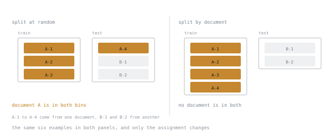

# 第 22 课：数据污染与留出集设计

**使命关联:** 一个你无法信任的留出集，比没有还糟，因为它会产生自信而错误的决策。
**主要来源:** [代码：lm-evaluation-harness，EleutherAI](https://github.com/EleutherAI/lm-evaluation-harness)
**前置知识:** [第 21 课](0021-building-the-dataset.md)

## 热身

1. ▢ 为什么要在划分之前去重？

检查

横跨划分两侧的一对重复，会把一个训练样本放进留出集，于是留出集的表现度量的就是记忆。

2. ▢ 微调教得差的是什么？

检查

新的事实、原本不具备的推理、最新的信息，以及精确的计算。它教得好的是格式、语气和一致性。

3. ▢ 你发布哪个检查点？

检查

留出集损失最小值处的那个，这以一个你可以信任的留出集为前提。

## 要点

### 两种数据污染

**你自己造成的污染。** 测试样本也（完全或近似地）出现在你的训练集里。完全在你的控制之下，发生时也完全是你的错。

**继承来的污染。** 测试样本出现在基础模型的*预训练*语料里。不在你的控制之下，从外部基本上无法检测，这也是公开基准的分数应当带着怀疑去读的原因。如果一个基准早于基础模型出现，又在公开的网络上，就假定有一些暴露。

实际的后果是：**公开基准对你的决策来说，是一个弱信号。** 它可能度量的是基础模型已经见过的东西的回忆。你自己新构建的留出数据，才是强信号，它是你真正能信任的唯一东西。

### 恰当地划分

随机划分是默认做法，而且常常是错的。你按什么来划分，决定了你度量的是哪种泛化。

| 按什么划分 | 度量什么 | 何时使用 |
|---|---|---|
| 随机的样本 | 对新样本的泛化 | 样本确实相互独立 |
| 组或实体 | 对新实体的泛化 | 多个样本共享同一个客户、文档、作者 |
| 时间 | 对未来的泛化 | 数据有任何时间结构 |

**分组泄漏**是典型的悄无声息的失败。从同一份源文档派生出的十个样本，随机划分，就有一些在训练集，一些在测试集。模型见过那份文档的内容，它的留出集分数反映的就是这一点。要按文档划分。

两幅图里是同样的六个样本，只是分配变了。左边，一份文档同时在两个箱里，这就是泄漏，别处再多的留出纪律也无法弥补它。

**时间泄漏**是另一种。在晚于你测试期的数据上训练，意味着模型见过了未来，而你的分数乐观到经不起部署的检验。任何带有时间维度的数据集，都应该按时间划分，而这是人们最常跳过的划分，因为随机更容易。

### 三份划分，而不是两份

- **训练集。** 模型拟合的东西。
- **验证集。** 你用来选择检查点、秩、学习率以及其他一切的东西。
- **测试集。** 只在最后碰一次，用来估计真实的表现。

要三份的原因是，对着一个集合做选择，就是在拟合它。按验证集选检查点，在验证集上比较二十种配置，挑出最好的，验证集的分数现在就乐观了，乐观的程度与你对着它做了多少次选择成正比。这就是测试集存在、而且只用一次的原因。

**实践中人们用两份，然后纳闷为什么部署后的表现不如评测。** 这个差距，恰恰就是他们做过的选择的量。

### 检测你自己造成的污染

要明确地针对测试集去重，而不只是在训练集内部去重：

1. 归一化：转小写、折叠空白、去掉标点。
2. 对训练集和测试集做精确匹配的哈希。把训练集中任何碰撞的项移除。
3. 用 MinHash 或嵌入相似度做近似重复检测，阈值要是你亲手看过的。
4. **亲自阅读相似度最高的那些对。** 阈值是猜出来的；你的眼睛才是校准。

第 4 步是人们跳过的一步，也是能找到真正问题的一步。

### 确定留出集的规模

留出集通常太小，撑不起由它得出的结论。大致的形状是：分辨小的差异需要很多样本，而且你在乎的差异越小，所需数量按二次方增长。

| 你想检测的差异 | 大致需要的规模 |
|---|---|
| 10 个百分点 | 几百个出头 |
| 5 个百分点 | 几百到一千个 |
| 1 到 2 个百分点 | 几千个 |

所以一个 50 个样本的留出集，能告诉你模型到底行不行。它不能告诉你秩 32 是否比秩 16 高出两个点，而把它当作能的，是一种非常常见的错误。

推论是：如果你有 200 个留出样本，就不要做十二种配置的扫描。扫描的优胜者多半是噪声，你花了算力，选出的是一个随机的配置。

### 成对比较

比较两个模型时，在**同样的样本**上评测两者，并逐样本比较。成对比较消除了来自样本难度的方差，比起比较两个独立的平均值，用更少的样本就能检测出更小的差异。它只需要记账，没有别的成本。

要保留逐样本的结果，而不只是汇总值。“模型 B 高出 3 个点”，远不如“B 修好了 A 答错的 14 个样本，又弄坏了 A 答对的 6 个”有用，而学到东西的地方，正是那六个。

## 练习

1. ▢ 区分你自己造成的污染和继承来的污染，并说明各自意味着什么。

检查

你自己造成的：测试样本也在你的训练集里。可以预防、可以检测，是你的责任。

继承来的：测试样本在基础模型的预训练语料里。不可控，基本上无法检测，也是公开基准的分数对你的决策来说是弱证据的原因。

意味着要信任新构建的私有留出数据，胜过任何公开基准。

2. ▢ 你的数据集有 500 个样本，派生自 50 份源文档。你随机划分，得到 96% 的留出集准确率。哪里出了问题？

检查

分组泄漏。来自同一份文档的样本在两个划分里都有，所以模型见过那份文档的内容，分数反映的是回忆。

按文档划分：一份文档的所有样本都归到一边。预期真实的数字会低得多。

3. ▢ 为什么是三份划分，而不是两份？

检查

因为对着一个集合做选择，就是在拟合它。在验证集上做的每一次检查点选择和配置比较，都会让验证集的分数变得乐观。

测试集在最后之前都不碰，所以它给出的是无偏的估计。只有两份划分时，你报告的数字里包含了你全部的选择，这恰恰是人们在评测和部署之间看到的那个差距。

4. ▢ 你有 80 个留出样本，想知道秩 64 是否胜过秩 16。你能知道吗？

检查

除非差异非常大，否则不能。八十个样本能支持检测出十个点或更大的变动；两个合理的秩之间的差异，通常最多几个点。

要么获取更多留出数据，要么接受用你手头的东西，这个问题无法回答。硬要回答它，会产生自信而错误的决策。

5. ▢ 哪种划分最常被跳过，跳过它要付出什么代价？

    - a) 数据有时间顺序时，按时间划分
    - b) 在所有可用的样本上随机划分
    - c) 按输出长度划分成均衡的桶
    - d) 按产生标签的标注员划分

检查

**a)** 数据有时间顺序时，按时间划分。

随机更容易，也是默认做法，所以时间结构被忽略了。代价是在晚于测试期的数据上训练：模型见过了未来，分数经不起部署的检验。

6. ▢ 为什么成对比较比比较两个平均值更好？

检查

它通过在相同的条目上比较两个模型，消除了来自样本难度的方差，所以用更少的样本就能检测出更小的差异。

它还产出了更有用的成果：具体哪些样本改善了，哪些退步了。学到东西的地方，就在那些退步里。

## 实战练习

- [ ] 检查你的数据集有没有分组结构：文档、客户、作者、会话。如果有，按它重新划分，并比较两个留出集的数字。
- [ ] 在训练集和测试集之间运行近似重复检测。亲手阅读相似度最高的二十对。
- [ ] 划分成三个集合，并写下每一个可以用来做什么的规则。然后遵守它。
- [ ] 明天：算一算，要检测出你真正在乎的那个差异，需要多少留出样本。与你实际拥有的数量比较。

## 延伸阅读

- [代码：lm-evaluation-harness，EleutherAI](https://github.com/EleutherAI/lm-evaluation-harness)
- [文档：Splitting datasets，Hugging Face Datasets](https://huggingface.co/docs/datasets/main/en/process)
- [第 23 课：有意义的指标](0023-metrics-that-mean-something.md)

---

没学明白？请重读顶部的主要来源，因为本课是对它的压缩，而理解正是在压缩中流失的。如果有哪个术语觉得含糊，可以查看[术语表](../GLOSSARY.md)。

如果问题出在课程本身，而不是学习材料，那就是一个缺陷：[提交 issue](https://github.com/TokenCemetery/teach/issues)。
