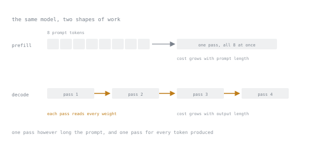

# Lección 26. Costo, latencia y throughput

**Vínculo con la misión:** "Medir lo que costó en calidad y en latencia" está en la lista de éxito. El fine-tuning es con frecuencia una decisión de *costo*, y esta es la aritmética que hay detrás.
**Fuente principal:** [Blog: "LLM Inference Performance Engineering: Best Practices", Databricks](https://www.databricks.com/blog/llm-inference-performance-engineering-best-practices)
**Requisitos previos:** [Lección 25](0025-serving-adapters.md)

## Calentamiento

1. ▢ ¿Cuál es el argumento operativo a favor del serving sin fusionar?

<details markdown="1"><summary>Comprobación</summary>

El rollback es un cambio de enrutamiento y no un despliegue, y el base intacto sigue disponible como alternativa y como punto de comparación.

</details>

2. ▢ ¿Por qué debes evaluar el artefacto que despliegas?

<details markdown="1"><summary>Comprobación</summary>

La cuantización del momento de servir lleva un costo permanente de calidad por petición. Los números de un modelo en bf16 no describen un despliegue de 4 bits.

</details>

3. ▢ ¿Qué se le da mal enseñar al fine-tuning?

<details markdown="1"><summary>Comprobación</summary>

Hechos nuevos, capacidad de razonamiento ausente, información actual, cálculo preciso.

</details>

## Qué debes saber

### La forma en dos fases de la inferencia

La generación tiene dos fases con características de rendimiento completamente distintas, y confundirlas vuelve incoherente toda discusión sobre optimización.

El **prefill** procesa todo el prompt de entrada de una vez. Todos los tokens están disponibles, así que el trabajo es una gran multiplicación de matrices en paralelo, lo que lo hace **limitado por cómputo.** El costo escala con la longitud del prompt.

El **decode** genera un token a la vez, cada uno dependiendo del anterior. Cada paso lee todos los pesos del modelo para producir un único token, así que la aritmética por byte movido es minúscula, lo que lo hace **limitado por el ancho de banda de memoria.** El costo escala con la longitud de la salida.



Una caja en la fila superior frente a cuatro en la inferior es toda la asimetría. Alargar el prompt ensancha la pasada única; alargar la salida añade cajas a la cadena.

Consecuencias:

- **Los prompts largos son baratos por token; las salidas largas son caras por token.** No es simétrico, y la asimetría es grande.
- La velocidad del decode la fija el ancho de banda de memoria, así que un modelo más pequeño es más rápido casi en proporción a su tamaño.
- El batching ayuda enormemente al decode, porque los pesos se leen una vez para todo el batch, y ayuda mucho menos al prefill.

### Las métricas que importan

| Métrica | Significado | La fija |
|---|---|---|
| Time to first token | Latencia del prefill | Longitud del prompt, cómputo |
| Inter-token latency | Tiempo por token de salida | Ancho de banda de memoria, tamaño del modelo |
| Latencia total | De punta a punta | Ambas, más la cola |
| Throughput | Tokens/segundo entre todas las peticiones | Eficiencia del batching |
| Costo por petición | Dinero | Throughput y costo del hardware |

La latencia y el throughput se intercambian entre sí a través del batch size. Los batches más grandes suben el throughput y suben la latencia por petición. No hay un único mejor ajuste: depende de si hay una persona esperando.

### Dónde cambia el fine-tuning la economía

Esta es la parte que la gente pasa por alto. El beneficio de costo del fine-tuning normalmente no tiene nada que ver con que los pesos sean mejores.

**Prompts más cortos.** Un modelo con fine-tuning no necesita ejemplos few-shot, ni largas instrucciones de formato, ni un system prompt elaborado, porque ese comportamiento está en los pesos. Si tu prompt baja de 2,000 tokens a 200, has quitado 1,800 tokens de prefill de cada petición, para siempre. En un endpoint de alto volumen eso es a menudo todo el caso de negocio.

**Salidas más cortas.** Un modelo entrenado para responder en el formato requerido deja de rellenar con preámbulos y evasivas. Como el decode es la fase cara, recortar la longitud de la salida vale más por token que recortar la de la entrada.

**Que un modelo más pequeño llegue a bastar.** La versión más fuerte del argumento: un modelo pequeño con fine-tuning que iguala a un modelo general grande en tu tarea estrecha es drásticamente más barato por petición y de menor latencia, porque el decode está limitado por ancho de banda y el ancho de banda escala con el tamaño. Cambiar un modelo general grande por uno pequeño y especializado es donde viven los ahorros de un orden de magnitud.

**Menos reintentos.** Si el modelo general produce salida inválida el 15% de las veces y reintentas, tu costo real es 1.15× el costo visible. Un fine-tune que alcance un 99% de validez elimina casi todo eso.

### La contabilidad honesta

Frente a esos ahorros, cuenta los costos:

| Costo | Naturaleza |
|---|---|
| Cómputo de entrenamiento | Único por versión, normalmente pequeño para adapters |
| Creación de datos | A menudo el costo dominante, y normalmente tiempo humano |
| Infraestructura de evaluación | Único, y luego mantenimiento continuo |
| Complejidad de serving | Continuo: stack con soporte de adapters, versionado, enrutamiento |
| Reentrenamiento | Continuo: los modelos, los datos y los requisitos se mueven |
| Experiencia | Continuo: alguien debe ser responsable de esto |

**Los costos recurrentes son los que lo deciden, y son los que se dejan fuera de la estimación inicial.** Un fine-tune que ahorra un poco de dinero por petición y requiere a una persona para mantenerlo es un mal intercambio con poco volumen y uno bueno con mucho volumen. El punto de cruce es aritmética, así que haz la aritmética.

### Una comparación resuelta

Supón un modelo general grande con un prompt de 2,000 tokens frente a un modelo pequeño con fine-tuning con un prompt de 200 tokens, ambos produciendo 150 tokens de salida.

```text
General:  2000 prefill + 150 decode, on a large model
Tuned:     200 prefill + 150 decode, on a small model
```

El ahorro de prompt es de 1,800 tokens de prefill. El ahorro por tamaño del modelo se aplica a ambas fases y especialmente al costo de ancho de banda del decode. Multiplica por el volumen de peticiones, compara con los costos fijos y recurrentes de arriba, y tendrás una respuesta real en lugar de una intuición.

Con mil peticiones al día puede que esto no compense el trabajo de datos. Con un millón es muy probable que sí. **El volumen es la variable decisiva, y es la que se enuncia con menos frecuencia.**

### Mide, no modeles

Todo lo anterior tiene la forma correcta y la precisión equivocada. Los números reales dependen del hardware, el stack de serving, el batch size, las longitudes de secuencia y el patrón de tráfico de maneras que ninguna fórmula captura. Mide:

- Time to first token e inter-token latency, con tus longitudes de prompt reales
- Throughput con varios batch sizes, para encontrar tu punto de latencia/throughput
- Costo por mil peticiones, con la forma real de tu tráfico
- Las mismas tres para la alternativa con la que comparas

Y mide con una carga realista. Un benchmark con una petición cada vez no te dice nada sobre un endpoint de producción con batching, porque el batching es el factor dominante del throughput.

## Práctica

1. ▢ ¿Qué fase está limitada por cómputo, cuál por ancho de banda, y qué se sigue?

<details markdown="1"><summary>Comprobación</summary>

El prefill está limitado por cómputo, porque todo el prompt se procesa en paralelo. El decode está limitado por el ancho de banda de memoria, porque cada paso lee todos los pesos para producir un token.

Se sigue que los prompts largos son relativamente baratos por token, las salidas largas son caras, el batching ayuda al decode mucho más que al prefill, y los modelos más pequeños aceleran el decode casi en proporción a su tamaño.

</details>

2. ▢ Tu fine-tune recorta la longitud del prompt de 1,800 tokens a 150 y deja sin cambios la longitud de la salida. ¿De dónde viene el ahorro?

<details markdown="1"><summary>Comprobación</summary>

Del prefill: 1,650 tokens menos de trabajo limitado por cómputo en cada petición. El comportamiento que antes especificaban los ejemplos few-shot y las instrucciones de formato vive ahora en los pesos.

Este es con frecuencia todo el caso económico del fine-tuning, y no tiene nada que ver con que el modelo sea más listo.

</details>

3. ▢ ¿Qué beneficio del fine-tuning produce la mayor reducción de costo?

    - a) Que el prompt se acorte en mil tokens
    - b) Que un modelo más pequeño llegue a bastar para la tarea
    - c) Que la salida se acorte en cincuenta tokens de salida
    - d) Que la tasa de reintentos baje de quince por ciento a uno

<details markdown="1"><summary>Comprobación</summary>

**b)** Que un modelo más pequeño llegue a bastar para la tarea.

Reduce ambas fases a la vez, y el decode, la fase cara, escala con el tamaño del modelo porque está limitado por ancho de banda. Las demás son reales y aditivas, pero un cambio de tamaño del modelo es multiplicativo sobre todo.

</details>

4. ▢ ¿Qué costos se omiten con más frecuencia de la estimación inicial?

<details markdown="1"><summary>Comprobación</summary>

Los recurrentes: el reentrenamiento a medida que los modelos y los requisitos se mueven, la complejidad de serving, el mantenimiento de la evaluación y la experiencia de una persona que sea responsable.

El cómputo de entrenamiento es barato para los adapters y se cita. El costo humano continuo es caro y se olvida, y suele ser lo que decide la cuestión.

</details>

5. ▢ Mides la latencia de una sola petición y concluyes que tu endpoint es lo bastante rápido. ¿Qué falla?

<details markdown="1"><summary>Comprobación</summary>

Producción sirve peticiones concurrentes en batches. El batch size domina tanto el throughput como la latencia por petición, y una medición de una sola petición no observa ninguno.

Mide con una concurrencia realista, con varios batch sizes, y elige de forma deliberada tu punto en la curva de latencia/throughput.

</details>

6. ▢ Misma tarea, mismo ahorro por petición, 500 peticiones al día frente a 5 millones. ¿Misma decisión?

<details markdown="1"><summary>Comprobación</summary>

No. Los costos fijos y recurrentes de creación de datos, evaluación, complejidad de serving y mantenimiento son esencialmente independientes del volumen, mientras que los ahorros escalan con él.

Con 500 al día, el costo humano recurrente casi con seguridad domina. Con 5 millones es despreciable frente a los ahorros. El volumen es la variable decisiva y pertenece a la primera frase de la propuesta.

</details>

## Prácticas en el mundo real

- [ ] Mide el time to first token y la inter-token latency de tu modelo con tus longitudes de prompt reales.
- [ ] Mide el throughput con batch sizes 1, 4, 16 y 64. Grafica el intercambio latencia/throughput y elige tu punto.
- [ ] Calcula el costo por mil peticiones para tu ruta con fine-tuning y para la alternativa. Incluye los costos recurrentes.
- [ ] Mañana: encuentra el volumen de peticiones al que tu fine-tune alcanza el punto de equilibrio. Compáralo con tu volumen real.

## Para profundizar

- [Blog: "LLM Inference Performance Engineering: Best Practices", Databricks](https://www.databricks.com/blog/llm-inference-performance-engineering-best-practices)
- [Docs: Optimization and tuning, vLLM](https://docs.vllm.ai/en/latest/configuration/optimization.html)
- [Lección 27. Cuándo no hacer fine-tuning](0027-when-not-to-fine-tune.md)

---

¿No termina de quedar claro? Vuelve a leer la fuente primaria de arriba, ya que esta lección la comprime y en la compresión es donde se escapa la comprensión. Consulta el [glosario](../GLOSSARY.md) por si algún término te resultó resbaladizo.

Si lo poco claro es la propia lección y no el material, eso es un defecto: [abre un issue](https://github.com/TokenCemetery/teach/issues).
