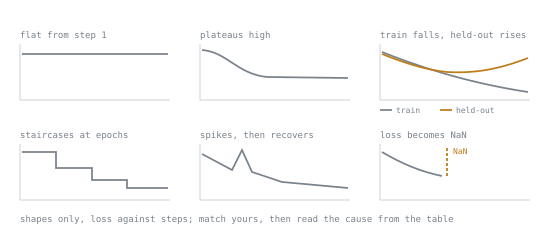

# 失败模式

诊断用的速查表。运行期间把它开着。

## 四项检查，先于其他一切

```python
# 1. Did the adapter attach?
model.print_trainable_parameters()          # compare to your arithmetic

# 2. Is the data what you think?
print(repr(tokenizer.decode(ds[0]["input_ids"])))
print(sum(1 for l in ds[0]["labels"] if l != -100), "of", len(ds[0]["labels"]), "scored")

# 3. Does loss move?                        # logging_steps=1 over 50 steps

# 4. Can it overfit two examples?           # loss → ~0 in 100 steps, or the pipeline is broken
```

第 2 项检查，读一遍就能抓住模板不匹配、缺少回合结束 token、屏蔽缺陷和截断。它是整个过程里最值的十秒钟。

## 症状 → 原因



下面前十一行说的是一条曲线，而不是一个事件，其中有几行的形状相同：三行说平坦，两行说几乎不动。先对上草图，再把每一行点到这个形状的都读一遍，因为同一个形状可能有不止一个原因。从第十二行起，症状是在别处观察到的，在输出里、在加载错误里，或者在回归测试集里，没有曲线可对。

| 症状 | 可能的原因 | 检查 |
|---|---|---|
| 从第 1 步起损失恰好平坦 | 适配器什么也没匹配上 | `print_trainable_parameters()` |
| 从第 1 步起损失恰好平坦 | 所有标签都是 `-100` | 数一数被打分的位置 |
| 从第 1 步起损失恰好平坦 | 学习率低了几个数量级 | 应在 ~`1e-4` |
| 损失几乎不动 | 目标模块名对这个架构不对 | `named_modules()` |
| 损失几乎不动 | `α/r` 意外地很小 | 提高了 `r`，忘了 `α` |
| 损失在高位停滞 | 容量上限 | 更多的秩或更多的目标，而不是更多的 epoch |
| 留出集上升，训练下降 | 过拟合 | 发布留出集损失最小值处的检查点 |
| 训练很快 → 0，留出集立刻上升 | 对这个容量来说数据集太小了 | 更多数据，更小容量 |
| 损失在 epoch 边界呈阶梯状 | 记忆 | 更少的 epoch |
| 损失出现尖峰后恢复 | 一个有问题的批次 | 找出那个异常的样本 |
| 损失 → `NaN` | 溢出，或数据有问题 | 优先用 bf16；降低学习率；加预热 |
| 留出集好得可疑 | 划分两侧存在数据污染 | 对训练集与测试集去重，阅读相似度最高的那些对 |
| 模型永远不会停止生成 | 训练数据里没有回合结束 token | 解码一个样本 |
| 输出无视所要求的格式 | 训练与部署的模板不匹配 | 用 `repr` 比较 |
| 答案在句子中间被截断 | `max_length` 截断了目标 | 检查长度分布 |
| 回答没人问过的问题 | 打包破坏了损失屏蔽或边界 | 验证 `-100` 在打包后依然保留 |
| 在无关的事情上变差 | 灾难性遗忘 | 回归测试集对照存下的基线 |
| 不再拒绝基础模型拒绝过的 | 安全上的退步 | **阻止发布** |
| 合并后与未合并的输出不同 | 合并的缺陷，或者当时开着采样 | 用贪心解码重新验证 |
| 合并后的模型退化了 | 合并进了量化的基础模型 | 合并进全精度，之后再量化 |
| 适配器无法加载 | 基础模型或版本不对 | 适配器是一个差分；它需要它那个确切的基础模型 |
| 4 位基础模型上出现梯度错误 | 跳过了 `prepare_model_for_kbit_training` | 加上它 |
| 评测很好，生产很差 | 训练与部署的分布不匹配 | 用真实的输入训练，而不是干净的 |
| 重新运行后结果消失了 | 种子噪声，从来就不是真实的效应 | 多个随机种子，成对比较 |

## 悄无声息的失败：没有报错，结果却是错的

危险的一类。什么都不报错，一切看起来都没问题。

1. 训练与部署之间的**模板不匹配**。
2. **缺少回合结束 token。** 训练得很好，却永远停不下来。
3. **损失屏蔽有误。** 无意中在提示词上训练。
4. **数据污染。** 留出集度量的是记忆，报告的却是泛化。
5. **分组或时间上的泄漏。** 按错误的键来划分。
6. **灾难性遗忘。** 你盯着的每个数字都在改善。
7. **适配器什么也没挂上。** 训练、记录损失，却什么也没学到。
8. **评测的产物与你发布的不同**，例如以 bf16 评测、以 4 位部署。

每一个在上面都有具体的检测步骤。没有一个会自己报警。

## 减轻遗忘

最便宜的优先：

1. 更少的步数，或更早的检查点
2. 更低的学习率
3. 更低的秩，或更少的目标模块
4. 在训练中混入百分之几的通用指令数据
5. **保持适配器不合并，并做路由**，这样基础模型保持完好，遗忘就不再要紧

## 比较的规范

- 一次只改一个变量；固定随机种子、数据和划分
- 多个随机种子，因为方差往往超过效应
- 在相同的样本上成对比较
- 报告 `n` 和区间，绝不报告光秃秃的数字
- 每一次都要阅读实际的生成结果，包括失败的

## 每次运行要记录什么

基础模型**及其版本** · 适配器配置原样保存 · 数据集和确切的划分 · 随机种子 · 有效批大小 · 学习率和调度 · 步数 · 选定的检查点以及为它提供依据的数字 · 库的版本 · 评测和回归的结果。

## 相关内容

- [第 11 课](../lessons/0011-your-first-adapter.md)、[第 12 课](../lessons/0012-reading-a-training-run.md)、[第 22 课](../lessons/0022-contamination-and-held-out-design.md)、[第 24 课](../lessons/0024-the-regression-suite.md)
