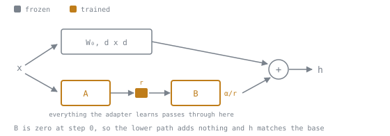

# LoRA Hyperparameters

फ़ैसले की शीट। सटीक parameter नामों के लिए installed library version पढ़ें, क्योंकि यह सतह releases के बीच बदलती है।

## समीकरण

```text
h = W₀x + (α/r) · BAx
```

`A` random, `B` शून्य, इसलिए step 0 पर `ΔW = 0` और model base के बिल्कुल बराबर शुरू होता है।



`A` और `B` के बीच की पट्टी `r` values चौड़ी है, और इनपुट से आउटपुट तक adapter के पास यही अकेला रास्ता है। अगले खंड में capacity का यही मतलब है: rank बढ़ाने से वह पट्टी चौड़ी होती है और तस्वीर में बाक़ी कुछ नहीं बदलता, इसीलिए यह लगभग बिना memory ख़र्च के अभिव्यक्ति-क्षमता ख़रीदता है।

## Rank

Capacity। यह तय करता है कि adapter कितना जटिल update व्यक्त कर सकता है।

| Rank | किसके लिए ठीक |
|---|---|
| 4 से 8 | Style, tone, output format; छोटे datasets |
| 16 से 32 | असली task, कुछ हज़ार examples |
| 64 से 128 | कठिन tasks, बड़ा data, reasoning-भारी व्यवहार |
| 256+ | बड़े SFT data पर full fine-tuning की capacity के क़रीब |

Rank की memory लागत लगभग शून्य है। इसकी असली क़ीमत छोटे data पर overfitting का जोखिम है।

## Alpha

**सिर्फ़ `α/r` मायने रखता है।** रिवाज़ है `α = 2r`।

| `r` | `α` | `α/r` | |
|---|---|---|---|
| 8 | 16 | 2.0 | baseline |
| 16 | 32 | 2.0 | ज़्यादा capacity, वही scale |
| 16 | 16 | 1.0 | कमज़ोर update |
| 64 | 16 | 0.25 | **जाल**: capacity ऊपर, प्रभाव 8× नीचे |

`α` बढ़ाए बिना `r` बढ़ाना adapter को *घटा* देता है। rank ≥ 64 पर `use_rslora=True` पर विचार करें, जो `α/√r` इस्तेमाल करता है।

## Target modules

| स्थिति | Targets |
|---|---|
| असली task के लिए default | all linear |
| छोटा dataset (< ~1k) | सिर्फ़ attention, कम rank |
| सिर्फ़ style या tone | सिर्फ़ attention, कम rank |
| नए भेद सीखने हों | MLP शामिल करना ज़रूरी |
| किसी पेपर को दोहराना | ठीक उनके वाले |

`"all-linear"` लोड हुए model के सामने हल होता है, इसलिए अनजाने नामकरण के सामने पुराना नहीं पड़ सकता। Attention-only 2021 का ablation है, default नहीं।

आम नाम, पर **`named_modules()` से जाँच लें**:

```text
attention: q_proj  k_proj  v_proj  o_proj
mlp:       gate_proj  up_proj  down_proj
```

## Learning rate

| तरीक़ा | सीमा |
|---|---|
| Adapter fine-tuning | `1e-4` से `2e-4` |
| Full fine-tuning | `1e-5` से `5e-5` |

Full fine-tuning का rate adapter run में ले आना पहले नतीजे के निराशाजनक होने की प्रमुख वजहों में से एक है। Warm-up (कुछ सौ steps) और cosine decay इस्तेमाल करें।

## अन्य settings

| Setting | Default | टिप्पणी |
|---|---|---|
| `lora_dropout` | 0.0 से 0.05 | तभी बढ़ाएँ जब held-out loss बढ़ रहा हो |
| `bias` | `"none"` | शायद ही निर्णायक; merging को जटिल बनाता है |
| Epochs | 2 से 3 | छोटे instruction data पर; ज़्यादा आम तौर पर रट जाता है |
| Gradient checkpointing | on | Adapters के लिए लगभग default |
| `use_cache` | training में off | Checkpointing से टकराता है; training के लिए बेकार |

## Variants, अक्ष के हिसाब से

| अक्ष | तरीक़ा | कब मदद करता है |
|---|---|---|
| Scaling | rsLoRA | ऊँचा rank |
| Learning rates | LoRA+ | `A` और `B` के लिए अलग rates |
| Init | PiSSA, OLoRA | तेज़ convergence; zero-init छोड़ना पड़ता है |
| Init | LoftQ | Quantized base के सामने training |
| संरचना | DoRA | Rank किसी और कारण से नीचे बँधा हो |
| संरचना | AdaLoRA | Layers को असमान rank चाहिए |
| संरचना | VeRA | Adapter का आकार ही बाध्यकारी बाधा हो |

**हराने लायक baseline:** all-linear, पर्याप्त rank, tune किया हुआ learning rate। ज़्यादातर variants इसे seed noise से ज़्यादा के अंतर से पार नहीं करते।

## Quantized base (QLoRA)

```python
BitsAndBytesConfig(
    load_in_4bit=True,
    bnb_4bit_quant_type="nf4",             # not "fp4"
    bnb_4bit_use_double_quant=True,
    bnb_4bit_compute_dtype=torch.bfloat16,  # do not leave at default
)
```

फिर `prepare_model_for_kbit_training(model, use_gradient_checkpointing=True)`। इसे छोड़ने पर runs अस्थिर होते हैं या gradient की अबूझ errors आती हैं।

बाक़ी हर hyperparameter वैसा ही रहता है। **QLoRA सस्ते base वाला LoRA है।**

Merge **full-precision** base में करें, quantized में कभी नहीं।

## Curve से diagnosis

| Train | Held-out | Diagnosis | कार्रवाई |
|---|---|---|---|
| ↓ | ↓ | सीख रहा है | जारी रखें |
| ↓ | एक गिरावट के बाद ↑ | Overfitting | न्यूनतम वाला ship करें; कम capacity या ज़्यादा data |
| → ऊँचा | → ऊँचा | Underfitting | ज़्यादा rank, ज़्यादा targets, ऊँचा LR |
| Step 1 से सपाट | सपाट | टूटा हुआ | जाँचें कि adapter जुड़ा और labels सब `-100` तो नहीं |
| `NaN` | भी `NaN` | Overflow | LR घटाएँ; warm-up जोड़ें; bf16 चुनें |

## संबंधित

- [पाठ 9](../lessons/0009-rank-alpha-and-initialisation.md), [पाठ 10](../lessons/0010-choosing-target-modules.md), [पाठ 19](../lessons/0019-when-dora-wins.md), [पाठ 20](../lessons/0020-judging-a-new-variant.md)
