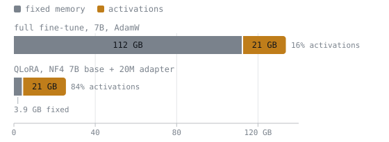

# Memory Budget

Adapter fine-tuning के लिए bytes का हिसाब। run के दौरान खोजने के लिए बनाया गया।

## प्रति parameter bytes

| Format | Bytes | Bits |
|---|---|---|
| fp32 | 4 | 32 |
| bf16 / fp16 | 2 | 16 |
| int8 | 1 | 8 |
| 4-bit, raw | 0.5 | 4 |
| 4-bit + fp32 scales, block 64 | 0.5625 | 4.5 |
| 4-bit + double quant | ~0.516 | ~4.13 |

**सहज नियम:** bf16 gigabytes ≈ 2 × अरबों में parameters।

## प्रति parameter training की लागत

| श्रेणी | fp32 | Mixed precision |
|---|---|---|
| Weights | 4 | 2 bf16 + 4 fp32 master |
| Gradients | 4 | 2 |
| AdamW moment 1 | 4 | 4 |
| AdamW moment 2 | 4 | 4 |
| **Trainable कुल** | **16** | **16** |
| **Frozen कुल** | **4** | **2** |

Mixed precision कुल को घटाता नहीं। वह arithmetic throughput ख़रीदता है।

| Optimizer variant | Bytes/param |
|---|---|
| AdamW, fp32 moments | 16 |
| AdamW, 8-bit moments | 10 |
| SGD with momentum | 12 |

## Parameter की गिनती

```text
attention/layer = 2·d² + 2·d·d_kv          # q,o full; k,v narrowed by GQA
mlp/layer       = 3·d·d_ff                  # gate, up, down
model           ≈ n_layers·(attn + mlp) + vocab·d·(1 if tied else 2)
```

MLP आम तौर पर एक block का 75 से 80% होता है।

## Adapter के parameters की गिनती

```text
adapter = Σ over targeted layers:  r · (d_in + d_out)
```

यह **बड़े** आयाम पर हावी रहता है, इसलिए GQA का संकुचन adapter को मुश्किल से ही छोटा करता है।

| Base | Targets | Rank | Adapter | Base का % |
|---|---|---|---|---|
| ~1.1B, d=2048 | attention | 8 | 2.5M | 0.22% |
| ~7B, d=4096 | q,v | 16 | 6.8M | 0.10% |
| ~7B, d=4096 | all-linear | 64 | ~160M | ~2.3% |

## Activations

```text
activations ≈ n_layers · batch · seq_len · d · ~20 bytes
```

यह constant नापने की शुरुआती जगह है, कोई नियम नहीं। Batch और sequence length में रैखिक; attention-score वाला वर्गीय पद memory-efficient attention kernel हटा देता है।

| Config | अनुमान |
|---|---|
| 24 layers, d=2048, batch 4, seq 2048 | ~8 GB |
| 32 layers, d=4096, batch 2, seq 4096 | ~21 GB |

Gradient checkpointing इसे लगभग एक परिमाण-क्रम घटा देता है, बदले में step का समय ~20 से 40% बढ़ता है।

**Adapter run में आम तौर पर activations हावी रहते हैं।** यह full fine-tuning की तस्वीर को उलट देता है।



दोनों bars का fixed memory नीचे की table से और activations ऊपर की 32-layer, d=4096, batch 2, seq 4096 वाली पंक्ति से लिए गए हैं, gradient checkpointing के बिना। Activation का block दोनों में एक ही आकार का है, क्योंकि वह forward pass के आकार पर निर्भर है, इस पर नहीं कि कितने parameters trainable हैं। उसके आसपास की memory ही सिकुड़ती है, इसीलिए जिसे घटाना है वह शायद ही कभी adapter होता है।

## काम किए गए कुल, activations को छोड़कर

| Setup | Fixed memory |
|---|---|
| Full FT, 1.5B, AdamW | 24 GB |
| Full FT, 7B, AdamW | 112 GB |
| Full FT, 70B, AdamW | 1120 GB |
| bf16 7B base + 20M adapter | 14.3 GB |
| NF4 7B base + 20M adapter | ~3.9 GB |
| NF4 13B base + 30M adapter | ~7.2 GB |

## जब run memory में न समाए

इस क्रम में कि आप क्या छोड़ते हैं:

1. **Gradient checkpointing**, सिर्फ़ समय की क़ीमत
2. **Batch size घटाएँ, gradient accumulation बढ़ाएँ**, सांख्यिकीय रूप से समतुल्य
3. **Sequence length छोटी करें**, पर पहले token-length का वितरण जाँच लें; इससे task बदलता है
4. **Base को quantise करें**, कुछ गुणवत्ता की क़ीमत
5. **Rank घटाएँ**, सबसे कम बचाता है और capacity की क़ीमत लेता है

Rank पहली सूझ है और लगभग सबसे बुरा विकल्प। 4M adapter पर rank आधा करने से ~32 MB बचता है।

## Effective batch size

```text
effective = per_device_batch × grad_accumulation × num_devices
```

हमेशा effective संख्या ही बताएँ।

## संबंधित

- [पाठ 5](../lessons/0005-counting-parameters-and-bytes.md), [पाठ 6](../lessons/0006-gradients-and-optimizer-state.md), [पाठ 7](../lessons/0007-activations-and-checkpointing.md), [पाठ 15](../lessons/0015-nf4-and-double-quantisation.md)
