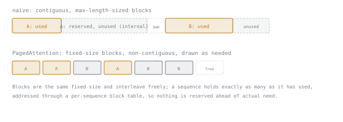

# 第 1 课：KV 缓存

**使命关联:** 本工作区所辩护的每一个延迟和吞吐量数字，都可以追溯到 KV 缓存在内存中的开销，以及服务器管理这笔开销的能力。
**主要来源:** [文档：“Optimizing inference”，Hugging Face Transformers](https://huggingface.co/docs/transformers/main/en/llm_optims)
**前置知识:** 无

## 要点

### 为什么解码需要缓存

Transformer 一次生成一个 token。要产生第 *N* 个 token，自注意力需要第 1 个到第 *N* 个 token 在每一层的键向量和值向量。如果没有缓存，每个新 token 都会迫使模型把*整个*前缀的键和值重新算一遍，尽管这些向量在 token 生成之后永远不会再变。这是二次方量级的工作，花在重新计算已经算过的东西上。

**KV 缓存**在每个 token 的键向量和值向量第一次算出来的那一刻，就按层把它们存下来，所以生成第 *N+1* 个 token 时，只需要算一组新的 K/V 向量，其余的直接复用。自回归生成能够实用，靠的就是它：用内存换掉了重复计算。

### 这笔内存实际要花多少

缓存不是免费的，它的大小决定了服务器一次能在内存里容纳多少个请求。每个 token 在每一层都保存一个键向量和一个值向量，每个向量的大小等于模型的隐藏维度（`d_model`，即模型残差流的维度）。在半精度（每个值 2 字节）下：

```text
bytes per token = 2 (K and V) × num_layers × d_model × 2 bytes
```

以 Llama-2-7B 为具体例子：32 层，`d_model` = 4096。

```text
2 × 32 × 4096 × 2 bytes = 524,288 bytes ≈ 512 KB per token
```

在 4096 个 token 的上下文下，就是 `512 KB × 4096 ≈ 2 GB`，而这只是*一个*序列。同时容纳 16 个这样的序列，仅缓存就需要约 32 GB，超过了模型自己的权重在 fp16 下占的 14 GB。这套算术说明了为什么“多加点 KV 缓存就行”是错误的本能反应，也说明了为什么服务栈对缓存内存如此执着，而不是事后才想起它（完整的推导，包括它如何随 GQA/MQA 这类注意力头共享方案缩放，见 Kipply 的 [Transformer Inference Arithmetic](https://kipp.ly/transformer-inference-arithmetic/)）。

### 朴素的缓存在哪里浪费内存

朴素的实现为每个序列预留一整块连续的内存，大小按它可能达到的最大序列长度来定。由此带来两种失败模式：

- **内部碎片**：一个最后很短的序列，仍然占着按它从未用到的最大长度预留的内存。
- **外部碎片**：实际长度各不相同的序列，在它们预留的块之间留下空隙，没有任何其他序列的缓存能放进去。

PagedAttention 论文测得，朴素的系统中，已分配的 KV 缓存内存实际装着有用数据的，低至 20% 到 40%。它的修复办法直接借自操作系统的虚拟内存：把缓存切成固定大小的块，非连续地存放，并为每个序列维护一张块表，把逻辑位置映射到物理块。这就是 vLLM 围绕的核心思想，也是这个框架和算术同样重要的原因：同一份缓存，分配得好，就能服务多得多的并发请求。



## 练习

1. ▢ 用一句话说，KV 缓存让服务器在第一个之后生成的每个 token 上跳过了什么？

<details markdown="1"><summary>检查</summary>

跳过了为序列中每个先前的 token，在每一层重新计算键向量和值向量。只需要算新 token 的 K/V；其余的都从缓存里读。

</details>

2. ▢ 一个模型有 40 层，`d_model` = 5120，以 fp16 提供服务。估算一个序列在 2048 个 token 的上下文下的 KV 缓存大小。

<details markdown="1"><summary>提示</summary>

用 `2 × num_layers × d_model × 2 bytes`，再乘以 token 数。

</details>

<details markdown="1"><summary>检查</summary>

每个 token：`2 × 40 × 5120 × 2 = 819,200 bytes ≈ 800 KB`。
2048 个 token 时：一个序列 `800 KB × 2048 ≈ 1.6 GB`。

</details>

3. ▢ 两个序列持有朴素的、连续的、按最大长度定大小的 KV 缓存块。其中一个结束时，离它预留的最大长度还差得很远。它预留了却没用到的内存会怎样，这给服务器带来了什么代价？

<details markdown="1"><summary>检查</summary>

在该序列的缓存被释放之前，这些内存一直被预留着，别的序列都用不了：这就是内部碎片。代价是服务器实际能服务的并发序列变少了，因为看起来“已分配”的内存并没有做任何有用的工作。

</details>

4. ▢ 关于 PagedAttention 的修复，下面哪种说法是对的？

    - a) 它缩小了给定模型和上下文长度的 KV 缓存的总大小
    - b) 它去掉了 KV 缓存，改为按需重新计算注意力
    - c) 它把缓存存放在固定大小、非连续的块里，从而减少了浪费的内存
    - d) 它只对 llama.cpp 这类 CPU 服务栈有帮助

<details markdown="1"><summary>检查</summary>

**c)** 它把缓存存放在固定大小、非连续的块里，通过每个序列各自的块表来寻址，从而减少了浪费的内存，这与操作系统虚拟内存分页是同一个思路。

(a) 是错的：每个 token 的开销没变；缩小的只是它周围的浪费。(b) 是错的：缓存依然在，只是分配得更好了。(d) 是错的：PagedAttention 是一种 GPU 服务技术（vLLM）；本工作区把 llama.cpp 单独来讲。

</details>

## 实战练习

- [ ] 挑一个你打算提供服务的模型。用上面的公式，根据它公布的 `num_layers` 和隐藏维度，算出它每个 token 的 KV 缓存大小。
- [ ] 算出同一个模型在你打算使用的精度下的完整权重大小，并把它与最大上下文长度下的 KV 缓存大小做比较。
- [ ] 明天：找到某个服务栈（vLLM 或 llama.cpp）的文档，找出控制它为 KV 缓存预留多少内存的参数。

## 延伸阅读

- [文章：“Transformer Inference Arithmetic”，Kipply](https://kipp.ly/transformer-inference-arithmetic/)
- [论文：“Efficient Memory Management for Large Language Model Serving with PagedAttention”，Kwon 等，SOSP 2023](https://arxiv.org/abs/2309.06180)
- [资源](../RESOURCES.md)

---

没学明白？请重读顶部的主要来源，因为本课是对它的压缩，而理解正是在压缩中流失的。如果有哪个术语觉得含糊，可以查看[术语表](../GLOSSARY.md)。

如果问题出在课程本身，而不是学习材料，那就是一个缺陷：[提交 issue](https://github.com/TokenCemetery/teach/issues)。
