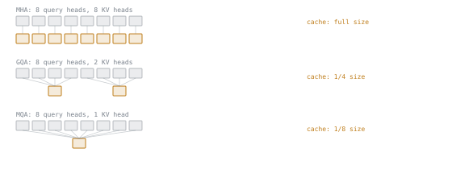

# 第 2 课：容量与批大小

**使命关联:** 延迟预算是用服务器能同时容纳多少个并发请求来辩护的，而这个数字直接来自本课所扩展的缓存算术。
**主要来源:** [文章：“Transformer Inference Arithmetic”，Kipply](https://kipp.ly/transformer-inference-arithmetic/)
**前置知识:** [第 1 课](0001-the-kv-cache.md)、[KV 缓存](../GLOSSARY.md)

## 热身

1. ▢ 用一句话说，KV 缓存让服务器在第一个之后生成的每个 token 上跳过了什么？

<details markdown="1"><summary>检查</summary>

跳过了为序列中每个先前的 token，在每一层重新计算键向量和值向量。

</details>

2. ▢ 朴素的、连续的、按最大长度定大小的缓存分配有什么问题，PagedAttention 在这方面改变了什么？

<details markdown="1"><summary>检查</summary>

它按序列可能达到的最大长度预留内存，把内存浪费在内部碎片和外部碎片上。PagedAttention 改为把缓存分配在固定大小、非连续的块里，通过每个序列各自的表来寻址。

</details>

## 要点

### 大多数模型并不是每个头都缓存一份键和值

第 1 课的公式，每个 token `2 × num_layers × d_model × 2 bytes`，假定每个注意力头都保存自己的键向量和值向量。这就是**多头注意力（MHA）**。如今大多数提供服务的模型使用**分组查询注意力（GQA）**或它的极端情形**多查询注意力（MQA）**：许多查询头共享数量少得多的键/值头。缓存永远只为每个 *KV 头*保存一对 K/V，而不是为每个查询头保存，所以公式变成：

```text
bytes per token = 2 (K and V) × num_layers × num_kv_heads × head_dim × bytes_per_value
```

其中 `head_dim = d_model / num_heads`，现在要紧的是 `num_kv_heads`，而不是头的总数。当 `num_kv_heads = num_heads` 时，它恰好化简为第 1 课的公式（MHA 是 GQA 的特例）。当 `num_kv_heads` 小得多时，缓存按同样的比例缩小，这是白送的，上下文长度和批大小都不用改。



Llama-2-70B 是一个具体的例子：80 层，64 个查询头，但只有 8 个 KV 头，`head_dim` = 128。在 fp16 下：

```text
per token = 2 × 80 × 8 × 128 × 2 bytes = 327,680 bytes ≈ 320 KB
```

如果它用的是完整的 MHA（64 个 KV 头，而不是 8 个），同样的层数和 `head_dim` 给出的是每个 token `2 × 80 × 64 × 128 × 2 = 2,621,440 bytes ≈ 2.5 MB`，多了八倍，恰好是 `num_heads` 与 `num_kv_heads` 的比值。GQA 既是建模上的决定，也是服务成本上的决定。

### 把每个 token 的开销累积成一个批次的总占用

服务器很少只容纳一个序列。任意时刻的缓存总占用，等于每个 token 的开销，乘以每个序列已经增长到的长度，再乘以同时驻留的序列数：

```text
total cache bytes = bytes per token × context length × batch size
```

对于 4096 个 token 上下文下的 Llama-2-70B，一个序列花费 `320 KB × 4096 ≈ 1.25 GB`。在同样的长度下，三十二个并发序列花费 `1.25 GB × 32 = 40 GB`，而这时模型自己的权重还一点空间都没占。

### 把它变成容量预算

这才是一个服务决策真正需要的数字：给定一个内存池，能放下多少个并发序列？从可用的总内存中减去权重和框架开销，再把剩下的除以你打算支持的上下文长度下每个序列的缓存开销：

```text
max concurrent sequences = (total memory − weights − overhead) / (bytes per token × context length)
```

以一个 320 GB 的内存池（四块 80 GB 的 GPU，张量并行）服务 Llama-2-70B 为例，权重和框架开销实测为 160 GB。这给缓存留下 160 GB。按上面 4096 个 token、每个序列 1.25 GB 的数字：`160 GB / 1.25 GB ≈ 128` 个并发序列。批处理调度器要与之周旋的，通常是这个上限，而不是模型的原始吞吐量，第 4 课就从这里接着讲。

## 练习

1. ▢ 一个模型使用 GQA，`num_kv_heads` 是 `num_heads` 的四分之一。与同一个模型在完整 MHA 下相比，它每个 token 的 KV 缓存小多少？

<details markdown="1"><summary>检查</summary>

是四分之一大小。缓存为每个 KV 头保存一对 K/V，而不是为每个查询头保存，所以每个 token 的开销只随 `num_kv_heads` 缩放；公式里其余的一切都没变。

</details>

2. ▢ 一个模型有 48 层，40 个查询头，8 个 KV 头，`head_dim` = 128，以 fp16 提供服务。计算它每个 token 的 KV 缓存大小。

<details markdown="1"><summary>提示</summary>

用 `2 × num_layers × num_kv_heads × head_dim × bytes_per_value`。查询头的数量根本不出现在公式里。

</details>

<details markdown="1"><summary>检查</summary>

`2 × 48 × 8 × 128 × 2 = 196,608 bytes ≈ 192 KB` 每个 token。

</details>

3. ▢ 用第 2 题中每个 token 192 KB 的模型，计算 16 个序列、上下文 2048 个 token 的一个批次的缓存总占用。

<details markdown="1"><summary>提示</summary>

`total cache bytes = bytes per token × context length × batch size`。

</details>

<details markdown="1"><summary>检查</summary>

每个序列：`192 KB × 2048 ≈ 384 MB`。16 个序列：`384 MB × 16 = 6,144 MB ≈ 6 GB`。

</details>

4. ▢ 一台服务器有 96 GB 内存。权重和框架开销占 40 GB。在这台服务器支持的上下文长度下，每个序列的缓存花费 384 MB。缓存预算允许的最大并发序列数是多少？

<details markdown="1"><summary>检查</summary>

`(96 GB − 40 GB) / 384 MB = 56 GB / 384 MB ≈ 149` 个序列。实践中，服务器会在这个上限之下再预留一道安全余量，但算术就是这个除法。

</details>

## 实战练习

- [ ] 在一个你打算提供服务的模型的配置文件里，查找 `num_key_value_heads`（或等价的）字段，和 `num_attention_heads` 放在一起看。算出二者的比值，以及它在缓存大小上换回了多少。
- [ ] 用那个模型每个 token 的缓存大小，算出你能用到的一个内存池（或某块公开发布的 GPU 的内存），在你关心的上下文长度下能容纳多少个并发序列。
- [ ] 明天：找到你选用的服务栈（vLLM 或 llama.cpp）用来限制 KV 缓存内存总量的参数，并读一读当一个请求会超出它时会发生什么。

## 延伸阅读

- [文章：“Transformer Inference Arithmetic”，Kipply](https://kipp.ly/transformer-inference-arithmetic/)
- [论文：“Efficient Memory Management for Large Language Model Serving with PagedAttention”，Kwon 等，SOSP 2023](https://arxiv.org/abs/2309.06180)
- [资源](../RESOURCES.md)

---

没学明白？请重读顶部的主要来源，因为本课是对它的压缩，而理解正是在压缩中流失的。如果有哪个术语觉得含糊，可以查看[术语表](../GLOSSARY.md)。

如果问题出在课程本身，而不是学习材料，那就是一个缺陷：[提交 issue](https://github.com/TokenCemetery/teach/issues)。
