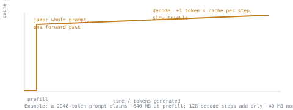

# 第 3 课：增长、预填充、解码与精度

**使命关联:** 延迟预算取决于缓存内存在一次请求的什么时候被占用，而不只是它的最终大小，也取决于服务器除了批大小和上下文长度之外，还有哪些杠杆可以影响这个大小。
**主要来源:** [文档：vLLM Documentation，vLLM Project](https://docs.vllm.ai/en/latest/)
**前置知识:** [第 2 课](0002-capacity-and-batch-size.md)、[KV 缓存](../GLOSSARY.md)

## 热身

1. ▢ 用每个 token 的字节数、上下文长度和批大小，写出一个批次 KV 缓存总占用的公式。

检查

`total cache bytes = bytes per token × context length × batch size`。

2. ▢ 为什么使用分组查询注意力的模型，KV 缓存比同一个模型在完整多头注意力下更小？

检查

缓存为每个 KV 头保存一对键/值，而不是为每个查询头保存，而 GQA 用的 KV 头比查询头少。缓存随 `num_kv_heads` 缩放，完整的 MHA 把它设成等于 `num_heads`。

## 要点

### 缓存并不是以稳定的速率增长

一次请求有两个阶段，它们占用缓存内存的方式截然不同。

**预填充**在一次前向计算中处理整个提示词：每个提示词 token 的键向量和值向量一起被算出并缓存，一步完成。在模型生成出任何一个输出 token 之前，缓存就从空跳到了 `bytes per token × prompt length`。这个阶段受算力限制：它是对整个提示词做的一次大型并行矩阵乘法。

**解码**接着一次生成一个输出 token。每一步恰好多算并缓存一个 token 的键和值，所以缓存每步增长 `bytes per token`，相比之下是缓缓的细流。这个阶段受内存带宽限制：每一步都必须把整个缓存读回来才能对它做注意力，而新增的工作只有一个 token。

因此，长提示词会在预填充时立刻占去一个请求最终缓存占用的大部分，而解码则慢慢加上其余的部分。只看“最终上下文长度”的容量规划，其实是在问“预填充加上我预期的若干解码步之后，它会长到多大”，而这两个阶段的贡献，时间安排截然不同。

### 独立于模型自身权重的杠杆：缓存精度

第 2 课的公式把 `bytes_per_value` 作为单独的一项，与 `num_layers`、`num_kv_heads` 和 `head_dim` 分开。这一项不必与模型计算时使用的精度一致。服务栈可以用更低的精度存储 KV 缓存本身，常见的是 fp8，而模型仍以 bf16 或 fp16 计算。把 `bytes_per_value` 从 2 字节减到 1 字节，缓存的占用就直接减半，`num_kv_heads` 不变，上下文长度不变，也不用重新训练：这是服务时的选择，与权重被量化到什么精度无关。

这可以和第 2 课的一切叠加。再用 Llama-2-70B 的数字（80 层，8 个 KV 头，`head_dim` = 128）：fp16 下每个 token 的开销是 320 KB。fp8 下是 `2 × 80 × 8 × 128 × 1 byte = 163,840 bytes ≈ 160 KB`，恰好减半，因为变的只有 `bytes_per_value`。

## 练习

1. ▢ 一个请求有 2048 个 token 的提示词。用 Llama-2-70B 在 fp16 下每个 token 320 KB 的数字，仅预填充就会占去多少缓存，在生成任何输出 token 之前？

检查

`320 KB × 2048 ≈ 640 MB`，在单独的一次预填充步骤中占去。

2. ▢ 同一个请求接着通过解码生成了 128 个输出 token。解码额外增加了多少缓存，这占这个请求最终缓存总量的几分之几？

提示

解码增加的是 `bytes per token × number of decode steps`。把它与第 1 题的预填充数字做比较。

检查

解码增加了 `320 KB × 128 ≈ 40 MB`。缓存总量是 `640 MB + 40 MB = 680 MB`，所以解码只占约 6%；预填充一步就占去了另外的 94%。

3. ▢ 用 Llama-2-70B 的 fp8 缓存数字，每个 token 160 KB，计算 64 个序列、上下文 4096 个 token 的一个批次的缓存总占用。

提示

`total cache bytes = bytes per token × context length × batch size`，与热身中的公式相同。

检查

`160 KB × 4096 × 64 = 41,943,040 KB ≈ 40 GB`。

4. ▢ 同一个批次的 fp16 版本（第 3 题，但每个 token 320 KB）会花多少缓存？这个对比说明了，把精度的改变叠加在头共享的改变之上，是怎么回事？

检查

`320 KB × 4096 × 64 ≈ 80 GB`，恰好是两倍。fp8 缓存在 GQA 已经相对完整的 MHA 省回的基础之上，又把占用减半：这两个杠杆是独立的，是相乘叠加，而不是互相替代。

## 实战练习

- [ ] 找到你的服务栈中设置 KV 缓存数据类型的参数（vLLM：`--kv-cache-dtype`），读一读它支持哪些精度，以及它对精度有什么警告。
- [ ] 针对你实际预期的请求形状（提示词长度、预期输出长度），用某个模型真实的每 token 数字，算出它最终的缓存中，预填充占去多少、解码占去多少。
- [ ] 明天：读 vLLM 文档中关于分块预填充的一段，用一句话写下：为什么把预填充拆成若干块，会改变本课所描述的内存占用时间安排。

## 延伸阅读

- [文档：vLLM Documentation，vLLM Project](https://docs.vllm.ai/en/latest/)
- [文章：“Transformer Inference Arithmetic”，Kipply](https://kipp.ly/transformer-inference-arithmetic/)
- [资源](../RESOURCES.md)

---

没学明白？请重读顶部的主要来源，因为本课是对它的压缩，而理解正是在压缩中流失的。如果有哪个术语觉得含糊，可以查看[术语表](../GLOSSARY.md)。

如果问题出在课程本身，而不是学习材料，那就是一个缺陷：[提交 issue](https://github.com/TokenCemetery/teach/issues)。
