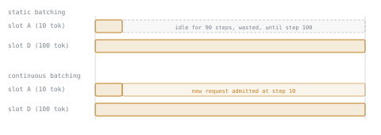

# 第 4 课：静态批处理与连续批处理

**使命关联:** 批处理是把服务器的 KV 缓存容量（第 1 到 3 课教你如何计算的那个东西）变成实际服务吞吐量的杠杆；服务器批处理做得好不好，决定了这份容量有多少用在有用的工作上。
**主要来源:** [文章：“How continuous batching enables 23x throughput in LLM inference while reducing p50 latency”，Anyscale](https://www.anyscale.com/blog/continuous-batching-llm-inference)
**前置知识:** [第 3 课](0003-growth-prefill-decode-precision.md)、[KV 缓存](../GLOSSARY.md)

## 热身

1. ▢ 为什么解码受内存带宽限制，而不是受算力限制？

检查

每个解码步都要把整个 KV 缓存读回来才能对它做注意力，却只为了算出一个新 token。每步新增的计算量，相对于读取缓存和权重所需的内存流量来说很小。

2. ▢ 第 3 课区分了预填充和解码。这两者中，哪一个在一次前向计算中处理整个提示词？

检查

预填充。而解码每步只生成一个输出 token，并让缓存增长一个 token 的量。

## 要点

### 为什么把解码步批在一起是有帮助的

一个解码步的内存流量，即读取模型的权重和每个驻留序列的 KV 缓存，无论是只算一个序列的下一个 token，还是同时算好几个序列的下一个 token，几乎都不变。把多个序列的解码步批在一起，就是把同样的内存流量分摊到更多有用的计算上，而这恰恰是受内存带宽限制的一步所需要的修复：每读一个字节，做更多的工作。

### 静态批处理会因完成时间参差不齐而浪费这份收益

显而易见的批处理方式，是把一组固定的请求编在一起，运行解码步直到其中每一个都完成，然后开始下一组。这就是**静态批处理**，它有一个严重的缺陷：这一组必须等到最长的那个序列结束才能结束。每个提前完成的序列仍然占着一个批次槽位，什么也不贡献，直到整组完成。

以四个批在一起的请求为例，分别需要 10、20、30 和 100 个输出 token。这个批次要运行 100 步，因为最长的序列需要这么多。在这 100 步里，批次消耗了 `4 × 100 = 400` 个槽位步数的 GPU 工作，但其中只有 `10 + 20 + 30 + 100 = 160` 个槽位步数做了有用的事。其余的 240 个，花在已经完成的序列上，闲坐着等到批次边界。这就是 60% 的浪费，而且随着请求长度之间的差距增大，情况还会更糟，这正是常态：真实的请求在生成量上差别极大。

### 连续批处理去掉了批次的边界

**连续批处理**（也叫迭代级调度）以单个解码步而不是固定的一组为单位来调度。一个序列一完成，它的槽位就被释放，等待中的新请求在紧接着的下一步被接纳进批次，而不是等它原来那一组里的其他每个序列也都完成。批次的构成不断变化；保持大致恒定的是它的大小，而不是任何一个请求的生命周期。

在这个四请求的例子里，只需要 10 个 token 的那个序列在第 10 步释放它的槽位。静态调度器让这个槽位再空闲 90 步。连续调度器则立刻把一个新请求接纳进去，所以 GPU 在这个槽位上持续做有用的工作，而不是一直拖着死重量，直到某个任意的边界。这就是本课主要来源所报告的吞吐量收益背后的机制：不是每步的计算变快了，而是每一步中，花在无事可做的序列上的浪费少得多了。

## 练习

1. ▢ 一个静态批次里有两个请求，分别需要 15 和 60 个输出 token。这个批次总共消耗多少槽位步数，其中多少是有用的，浪费的比例是多少？

提示

总槽位步数是 `batch size × steps until the longest sequence finishes`。有用的槽位步数是每个请求实际长度之和。

检查

总计：`2 × 60 = 120` 个槽位步数。有用的：`15 + 60 = 75`。浪费的：`120 − 75 = 45`，也就是 `45 / 120 = 37.5%`。

2. ▢ 在连续批处理的调度器里，批次中的某个序列刚好生成完的那一步会发生什么？

检查

它的槽位立刻被释放，一个等待中的新请求在下一步被接纳进这个槽位，而不是让槽位闲置，直到某个固定的组里其他每个序列也都完成。

3. ▢ 与静态批处理相比，下面哪种说法对连续批处理是对的？

    - a) 它降低了注意力本身每步的计算开销
    - b) 它在驱逐已完成的序列之前，先去掉它们对 KV 缓存的需求
    - c) 它通过在槽位腾出时接纳新请求来保持批次是满的，而不是等一个固定的组全部完成
    - d) 它只适用于 llama.cpp 这类 CPU 服务栈

检查

**c)** 它持续地保持批次是满的。(a) 是错的：每步的算术没变；收益是浪费的槽位步数更少了。(b) 是错的，而且说反了：已完成序列的缓存，在驱逐它时一并释放，两种调度风格都是如此。(d) 是错的：连续批处理是一种 GPU 服务的调度技术，与 vLLM 和类似的引擎关系最密切。

4. ▢ 一个静态批次有 8 个请求，每个都恰好需要 50 个输出 token。对这个特定的批次，连续批处理相比静态批处理能提高吞吐量吗，为什么能或不能？

检查

几乎没有，甚至完全没有。连续批处理的收益来自填满那些先完成的请求腾出的槽位，而其他请求还在继续运行。当组里每个请求需要的 token 数完全相同时，既没有提前完成的，也没有需要填满的空闲槽位，所以静态批处理在这里本来就不浪费任何东西。

## 实战练习

- [ ] 找到你选用的服务栈中用来启用连续批处理的参数或配置项（vLLM 默认启用；看看它的文档把底层机制叫作什么）。
- [ ] 看一份你能拿到的真实流量样本或请求日志（或者一份公开的 LLM 请求长度数据集），估计最短与最长输出长度之间的差距。估算这个差距会造成的静态批处理浪费比例。
- [ ] 明天：读一段关于连续批处理调度器如何决定接纳哪个等待中的请求的文字，记下它是简单的到达顺序，还是别的方式。

## 延伸阅读

- [文章：“How continuous batching enables 23x throughput in LLM inference while reducing p50 latency”，Anyscale](https://www.anyscale.com/blog/continuous-batching-llm-inference)
- [文档：vLLM Documentation，vLLM Project](https://docs.vllm.ai/en/latest/)
- [资源](../RESOURCES.md)

---

没学明白？请重读顶部的主要来源，因为本课是对它的压缩，而理解正是在压缩中流失的。如果有哪个术语觉得含糊，可以查看[术语表](../GLOSSARY.md)。

如果问题出在课程本身，而不是学习材料，那就是一个缺陷：[提交 issue](https://github.com/TokenCemetery/teach/issues)。
