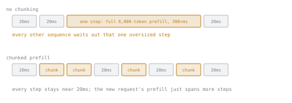

# 第 5 课：请求调度

**使命关联:** 第 4 课的连续批处理，只有在接纳请求进入它的调度器自身不制造新的延迟问题时才有帮助；这个权衡就在本课里。
**主要来源:** [文档：vLLM Documentation，vLLM Project](https://docs.vllm.ai/en/latest/)
**前置知识:** [第 4 课](0004-static-vs-continuous-batching.md)、[KV 缓存](../GLOSSARY.md)

## 热身

1. ▢ 在连续批处理中，批次里的某个序列刚好生成完的那一刻会发生什么？

检查

它的槽位立刻被释放，一个等待中的新请求在下一步被接纳进去，而不是让槽位闲置，直到一组固定的请求一起全部完成。

2. ▢ 为什么预填充受算力限制，而解码受内存带宽限制？

检查

预填充在一次大型的并行前向计算中处理整个提示词，所以每读一个字节都有足够的工作量让 GPU 的算力保持忙碌。解码每步只算一个新 token，所以每步的内存流量（读取缓存和权重）压过了少量的新计算。

## 要点

### 下一个轮到哪个等待中的请求

调度器手里有一个等待请求的队列，需要一个策略，来决定把哪一个接纳进刚腾出来的槽位。简单的默认做法，也是 vLLM 在没有其他配置时所用的，是**先到先服务（FCFS）**：请求按到达顺序接纳。它不是唯一可能的策略（调度器也可以按预期长度，或者按规定的延迟预算来排优先级），但 FCFS 是最应该先了解的默认策略：它简单，也公平，因为没有请求需要排在后到的请求后面，而且每一种更精细的策略，都是第 4 课所描述的这个“接纳进腾出的槽位”机制的变体。

### 一个批次步是原子的，这带来了新问题

共用一个批次步的每个序列是一起前进的：整一步的延迟，取决于其中最昂贵的那份工作。接纳一个新请求，意味着它的预填充工作得在某个地方完成，而最直接的地方，就是紧接着的下一个批次步，与已经在运行的序列所需的解码步放在一起。

新请求的提示词短的时候，这没问题。提示词长的时候就不行了：一个 6000 个 token 的预填充并进一步里，现在主导了这一步的延迟，批次里其他每个序列，那些只需要一个小而快的解码步的序列，都要等它完成之后才能拿到各自的下一个 token。一次大的接纳，拖住了所有其他人的进度。这是一个**队首阻塞**问题：队列没问题，有问题的是当前正在运行的东西。

### 分块预填充限制了损害

**分块预填充**把一个大提示词的预填充拆成较小的块，并把每一块与批次中正在进行的解码步交错执行，而不是在一步里跑完整个预填充。现在每个批次步只接纳有限量的新预填充工作，也就是能放进这一步延迟预算的量，而不是新接纳的请求的提示词恰好包含多少就是多少。代价是新请求自己的预填充现在要几步才能完成，而不是一步，但批次里没有其他序列因为等它而停滞。

## 练习

1. ▢ 一个连续批次正在运行平稳的、只含解码的步骤，每步约 20 ms。一个 6000 个 token 的提示词被接纳，它的完整预填充没有分块，直接并进紧接着的下一步里。这一步的延迟会怎样，谁会感受到影响？

检查

这一步现在除了批次里其他每个序列的解码工作之外，还得完成全部 6000 个提示词 token 的预填充计算，因为整个批次是在一步里一起前进的。这一步的延迟膨胀到远远超过 20 ms，批次里其他每个序列，包括那些只需要一个快速解码步的序列，都要等这一步完成后才能拿到各自的下一个 token。

2. ▢ 分块预填充如何避免第 1 题所描述的停滞？

提示

想想每一步里变了什么，而不是所需预填充工作的总量变了什么。

检查

调度器不再在一步里运行新请求的整个提示词，而是把它的预填充拆成较小的块，每一块与批次正常的解码步交错执行，每步只接纳有限量的新预填充工作。任何单独一步的延迟都保持有界；新请求自己的预填充只是总共需要更多的步数才能完成。

3. ▢ 关于分块预填充，下面哪种说法是对的？

    - a) 它完全去掉了预填充，把每个 token 都当作解码步
    - b) 它通过把大的预填充拆成块，限制了一步所增加的延迟
    - c) 它是 llama.cpp 这类 CPU 服务栈特有的技术
    - d) 它减少了长提示词完整处理之后所需的 KV 缓存量

检查

**b)** 它通过把大的预填充拆成与解码交错的块，限制了一步所增加的延迟。(a) 是错的：提示词仍然需要完整的预填充处理，只是摊在更多的步数里。(c) 是错的：它是一种 GPU 连续批处理的调度技术。(d) 是错的：一个提示词完整处理之后最终的缓存大小不变；分块只改变抵达那里的工作在时间上如何摊开。

4. ▢ 单靠 FCFS 接纳（不分块），能避免第 1 题中的停滞吗？

检查

不能。FCFS 只决定接下来接纳哪个等待中的请求；对于这个请求一旦被接纳后，它的预填充工作有多少落在单独一步里，它只字不提。停滞来自把整个大预填充并进一个原子的批次步，而修复它的是分块，不是接纳顺序。

## 实战练习

- [ ] 找到你的服务栈中分块预填充的参数或配置项（vLLM：较新的版本默认启用；在它的文档里查找块大小的设置），读一读默认的块大小是多少。
- [ ] 针对一份你手头有请求长度数据的工作负载，粗略估计，不分块的话，提示词长到足以让一个批次步明显停滞，有多频繁。
- [ ] 明天：读一段关于调度器如何在接纳新请求的预填充块与继续一个正在进行的预填充块之间做决定的文字，当二者争夺同一步的预算时。

## 延伸阅读

- [文档：vLLM Documentation，vLLM Project](https://docs.vllm.ai/en/latest/)
- [文章：“How continuous batching enables 23x throughput in LLM inference while reducing p50 latency”，Anyscale](https://www.anyscale.com/blog/continuous-batching-llm-inference)
- [资源](../RESOURCES.md)

---

没学明白？请重读顶部的主要来源，因为本课是对它的压缩，而理解正是在压缩中流失的。如果有哪个术语觉得含糊，可以查看[术语表](../GLOSSARY.md)。

如果问题出在课程本身，而不是学习材料，那就是一个缺陷：[提交 issue](https://github.com/TokenCemetery/teach/issues)。
