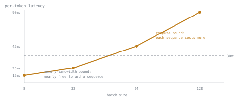

# 第 6 课：吞吐量与延迟的权衡

**使命关联:** 这是第 2 阶段的收官课：为一个给定的工作负载辩护批处理配置，意味着对照延迟预算和第 2 课算出的容量上限，为第 4 和第 5 课所描述的吞吐量与延迟的权衡给出一个数字。
**主要来源:** [文档：vLLM Documentation，vLLM Project](https://docs.vllm.ai/en/latest/)
**前置知识:** [第 5 课](0005-request-scheduling.md)、[第 2 课](0002-capacity-and-batch-size.md)、[KV 缓存](../GLOSSARY.md)

## 热身

1. ▢ 为什么把更多序列的解码步批在一起，能提高吞吐量，而内存流量却不会成比例地增加？

检查

一个解码步的内存流量，即读取权重和驻留的 KV 缓存，无论是只算一个序列的下一个 token，还是同时算好几个，几乎都不变。批处理把同样的流量分摊到更多有用的计算上。

2. ▢ 用一句话说，第 2 课的容量上限是什么？

检查

`(total memory − weights − overhead) / (bytes per token × context length)`：KV 缓存预算所允许的最大并发序列数，与延迟的任何方面都无关。

## 要点

### 更大的批次同时做两件事，而且二者的方向相反

给批次增加一个序列会提高吞吐量：每秒产出更多的 token，是这一步中所有序列汇总的结果。但是批次步中的每个序列是一起前进的（第 5 课），所以把更多序列的解码工作堆进一步里，也会让这一步本身花更长时间。单个序列自己相继两个 token 之间的延迟，即它的 token 间延迟，随着它所共用一步的批次而增长。吞吐量和每 token 延迟是一起变化的，而不是各自独立地互相对立：把一个推高，另一个也跟着被推高。

### 这条曲线有两种状态

在小批次下，解码受内存带宽限制（第 4 课）：同样的权重和缓存读取，已经主导了这一步的开销，所以再加一个序列几乎是免费的。吞吐量随批大小大致线性上升，而步延迟几乎不动。超过某个批大小之后，堆起来的工作足够多，成为瓶颈的就是 GPU 的原始算力，而不是它的内存带宽：每多加一个序列，步延迟就明显攀升，而每多一个序列换来的额外吞吐量，比上一个更少。这个拐点，就是第 3 课在预填充与解码之间划出的“受内存带宽限制与受算力限制”的同一个区别，现在随着批次增大，发生在解码内部。

### 为一套配置辩护，意味着在这条曲线上选一个点，而不是选可用的最大数字

一个给定的工作负载带来两个独立的约束，值得辩护的配置，是同时满足两者的最大批大小：

- **延迟预算**：对 token 间延迟规定的上限（比如，任何输出 token 到达所花的时间都不应超过多少毫秒）。
- **容量上限**：第 2 课由内存推出的最大值，它对延迟只字不提，只关心缓存到底放不放得下。

批大小低于这两个约束，就把预算本来承受得起的吞吐量留在了桌上。批大小高于延迟预算，就是用一次延迟违约，去换没人要的吞吐量。要辩护的数字，是预算所允许的与容量所允许的二者中较小的那个，而选它的推理，就是对“为什么是这个数字而不是别的”的回答，而这才是为一套配置辩护真正的含义。

## 练习

1. ▢ 一套服务栈在四个批大小下做了基准测试：8（15 ms/token）、32（25 ms/token）、64（45 ms/token）、128（90 ms/token）。规定的延迟预算是 30 ms/token。这几个批大小中，满足预算的最大者是哪个？

检查

32，25 ms/token。64 和 128 都超过了 30 ms 的预算；32 是四个中仍在预算之内的最大者。

2. ▢ 接着第 1 题：这个工作负载的 KV 缓存容量上限，按第 2 课的算法算出来是 100 个并发序列。实际应该辩护的批大小是多少，起约束作用的是哪个条件？

提示

要辩护的数字，是每个约束各自允许的值中较小的那个。

检查

批大小 32。这里起约束作用的是延迟预算，因为 32 远低于 100 个序列的容量上限；缓存还有很多余地，但延迟预算没有。

3. ▢ 假设容量上限算出来是 20 个序列，第 1 题的其他一切不变。现在应该辩护的批大小是多少，为什么？

检查

批大小 20。现在起约束作用的是容量上限，而不是延迟预算：32 本来能满足 30 ms/token 的预算，但缓存根本容纳不了那么多并发序列，所以内存约束把这个数字压得比单看延迟时更低。

4. ▢ 一个团队为第 1 题的工作负载选了批大小 8，远低于由延迟预算推出的 32，也远低于 100 个序列的容量上限。这个选择的代价是什么？

检查

留在桌上的吞吐量。在 8 的时候，步延迟（15 ms/token）远低于 30 ms 的预算，意味着预算本来承受得起更大的批次，而缓存的余地也比 8 个序列用的多得多。没有任何东西被违反，但服务器服务的并发请求比它本来能辩护的更少。

## 实战练习

- [ ] 找到你的服务栈中最大批大小的参数（vLLM：`--max-num-seqs`），读一读它的文档对照延迟目标来调它是怎么说的。
- [ ] 如果你能用到一台运行中的服务器或它的基准测试，画出（或找到）它在几个批大小下的吞吐量和每 token 延迟，并大致找出受算力限制的状态从哪里开始。
- [ ] 明天：为你关心的某个工作负载，选一个你真的想辩护的延迟预算，并用一句话写下：为什么是这个数字，而不是更严或更松的。

## 延伸阅读

- [文档：vLLM Documentation，vLLM Project](https://docs.vllm.ai/en/latest/)
- [文章：“How continuous batching enables 23x throughput in LLM inference while reducing p50 latency”，Anyscale](https://www.anyscale.com/blog/continuous-batching-llm-inference)
- [资源](../RESOURCES.md)

---

没学明白？请重读顶部的主要来源，因为本课是对它的压缩，而理解正是在压缩中流失的。如果有哪个术语觉得含糊，可以查看[术语表](../GLOSSARY.md)。

如果问题出在课程本身，而不是学习材料，那就是一个缺陷：[提交 issue](https://github.com/TokenCemetery/teach/issues)。
