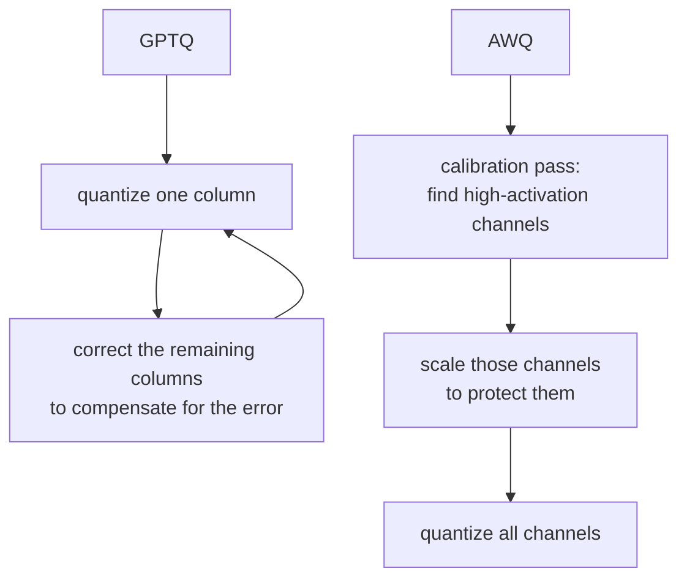

# Lección 7. Esquemas de cuantización al servir

**Vínculo con la misión:** Los pesos, y no solo la KV cache, ocupan memoria y se leen en cada paso de decode; cuantizarlos es la tercera palanca que cubre este espacio de trabajo, junto al batching y la propia caché.
**Fuente principal:** [Docs: "Optimizing inference", Hugging Face Transformers](https://huggingface.co/docs/transformers/main/en/llm_optims)
**Requisitos previos:** [Lección 6](0006-throughput-latency-tradeoff.md), [KV cache](../GLOSSARY.md)

## Calentamiento

1. ▢ ¿Por qué un paso de decode está limitado por el ancho de banda de memoria y no por cómputo?

Comprobación

Cada paso de decode calcula solo un token nuevo, así que la cantidad de cómputo nuevo por paso es pequeña en comparación con el tráfico de memoria necesario para volver a leer los pesos y la KV cache.

2. ▢ La lección 3 presentó fp8 como una precisión de la KV cache independiente de la precisión de los propios pesos del modelo. ¿Qué hizo reducir a la mitad `bytes_per_value` con la huella de la caché?

Comprobación

Redujo a la mitad el tamaño de la caché por token, sin cambiar `num_kv_heads`, la longitud de contexto ni nada del propio modelo.

## Qué debes saber

### Los pesos también se leen en cada paso, así que cuantizarlos acelera el decode directamente

Los pesos de un modelo de 7B ocupan unos 14 GB en fp16 (lección 1). Cada paso de decode los lee todos de nuevo, y como el decode está limitado por el ancho de banda de memoria, el tiempo que eso toma se acerca al cuello de botella real del paso. Cuantizar los pesos a una precisión menor reduce cuántos bytes tiene que leer un paso, lo que acelera el decode por la misma razón que lo hace una KV cache más pequeña: menos tráfico de memoria por paso, no menos cómputo.

### Los esquemas directos: int8 e int4

**int8** guarda cada peso en un byte en lugar de los dos de fp16, lo que reduce a la mitad la memoria de los pesos, con un costo de precisión pequeño y normalmente tolerable. **int4** va más allá, empaquetando dos pesos por byte, lo que reduce la huella de fp16 a una cuarta parte. La pega es que redondear sin más cada peso al valor de 4 bits representable más cercano (**cuantización por redondeo al más cercano**) degrada la precisión de forma más brusca que int8, porque 4 bits dejan muchos menos valores para representar el rango original de un peso. Con 8 bits, el redondeo ingenuo suele ir bien. Con 4 bits, normalmente no, sin algo más inteligente que un redondeo uniforme.

### GPTQ y AWQ son ese "algo más inteligente"

**GPTQ** cuantiza un modelo capa por capa, una columna de pesos a la vez, y tras cuantizar cada columna ajusta los pesos restantes de esa capa que aún no se han cuantizado para compensar el error recién introducido, usando información de segundo orden sobre lo sensible que es la salida de la capa a cada peso. Ese paso de corrección es lo que le permite llegar a 3 o 4 bits con mucha menos pérdida de precisión que el redondeo ingenuo.

**AWQ** (activation-aware weight quantization, cuantización de pesos consciente de las activaciones) adopta otro ángulo: observa qué canales de pesos ven las mayores magnitudes de activación durante una pasada de calibración, con la teoría de que un canal multiplicado por activaciones grandes contribuye más a la salida de la capa y por eso es más sensible al error de cuantización. Escala esos canales destacados para protegerlos de la mayor parte del error de cuantización, en lugar de corregir el error a posteriori como hace GPTQ. Ambos apuntan al mismo resultado, un modelo preciso con pesos de 4 bits, por mecanismos distintos: GPTQ compensa el error después de cuantizar cada columna, AWQ protege los pesos con más probabilidad de importar antes de cuantizar siquiera.

## Práctica

1. ▢ Los pesos en fp16 de un modelo ocupan 14 GB. ¿Aproximadamente cuánta memoria ocuparían las versiones int8 e int4 de los mismos pesos?

Comprobación

int8: unos 7 GB, la mitad de fp16. int4: unos 3.5 GB, una cuarta parte de fp16.

2. ▢ ¿Por qué cuantizar los pesos de fp16 a int8 acelera el decode, dado que el cuello de botella del decode es el ancho de banda de memoria y no el cómputo?

Comprobación

Cada paso de decode vuelve a leer los pesos de la memoria. Reducir su tamaño a la mitad reduce a la mitad el tráfico de memoria que tiene que hacer ese paso, lo que reduce directamente el tiempo que tarda un paso limitado por el ancho de banda de memoria, independientemente de cualquier cambio en cuánto cómputo realiza el paso.

3. ▢ ¿Por qué la cuantización ingenua por redondeo al más cercano aguanta razonablemente bien con int8 pero se degrada de forma más brusca con int4?

Pista

Piensa en cuántos valores distintos hay disponibles para representar el rango original de un peso con cada ancho de bits.

Comprobación

int8 tiene 256 valores representables para repartir por el rango de un peso; int4 solo tiene 16. Cuanto más gruesa es la cuadrícula disponible, más crece el error de redondeo de cada peso, y con 4 bits ese error es lo bastante grande para dañar la precisión de forma notable sin un esquema más inteligente.

4. ▢ ¿Cuál es la diferencia clave entre cómo deciden GPTQ y AWQ qué pesos proteger del error de cuantización?

Comprobación

GPTQ cuantiza columna por columna y corrige después el resto aún no cuantizado de una capa, compensando el error ya introducido. AWQ, en cambio, mira de antemano las magnitudes de activación durante una pasada de calibración, identifica los canales de pesos que más importan y los protege de la mayor parte del error antes de cuantizar, en lugar de corregir a posteriori.

5. ▢ ¿Qué afirmación es verdadera de GPTQ y AWQ en comparación con la cuantización ingenua por redondeo al más cercano a 4 bits?

    - a) Evitan cuantizar los pesos del modelo, y cuantizan solo sus activaciones
    - b) Usan calibración o corrección por capa para conservar más precisión con el mismo ancho de bits
    - c) Solo funcionan si se combinan con una KV cache de menor precisión
    - d) Reducen la huella de memoria del modelo por debajo de lo que consigue int4 por sí solo

Comprobación

**b)** Ambos usan información adicional, corrección de segundo orden en GPTQ, calibración de la magnitud de activación en AWQ, para conservar la precisión que el redondeo ingenuo perdería con el mismo ancho de bits. (a) es falsa: ambos cuantizan los propios pesos. (c) es falsa: la cuantización de pesos y la precisión de la KV cache son palancas independientes, como estableció la lección 3. (d) es falsa: el ancho de bits, y por tanto la huella de memoria, es el mismo objetivo de 4 bits; lo que difiere es cuánta precisión sobrevive al llegar allí.

## Prácticas en el mundo real

- [ ] Encuentra un checkpoint cuantizado de un modelo que conozcas (busca "GPTQ" o "AWQ" en su nombre en un hub de modelos) y lee su model card para ver qué ancho de bits y qué dataset de calibración se usaron.
- [ ] Encuentra el parámetro de tu stack de serving para cargar un modelo cuantizado (vLLM admite checkpoints GPTQ y AWQ directamente) y lee qué dice sobre los formatos admitidos.
- [ ] Mañana: lee un párrafo que compare la precisión reportada de GPTQ y AWQ con el mismo ancho de bits, en un benchmark que puedas encontrar, y anota cuál aguantó mejor para ese modelo concreto.

## Para profundizar

- [Paper: "GPTQ: Accurate Post-Training Quantization for Generative Pre-trained Transformers", Frantar et al., 2023](https://arxiv.org/abs/2210.17323)
- [Docs: "Optimizing inference", Hugging Face Transformers](https://huggingface.co/docs/transformers/main/en/llm_optims)
- [Recursos](../RESOURCES.md)

---

¿No termina de quedar claro? Vuelve a leer la fuente primaria de arriba, ya que esta lección la comprime y en la compresión es donde se escapa la comprensión. Consulta el [glosario](../GLOSSARY.md) por si algún término te resultó resbaladizo.

Si lo poco claro es la propia lección y no el material, eso es un defecto: [abre un issue](https://github.com/TokenCemetery/teach/issues).
