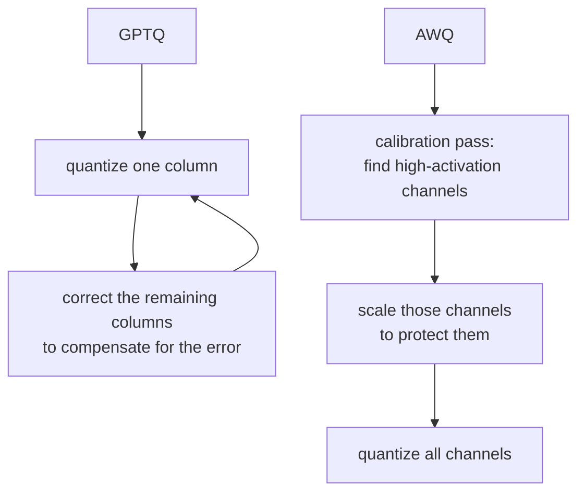

# Leçon 7. Schémas de quantification au moment du serving

**Lien avec la mission :** Les poids, et pas seulement le KV cache, résident en mémoire et sont lus à chaque étape de decode ; les quantifier est le troisième levier que cet espace de travail couvre, à côté du batching et du cache lui-même.
**Source primaire :** [Doc : "Optimizing inference", Hugging Face Transformers](https://huggingface.co/docs/transformers/main/en/llm_optims)
**Prérequis :** [Leçon 6](0006-throughput-latency-tradeoff.md), [KV cache](../GLOSSARY.md)

## Échauffement

1. ▢ Pourquoi une étape de decode est-elle limitée par la bande passante mémoire plutôt que par le calcul ?

Vérifier

Chaque étape de decode ne calcule qu'un seul nouveau token, donc la quantité de nouveau calcul par étape est faible par rapport au trafic mémoire nécessaire pour relire les poids et le KV cache.

2. ▢ La leçon 3 a présenté fp8 comme une précision de KV cache indépendante de la précision des poids du modèle. Qu'a fait le fait de diviser `bytes_per_value` par deux à l'empreinte du cache ?

Vérifier

Cela a divisé d'emblée par deux la taille du cache par token, sans rien changer à `num_kv_heads`, à la longueur de contexte, ni à rien d'autre dans le modèle lui-même.

## À savoir

### Les poids sont lus à chaque étape aussi, donc les quantifier accélère directement le decode

Les poids d'un modèle 7B prennent environ 14 GB en fp16 (leçon 1). Chaque étape de decode les relit tous, et comme le decode est limité par la bande passante mémoire, le temps que cela prend est proche du véritable goulot d'étranglement de l'étape. Quantifier les poids dans une précision plus basse réduit le nombre d'octets qu'une étape doit lire, ce qui accélère le decode pour la même raison qu'un KV cache plus petit : moins de trafic mémoire par étape, pas moins de calcul.

### Les schémas simples : int8 et int4

**int8** stocke chaque poids sur un octet au lieu des deux de fp16, ce qui divise d'emblée la mémoire des poids par deux, avec un coût de précision faible et généralement tolérable. **int4** va plus loin, en empaquetant deux poids par octet, ce qui divise l'empreinte fp16 par quatre. Le piège est que l'arrondi naïf de chaque poids à la valeur 4 bits représentable la plus proche (**quantification par arrondi au plus proche**, ou round-to-nearest) dégrade la précision plus brutalement que int8, parce que 4 bits laissent bien moins de valeurs pour représenter la plage d'origine d'un poids. À 8 bits, l'arrondi naïf est généralement suffisant. À 4 bits, il ne l'est généralement pas, sans quelque chose de plus malin qu'un arrondi uniforme.

### GPTQ et AWQ sont ce « quelque chose de plus malin »

**GPTQ** quantifie un modèle couche par couche, une colonne de poids à la fois, et après avoir quantifié chaque colonne il ajuste les poids restants, pas encore quantifiés, de cette couche pour compenser l'erreur qui vient d'être introduite, en utilisant l'information de second ordre sur la sensibilité de la sortie de la couche à chaque poids. Cette étape de correction est ce qui lui permet d'atteindre 3 à 4 bits avec bien moins de perte de précision que l'arrondi naïf.

**AWQ** (activation-aware weight quantization, quantification des poids sensible aux activations) adopte un autre angle : il observe quels canaux de poids voient les plus grandes magnitudes d'activation pendant une passe de calibration, partant de l'idée qu'un canal multiplié par de grandes activations contribue davantage à la sortie de la couche et est donc plus sensible à l'erreur de quantification. Il met à l'échelle ces canaux saillants pour les protéger d'une partie de l'erreur de quantification, au lieu de corriger l'erreur après coup comme le fait GPTQ. Les deux visent le même résultat, un modèle précis avec des poids 4 bits, par des mécanismes différents : GPTQ compense l'erreur après avoir quantifié chaque colonne, AWQ protège les poids les plus susceptibles de compter avant même de quantifier.

## Pratique

1. ▢ Les poids fp16 d'un modèle prennent 14 GB. Combien de mémoire prendraient à peu près des versions int8 et int4 des mêmes poids ?

Vérifier

int8 : environ 7 GB, la moitié de fp16. int4 : environ 3.5 GB, le quart de fp16.

2. ▢ Pourquoi quantifier les poids de fp16 à int8 accélère-t-il le decode, alors que le goulot d'étranglement du decode est la bande passante mémoire et non le calcul ?

Vérifier

Chaque étape de decode relit les poids depuis la mémoire. En diviser la taille par deux divise par deux le trafic mémoire que l'étape doit effectuer, ce qui réduit directement le temps que prend une étape limitée par la bande passante mémoire, indépendamment de tout changement dans la quantité de calcul que l'étape effectue.

3. ▢ Pourquoi la quantification naïve par arrondi au plus proche tient-elle raisonnablement bien à int8 mais se dégrade-t-elle plus brutalement à int4 ?

Indice

Pensez au nombre de valeurs distinctes disponibles pour représenter la plage d'origine d'un poids à chaque largeur de bits.

Vérifier

int8 a 256 valeurs représentables à répartir sur la plage d'un poids ; int4 n'en a que 16. Plus la grille disponible est grossière, plus l'erreur d'arrondi de chaque poids grandit, et à 4 bits cette erreur est assez grande pour nuire sensiblement à la précision sans schéma plus malin.

4. ▢ Quelle est la différence essentielle entre la façon dont GPTQ et AWQ décident quels poids protéger de l'erreur de quantification ?

Vérifier

GPTQ quantifie colonne par colonne et corrige ensuite le reste non encore quantifié d'une couche, en compensant l'erreur déjà introduite. AWQ regarde plutôt au préalable les magnitudes d'activation pendant une passe de calibration, identifie les canaux de poids qui comptent le plus, et protège ces canaux d'une partie de l'erreur avant de quantifier, au lieu de corriger après coup.

5. ▢ Laquelle de ces affirmations est vraie à propos de GPTQ et AWQ par rapport à la quantification naïve par arrondi au plus proche à 4 bits ?

    - a) Ils évitent de quantifier les poids du modèle, et ne quantifient que ses activations
    - b) Ils utilisent la calibration ou une correction par couche pour préserver davantage de précision à la même largeur de bits
    - c) Ils ne fonctionnent qu'associés à un KV cache de précision plus basse
    - d) Ils réduisent l'empreinte mémoire du modèle en dessous de ce que int4 atteint seul

Vérifier

**b)** Les deux utilisent de l'information supplémentaire, une correction de second ordre pour GPTQ, une calibration des magnitudes d'activation pour AWQ, pour préserver la précision que l'arrondi naïf perdrait à la même largeur de bits. (a) est fausse : les deux quantifient les poids eux-mêmes. (c) est fausse : la quantification des poids et la précision du KV cache sont des leviers indépendants, comme l'a établi la leçon 3. (d) est fausse : la largeur de bits, et donc l'empreinte mémoire, est la même cible de 4 bits ; ce qui diffère, c'est la quantité de précision qui survit pour y arriver.

## Exercices en situation réelle

- [ ] Trouvez un checkpoint quantifié d'un modèle que vous connaissez (cherchez « GPTQ » ou « AWQ » dans son nom sur un hub de modèles) et lisez sa fiche de modèle pour savoir quelle largeur de bits et quel jeu de données de calibration ont été utilisés.
- [ ] Trouvez l'option de votre pile de serving pour charger un modèle quantifié (vLLM prend directement en charge les checkpoints GPTQ et AWQ) et lisez ce qu'elle dit des formats pris en charge.
- [ ] Demain : lisez un paragraphe qui compare la précision rapportée de GPTQ et d'AWQ à la même largeur de bits, sur un benchmark que vous pouvez trouver, et notez lequel a le mieux tenu pour ce modèle précis.

## Pour aller plus loin

- [Article : "GPTQ: Accurate Post-Training Quantization for Generative Pre-trained Transformers", Frantar et al., 2023](https://arxiv.org/abs/2210.17323)
- [Doc : "Optimizing inference", Hugging Face Transformers](https://huggingface.co/docs/transformers/main/en/llm_optims)
- [Ressources](../RESOURCES.md)

---

Ça ne passe pas ? Relisez la source primaire en haut de page, car cette leçon la condense et c'est dans la condensation que la compréhension s'échappe. Consultez le [glossaire](../GLOSSARY.md) pour tout terme qui vous a paru glissant.

Si c'est la leçon elle-même qui n'est pas claire plutôt que la matière, c'est un défaut : [ouvrez une issue](https://github.com/TokenCemetery/teach/issues).
