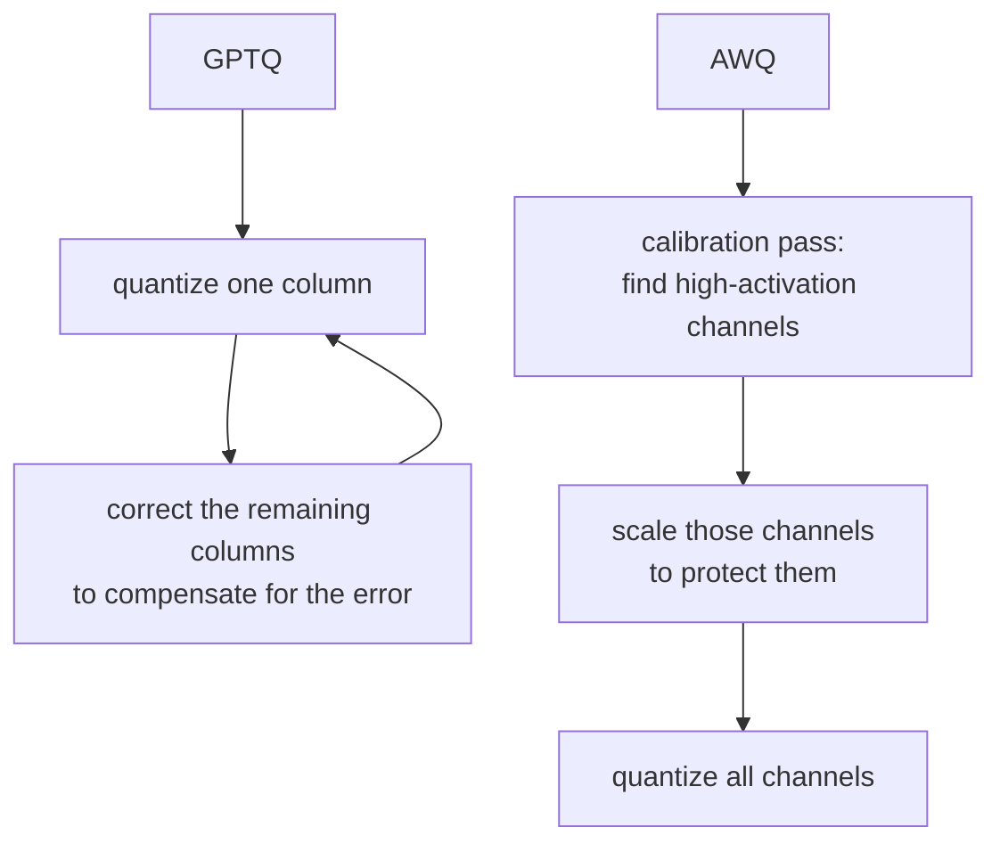

# पाठ 7. Serve Time पर Quantization Schemes

**मिशन से संबंध:** सिर्फ़ KV cache ही नहीं, weights भी memory में रहते हैं और हर decode step में पढ़े जाते हैं; उन्हें quantize करना इस workspace का तीसरा उपाय है, batching और cache के साथ।
**मुख्य स्रोत:** [दस्तावेज़: "Optimizing inference", Hugging Face Transformers](https://huggingface.co/docs/transformers/main/en/llm_optims)
**पूर्व-आवश्यकताएँ:** [पाठ 6](0006-throughput-latency-tradeoff.md), [KV cache](../GLOSSARY.md)

## वार्म-अप

1. ▢ Decode step compute-bound के बजाय memory-bandwidth bound क्यों है?

जाँचें

हर decode step सिर्फ़ एक नया token compute करता है, इसलिए हर step में नया compute, weights और KV cache वापस पढ़ने के लिए ज़रूरी memory traffic की तुलना में छोटा होता है।

2. ▢ पाठ 3 ने fp8 को KV cache की ऐसी precision के रूप में बताया जो model के अपने weight precision से स्वतंत्र है। `bytes_per_value` को आधा करने से cache के footprint का क्या हुआ?

जाँचें

उसने cache का प्रति-token आकार सीधे आधा कर दिया, `num_kv_heads`, context length या model के बारे में किसी भी चीज़ में बदलाव के बिना।

## यह जानें

### Weights भी हर step में पढ़े जाते हैं, इसलिए उन्हें quantize करने से decode सीधे तेज़ होता है

7B model के weights fp16 में लगभग 14 GB लेते हैं (पाठ 1)। हर decode step उन सबको वापस पढ़ता है, और चूँकि decode memory-bandwidth bound है, उसमें लगने वाला समय step की असली अड़चन के क़रीब है। Weights को कम precision में quantize करने से step को कितने bytes पढ़ने पड़ते हैं वह घटता है, जिससे decode उसी कारण तेज़ होता है जिस कारण छोटा KV cache उसे तेज़ करता है: प्रति step कम memory traffic, कम compute नहीं।

### सीधी-सादी schemes: int8 और int4

**int8** हर weight को fp16 के दो bytes की जगह एक byte में रखता है, weight memory सीधे आधी कर देता है, थोड़ी और आम तौर पर सहने लायक़ accuracy की क़ीमत पर। **int4** और आगे जाता है, हर byte में दो weights पैक करता है, fp16 के footprint का चौथाई कर देता है। पेच यह है कि हर weight को सीधे सबसे नज़दीकी representable 4-bit value पर गोल कर देना (**round-to-nearest quantization**) int8 की तुलना में accuracy को ज़्यादा तेज़ी से बिगाड़ता है, क्योंकि 4 bits weight की मूल range को दिखाने के लिए बहुत कम values छोड़ते हैं। 8-bit पर सीधा rounding आम तौर पर ठीक रहता है। 4-bit पर वह आम तौर पर ठीक नहीं रहता, जब तक एकसमान rounding से कुछ ज़्यादा समझदार तरीक़ा न हो।

### GPTQ और AWQ वह "कुछ ज़्यादा समझदार तरीक़ा" हैं

**GPTQ** model को layer-दर-layer, एक बार में एक weight column quantize करता है, और हर column quantize करने के बाद उस layer के बचे, अभी quantize न हुए weights को समायोजित करता है ताकि अभी आई त्रुटि की भरपाई हो सके, इसके लिए वह इस दूसरे-क्रम की जानकारी का इस्तेमाल करता है कि layer का output हर weight के प्रति कितना संवेदनशील है। यही सुधार का चरण उसे सीधे rounding से कहीं कम accuracy खोकर 3 से 4 bits तक पहुँचने देता है।

**AWQ** (activation-aware weight quantization) अलग कोण लेता है: वह calibration pass के दौरान देखता है कि किन weight channels पर सबसे बड़ी activation magnitudes पड़ती हैं, इस सिद्धांत पर कि जिस channel को बड़ी activations से गुणा किया जाता है वह layer के output में ज़्यादा योगदान देता है और इसलिए quantization त्रुटि के प्रति ज़्यादा संवेदनशील है। वह उन अहम channels को scale करता है ताकि उन्हें ज़्यादा से ज़्यादा quantization त्रुटि से बचाया जा सके, बजाय इसके कि त्रुटि के बाद उसकी भरपाई की जाए जैसा GPTQ करता है। दोनों का लक्ष्य एक ही नतीजा है, 4-bit weights पर सटीक model, पर अलग तंत्रों से: GPTQ हर column quantize करने के बाद त्रुटि की भरपाई करता है, AWQ quantize करने से पहले ही उन weights को बचाता है जिनके मायने रखने की सबसे ज़्यादा संभावना है।

## अभ्यास

1. ▢ किसी model के fp16 weights 14 GB लेते हैं। उन्हीं weights के int8 और int4 रूप मोटे तौर पर कितनी memory लेंगे?

जाँचें

int8: लगभग 7 GB, fp16 का आधा। int4: लगभग 3.5 GB, fp16 का चौथाई।

2. ▢ Weights को fp16 से int8 में quantize करने से decode तेज़ क्यों होता है, जबकि decode की अड़चन memory bandwidth है, compute नहीं?

जाँचें

हर decode step weights को memory से वापस पढ़ता है। उनका आकार आधा करने से उस step को जितना memory traffic करना पड़ता है वह आधा हो जाता है, जो memory-bandwidth-bound step के लगने वाले समय को सीधे घटाता है, step कितना compute करता है इसमें किसी बदलाव से स्वतंत्र।

3. ▢ Naive round-to-nearest quantization int8 पर ठीक-ठाक टिकता है पर int4 पर ज़्यादा तेज़ी से बिगड़ता क्यों है?

संकेत

सोचें कि हर bit width पर weight की मूल range दिखाने के लिए कितनी अलग values उपलब्ध हैं।

जाँचें

int8 के पास weight की range में फैलाने के लिए 256 representable values हैं; int4 के पास सिर्फ़ 16। उपलब्ध ग्रिड जितना मोटा होगा, हर weight की rounding त्रुटि उतनी बढ़ेगी, और 4 bits पर वह त्रुटि इतनी बड़ी है कि बिना किसी ज़्यादा समझदार scheme के accuracy को साफ़ चोट पहुँचाती है।

4. ▢ GPTQ और AWQ में इस बात का मुख्य फ़र्क़ क्या है कि वे किन weights को quantization त्रुटि से बचाना तय करते हैं?

जाँचें

GPTQ column-दर-column quantize करता है और बाद में layer के अभी quantize न हुए बचे हिस्से को सुधारता है, जो त्रुटि पहले ही आ चुकी है उसकी भरपाई करते हुए। AWQ इसके बजाय पहले calibration pass के दौरान activation magnitudes देखता है, उन weight channels की पहचान करता है जो सबसे ज़्यादा मायने रखते हैं, और quantize करने से पहले उन channels को ज़्यादा से ज़्यादा त्रुटि से बचाता है, बाद में सुधारने के बजाय।

5. ▢ 4-bit पर naive round-to-nearest quantization की तुलना में GPTQ और AWQ के बारे में कौन-सा दावा सही है?

    - a) वे model के weights को बिल्कुल quantize नहीं करते, सिर्फ़ उसकी activations को करते हैं
    - b) वे calibration या प्रति-layer सुधार इस्तेमाल करके उसी bit width पर ज़्यादा accuracy बचाते हैं
    - c) वे सिर्फ़ तब काम करते हैं जब कम-precision KV cache के साथ जोड़े जाएँ
    - d) वे model का memory footprint अकेले int4 से हासिल होने वाले से भी नीचे ले जाते हैं

जाँचें

**b)** दोनों अतिरिक्त जानकारी इस्तेमाल करते हैं, GPTQ के लिए दूसरे-क्रम का सुधार, AWQ के लिए activation-magnitude calibration, ताकि वह accuracy बचे जो उसी bit width पर naive rounding खो देता। (a) ग़लत है: दोनों weights को ही quantize करते हैं। (c) ग़लत है: weight quantization और KV cache की precision स्वतंत्र उपाय हैं, जैसा पाठ 3 ने स्थापित किया। (d) ग़लत है: bit width, और इसलिए memory footprint, वही 4-bit लक्ष्य है; फ़र्क़ इसमें है कि वहाँ पहुँचने में कितनी accuracy बची रहती है।

## असली दुनिया का अभ्यास

- [ ] किसी जाने-पहचाने model का quantized checkpoint खोजें (model hub पर उसके नाम में "GPTQ" या "AWQ" खोजें) और उसका model card पढ़ें कि कौन-सी bit width और calibration dataset इस्तेमाल हुई।
- [ ] अपनी serving stack का quantized model load करने का flag ढूँढें (vLLM GPTQ और AWQ checkpoints सीधे support करता है) और पढ़ें कि वह समर्थित formats के बारे में क्या कहता है।
- [ ] कल: एक अनुच्छेद पढ़ें जो उसी bit width पर GPTQ और AWQ की रिपोर्ट की गई accuracy की तुलना करता हो, किसी ऐसे benchmark पर जो आप खोज सकें, और नोट करें कि उस ख़ास model के लिए कौन बेहतर टिका।

## आगे बढ़ने के लिए

- [पेपर: "GPTQ: Accurate Post-Training Quantization for Generative Pre-trained Transformers", Frantar et al., 2023](https://arxiv.org/abs/2210.17323)
- [दस्तावेज़: "Optimizing inference", Hugging Face Transformers](https://huggingface.co/docs/transformers/main/en/llm_optims)
- [संसाधन](../RESOURCES.md)

---

बात नहीं बन रही? ऊपर दिए मुख्य स्रोत को दोबारा पढ़ें, क्योंकि यह पाठ उसे संक्षिप्त करता है और समझ संक्षेप में ही रिसती है। जो शब्द फिसलन भरा लगे, उसके लिए [शब्दावली](../GLOSSARY.md) देखें।

अगर दिक़्क़त सामग्री की नहीं बल्कि पाठ की ही है, तो वह एक खोट है: [issue खोलें](https://github.com/TokenCemetery/teach/issues)।
