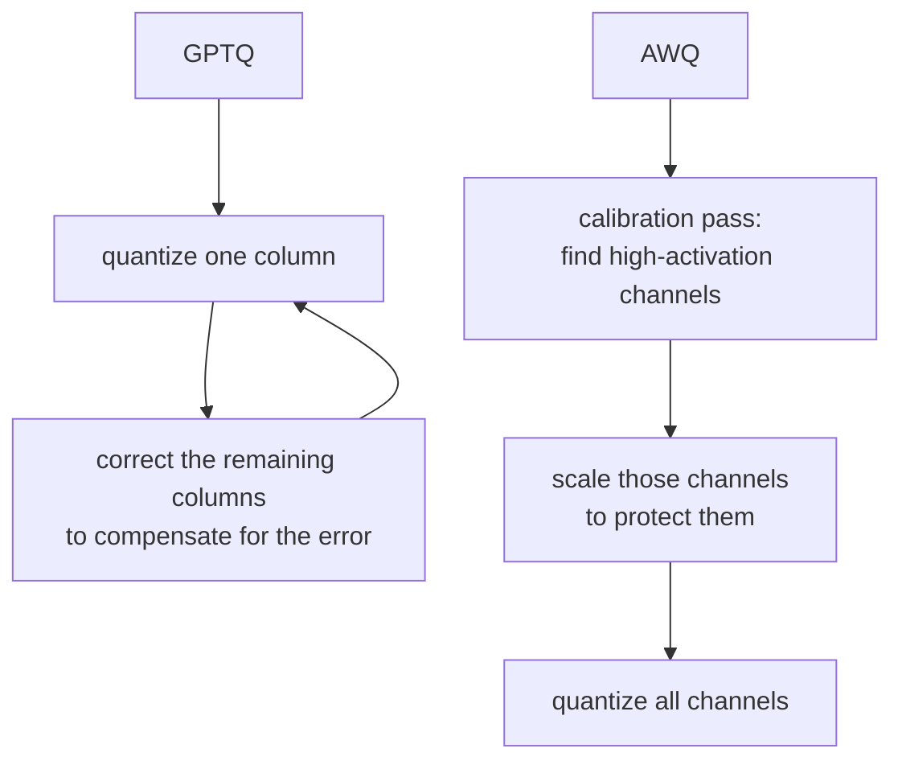

# Lição 7. Esquemas de quantização no serving

**Ligação com a missão:** Os pesos, e não só o KV cache, ficam na memória e são lidos a cada passo de decode; quantizá-los é a terceira alavanca que este workspace cobre, ao lado do batching e do próprio cache.
**Fonte principal:** [Documentação: "Optimizing inference", Hugging Face Transformers](https://huggingface.co/docs/transformers/main/en/llm_optims)
**Pré-requisitos:** [Lição 6](0006-throughput-latency-tradeoff.md), [KV cache](../GLOSSARY.md)

## Aquecimento

1. ▢ Por que um passo de decode é limitado pela largura de banda de memória e não por compute?

Verificação

Cada passo de decode calcula apenas um novo token, então a quantidade de compute novo por passo é pequena em relação ao tráfego de memória necessário para ler de volta os pesos e o KV cache.

2. ▢ A lição 3 introduziu o fp8 como uma precisão de KV cache independente da precisão dos pesos do próprio modelo. O que reduzir `bytes_per_value` pela metade fez com a pegada do cache?

Verificação

Reduziu o tamanho do cache por token exatamente pela metade, sem nenhuma mudança em `num_kv_heads`, no comprimento de contexto ou em qualquer coisa sobre o próprio modelo.

## Saiba isto

### Os pesos também são lidos a cada passo, então quantizá-los acelera o decode diretamente

Os pesos de um modelo de 7B ocupam cerca de 14 GB em fp16 (lição 1). Todo passo de decode lê todos eles de volta, e como o decode é limitado pela largura de banda de memória, o tempo que isso leva é quase o gargalo real do passo. Quantizar os pesos para uma precisão menor reduz quantos bytes um passo precisa ler, o que acelera o decode pelo mesmo motivo que um KV cache menor: menos tráfego de memória por passo, e não menos compute.

### Os esquemas diretos: int8 e int4

O **int8** armazena cada peso em um byte em vez dos dois do fp16, cortando a memória dos pesos pela metade de imediato, com um custo de acurácia pequeno e geralmente tolerável. O **int4** vai além, empacotando dois pesos por byte, reduzindo a pegada do fp16 a um quarto. O problema é que arredondar ingenuamente cada peso para o valor de 4 bits representável mais próximo (**quantização por arredondamento para o mais próximo**) degrada a acurácia de forma mais acentuada do que o int8, porque 4 bits deixam muito menos valores para representar a faixa original de um peso. Em 8 bits, o arredondamento ingênuo costuma ser suficiente. Em 4 bits, em geral não é, sem algo mais esperto do que o arredondamento uniforme.

### GPTQ e AWQ são o "algo mais esperto"

O **GPTQ** quantiza um modelo camada por camada, uma coluna de pesos por vez, e depois de quantizar cada coluna ele ajusta os pesos restantes, ainda não quantizados, daquela camada para compensar o erro que acabou de ser introduzido, usando informação de segunda ordem sobre o quão sensível a saída da camada é a cada peso. Esse passo de correção é o que lhe permite chegar a 3 ou 4 bits com muito menos perda de acurácia do que o arredondamento ingênuo.

O **AWQ** (activation-aware weight quantization) segue outro ângulo: ele observa quais canais de pesos veem as maiores magnitudes de ativação durante uma passada de calibração, na teoria de que um canal multiplicado por ativações grandes contribui mais para a saída da camada e, portanto, é mais sensível ao erro de quantização. Ele escala esses canais salientes para protegê-los de boa parte do erro de quantização, em vez de corrigir o erro depois do fato como o GPTQ faz. Os dois miram o mesmo resultado, um modelo acurado com pesos de 4 bits, por mecanismos diferentes: o GPTQ compensa o erro depois de quantizar cada coluna, o AWQ protege os pesos com maior probabilidade de importar antes de quantizar.

## Prática

1. ▢ Os pesos em fp16 de um modelo ocupam 14 GB. Aproximadamente quanta memória ocupariam as versões int8 e int4 dos mesmos pesos?

Verificação

int8: cerca de 7 GB, metade do fp16. int4: cerca de 3,5 GB, um quarto do fp16.

2. ▢ Por que quantizar os pesos de fp16 para int8 acelera o decode, dado que o gargalo do decode é a largura de banda de memória, e não o compute?

Verificação

Todo passo de decode lê os pesos de volta da memória. Reduzir o tamanho deles pela metade reduz pela metade o tráfego de memória que esse passo precisa fazer, o que encurta diretamente o tempo de um passo limitado pela largura de banda de memória, independentemente de qualquer mudança em quanto compute o passo realiza.

3. ▢ Por que a quantização ingênua por arredondamento para o mais próximo se sustenta razoavelmente bem em int8, mas degrada de forma mais acentuada em int4?

Dica

Pense em quantos valores distintos estão disponíveis para representar a faixa original de um peso em cada largura de bits.

Verificação

O int8 tem 256 valores representáveis para distribuir pela faixa de um peso; o int4 tem apenas 16. Quanto mais grossa a grade disponível, mais cresce o erro de arredondamento de cada peso, e em 4 bits esse erro é grande o bastante para prejudicar a acurácia de forma perceptível sem um esquema mais esperto.

4. ▢ Qual é a diferença central entre como o GPTQ e o AWQ decidem quais pesos proteger do erro de quantização?

Verificação

O GPTQ quantiza coluna por coluna e corrige depois o restante ainda não quantizado de uma camada, compensando o erro já introduzido. O AWQ, em vez disso, olha antes as magnitudes de ativação durante uma passada de calibração, identifica os canais de pesos que mais importam e os protege de boa parte do erro antes de quantizar, em vez de corrigir depois do fato.

5. ▢ Qual afirmação é verdadeira sobre o GPTQ e o AWQ em comparação com a quantização ingênua por arredondamento para o mais próximo em 4 bits?

    - a) Eles evitam quantizar os pesos do modelo, quantizando apenas as ativações
    - b) Eles usam calibração ou correção por camada para preservar mais acurácia na mesma largura de bits
    - c) Eles só funcionam quando combinados com um KV cache de menor precisão
    - d) Eles reduzem a pegada de memória do modelo abaixo do que o int4 sozinho alcança

Verificação

**b)** Os dois usam informação extra, correção de segunda ordem no GPTQ e calibração por magnitude de ativação no AWQ, para preservar a acurácia que o arredondamento ingênuo perderia na mesma largura de bits. (a) é falsa: os dois quantizam os próprios pesos. (c) é falsa: a quantização de pesos e a precisão do KV cache são alavancas independentes, como a lição 3 estabeleceu. (d) é falsa: a largura de bits, e portanto a pegada de memória, é a mesma meta de 4 bits; o que difere é quanta acurácia sobrevive até chegar lá.

## Prática no mundo real

- [ ] Encontre um checkpoint quantizado de um modelo que você conhece (procure por "GPTQ" ou "AWQ" no nome dele em um hub de modelos) e leia o model card para ver qual largura de bits e qual dataset de calibração foram usados.
- [ ] Encontre a flag da sua stack de serving para carregar um modelo quantizado (o vLLM suporta checkpoints GPTQ e AWQ diretamente) e leia o que ela diz sobre os formatos suportados.
- [ ] Amanhã: leia um parágrafo que compare a acurácia reportada de GPTQ e AWQ na mesma largura de bits, em um benchmark que você encontre, e anote qual dos dois se saiu melhor para aquele modelo específico.

## Para ir além

- [Artigo científico: "GPTQ: Accurate Post-Training Quantization for Generative Pre-trained Transformers", Frantar et al., 2023](https://arxiv.org/abs/2210.17323)
- [Documentação: "Optimizing inference", Hugging Face Transformers](https://huggingface.co/docs/transformers/main/en/llm_optims)
- [Recursos](../RESOURCES.md)

---

Não ficou claro? Releia a fonte principal no topo, já que esta lição a comprime e é na compressão que o entendimento escapa. Consulte o [glossário](../GLOSSARY.md) para qualquer termo que pareceu escorregadio.

Se o problema é a lição em si, e não o material, isso é um defeito: [abra uma issue](https://github.com/TokenCemetery/teach/issues).
