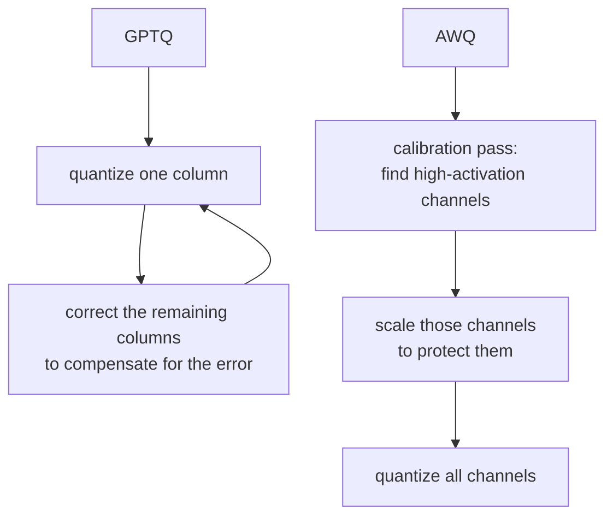

# Урок 7. Схемы квантизации при обслуживании

**Связь с целью курса:** В памяти лежит не только KV-кеш, но и веса, которые читаются на каждом шаге декодирования; их квантизация это третий рычаг, который охватывает это рабочее пространство, наряду с батчингом и самим кешем.
**Первоисточник:** [Документация: "Optimizing inference", Hugging Face Transformers](https://huggingface.co/docs/transformers/main/en/llm_optims)
**Предварительные требования:** [Урок 6](0006-throughput-latency-tradeoff.md), [KV-кеш](../GLOSSARY.md)

## Разминка

1. ▢ Почему шаг декодирования ограничен пропускной способностью памяти, а не вычислениями?

Проверка

Каждый шаг декодирования вычисляет только один новый токен, поэтому объём новых вычислений на шаг мал по сравнению с обменом с памятью, нужным для чтения весов и KV-кеша.

2. ▢ Урок 3 ввёл fp8 как точность KV-кеша, не зависящую от точности собственных весов модели. Что сделало уменьшение `bytes_per_value` вдвое с объёмом кеша?

Проверка

Оно вдвое уменьшило размер кеша на токен, без изменения `num_kv_heads`, длины контекста или чего-либо в самой модели.

## Что нужно знать

### Веса тоже читаются на каждом шаге, поэтому их квантизация напрямую ускоряет декодирование

Веса модели на 7B занимают около 14 ГБ в fp16 (урок 1). Каждый шаг декодирования читает их все обратно, а поскольку декодирование ограничено пропускной способностью памяти, время на это близко к реальному узкому месту шага. Квантизация весов до более низкой точности уменьшает число байт, которые шагу приходится читать, и это ускоряет декодирование по той же причине, что и меньший KV-кеш: меньше обмена с памятью на шаг, а не меньше вычислений.

### Простые схемы: int8 и int4

**int8** хранит каждый вес в одном байте вместо двух в fp16, вдвое сокращая память весов, с небольшой и обычно приемлемой потерей точности. **int4** идёт дальше, упаковывая два веса в байт и сокращая объём fp16 в четыре раза. Загвоздка в том, что наивное округление каждого веса до ближайшего представимого 4-битного значения (**квантизация округлением до ближайшего, round-to-nearest**) ухудшает точность резче, чем int8, потому что 4 бита оставляют гораздо меньше значений для представления исходного диапазона веса. При 8 битах наивное округление обычно годится. При 4 битах обычно нет, если не применить что-то умнее равномерного округления.

### GPTQ и AWQ это и есть «что-то умнее»

**GPTQ** квантизует модель слой за слоем, по одному столбцу весов, и после квантизации каждого столбца подправляет оставшиеся, ещё не квантизованные веса этого слоя, чтобы компенсировать только что внесённую ошибку, используя информацию второго порядка о том, насколько выход слоя чувствителен к каждому весу. Именно этот шаг коррекции позволяет достичь 3-4 бит с гораздо меньшей потерей точности, чем при наивном округлении.

**AWQ** (activation-aware weight quantization, квантизация весов с учётом активаций) заходит с другой стороны: она наблюдает, какие каналы весов видят наибольшие величины активаций на калибровочном проходе, исходя из того, что канал, умножаемый на большие активации, вносит больший вклад в выход слоя и потому более чувствителен к ошибке квантизации. Она масштабирует эти значимые каналы, чтобы защитить их от как можно большей ошибки квантизации, вместо того чтобы исправлять ошибку постфактум, как делает GPTQ. Обе нацелены на один результат, точную модель с 4-битными весами, но разными механизмами: GPTQ компенсирует ошибку после квантизации каждого столбца, AWQ защищает веса, которые скорее всего важны, до начала квантизации.

## Практика

1. ▢ Веса модели в fp16 занимают 14 ГБ. Сколько примерно памяти заняли бы версии тех же весов в int8 и int4?

Проверка

int8: около 7 ГБ, половина fp16. int4: около 3,5 ГБ, четверть fp16.

2. ▢ Почему квантизация весов из fp16 в int8 ускоряет декодирование, если узкое место декодирования это пропускная способность памяти, а не вычисления?

Проверка

Каждый шаг декодирования читает веса обратно из памяти. Уменьшение их размера вдвое вдвое сокращает обмен с памятью, который должен выполнить шаг, а это напрямую сокращает время шага, ограниченного пропускной способностью памяти, независимо от какого-либо изменения объёма вычислений на шаге.

3. ▢ Почему наивная квантизация округлением до ближайшего вполне держится при int8, но деградирует резче при int4?

Подсказка

Подумайте о том, сколько различных значений доступно для представления исходного диапазона веса при каждой разрядности.

Проверка

У int8 есть 256 представимых значений, чтобы покрыть диапазон веса; у int4 только 16. Чем грубее доступная сетка, тем больше растёт ошибка округления каждого веса, и при 4 битах эта ошибка достаточно велика, чтобы заметно навредить точности без более умной схемы.

4. ▢ В чём ключевое различие между тем, как GPTQ и AWQ решают, какие веса защищать от ошибки квантизации?

Проверка

GPTQ квантизует столбец за столбцом и потом корректирует ещё не квантизованный остаток слоя, компенсируя уже внесённую ошибку. AWQ же заранее смотрит на величины активаций на калибровочном проходе, определяет каналы весов, которые важнее всего, и защищает эти каналы от как можно большей ошибки до квантизации, а не исправляет постфактум.

5. ▢ Какое утверждение верно для GPTQ и AWQ по сравнению с наивной квантизацией округлением до ближайшего при 4 битах?

    - a) Они вообще не квантизуют веса модели, только её активации
    - b) Они используют калибровку или послойную коррекцию, чтобы сохранить больше точности при той же разрядности
    - c) Они работают только в паре с KV-кешем более низкой точности
    - d) Они уменьшают объём памяти модели ниже того, чего достигает один int4

Проверка

**b)** Обе используют дополнительную информацию, коррекцию второго порядка в GPTQ и калибровку по величинам активаций в AWQ, чтобы сохранить точность, которую наивное округление потеряло бы при той же разрядности. (a) неверно: обе квантизуют сами веса. (c) неверно: квантизация весов и точность KV-кеша это независимые рычаги, как установил урок 3. (d) неверно: разрядность, а значит и объём памяти, та же целевая 4-битная; различается то, сколько точности уцелеет на пути к ней.

## Практика в реальной работе

- [ ] Найдите квантизованный чекпоинт знакомой вам модели (поищите «GPTQ» или «AWQ» в названии на хабе моделей) и прочитайте в её карточке, какие разрядность и калибровочный набор данных использовались.
- [ ] Найдите флаг вашего стека обслуживания для загрузки квантизованной модели (vLLM напрямую поддерживает чекпоинты GPTQ и AWQ) и прочитайте, что он говорит о поддерживаемых форматах.
- [ ] Завтра: прочитайте один абзац со сравнением заявленной точности GPTQ и AWQ при одной разрядности на найденном вами бенчмарке и отметьте, какая из них лучше показала себя для этой конкретной модели.

## Что почитать дальше

- [Научная статья: "GPTQ: Accurate Post-Training Quantization for Generative Pre-trained Transformers", Frantar et al., 2023](https://arxiv.org/abs/2210.17323)
- [Документация: "Optimizing inference", Hugging Face Transformers](https://huggingface.co/docs/transformers/main/en/llm_optims)
- [Ресурсы](../RESOURCES.md)

---

Не доходит? Перечитайте первоисточник в начале: этот урок его сжимает, а при сжатии понимание как раз и теряется. Загляните в [глоссарий](../GLOSSARY.md), если какой-то термин показался скользким.

Если неясен сам урок, а не материал, это дефект: [откройте issue](https://github.com/TokenCemetery/teach/issues).
