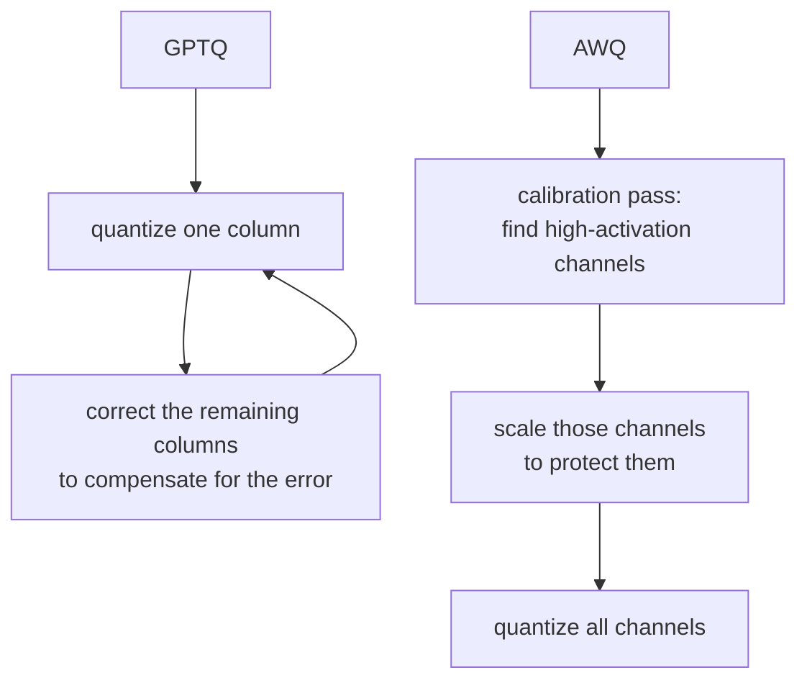

# 第 7 课：服务时的量化方案

**使命关联:** 驻留在内存里、并在每个解码步被读取的，不只是 KV 缓存，还有权重；量化它们，是本工作区在批处理和缓存本身之外涉及的第三个杠杆。
**主要来源:** [文档：“Optimizing inference”，Hugging Face Transformers](https://huggingface.co/docs/transformers/main/en/llm_optims)
**前置知识:** [第 6 课](0006-throughput-latency-tradeoff.md)、[KV 缓存](../GLOSSARY.md)

## 热身

1. ▢ 为什么一个解码步受内存带宽限制，而不是受算力限制？

检查

每个解码步只算一个新 token，所以每步新增的计算量，相对于读回权重和 KV 缓存所需的内存流量来说很小。

2. ▢ 第 3 课介绍了 fp8，作为独立于模型自身权重精度的 KV 缓存精度。把 `bytes_per_value` 减半，对缓存的占用做了什么？

检查

它直接把缓存每个 token 的大小减半，`num_kv_heads`、上下文长度或模型本身的任何方面都没有变。

## 要点

### 权重每一步也要被读取，所以量化它们直接加快解码

一个 7B 模型的权重在 fp16 下约占 14 GB（第 1 课）。每个解码步都要把它们全部读回来，而由于解码受内存带宽限制，这花掉的时间就接近这一步真正的瓶颈。把权重量化到更低的精度，缩小了一步必须读取的字节数，这加快解码的原因和更小的 KV 缓存一样：每步的内存流量更少，而不是计算更少。

### 直接的方案：int8 和 int4

**int8** 用一个字节而不是 fp16 的两个字节来存每个权重，直接把权重内存减半，精度代价很小，通常可以接受。**int4** 走得更远，每字节装两个权重，把 fp16 的占用降到四分之一。问题在于，朴素地把每个权重四舍五入到最近的可表示的 4 位值（**四舍五入量化**），精度下降得比 int8 严重得多，因为 4 位留给表示权重原来取值范围的值少得多。在 8 位时，朴素的四舍五入通常没问题。在 4 位时，没有比均匀四舍五入更聪明的办法，通常就不行了。

### GPTQ 和 AWQ 就是那个“更聪明的办法”

**GPTQ** 逐层量化模型，一次一个权重列，量化完每一列之后，利用该层输出对每个权重有多敏感的二阶信息，调整这一层中其余尚未量化的权重，来补偿刚刚引入的误差。正是这个纠正步骤，让它能压到 3 到 4 位，而精度损失比朴素的四舍五入小得多。

**AWQ**（激活感知的权重量化）换了一个角度：它在校准过程中观察哪些权重通道遇到最大的激活幅值，其依据是，一个与大激活相乘的通道，对该层输出的贡献更大，因此对量化误差更敏感。它对这些显著的通道做缩放，保护它们免受尽可能多的量化误差，而不是像 GPTQ 那样事后纠正误差。二者的目标相同，都是得到 4 位权重下仍然准确的模型，只是机制不同：GPTQ 在量化每一列之后补偿误差，AWQ 则在量化之前，先保护最可能要紧的权重。

## 练习

1. ▢ 一个模型的 fp16 权重占 14 GB。同样的权重，int8 和 int4 版本大约各占多少内存？

检查

int8：约 7 GB，是 fp16 的一半。int4：约 3.5 GB，是 fp16 的四分之一。

2. ▢ 既然解码的瓶颈是内存带宽，而不是算力，为什么把权重从 fp16 量化到 int8 能加快解码？

检查

每个解码步都要从内存里把权重读回来。把它们的大小减半，就把这一步必须做的内存流量减半，这直接缩短了受内存带宽限制的一步所花的时间，与这一步执行多少计算的任何变化无关。

3. ▢ 为什么朴素的四舍五入量化在 int8 时还撑得住，到 int4 时却下降得更严重？

提示

想想在每个位宽下，有多少个不同的值可以用来表示一个权重原来的取值范围。

检查

int8 有 256 个可表示的值，可以铺在一个权重的取值范围上；int4 只有 16 个。可用的网格越粗，每个权重的舍入误差就越大，而在 4 位时，这个误差大到足以明显损害精度，除非有更聪明的方案。

4. ▢ GPTQ 和 AWQ 在决定保护哪些权重免受量化误差时，关键的区别是什么？

检查

GPTQ 逐列量化，之后再纠正一层中尚未量化的剩余部分，补偿已经引入的误差。AWQ 则事先在校准过程中查看激活幅值，找出最要紧的权重通道，在量化之前就保护这些通道免受尽可能多的误差，而不是事后纠正。

5. ▢ 与 4 位下朴素的四舍五入量化相比，关于 GPTQ 和 AWQ，哪种说法是对的？

    - a) 它们完全不量化模型的权重，只量化激活
    - b) 它们利用校准或逐层纠正，在同样的位宽下保住更多精度
    - c) 它们只有与更低精度的 KV 缓存搭配才起作用
    - d) 它们把模型的内存占用降到了单靠 int4 做不到的程度

检查

**b)** 二者都用了额外的信息，GPTQ 用二阶纠正，AWQ 用激活幅值校准，来保住朴素四舍五入在同样位宽下会损失的精度。(a) 是错的：二者量化的都是权重本身。(c) 是错的：权重量化和 KV 缓存精度是独立的杠杆，第 3 课已经确立了这一点。(d) 是错的：位宽，进而内存占用，都是同样的 4 位目标；不同的只是抵达那里时，有多少精度幸存下来。

## 实战练习

- [ ] 找一个你熟悉的模型的量化检查点（在模型库里搜索名称中带“GPTQ”或“AWQ”的），读它的模型卡，看用了什么位宽和校准数据集。
- [ ] 找到你的服务栈中加载量化模型的参数（vLLM 直接支持 GPTQ 和 AWQ 检查点），读一读它对支持的格式是怎么说的。
- [ ] 明天：读一段比较 GPTQ 和 AWQ 在同样位宽下所报告精度的文字，选一个你能找到的基准测试，记下对那个具体的模型来说，哪一个保得更好。

## 延伸阅读

- [论文：“GPTQ: Accurate Post-Training Quantization for Generative Pre-trained Transformers”，Frantar 等，2023](https://arxiv.org/abs/2210.17323)
- [文档：“Optimizing inference”，Hugging Face Transformers](https://huggingface.co/docs/transformers/main/en/llm_optims)
- [资源](../RESOURCES.md)

---

没学明白？请重读顶部的主要来源，因为本课是对它的压缩，而理解正是在压缩中流失的。如果有哪个术语觉得含糊，可以查看[术语表](../GLOSSARY.md)。

如果问题出在课程本身，而不是学习材料，那就是一个缺陷：[提交 issue](https://github.com/TokenCemetery/teach/issues)。
