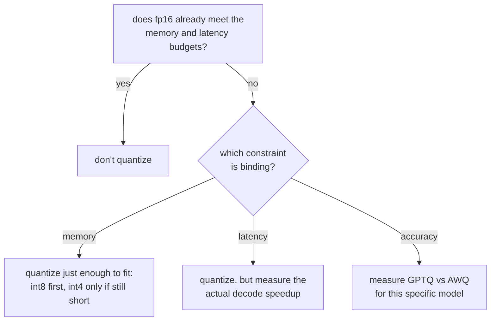

# Lección 9. Elegir y defender un esquema de cuantización

**Vínculo con la misión:** Este es el cierre de la etapa 3: elegir un esquema de cuantización y defender el compromiso significa nombrar qué restricción forzó la elección y citar las cifras de memoria, precisión y velocidad que las lecciones 7 y 8 enseñaron a encontrar.
**Fuente principal:** [Docs: "Optimizing inference", Hugging Face Transformers](https://huggingface.co/docs/transformers/main/en/llm_optims)
**Requisitos previos:** [Lección 8](0008-accuracy-speed-memory-tradeoffs.md), [Lección 2](0002-capacity-and-batch-size.md), [KV cache](../GLOSSARY.md)

## Calentamiento

1. ▢ ¿Cuál es la diferencia clave entre cómo deciden GPTQ y AWQ qué pesos proteger del error de cuantización?

Comprobación

GPTQ cuantiza columna por columna y corrige después el resto aún no cuantizado de una capa. AWQ, en cambio, calibra de antemano sobre las magnitudes de activación y protege del error a los canales que más importan antes de cuantizar.

2. ▢ ¿Por qué la aceleración medida del decode de un modelo cuantizado podría quedar por debajo de su proporción de ahorro de memoria?

Comprobación

Los pesos cuantizados a menudo necesitan descuantizarse a una precisión mayor justo antes de la multiplicación de matrices, y esa sobrecarga se come la aceleración teórica a menos que el kernel opere directamente sobre el formato cuantizado.

## Qué debes saber

### Empieza preguntando si fp16 ya funciona

La cuantización no es un paso por defecto; es una solución para una restricción que fp16 no cumple. Si los pesos en fp16 del modelo ya caben en el presupuesto de memoria y el servidor ya cumple su presupuesto de latencia (lección 6), cuantizar no compra nada que la carga de trabajo necesite, a un costo real y medido en precisión. La primera pregunta no es "qué esquema", es "hay algo que realmente necesite arreglarse".

### Identifica qué restricción es la que limita

Cuando sí hay algo que arreglar, nombra qué es, porque decide hasta dónde llegar:

- **Limitado por memoria**: los pesos del modelo, más la capacidad de KV cache que exige la lección 2, no caben en absoluto en la memoria disponible. Cuantiza lo justo para que quepa, y no más: primero int8, ya que es el que menos precisión medida cuesta, y baja a int4 con GPTQ o AWQ solo si int8 por sí solo sigue sin dejar espacio para la capacidad de caché que necesita la carga de trabajo.
- **Limitado por latencia**: el modelo cabe en memoria, pero el decode es más lento de lo que permite el presupuesto declarado. Como el decode está limitado por el ancho de banda de memoria, una huella de pesos menor con int8 o int4 puede ayudar, pero la aceleración real hay que medirla (lección 8), no suponerla a partir del ancho de bits.
- **Limitado por precisión**: la carga de trabajo tiene un techo de puntuación de benchmark o de perplejidad que no puede cruzar. Esta restricción no descarta la cuantización, pero descarta elegir un esquema solo por memoria o velocidad: GPTQ y AWQ se comportan de forma distinta en modelos distintos, así que hay que medir cuál conserva más precisión para este modelo, y no suponerlo a partir de qué paper tenía mejores cifras en general.

### Defender la elección significa citar tres cifras, no una

Una respuesta defendible a "por qué este esquema" nombra:

1. **La cifra de memoria** que hizo necesaria la cuantización en primer lugar, o la que muestra que no lo era (fp16 ya cabía).
2. **La cifra de precisión** medida para el esquema elegido con el ancho de bits elegido: una diferencia de perplejidad o un cambio de puntuación en un benchmark frente al modelo sin cuantizar, no una impresión a partir de salidas de muestra.
3. **La cifra de velocidad** realmente medida para la fase que le importa al presupuesto, ya que la lección 8 mostró que la ganancia en tiempo real no sigue automáticamente la proporción de memoria.

Una elección defendida con solo una de estas no está defendida; está adivinada y tuvo suerte en los ejes que nadie comprobó.

## Práctica

1. ▢ Un equipo sirve un modelo en una sola GPU de 80 GB. Sus pesos en fp16 ocupan 70 GB, y quedan 10 GB para la KV cache y la sobrecarga del framework. Con el razonamiento de la lección 2, ¿qué problema crea esto y qué restricción es la que limita?

Comprobación

10 GB de margen de caché admiten muy pocas secuencias concurrentes con cualquier longitud de contexto significativa, según la fórmula de capacidad de la lección 2. Es una restricción de memoria: los pesos por sí solos están desplazando la capacidad de caché que necesita la carga de trabajo.

2. ▢ El equipo cuantiza esos pesos a int8, que bajan a unos 35 GB. ¿Qué recupera esto, en términos del techo de capacidad de la lección 2?

Comprobación

Aproximadamente 45 GB disponibles ahora para la KV cache y la sobrecarga en lugar de 10 GB, lo que eleva sustancialmente el techo de capacidad (el máximo de secuencias concurrentes que permite el presupuesto de caché), ya que ese techo se calcula a partir de la memoria que queda tras los pesos.

3. ▢ Tras pasar a int8, la capacidad y la latencia medidas del equipo cumplen ahora los objetivos de la carga de trabajo. ¿Deberían pasar a int4 de todos modos, ya que liberaría aún más memoria? ¿Por qué sí o por qué no?

Comprobación

No. Una vez que int8 ya satisface las restricciones de capacidad y de latencia, bajar aún más a int4 compra memoria que nadie necesita a un costo real y medido de precisión que, como mostró la lección 8, crece más rápido por debajo de int8. Cuantizar más de lo que exige la restricción que limita es el mismo error que cuantizar cuando fp16 ya cabía: pagar un costo de precisión por un objetivo que ya se cumplía.

4. ▢ Un colega defiende una elección de cuantización diciendo "int4 con AWQ da el mayor ahorro de memoria, así que eso usamos". ¿Qué falta en esa defensa?

Comprobación

Las otras dos cifras. El ahorro de memoria por sí solo no dice si la restricción que realmente limitaba necesitaba int4 en lugar de int8, si la precisión de AWQ se mantuvo para este modelo concreto (medida, no supuesta), ni si se comprobó la aceleración del decode que le importa al presupuesto de latencia de esta carga de trabajo. "El mayor ahorro de memoria" defiende un eje y deja sin examinar los otros dos.

5. ▢ ¿Qué afirmación es verdadera sobre elegir entre int8 e int4 para una carga de trabajo limitada por latencia?

    - a) Siempre debe preferirse int4, ya que libera más memoria
    - b) La elección debe basarse en cuál tiene una aceleración medida, para la fase que cubre el presupuesto, que realmente cumpla el objetivo
    - c) El ancho de bits por sí solo determina la aceleración, así que la proporción de memoria puede usarse directamente
    - d) Las cargas de trabajo limitadas por latencia nunca deberían cuantizar los pesos, solo la KV cache

Comprobación

**b)** La aceleración medida de la fase relevante, el decode en la mayoría de los casos limitados por latencia, es lo que debe decidirlo, ya que la lección 8 mostró que la ganancia en tiempo real no sigue automáticamente la proporción de memoria. (a) es falsa: liberar más memoria de la que exige la restricción es un costo, no un beneficio. (c) es falsa, por la misma razón que (a). (d) es falsa: la cuantización de pesos acelera directamente el decode, ya que el decode está limitado por el ancho de banda de memoria tanto en los pesos como en la caché.

## Prácticas en el mundo real

- [ ] Para un modelo y un presupuesto de hardware que tengas en mente, calcula si los pesos en fp16 caben de verdad junto a una capacidad de KV cache que necesitarías, con la fórmula de la lección 2, antes de dar por supuesto que la cuantización es necesaria.
- [ ] Si la cuantización es necesaria, nombra por escrito qué restricción (memoria, latencia o precisión) es la que limita, y cuál es la cifra objetivo de esa restricción.
- [ ] Mañana: encuentra la elección de cuantización documentada de un despliegue de serving real (un model card, una entrada de blog, un texto de ingeniería) y comprueba si cita una cifra de memoria, de precisión y de velocidad, o solo una de las tres.

## Para profundizar

- [Docs: "Optimizing inference", Hugging Face Transformers](https://huggingface.co/docs/transformers/main/en/llm_optims)
- [Paper: "GPTQ: Accurate Post-Training Quantization for Generative Pre-trained Transformers", Frantar et al., 2023](https://arxiv.org/abs/2210.17323)
- [Recursos](../RESOURCES.md)

---

¿No termina de quedar claro? Vuelve a leer la fuente primaria de arriba, ya que esta lección la comprime y en la compresión es donde se escapa la comprensión. Consulta el [glosario](../GLOSSARY.md) por si algún término te resultó resbaladizo.

Si lo poco claro es la propia lección y no el material, eso es un defecto: [abre un issue](https://github.com/TokenCemetery/teach/issues).
