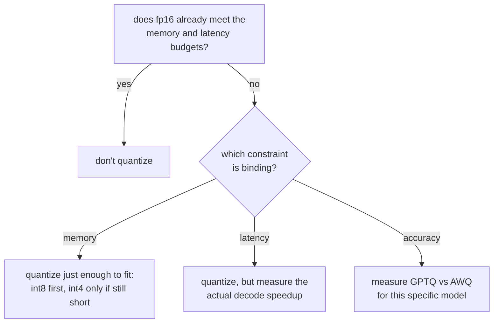

# Leçon 9. Choisir et défendre un schéma de quantification

**Lien avec la mission :** C'est la synthèse de l'étape 3 : choisir un schéma de quantification et défendre le compromis, c'est nommer la contrainte qui a forcé le choix et citer les chiffres de mémoire, de précision et de vitesse que les leçons 7 et 8 ont appris à trouver.
**Source primaire :** [Doc : "Optimizing inference", Hugging Face Transformers](https://huggingface.co/docs/transformers/main/en/llm_optims)
**Prérequis :** [Leçon 8](0008-accuracy-speed-memory-tradeoffs.md), [Leçon 2](0002-capacity-and-batch-size.md), [KV cache](../GLOSSARY.md)

## Échauffement

1. ▢ Quelle est la différence essentielle entre la façon dont GPTQ et AWQ décident quels poids protéger de l'erreur de quantification ?

Vérifier

GPTQ quantifie colonne par colonne et corrige ensuite le reste non encore quantifié d'une couche. AWQ calibre plutôt au préalable sur les magnitudes d'activation et protège de l'erreur, avant de quantifier, les canaux qui comptent le plus.

2. ▢ Pourquoi l'accélération mesurée du decode d'un modèle quantifié pourrait-elle rester en deçà de son rapport d'économie de mémoire ?

Vérifier

Les poids quantifiés doivent souvent être déquantifiés vers une précision plus haute juste avant la multiplication matricielle, et ce surcoût grignote l'accélération théorique, à moins que le kernel opère directement sur le format quantifié.

## À savoir

### Commencez par vous demander si fp16 fonctionne déjà

La quantification n'est pas une étape par défaut ; c'est un correctif pour une contrainte que fp16 ne satisfait pas. Si les poids fp16 du modèle tiennent déjà dans le budget de mémoire et si le serveur respecte déjà son budget de latence (leçon 6), quantifier n'apporte rien dont la charge de travail ait besoin, pour un coût réel et mesuré en précision. La première question n'est pas « quel schéma », c'est « y a-t-il vraiment quelque chose à corriger ».

### Identifiez quelle contrainte lie

Quand quelque chose doit effectivement être corrigé, nommez ce que c'est, parce que cela décide jusqu'où aller :

- **Contrainte de mémoire** : les poids du modèle, plus la capacité de KV cache que la leçon 2 exige, ne tiennent pas du tout dans la mémoire disponible. Quantifiez juste assez pour tenir, et pas plus : int8 d'abord, puisqu'il coûte le moins de précision mesurée, et ne descendez à int4 avec GPTQ ou AWQ que si int8 seul ne laisse toujours pas de place pour la capacité de cache dont la charge de travail a besoin.
- **Contrainte de latence** : le modèle tient en mémoire, mais le decode est plus lent que ne le permet le budget annoncé. Comme le decode est limité par la bande passante mémoire, une empreinte de poids plus petite avec int8 ou int4 peut aider, mais l'accélération réelle doit être mesurée (leçon 8), pas supposée à partir de la largeur de bits.
- **Contrainte de précision** : la charge de travail a un plafond de score de benchmark ou de perplexité qu'elle ne peut pas franchir. Cette contrainte n'exclut pas la quantification, mais elle exclut de choisir un schéma sur la seule mémoire ou la seule vitesse : GPTQ et AWQ tiennent différemment selon les modèles, donc celui qui préserve le plus de précision doit être mesuré pour ce modèle, et non supposé d'après les chiffres de l'article qui avaient l'air meilleurs en général.

### Défendre le choix, c'est citer trois chiffres, pas un

Une réponse défendable à « pourquoi ce schéma » nomme :

1. **Le chiffre de mémoire** qui a rendu la quantification nécessaire au départ, ou celui qui montre qu'elle ne l'était pas (fp16 tenait déjà).
2. **Le chiffre de précision** mesuré pour le schéma choisi à la largeur de bits choisie : un écart de perplexité ou une variation de score de benchmark par rapport au modèle non quantifié, et non une impression tirée d'exemples de sorties.
3. **Le chiffre de vitesse** réellement mesuré pour la phase dont le budget se soucie, puisque la leçon 8 a montré que le gain en temps réel ne suit pas automatiquement le rapport mémoire.

Un choix défendu par un seul de ces chiffres n'est pas défendu ; il est deviné, et il a eu de la chance sur les axes que personne n'a vérifiés.

## Pratique

1. ▢ Une équipe sert un modèle sur un seul GPU de 80 GB. Ses poids fp16 prennent 70 GB, laissant 10 GB pour le KV cache et le surcoût du framework. Avec le raisonnement de la leçon 2, quel problème cela crée-t-il, et quelle contrainte lie ?

Vérifier

10 GB de marge de cache permettent très peu de séquences concurrentes à une longueur de contexte significative, selon la formule de capacité de la leçon 2. C'est une contrainte de mémoire : les poids seuls évincent la capacité de cache dont la charge de travail a besoin.

2. ▢ L'équipe quantifie ces poids en int8, les ramenant à environ 35 GB. Qu'est-ce que cela rachète, en termes de plafond de capacité de la leçon 2 ?

Vérifier

Environ 45 GB sont maintenant disponibles pour le KV cache et le surcoût au lieu de 10 GB, ce qui relève sensiblement le plafond de capacité (le nombre maximal de séquences concurrentes que permet le budget de cache), puisque ce plafond se calcule à partir de la mémoire qui reste après les poids.

3. ▢ Après le passage à int8, la capacité et la latence mesurées de l'équipe satisfont maintenant toutes deux les cibles de la charge de travail. Devrait-elle quand même passer à int4, puisqu'il libérerait encore plus de mémoire ? Pourquoi ou pourquoi pas ?

Vérifier

Non. Une fois que int8 satisfait déjà les contraintes de capacité et de latence, descendre encore à int4 achète de la mémoire dont personne n'a besoin, pour un coût réel et mesuré en précision que la leçon 8 a montré croître plus vite sous int8. Quantifier plus loin que ce que la contrainte qui lie exige, c'est la même erreur que quantifier alors que fp16 tenait déjà : payer un coût de précision pour une cible déjà atteinte.

4. ▢ Un collègue défend un choix de quantification en disant « int4 avec AWQ donne les meilleures économies de mémoire, c'est donc ce que nous avons utilisé ». Qu'est-ce qui manque à cette défense ?

Vérifier

Les deux autres chiffres. Les seules économies de mémoire ne disent pas si la contrainte réellement liante exigeait int4 plutôt que int8, si la précision d'AWQ a tenu pour ce modèle précis (mesurée, pas supposée), ni si l'accélération du decode dont le budget de latence de cette charge de travail se soucie a réellement été vérifiée. « Les meilleures économies de mémoire » défend un axe et laisse les deux autres sans examen.

5. ▢ Laquelle de ces affirmations est vraie à propos du choix entre int8 et int4 pour une charge de travail contrainte par la latence ?

    - a) int4 devrait toujours être préféré, puisqu'il libère plus de mémoire
    - b) Le choix devrait reposer sur celui dont l'accélération mesurée, pour la phase que couvre le budget, atteint réellement la cible
    - c) La largeur de bits seule détermine l'accélération, donc le rapport de mémoire peut être utilisé directement
    - d) Les charges de travail contraintes par la latence ne devraient jamais quantifier les poids, seulement le KV cache

Vérifier

**b)** L'accélération mesurée pour la phase concernée, le decode dans la plupart des cas limités par la latence, est ce qui doit décider, puisque la leçon 8 a montré que le gain en temps réel ne suit pas automatiquement le rapport mémoire. (a) est fausse : libérer plus de mémoire que la contrainte n'en demande est un coût, pas un bénéfice. (c) est fausse, pour la même raison que (a). (d) est fausse : la quantification des poids accélère directement le decode, puisque le decode est limité par la bande passante mémoire sur les poids autant que sur le cache.

## Exercices en situation réelle

- [ ] Pour un modèle et un budget matériel que vous avez en tête, déterminez si les poids fp16 tiennent réellement à côté d'une capacité de KV cache dont vous auriez besoin, avec la formule de la leçon 2, avant de supposer que la quantification est nécessaire.
- [ ] Si la quantification est nécessaire, nommez par écrit quelle contrainte (mémoire, latence ou précision) lie, et quel est le chiffre cible pour cette contrainte.
- [ ] Demain : trouvez le choix de quantification documenté d'un vrai déploiement de serving (une fiche de modèle, un billet de blog, un compte rendu d'ingénierie) et vérifiez s'il cite un chiffre de mémoire, de précision et de vitesse, ou un seul des trois.

## Pour aller plus loin

- [Doc : "Optimizing inference", Hugging Face Transformers](https://huggingface.co/docs/transformers/main/en/llm_optims)
- [Article : "GPTQ: Accurate Post-Training Quantization for Generative Pre-trained Transformers", Frantar et al., 2023](https://arxiv.org/abs/2210.17323)
- [Ressources](../RESOURCES.md)

---

Ça ne passe pas ? Relisez la source primaire en haut de page, car cette leçon la condense et c'est dans la condensation que la compréhension s'échappe. Consultez le [glossaire](../GLOSSARY.md) pour tout terme qui vous a paru glissant.

Si c'est la leçon elle-même qui n'est pas claire plutôt que la matière, c'est un défaut : [ouvrez une issue](https://github.com/TokenCemetery/teach/issues).
