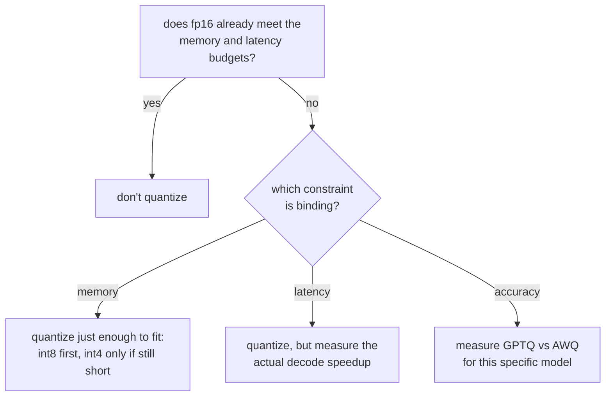

# पाठ 9. Quantization Scheme चुनना और उसका बचाव करना

**मिशन से संबंध:** यह चरण 3 का समापन है: quantization scheme चुनने और trade-off का बचाव करने का मतलब है यह बताना कि किस बाधा ने चुनाव करवाया और वे memory, accuracy और speed की संख्याएँ गिनाना जिन्हें खोजना पाठ 7 और 8 ने सिखाया।
**मुख्य स्रोत:** [दस्तावेज़: "Optimizing inference", Hugging Face Transformers](https://huggingface.co/docs/transformers/main/en/llm_optims)
**पूर्व-आवश्यकताएँ:** [पाठ 8](0008-accuracy-speed-memory-tradeoffs.md), [पाठ 2](0002-capacity-and-batch-size.md), [KV cache](../GLOSSARY.md)

## वार्म-अप

1. ▢ GPTQ और AWQ में इस बात का मुख्य फ़र्क़ क्या है कि वे किन weights को quantization त्रुटि से बचाना तय करते हैं?

जाँचें

GPTQ column-दर-column quantize करता है और बाद में layer के अभी quantize न हुए बचे हिस्से को सुधारता है। AWQ इसके बजाय पहले activation magnitudes पर calibrate करता है और quantize करने से पहले उन channels को त्रुटि से बचाता है जो सबसे ज़्यादा मायने रखते हैं।

2. ▢ Quantized model का नापा गया decode speedup उसके memory-बचत अनुपात से कम क्यों रह सकता है?

जाँचें

Quantized weights को अक्सर matrix multiply से ठीक पहले वापस ऊँची precision में dequantize करना पड़ता है, और वह overhead सैद्धांतिक speedup को खा जाता है, जब तक kernel सीधे quantized format पर न चले।

## यह जानें

### पहले पूछें कि fp16 पहले से काम करता है या नहीं

Quantization कोई default कदम नहीं है; यह उस बाधा का इलाज है जिसे fp16 पूरा नहीं कर पाता। अगर model के fp16 weights पहले से memory budget में समा जाते हैं और server पहले से अपना latency budget पूरा करता है (पाठ 6), तो quantize करने से वह कुछ नहीं मिलता जो workload को चाहिए, accuracy की असली, नापी गई क़ीमत पर। पहला सवाल "कौन-सी scheme" नहीं है, वह है "क्या सचमुच कुछ ठीक करने की ज़रूरत है"।

### पहचानें कि कौन-सी बाधा बाँध रही है

जब कुछ ठीक करने की ज़रूरत हो, तो नाम लें कि वह क्या है, क्योंकि वही तय करता है कि कितनी दूर जाना है:

- **Memory-बाधित**: model के weights, और पाठ 2 जो KV cache capacity माँगता है, मिलकर उपलब्ध memory में समाते ही नहीं। उतना quantize करें जितने में समा जाए, उससे आगे नहीं: पहले int8, क्योंकि उसकी नापी गई accuracy की क़ीमत सबसे कम है, और int4 पर GPTQ या AWQ के साथ तभी जाएँ जब अकेला int8 workload को चाहिए cache capacity के लिए जगह न छोड़े।
- **Latency-बाधित**: model memory में समाता है, पर decode बताए गए budget से धीमा है। चूँकि decode memory-bandwidth bound है, int8 या int4 से छोटा weight footprint मदद कर सकता है, पर असली speedup को नापना पड़ेगा (पाठ 8), bit width से मान नहीं लेना है।
- **Accuracy-बाधित**: workload की एक benchmark score या perplexity की सीमा है जिसे वह पार नहीं कर सकता। यह बाधा quantization को ख़ारिज नहीं करती, पर अकेले memory या speed से scheme चुनने को ख़ारिज करती है: GPTQ और AWQ अलग models पर अलग ढंग से टिकते हैं, इसलिए जो ज़्यादा accuracy बचाता है उसे इसी model के लिए नापना पड़ेगा, यह मानकर नहीं कि किस पेपर की संख्याएँ आम तौर पर बेहतर दिखीं।

### चुनाव का बचाव करने का मतलब एक नहीं, तीन संख्याएँ गिनाना है

"यही scheme क्यों" का बचाव करने लायक़ उत्तर ये बताता है:

1. **Memory का आँकड़ा** जिसने पहली जगह quantization को ज़रूरी बनाया, या वह जो दिखाता है कि वह ज़रूरी नहीं था (fp16 पहले से समा गया)।
2. **Accuracy की संख्या** जो चुनी गई scheme के लिए चुनी गई bit width पर नापी गई: unquantized model के मुक़ाबले perplexity का फ़र्क़ या benchmark score का बदलाव, नमूना outputs से बनी कोई धारणा नहीं।
3. **Speed की संख्या** जो budget जिस चरण की परवाह करता है उसके लिए असल में नापी गई, क्योंकि पाठ 8 ने दिखाया कि wall-clock फ़ायदा अपने आप memory अनुपात का पीछा नहीं करता।

सिर्फ़ इनमें से एक से बचाव किया गया चुनाव बचाव में नहीं है; वह अंदाज़ा है जो उन धुरियों पर क़िस्मत से चल गया जिन्हें किसी ने जाँचा नहीं।

## अभ्यास

1. ▢ एक team किसी model को एक 80 GB GPU पर serve करती है। उसके fp16 weights 70 GB लेते हैं, जिससे KV cache और framework overhead के लिए 10 GB बचते हैं। पाठ 2 के तर्क से बताएँ कि इससे क्या समस्या खड़ी होती है, और कौन-सी बाधा बाँध रही है?

जाँचें

पाठ 2 के capacity formula के अनुसार, 10 GB की cache गुंजाइश किसी भी अर्थपूर्ण context length पर बहुत कम concurrent sequences सँभालती है। यह memory की बाधा है: अकेले weights उस cache capacity को बाहर धकेल रहे हैं जो workload को चाहिए।

2. ▢ Team उन weights को int8 में quantize करती है, जो घटकर लगभग 35 GB रह जाते हैं। पाठ 2 की capacity सीमा के हिसाब से यह क्या वापस दिलाता है?

जाँचें

अब KV cache और overhead के लिए 10 GB की जगह लगभग 45 GB उपलब्ध हैं, जो capacity सीमा (cache budget जितने concurrent sequences की अधिकतम अनुमति देता है) को काफ़ी बढ़ा देता है, क्योंकि वह सीमा weights के बाद बची memory से ही निकलती है।

3. ▢ int8 पर आने के बाद, team की नापी गई capacity और latency दोनों अब workload के लक्ष्यों को पूरा करती हैं। क्या उन्हें फिर भी int4 पर जाना चाहिए, क्योंकि उससे और memory मुक्त होगी? क्यों या क्यों नहीं?

जाँचें

नहीं। जब int8 पहले से capacity और latency दोनों बाधाएँ पूरी कर रहा है, तो और नीचे int4 पर जाना ऐसी memory ख़रीदता है जो किसी को चाहिए नहीं, accuracy की उस असली, नापी गई क़ीमत पर जो पाठ 8 ने दिखाया कि int8 से नीचे ज़्यादा तेज़ी से बढ़ती है। बाँधने वाली बाधा जितना माँगती है उससे ज़्यादा quantize करना वही ग़लती है जो तब quantize करना है जब fp16 पहले से समा रहा था: ऐसे लक्ष्य के लिए accuracy की क़ीमत चुकाना जो पहले ही पूरा हो चुका था।

4. ▢ एक सहकर्मी quantization के चुनाव का बचाव यह कहकर करता है कि "AWQ के साथ int4 सबसे अच्छी memory बचत देता है, इसलिए हमने वही इस्तेमाल किया।" उस बचाव में क्या छूट रहा है?

जाँचें

बाक़ी दो संख्याएँ। अकेली memory बचत यह नहीं बताती कि जो बाधा सचमुच बाँध रही थी उसे int8 के बजाय int4 चाहिए था या नहीं, कि AWQ की accuracy इसी model के लिए टिकी या नहीं (नापी हुई, मानी हुई नहीं), या कि जिस decode speedup की इस workload का latency budget परवाह करता है उसे असल में जाँचा गया या नहीं। "सबसे अच्छी memory बचत" एक धुरी का बचाव करता है और बाक़ी दो को अनजाँचा छोड़ देता है।

5. ▢ Latency-बाधित workload के लिए int8 और int4 में चुनने के बारे में कौन-सा दावा सही है?

    - a) int4 को हमेशा पसंद करना चाहिए, क्योंकि वह ज़्यादा memory मुक्त करता है
    - b) चुनाव इस आधार पर होना चाहिए कि budget जिस चरण को कवर करता है उसके लिए किसका नापा गया speedup सचमुच लक्ष्य को पूरा करता है
    - c) अकेली bit width speedup तय करती है, इसलिए memory अनुपात को सीधे इस्तेमाल किया जा सकता है
    - d) Latency-बाधित workloads को weights कभी quantize नहीं करने चाहिए, सिर्फ़ KV cache करना चाहिए

जाँचें

**b)** संबंधित चरण का नापा गया speedup, ज़्यादातर latency-बाधित मामलों में decode, वही तय करना चाहिए, क्योंकि पाठ 8 ने दिखाया कि wall-clock फ़ायदा अपने आप memory अनुपात का पीछा नहीं करता। (a) ग़लत है: बाधा को जितना चाहिए उससे ज़्यादा memory मुक्त करना एक क़ीमत है, फ़ायदा नहीं। (c) ग़लत है, (a) वाले ही कारण से। (d) ग़लत है: weight quantization decode को सीधे तेज़ करता है, क्योंकि decode cache के साथ-साथ weights पर भी memory-bandwidth bound है।

## असली दुनिया का अभ्यास

- [ ] अपने सोचे हुए किसी model और hardware budget के लिए, यह मानने से पहले कि quantization ज़रूरी है, पाठ 2 के formula से निकालें कि fp16 weights उस KV cache capacity के साथ असल में समाते हैं या नहीं जो आपको चाहिए।
- [ ] अगर quantization ज़रूरी है तो लिखकर नाम लें कि कौन-सी बाधा (memory, latency या accuracy) बाँध रही है, और उस बाधा के लिए लक्ष्य संख्या क्या है।
- [ ] कल: किसी असली serving deployment का दर्ज किया हुआ quantization चुनाव खोजें (model card, blog post, engineering write-up) और जाँचें कि वह memory, accuracy और speed की संख्या देता है, या तीनों में से सिर्फ़ एक।

## आगे बढ़ने के लिए

- [दस्तावेज़: "Optimizing inference", Hugging Face Transformers](https://huggingface.co/docs/transformers/main/en/llm_optims)
- [पेपर: "GPTQ: Accurate Post-Training Quantization for Generative Pre-trained Transformers", Frantar et al., 2023](https://arxiv.org/abs/2210.17323)
- [संसाधन](../RESOURCES.md)

---

बात नहीं बन रही? ऊपर दिए मुख्य स्रोत को दोबारा पढ़ें, क्योंकि यह पाठ उसे संक्षिप्त करता है और समझ संक्षेप में ही रिसती है। जो शब्द फिसलन भरा लगे, उसके लिए [शब्दावली](../GLOSSARY.md) देखें।

अगर दिक़्क़त सामग्री की नहीं बल्कि पाठ की ही है, तो वह एक खोट है: [issue खोलें](https://github.com/TokenCemetery/teach/issues)।
