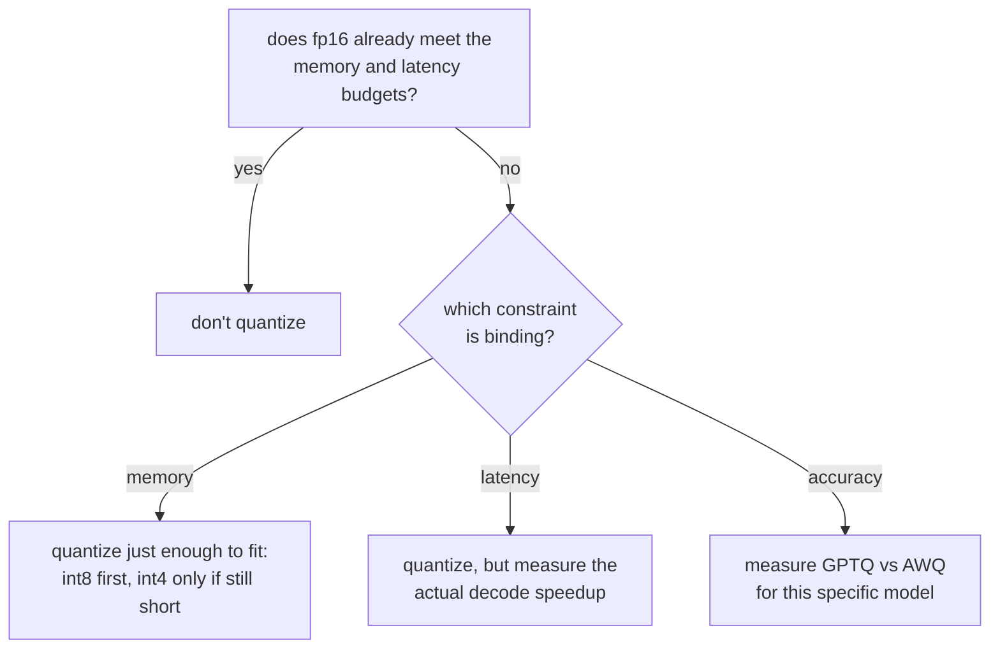

# Lição 9. Escolhendo e defendendo um esquema de quantização

**Ligação com a missão:** Este é o capstone da etapa 3: escolher um esquema de quantização e defender o trade-off significa nomear qual restrição forçou a escolha e citar os números de memória, acurácia e velocidade que as lições 7 e 8 ensinaram a encontrar.
**Fonte principal:** [Documentação: "Optimizing inference", Hugging Face Transformers](https://huggingface.co/docs/transformers/main/en/llm_optims)
**Pré-requisitos:** [Lição 8](0008-accuracy-speed-memory-tradeoffs.md), [Lição 2](0002-capacity-and-batch-size.md), [KV cache](../GLOSSARY.md)

## Aquecimento

1. ▢ Qual é a diferença central entre como o GPTQ e o AWQ decidem quais pesos proteger do erro de quantização?

Verificação

O GPTQ quantiza coluna por coluna e corrige depois o restante ainda não quantizado de uma camada. O AWQ, em vez disso, calibra antes sobre as magnitudes de ativação e protege do erro os canais que mais importam antes de quantizar.

2. ▢ Por que o ganho medido de velocidade no decode de um modelo quantizado poderia ficar aquém da sua razão de economia de memória?

Verificação

Os pesos quantizados muitas vezes precisam ser dequantizados de volta para uma precisão maior logo antes da multiplicação de matrizes, e esse overhead consome o ganho teórico, a menos que o kernel opere diretamente sobre o formato quantizado.

## Saiba isto

### Comece perguntando se o fp16 já funciona

A quantização não é um passo padrão; é uma correção para uma restrição que o fp16 não cumpre. Se os pesos em fp16 do modelo já cabem no orçamento de memória e o servidor já cumpre o seu orçamento de latência (lição 6), quantizar não compra nada de que a carga de trabalho precise, a um custo real e medido de acurácia. A primeira pergunta não é "qual esquema", é "existe algo que realmente precise ser corrigido".

### Identifique qual restrição está limitando

Quando algo de fato precisa ser corrigido, nomeie o que é, porque isso decide até onde ir:

- **Limitada por memória**: os pesos do modelo, mais a capacidade de KV cache que a lição 2 exige, não cabem na memória disponível. Quantize o suficiente para caber, e não além disso: int8 primeiro, já que é o que custa menos acurácia medida, e só desça para int4 com GPTQ ou AWQ se o int8 sozinho ainda não deixar espaço para a capacidade de cache de que a carga de trabalho precisa.
- **Limitada por latência**: o modelo cabe na memória, mas o decode é mais lento do que o orçamento declarado permite. Como o decode é limitado pela largura de banda de memória, uma pegada de pesos menor com int8 ou int4 pode ajudar, mas o ganho de velocidade real precisa ser medido (lição 8), e não presumido a partir da largura de bits.
- **Limitada por acurácia**: a carga de trabalho tem um teto de pontuação em benchmark ou de perplexidade que ela não pode cruzar. Essa restrição não descarta a quantização, mas descarta escolher um esquema só por memória ou velocidade: GPTQ e AWQ se saem de forma diferente em modelos diferentes, então o que preserva mais acurácia precisa ser medido para este modelo, e não presumido a partir de qual artigo teve números melhores em geral.

### Defender a escolha significa citar três números, não um

Uma resposta defensável a "por que este esquema" nomeia:

1. **O número de memória** que tornou a quantização necessária em primeiro lugar, ou o que mostra que ela não era (o fp16 já cabia).
2. **O número de acurácia** medido para o esquema escolhido na largura de bits escolhida: uma variação de perplexidade ou uma mudança de pontuação em benchmark em relação ao modelo não quantizado, e não uma impressão a partir de saídas de exemplo.
3. **O número de velocidade** realmente medido para a fase com que o orçamento se importa, já que a lição 8 mostrou que o ganho em tempo real não segue a razão de memória automaticamente.

Uma escolha defendida por apenas um desses não está defendida; foi chutada e teve sorte nos eixos que ninguém verificou.

## Prática

1. ▢ Uma equipe serve um modelo em uma única GPU de 80 GB. Os pesos em fp16 ocupam 70 GB, deixando 10 GB para o KV cache e o overhead do framework. Usando o raciocínio da lição 2, que problema isso cria, e qual restrição está limitando?

Verificação

10 GB de folga de cache suportam pouquíssimas sequências concorrentes em qualquer comprimento de contexto relevante, segundo a fórmula de capacidade da lição 2. Isso é uma restrição de memória: só os pesos já estão espremendo a capacidade de cache de que a carga de trabalho precisa.

2. ▢ A equipe quantiza esses pesos para int8, reduzindo-os a cerca de 35 GB. O que isso devolve, em termos do teto de capacidade da lição 2?

Verificação

Cerca de 45 GB agora disponíveis para KV cache e overhead em vez de 10 GB, o que eleva substancialmente o teto de capacidade (o máximo de sequências concorrentes que o orçamento de cache permite), já que esse teto é calculado a partir da memória que sobra depois dos pesos.

3. ▢ Depois de passar para int8, a capacidade e a latência medidas da equipe agora atendem às metas da carga de trabalho. Eles devem seguir para o int4 mesmo assim, já que liberaria ainda mais memória? Por que sim ou por que não?

Verificação

Não. Uma vez que o int8 já satisfaz as restrições de capacidade e de latência, descer ainda mais para o int4 compra memória de que ninguém precisa a um custo real e medido de acurácia que, como a lição 8 mostrou, cresce mais rápido abaixo do int8. Quantizar além do que a restrição limitante exige é o mesmo erro de quantizar quando o fp16 já cabia: pagar um custo de acurácia por uma meta que já estava cumprida.

4. ▢ Um colega defende uma escolha de quantização dizendo "int4 com AWQ dá a melhor economia de memória, então foi o que usamos". O que falta nessa defesa?

Verificação

Os outros dois números. A economia de memória sozinha não diz se a restrição que de fato estava limitando precisava do int4 em vez do int8, se a acurácia do AWQ se manteve para este modelo específico (medida, e não presumida), nem se o ganho de velocidade no decode com que o orçamento de latência desta carga de trabalho se importa foi de fato verificado. "Melhor economia de memória" defende um eixo e deixa os outros dois sem exame.

5. ▢ Qual afirmação é verdadeira sobre escolher entre int8 e int4 para uma carga de trabalho limitada por latência?

    - a) O int4 deve ser sempre preferido, já que libera mais memória
    - b) A escolha deve se basear em qual deles tem um ganho de velocidade medido, para a fase que o orçamento cobre, que de fato atinge a meta
    - c) Só a largura de bits determina o ganho de velocidade, então a razão de memória pode ser usada diretamente
    - d) Cargas de trabalho limitadas por latência nunca devem quantizar os pesos, só o KV cache

Verificação

**b)** O ganho de velocidade medido para a fase relevante, o decode na maioria dos casos limitados por latência, é o que deve decidir, já que a lição 8 mostrou que o ganho em tempo real não acompanha a razão de memória automaticamente. (a) é falsa: liberar mais memória do que a restrição exige é um custo, e não um benefício. (c) é falsa, pelo mesmo motivo de (a). (d) é falsa: a quantização de pesos acelera diretamente o decode, já que o decode é limitado pela largura de banda de memória tanto nos pesos quanto no cache.

## Prática no mundo real

- [ ] Para um modelo e um orçamento de hardware que você tenha em mente, calcule se os pesos em fp16 de fato cabem junto com uma capacidade de KV cache de que você precisaria, usando a fórmula da lição 2, antes de presumir que a quantização é necessária.
- [ ] Se a quantização for necessária, nomeie por escrito qual restrição (memória, latência ou acurácia) está limitando e qual é o número-alvo para essa restrição.
- [ ] Amanhã: encontre a escolha de quantização documentada de um deployment de serving real (um model card, um post de blog, um texto de engenharia) e verifique se ela cita um número de memória, de acurácia e de velocidade, ou apenas um dos três.

## Para ir além

- [Documentação: "Optimizing inference", Hugging Face Transformers](https://huggingface.co/docs/transformers/main/en/llm_optims)
- [Artigo científico: "GPTQ: Accurate Post-Training Quantization for Generative Pre-trained Transformers", Frantar et al., 2023](https://arxiv.org/abs/2210.17323)
- [Recursos](../RESOURCES.md)

---

Não ficou claro? Releia a fonte principal no topo, já que esta lição a comprime e é na compressão que o entendimento escapa. Consulte o [glossário](../GLOSSARY.md) para qualquer termo que pareceu escorregadio.

Se o problema é a lição em si, e não o material, isso é um defeito: [abra uma issue](https://github.com/TokenCemetery/teach/issues).
