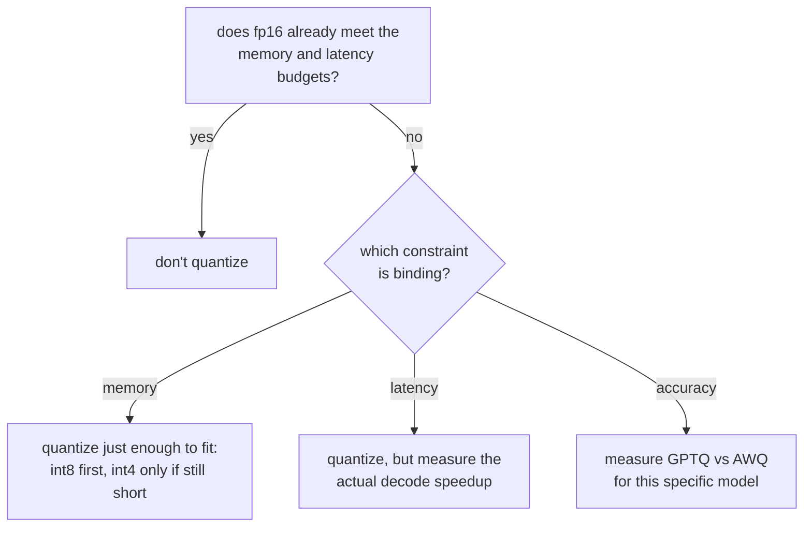

# Урок 9. Выбор и обоснование схемы квантизации

**Связь с целью курса:** Это итоговый урок этапа 3: выбрать схему квантизации и защитить компромисс значит назвать, какое ограничение вынудило выбор, и привести числа по памяти, точности и скорости, которые уроки 7 и 8 учили находить.
**Первоисточник:** [Документация: "Optimizing inference", Hugging Face Transformers](https://huggingface.co/docs/transformers/main/en/llm_optims)
**Предварительные требования:** [Урок 8](0008-accuracy-speed-memory-tradeoffs.md), [Урок 2](0002-capacity-and-batch-size.md), [KV-кеш](../GLOSSARY.md)

## Разминка

1. ▢ В чём ключевое различие между тем, как GPTQ и AWQ решают, какие веса защищать от ошибки квантизации?

Проверка

GPTQ квантизует столбец за столбцом и потом корректирует ещё не квантизованный остаток слоя. AWQ же заранее калибруется по величинам активаций и защищает от ошибки самые важные каналы до квантизации.

2. ▢ Почему измеренное ускорение декодирования квантизованной модели может не дотянуть до отношения экономии памяти?

Проверка

Квантизованные веса часто нужно деквантизовать обратно в более высокую точность прямо перед матричным умножением, и эти накладные расходы съедают теоретическое ускорение, если ядро не работает с квантизованным форматом напрямую.

## Что нужно знать

### Начните с вопроса, не работает ли уже fp16

Квантизация это не шаг по умолчанию; это исправление ограничения, которому fp16 не удовлетворяет. Если веса модели в fp16 уже помещаются в бюджет памяти, а сервер уже укладывается в бюджет задержки (урок 6), квантизация не даёт ничего, что нужно нагрузке, ценой реальной измеренной потери точности. Первый вопрос не «какая схема», а «нужно ли вообще что-то исправлять».

### Определите, какое ограничение определяющее

Когда что-то всё же нужно исправлять, назовите, что именно, потому что от этого зависит, как далеко идти:

- **Ограничение по памяти**: веса модели вместе с ёмкостью KV-кеша, которую требует урок 2, вообще не помещаются в доступную память. Квантизуйте ровно настолько, чтобы поместилось, и не дальше: сначала int8, поскольку он стоит наименьшей измеренной потери точности, и переходите к int4 с GPTQ или AWQ, только если одного int8 всё ещё не хватает на ёмкость кеша, нужную нагрузке.
- **Ограничение по задержке**: модель помещается в память, но декодирование медленнее, чем допускает заявленный бюджет. Поскольку декодирование ограничено пропускной способностью памяти, меньший объём весов от int8 или int4 может помочь, но реальное ускорение нужно измерять (урок 8), а не выводить из разрядности.
- **Ограничение по точности**: у нагрузки есть потолок балла на бенчмарке или перплексии, который нельзя пересекать. Это ограничение не исключает квантизацию, но исключает выбор схемы только по памяти или скорости: GPTQ и AWQ по-разному держатся на разных моделях, поэтому ту, что сохраняет больше точности, нужно измерять для этой модели, а не выводить из того, чьи числа в какой статье в целом выглядели лучше.

### Защитить выбор значит привести три числа, а не одно

Защитимый ответ на вопрос «почему эта схема» называет:

1. **Число по памяти**, которое сделало квантизацию необходимой, или то, которое показывает, что она не была нужна (fp16 уже помещался).
2. **Число по точности**, измеренное для выбранной схемы при выбранной разрядности: разница перплексии или изменение балла на бенчмарке относительно неквантизованной модели, а не впечатление от образцов вывода.
3. **Число по скорости**, реально измеренное для той фазы, которая интересует бюджет, поскольку урок 8 показал, что выигрыш по часам автоматически не следует отношению по памяти.

Выбор, защищённый лишь одним из них, не защищён; он угадан, и повезло на тех осях, которые никто не проверял.

## Практика

1. ▢ Команда обслуживает модель на одном GPU на 80 ГБ. Её веса в fp16 занимают 70 ГБ, оставляя 10 ГБ на KV-кеш и накладные расходы фреймворка. Рассуждая по уроку 2, какую проблему это создаёт и какое ограничение определяющее?

Проверка

10 ГБ запаса под кеш поддерживают очень мало одновременных последовательностей при сколько-нибудь осмысленной длине контекста, согласно формуле ёмкости из урока 2. Это ограничение по памяти: одни только веса вытесняют ёмкость кеша, нужную нагрузке.

2. ▢ Команда квантизует эти веса до int8, и они падают примерно до 35 ГБ. Что это возвращает с точки зрения потолка ёмкости из урока 2?

Проверка

Теперь около 45 ГБ доступно под KV-кеш и накладные расходы вместо 10 ГБ, что существенно повышает потолок ёмкости (максимальное число одновременных последовательностей, которое допускает бюджет кеша), поскольку этот потолок вычисляется из того, сколько памяти остаётся после весов.

3. ▢ После перехода на int8 измеренные ёмкость и задержка команды теперь укладываются в цели нагрузки. Стоит ли всё равно переходить на int4, раз он освободил бы ещё больше памяти? Почему да или нет?

Проверка

Нет. Раз int8 уже удовлетворяет и ограничению по ёмкости, и по задержке, переход дальше к int4 покупает память, которая никому не нужна, ценой реальной измеренной потери точности, которая, как показал урок 8, растёт быстрее ниже int8. Квантизовать дальше, чем требует определяющее ограничение, это та же ошибка, что квантизовать, когда fp16 уже помещался: платить потерей точности за цель, которая уже достигнута.

4. ▢ Коллега защищает выбор квантизации словами «int4 с AWQ даёт наибольшую экономию памяти, поэтому мы его и взяли». Чего не хватает в этой защите?

Проверка

Двух других чисел. Одна экономия памяти не говорит, нужен ли был для определяющего ограничения именно int4, а не int8, сохранилась ли точность AWQ для этой конкретной модели (измеренная, а не предполагаемая), и проверяли ли ускорение декодирования, которое интересует бюджет задержки этой нагрузки. «Наибольшая экономия памяти» защищает одну ось, оставляя две другие неисследованными.

5. ▢ Какое утверждение верно для выбора между int8 и int4 для нагрузки, ограниченной задержкой?

    - a) Всегда следует предпочитать int4, поскольку он освобождает больше памяти
    - b) Выбор должен основываться на том, у какого из них измеренное ускорение для охватываемой бюджетом фазы действительно достигает цели
    - c) Одна разрядность определяет ускорение, так что отношение по памяти можно использовать напрямую
    - d) Нагрузкам, ограниченным задержкой, никогда не следует квантизовать веса, только KV-кеш

Проверка

**b)** Решать должно измеренное ускорение для соответствующей фазы, в большинстве случаев с ограничением по задержке это декодирование, поскольку урок 8 показал, что выигрыш по часам автоматически не следует отношению по памяти. (a) неверно: освободить больше памяти, чем нужно ограничению, это издержка, а не выгода. (c) неверно по той же причине, что и (a). (d) неверно: квантизация весов напрямую ускоряет декодирование, поскольку декодирование ограничено пропускной способностью памяти как на весах, так и на кеше.

## Практика в реальной работе

- [ ] Для модели и аппаратного бюджета, которые у вас на уме, выясните, действительно ли веса в fp16 помещаются вместе с ёмкостью KV-кеша, которая вам понадобится, используя формулу урока 2, прежде чем считать квантизацию необходимой.
- [ ] Если квантизация необходима, письменно назовите, какое ограничение (память, задержка или точность) определяющее и какова целевая величина для этого ограничения.
- [ ] Завтра: найдите задокументированный выбор квантизации в реальном развёртывании (карточка модели, статья в блоге, инженерный разбор) и проверьте, приводит ли он числа по памяти, точности и скорости или только одно из трёх.

## Что почитать дальше

- [Документация: "Optimizing inference", Hugging Face Transformers](https://huggingface.co/docs/transformers/main/en/llm_optims)
- [Научная статья: "GPTQ: Accurate Post-Training Quantization for Generative Pre-trained Transformers", Frantar et al., 2023](https://arxiv.org/abs/2210.17323)
- [Ресурсы](../RESOURCES.md)

---

Не доходит? Перечитайте первоисточник в начале: этот урок его сжимает, а при сжатии понимание как раз и теряется. Загляните в [глоссарий](../GLOSSARY.md), если какой-то термин показался скользким.

Если неясен сам урок, а не материал, это дефект: [откройте issue](https://github.com/TokenCemetery/teach/issues).
