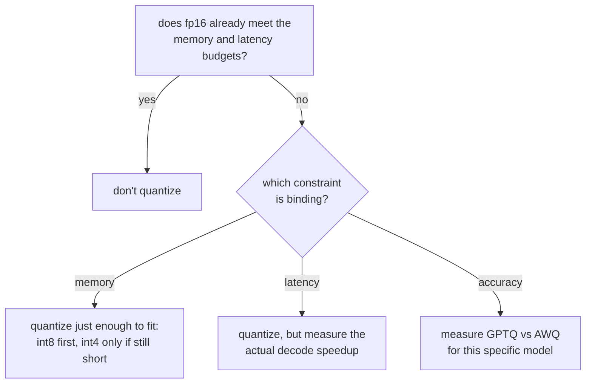

# 第 9 课：选择并为量化方案辩护

**使命关联:** 这是第 3 阶段的收官课：选择一个量化方案并为这个权衡辩护，意味着要说出是哪个约束迫使你做出这个选择，并引用第 7 和第 8 课教你如何找到的内存、精度和速度这三个数字。
**主要来源:** [文档：“Optimizing inference”，Hugging Face Transformers](https://huggingface.co/docs/transformers/main/en/llm_optims)
**前置知识:** [第 8 课](0008-accuracy-speed-memory-tradeoffs.md)、[第 2 课](0002-capacity-and-batch-size.md)、[KV 缓存](../GLOSSARY.md)

## 热身

1. ▢ GPTQ 和 AWQ 在决定保护哪些权重免受量化误差时，关键的区别是什么？

检查

GPTQ 逐列量化，之后再纠正一层中尚未量化的剩余部分。AWQ 则事先在激活幅值上做校准，在量化之前就保护最要紧的通道免受误差。

2. ▢ 为什么量化模型的实测解码加速，可能达不到它的内存节省比例？

检查

量化后的权重往往需要在矩阵乘法之前，立刻被反量化回更高的精度，这个开销会吃掉理论上的加速，除非内核能直接对量化格式进行运算。

## 要点

### 先问 fp16 是不是已经够用

量化不是默认的步骤；它是针对 fp16 满足不了的约束所做的修复。如果模型的 fp16 权重已经放得进内存预算，服务器也已经达到了延迟预算（第 6 课），那么量化就是用真实的、测出来的精度代价，去换取工作负载并不需要的东西。第一个问题不是“选哪个方案”，而是“有没有什么真的需要修复”。

### 找出起约束作用的是哪一个

当确实有东西需要修复时，要说出它是什么，因为它决定了要走多远：

- **内存受限**：模型的权重，加上第 2 课所要求的 KV 缓存容量，根本放不进可用的内存。量化到刚好放得下就够了，不要再往下：先 int8，因为它损失的实测精度最少，只有在单靠 int8 仍然没有给工作负载所需的缓存容量留出空间时，才用 GPTQ 或 AWQ 降到 int4。
- **延迟受限**：模型放得进内存，但解码比规定的预算所允许的更慢。由于解码受内存带宽限制，int8 或 int4 带来的更小的权重占用可能有帮助，但实际的加速必须测量出来（第 8 课），而不是从位宽去推断。
- **精度受限**：工作负载有一个无法越过的基准分数或困惑度上限。这个约束并不排除量化，但排除了只按内存或速度来选方案：GPTQ 和 AWQ 在不同模型上的表现不同，所以哪个保住的精度更多，必须针对这个模型去测，而不能假定按哪篇论文的数字总体上看起来更好来定。

### 为这个选择辩护，意味着要引用三个数字，而不是一个

对“为什么选这个方案”，一个站得住脚的回答要说出：

1. **让量化成为必要的那个内存数字**，或者说明它并不必要的那个数字（fp16 本来就放得下）。
2. **针对所选方案、所选位宽测得的精度数字**：相对于未量化的模型，困惑度的变化量或基准分数的变化，而不是对样例输出的印象。
3. **针对预算所关心的那个阶段实际测得的速度数字**，因为第 8 课表明，耗时上的收益并不会自动跟着内存比例走。

只靠其中一个来辩护的选择，并没有被辩护；它是猜出来的，而在没人检查的那些维度上碰巧走运了。

## 练习

1. ▢ 一个团队在一块 80 GB 的 GPU 上提供一个模型的服务。它的 fp16 权重占 70 GB，只给 KV 缓存和框架开销留下 10 GB。按第 2 课的推理，这造成了什么问题，起约束作用的是什么条件？

检查

按第 2 课的容量公式，10 GB 的缓存余量，在任何有意义的上下文长度下，只能支撑很少的并发序列。这是一个内存约束：仅权重就把工作负载所需的缓存容量挤掉了。

2. ▢ 团队把这些权重量化到 int8，降到约 35 GB。按第 2 课的容量上限，这换回了什么？

检查

现在大约有 45 GB 可用于 KV 缓存和开销，而不是 10 GB，这就大幅提高了容量上限（缓存预算所允许的最大并发序列数），因为这个上限是用权重之后剩下的内存算出来的。

3. ▢ 换成 int8 之后，团队实测的容量和延迟现在都达到了工作负载的目标。他们还应不应该继续用 int4，因为那样会腾出更多内存？为什么应该或不应该？

检查

不应该。一旦 int8 已经同时满足容量和延迟约束，再往下降到 int4，就是用真实的、测出来的精度代价（第 8 课表明它在 int8 以下增长得更快）去换没人需要的内存。量化得比起约束作用的条件所要求的更远，与在 fp16 已经放得下时还去量化，是同一个错误：为一个已经达到的目标付出精度代价。

4. ▢ 一位同事为一个量化选择辩护，说“用 AWQ 的 int4 内存节省最多，所以我们用了它”。这个辩护缺了什么？

检查

另外两个数字。光有内存节省，说明不了实际起约束作用的条件是否需要 int4 而不是 int8，说明不了 AWQ 的精度在这个具体模型上是否保住了（要测，不能假定），也说明不了这个工作负载的延迟预算所关心的解码加速，是否真的检查过。“内存节省最多”只为一个维度辩护，而把另外两个维度留着没检验。

5. ▢ 对一个延迟受限的工作负载，在 int8 与 int4 之间做选择，哪种说法是对的？

    - a) 应该总是优先选 int4，因为它腾出更多内存
    - b) 应该根据哪一个针对预算所涉及的阶段实测的加速确实达到了目标来选择
    - c) 位宽单独决定加速，所以可以直接使用内存比例
    - d) 延迟受限的工作负载永远不应该量化权重，只量化 KV 缓存

检查

**b)** 应该由相关阶段（在大多数受延迟限制的情形中是解码）的实测加速来决定，因为第 8 课表明，耗时上的收益并不会自动跟着内存比例走。(a) 是错的：腾出比约束所需更多的内存，是一种代价，而不是好处。(c) 是错的，原因与 (a) 相同。(d) 是错的：权重量化直接加快解码，因为解码不仅在缓存上，在权重上也受内存带宽限制。

## 实战练习

- [ ] 针对你心里的某个模型和硬件预算，在假定量化必不可少之前，先用第 2 课的公式，算出 fp16 权重是否真的放得进你所需的 KV 缓存容量旁边。
- [ ] 如果量化确实必要，用文字写下起约束作用的是哪个条件（内存、延迟还是精度），以及这个条件的目标数字是多少。
- [ ] 明天：找一个真实服务部署中有文档记录的量化选择（模型卡、博客文章、工程总结），检查它引用的是内存、精度和速度三个数字，还是只引用了其中一个。

## 延伸阅读

- [文档：“Optimizing inference”，Hugging Face Transformers](https://huggingface.co/docs/transformers/main/en/llm_optims)
- [论文：“GPTQ: Accurate Post-Training Quantization for Generative Pre-trained Transformers”，Frantar 等，2023](https://arxiv.org/abs/2210.17323)
- [资源](../RESOURCES.md)

---

没学明白？请重读顶部的主要来源，因为本课是对它的压缩，而理解正是在压缩中流失的。如果有哪个术语觉得含糊，可以查看[术语表](../GLOSSARY.md)。

如果问题出在课程本身，而不是学习材料，那就是一个缺陷：[提交 issue](https://github.com/TokenCemetery/teach/issues)。
