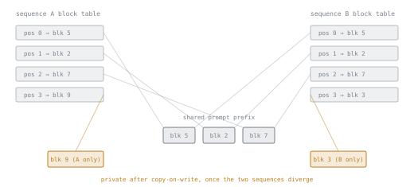

# 第 11 课：PagedAttention

**使命关联:** vLLM 的内存管理器，是让第 2 课的容量上限成为一个可移动、可共享的目标，而不是每个序列固定开销的机制，本课就是这套机制被完整点名的地方。
**主要来源:** [论文：“Efficient Memory Management for Large Language Model Serving with PagedAttention”，Kwon 等，SOSP 2023](https://arxiv.org/abs/2309.06180)
**前置知识:** [第 10 课](0010-standing-up-vllm.md)、[KV 缓存](../GLOSSARY.md)

## 热身

1. ▢ 朴素的、连续的、按最大长度定大小的 KV 缓存分配，受到哪两种碎片的困扰（第 1 课）？

检查

内部碎片：一个很短就结束的序列，仍然占着按它从未用到的最大长度预留的内存。外部碎片：大小不一的预留块之间的空隙，没有任何其他序列的缓存能放进去。

2. ▢ 用一句话说，第 1 课讲 PagedAttention 借用了操作系统虚拟内存的什么？

检查

把缓存切成固定大小的块，非连续地存放，通过每个序列各自的表，把逻辑位置映射到物理块来寻址，与操作系统页表是同一个思路。

## 要点

### 块表，再深入一层细节

每个序列的 KV 缓存被分成固定大小的**块**，每个块容纳固定数量的 token 的键和值。序列的**块表**把它的逻辑 token 位置映射到内存中的物理块位置，不管它们恰好在哪里。给定序列的注意力，通过这张表去查找它的块，而不是假定它们是连续的，正因如此，底层的内存管理器才能把块放在任何有空间的地方，就像操作系统的页表，让一个进程的内存页可以放在物理内存的任何位置一样。

### 块大小是一个权衡，不是一个随便定的参数

块更大，每个序列的块更少，块表的记账开销更小，但对于长度不能整除的序列，最后那个未填满的块里浪费的空间更多（内部碎片，只是规模远小于第 1 课那种朴素的整个序列的版本）。块更小，每个序列浪费的空间更少，但块更多，要跟踪的块表条目也更多。vLLM 默认的块大小（16 个 token）是在这两种代价之间选定的折中，而不是一个任意的数字。

### 在序列之间共享块

因为序列的块是通过它的块表间接触达的，而不是假定一个固定的物理布局，所以当内容相同时（最常见的是共享的提示词前缀），两个不同序列的块表可以指向*同一个*物理块。并行采样（对同一个提示词请求若干个补全）或束搜索是最清楚的情形：每个样本共享相同的提示词 token 的缓存，所以提示词的块在物理上只需存在一份，每个样本的块表都指向它们。当某个样本的生成与其他样本发生分歧时（任何新的、该样本特有的 token），**写时复制**会给这个样本创建它自己的、正在被修改的那个块的私有副本，这与操作系统在两个进程共享内存页、直到其中一个去写它时所用的机制完全一样。

## 练习

1. ▢ 块大小为 16 个 token，一个序列生成了 40 个 token 的输出。它用了多少个块，最后一个块里浪费了多少空间？

提示

把 40 除以 16，向上取整到整数个块；浪费的，就是最后那个未填满的块里没用上的部分。

检查

`40 / 16 = 2.5`，向上取整为 3 个块。前两个装 32 个 token；第三个装剩下的 8 个，浪费了该块里另外 8 个槽位，也就是在一个块的规模上，而不是一整个序列的规模上的内部碎片。

2. ▢ 为什么更小的块大小会减少这种浪费的空间，它又要以什么作为交换的代价？

检查

块更小，意味着最后那个未填满的块里可浪费的未使用槽位更少，因为每个块一开始就只有更少的位置。代价是每个序列总体上有更多的块，因此内存管理器需要跟踪和查找的块表条目也更多。

3. ▢ 从同一个 200 个 token 的提示词请求 10 个并行样本，块大小为 16 个 token。有块共享和没有块共享时，提示词的缓存各需要多少个物理块？

提示

先算出一份 200 个 token 的提示词需要多少个块，再判断在每种情况下存在多少份拷贝。

检查

`200 / 16 = 12.5`，一份提示词拷贝向上取整为 13 个块。不共享时，10 个样本各自持有自己的拷贝：`13 × 10 = 130` 个块。共享时，每个样本的块表都指向共享提示词的同样 13 个物理块，所以在任何样本开始生成它自己分歧的 token 之前，只需要 13 个块。

4. ▢ 第 3 题的十个样本中，有一个在某个位置生成的 token，与其他任何样本在该位置生成的都不同。到这时，那个样本的缓存会怎样？

检查

会触发写时复制：那个样本得到它正在写入的那个块的私有副本，而不是去修改其他每个样本的表仍然指向的共享块。只有发生分歧的那个样本要为新的块付出代价；其余九个继续共享原来的块。

5. ▢ 关于 vLLM 的块大小选择，哪种说法是对的？

    - a) 更大的块总是比更小的块浪费更多内存，没有任何抵消的好处
    - b) 块大小是在内部碎片与块表记账开销之间做权衡
    - c) 块大小只影响并行采样的工作负载，不影响单个请求的服务
    - d) 更小的块大小总是增加总内存使用量

检查

**b)** 更小的块在未填满的最后一个块里浪费的空间更少，但需要跟踪更多的块表条目；更大的块则相反。(a) 是错的：更大的块降低了记账开销，这是实实在在的好处。(c) 是错的：每个序列，无论是否共享，都被分成块，也都要承担碎片与记账的权衡。(d) 是错的：更小的块减少内部碎片，这可以降低总内存使用量，而不是总是提高它。

## 实战练习

- [ ] 在 vLLM 的文档里找到块大小的参数或配置项，读一读它的默认值是多少，以及文档对修改它是怎么说的。
- [ ] 如果你能运行一台服务器，对同一个提示词发送若干并行采样请求（`n` 大于 1），看看文档或日志里有没有报告关于前缀或块共享的任何信息。
- [ ] 明天：读一段关于前缀缓存的文字（在原本互不相关的请求之间，复用共享系统提示词的块），记下它怎样是同一个块共享的思路，只是应用在请求之间，而不是一个请求之内。

## 延伸阅读

- [论文：“Efficient Memory Management for Large Language Model Serving with PagedAttention”，Kwon 等，SOSP 2023](https://arxiv.org/abs/2309.06180)
- [文档：vLLM Documentation，vLLM Project](https://docs.vllm.ai/en/latest/)
- [资源](../RESOURCES.md)

---

没学明白？请重读顶部的主要来源，因为本课是对它的压缩，而理解正是在压缩中流失的。如果有哪个术语觉得含糊，可以查看[术语表](../GLOSSARY.md)。

如果问题出在课程本身，而不是学习材料，那就是一个缺陷：[提交 issue](https://github.com/TokenCemetery/teach/issues)。
