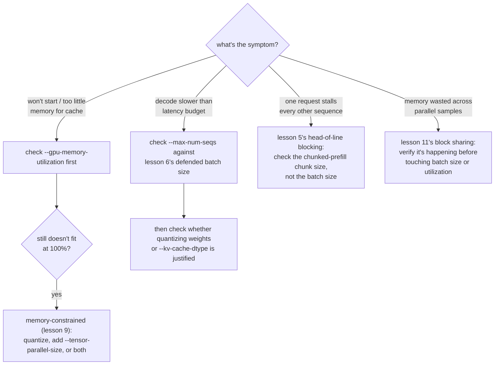

# Lección 12. Los parámetros de ajuste de vLLM que importan

**Vínculo con la misión:** Este es el cierre de la etapa 4: un stack de vLLM que responde solicitudes reales (lección 10) sigue necesitando ajuste frente a cualquier síntoma que produzca una carga de trabajo real, y eso significa saber a cuál de los conceptos de este espacio de trabajo remite realmente un síntoma dado.
**Fuente principal:** [Docs: vLLM Documentation, vLLM Project](https://docs.vllm.ai/en/latest/)
**Requisitos previos:** [Lección 11](0011-pagedattention.md), [Lección 2](0002-capacity-and-batch-size.md), [KV cache](../GLOSSARY.md)

## Calentamiento

1. ▢ Escribe de memoria la fórmula del techo de capacidad de la lección 2.

Comprobación

`max concurrent sequences = (total memory − weights − overhead) / (bytes per token × context length)`.

2. ▢ ¿Con qué tres cifras dice la lección 9 que hay que defender una elección de cuantización?

Comprobación

La cifra de memoria que hizo necesaria la cuantización (o muestra que no lo era), la cifra de precisión medida para el esquema elegido y la cifra de velocidad realmente medida para la fase que importa.

## Qué debes saber

### Un parámetro que cambia lo que significa "memoria total"

La fórmula de la lección 2 asume que la "memoria total" es con lo que cuente el servidor, pero vLLM no reclama por defecto una GPU entera: `--gpu-memory-utilization` fija la fracción de la memoria de una GPU que vLLM puede usar para pesos, KV cache y su propia sobrecarga, con un valor por defecto de en torno a 0.9. En una GPU de 80 GB, ese valor por defecto significa que unos 72 GB son la "memoria total" que debería usar realmente la fórmula de la lección 2, no 80 GB. Subir esta fracción hacia 1.0 da más espacio a la caché, lo que eleva el techo de capacidad, pero deja menos margen para cualquier otra cosa que comparta la GPU (otros procesos, la sobrecarga del asignador, un pico de memoria), intercambiando capacidad por margen de seguridad.

### Un parámetro para cuando los propios pesos no caben en ningún sitio

La cuantización (lecciones 7 a 9) es una respuesta a unos pesos que no caben; `--tensor-parallel-size` es otra, ortogonal. Divide los pesos de un modelo, y el cómputo sobre ellos, entre varias GPU, de modo que un modelo de 70B cuyos pesos en fp16 necesitan 140 GB puede ejecutarse en dos GPU de 80 GB (`--tensor-parallel-size 2`) aunque ninguna GPU por sí sola pudiera contenerlo. Esto no reduce el modelo como lo hace la cuantización; lo reparte, y se puede combinar con la cuantización en lugar de sustituirla, cuando la memoria de una sola GPU, incluso tras cuantizar, sigue sin bastar.

### Un procedimiento de decisión: haz coincidir el síntoma con el parámetro

Ajustar un servidor en funcionamiento es diagnosticar, no adivinar. Cada síntoma de abajo apunta al concepto de una lección concreta, no a un parámetro al azar que probar:

- **El servidor no arranca, o reporta muy poca memoria para la caché**: revisa primero `--gpu-memory-utilization`; el techo artificial que fija puede ser menor que la memoria libre real de la GPU. Si ni siquiera con el 100% de utilización caben los pesos, es el caso limitado por memoria de la lección 9: cuantiza, añade `--tensor-parallel-size`, o ambos.
- **El decode es más lento que el presupuesto de latencia**: revisa `--max-num-seqs` frente al tamaño de lote defendido en la lección 6, y luego comprueba si cuantizar los pesos (lecciones 7 a 9) o la caché (`--kv-cache-dtype`, lección 3) es lo que justifican realmente las cifras medidas.
- **Una solicitud detiene los tokens de todas las demás secuencias**: es el head-of-line blocking de la lección 5; revisa el tamaño de chunk del chunked prefill, no el tamaño de lote.
- **La memoria parece desperdiciada entre muchas muestras paralelas del mismo prompt**: es la compartición de bloques de la lección 11; verifica que realmente está ocurriendo antes de recurrir primero a un cambio del tamaño de lote o de la utilización de memoria.

## Práctica

1. ▢ Un servidor no arranca con "not enough memory for KV cache", aunque su GPU de 80 GB solo tiene 20 GB de pesos cargados. ¿Qué parámetro es lo primero que hay que revisar, y qué sacrifica subirlo?

Pista

Pregúntate qué fracción de la memoria de la GPU se le dijo realmente a vLLM que podía usar.

Comprobación

`--gpu-memory-utilization`. Con su valor por defecto de en torno a 0.9, solo unos 72 GB de los 80 GB están disponibles para vLLM, así que la caché puede estar asfixiada por un techo artificial y no por una escasez real. Subirlo hacia 1.0 libera más de la GPU para pesos y caché, pero deja menos margen para cualquier otra cosa en esa GPU, con riesgo de un fallo por falta de memoria si algo más necesita memoria también.

2. ▢ Los pesos en fp16 de un modelo de 70B (unos 140 GB) no caben en absoluto en una sola GPU de 80 GB, ni siquiera antes de considerar ninguna KV cache. Además de cuantizar los pesos, ¿qué otro parámetro de vLLM aborda esto, y en qué se diferencia de la cuantización?

Comprobación

`--tensor-parallel-size`, fijado para dividir el modelo entre varias GPU (por ejemplo, 2 para dos GPU de 80 GB). Se diferencia de la cuantización en el mecanismo: la cuantización reduce el propio modelo, a un costo de precisión; el tensor parallelism reparte los pesos y el cómputo del mismo modelo sin reducir entre la memoria combinada de más GPU, sin costo de precisión, a cambio de necesitar más GPU.

3. ▢ La latencia de decode de un servidor es buena, pero una solicitud concreta con un prompt muy largo hace que el siguiente token de cada otra solicitud en curso llegue tarde. ¿Qué parámetro de este espacio de trabajo aborda ese síntoma, y cuál no?

Comprobación

Lo aborda el tamaño de chunk del chunked prefill, ya que es el head-of-line blocking de la lección 5: un prefill grande metido en un paso de lote atómico retrasa a todos los que comparten ese paso. `--max-num-seqs` no lo aborda; el tope de tamaño de lote controla cuántas secuencias comparten un paso, no cuánto del trabajo de prefill de una secuencia cae en un solo paso.

4. ▢ ¿Qué afirmación es verdadera de `--gpu-memory-utilization` y `--tensor-parallel-size`?

    - a) Ambos reducen la huella de memoria del propio modelo, como lo hace la cuantización
    - b) `--gpu-memory-utilization` fija cuánto de una GPU puede usar vLLM; `--tensor-parallel-size` reparte el modelo entre varias GPU
    - c) `--tensor-parallel-size` solo es útil para stacks de serving en CPU como llama.cpp
    - d) Subir `--gpu-memory-utilization` no tiene ningún compromiso; siempre debería fijarse en 1.0

Comprobación

**b)** Eso es exactamente lo que hace cada parámetro. (a) es falsa: ninguno reduce el modelo; uno acota la fracción utilizable de una sola GPU, el otro reparte el modelo sin reducir entre GPU. (c) es falsa: el tensor parallelism es una técnica de serving multidispositivo en GPU. (d) es falsa: subirlo hacia 1.0 sacrifica margen para cualquier otra cosa que pueda necesitar memoria en esa GPU.

## Prácticas en el mundo real

- [ ] Encuentra `--gpu-memory-utilization` y `--tensor-parallel-size` en la documentación de vLLM y lee qué dicen el valor por defecto y las advertencias de cada uno.
- [ ] Para un modelo y un número de GPU que tengas en mente, calcula si harían falta tensor parallelism, cuantización o ambos para que quepan siquiera los pesos, con la aritmética simple de la lección 1.
- [ ] Mañana: si tienes un servidor en ejecución, baja deliberadamente `--gpu-memory-utilization` a algo pequeño (como 0.5) y observa qué ocurre con el techo de capacidad o con el comportamiento de arranque.

## Para profundizar

- [Docs: vLLM Documentation, vLLM Project](https://docs.vllm.ai/en/latest/)
- [Paper: "Efficient Memory Management for Large Language Model Serving with PagedAttention", Kwon et al., SOSP 2023](https://arxiv.org/abs/2309.06180)
- [Recursos](../RESOURCES.md)

---

¿No termina de quedar claro? Vuelve a leer la fuente primaria de arriba, ya que esta lección la comprime y en la compresión es donde se escapa la comprensión. Consulta el [glosario](../GLOSSARY.md) por si algún término te resultó resbaladizo.

Si lo poco claro es la propia lección y no el material, eso es un defecto: [abre un issue](https://github.com/TokenCemetery/teach/issues).
