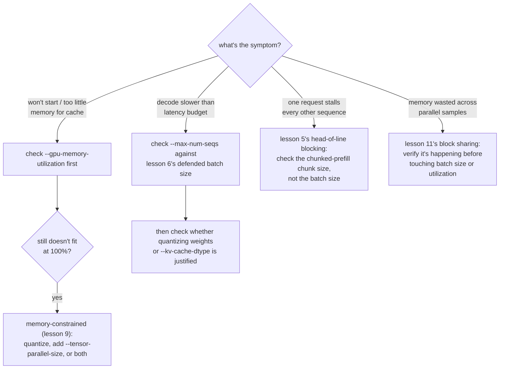

# Leçon 12. Les paramètres de réglage de vLLM qui comptent

**Lien avec la mission :** C'est la synthèse de l'étape 4 : une pile vLLM qui répond à de vraies requêtes (leçon 10) doit encore être réglée face au symptôme que produit une vraie charge de travail, ce qui exige de savoir à quel concept de cet espace de travail un symptôme donné renvoie réellement.
**Source primaire :** [Doc : vLLM Documentation, vLLM Project](https://docs.vllm.ai/en/latest/)
**Prérequis :** [Leçon 11](0011-pagedattention.md), [Leçon 2](0002-capacity-and-batch-size.md), [KV cache](../GLOSSARY.md)

## Échauffement

1. ▢ Écrivez de mémoire la formule du plafond de capacité de la leçon 2.

Vérifier

`max concurrent sequences = (total memory − weights − overhead) / (bytes per token × context length)`.

2. ▢ Avec quels trois chiffres la leçon 9 dit-elle qu'un choix de quantification doit être défendu ?

Vérifier

Le chiffre de mémoire qui a rendu la quantification nécessaire (ou qui montre qu'elle ne l'était pas), le chiffre de précision mesuré pour le schéma choisi, et le chiffre de vitesse réellement mesuré pour la phase qui compte.

## À savoir

### Une option qui change le sens de « mémoire totale »

La formule de la leçon 2 suppose que la « mémoire totale » est tout ce dont le serveur dispose, mais vLLM ne réclame pas par défaut un GPU entier : `--gpu-memory-utilization` fixe la fraction de la mémoire d'un GPU que vLLM a le droit d'utiliser pour les poids, le KV cache et son propre surcoût, avec une valeur par défaut d'environ 0.9. Sur un GPU de 80 GB, cette valeur par défaut signifie qu'environ 72 GB est la « mémoire totale » que la formule de la leçon 2 doit réellement utiliser, et non 80 GB. Relever cette fraction vers 1.0 donne plus de place au cache, ce qui relève le plafond de capacité, mais laisse moins de marge pour tout ce qui partage le GPU (d'autres processus, le surcoût de l'allocateur, un pic de mémoire), en échangeant de la capacité contre de la marge de sécurité.

### Une option pour quand les poids eux-mêmes ne tiennent nulle part

La quantification (leçons 7 à 9) est une réponse aux poids qui ne tiennent pas ; `--tensor-parallel-size` en est une autre, orthogonale. Elle répartit les poids d'un modèle, et le calcul sur eux, entre plusieurs GPU, si bien qu'un modèle 70B dont les poids fp16 demandent 140 GB peut tourner sur deux GPU de 80 GB (`--tensor-parallel-size 2`) bien qu'aucun GPU seul ne puisse le contenir. Cela ne réduit pas le modèle comme le fait la quantification ; cela l'étale, et cela peut se combiner avec la quantification au lieu de la remplacer, quand la mémoire d'un seul GPU, même après quantification, ne suffit toujours pas.

### Une procédure de décision : associer le symptôme au paramètre

Régler un serveur en fonctionnement, c'est du diagnostic, pas des tâtonnements. Chaque symptôme ci-dessous renvoie au concept d'une leçon précise, et non à une option au hasard à essayer :

- **Le serveur ne démarre pas, ou signale trop peu de mémoire pour le cache** : vérifiez d'abord `--gpu-memory-utilization` ; le plafond artificiel qu'elle fixe peut être inférieur à la vraie mémoire libre du GPU. Si même 100 % d'utilisation ne permet pas de faire tenir les poids, c'est le cas contraint par la mémoire de la leçon 9 : quantifiez, ajoutez `--tensor-parallel-size`, ou les deux.
- **Le decode est plus lent que le budget de latence** : vérifiez `--max-num-seqs` par rapport à la taille de batch défendue à la leçon 6, puis vérifiez si quantifier les poids (leçons 7 à 9) ou le cache (`--kv-cache-dtype`, leçon 3) est ce que les chiffres mesurés justifient réellement.
- **Une requête bloque les tokens de toutes les autres séquences** : c'est le head-of-line blocking de la leçon 5 ; vérifiez la taille de morceau du chunked prefill, pas la taille de batch.
- **La mémoire semble gaspillée sur de nombreux échantillons parallèles du même prompt** : c'est le partage de blocs de la leçon 11 ; vérifiez qu'il a bien lieu avant de toucher d'abord à la taille de batch ou à l'utilisation de la mémoire.

## Pratique

1. ▢ Un serveur échoue au démarrage avec « not enough memory for KV cache », alors que son GPU de 80 GB n'a que 20 GB de poids chargés. Quelle option est la première à vérifier, et que sacrifie-t-on en la relevant ?

Indice

Demandez-vous quelle fraction de la mémoire du GPU on a réellement dit à vLLM qu'il pouvait utiliser.

Vérifier

`--gpu-memory-utilization`. À sa valeur par défaut d'environ 0.9, seuls environ 72 GB sur 80 GB sont disponibles pour vLLM, donc le cache peut être privé de mémoire par un plafond artificiel plutôt que par une vraie pénurie. La relever vers 1.0 libère davantage du GPU pour les poids et le cache, mais laisse moins de marge pour tout le reste sur ce GPU, avec le risque d'un échec par manque de mémoire si autre chose a aussi besoin de mémoire.

2. ▢ Les poids fp16 d'un modèle 70B (environ 140 GB) ne tiennent pas du tout sur un seul GPU de 80 GB, avant même de considérer un KV cache. Outre la quantification des poids, quelle autre option de vLLM répond à ce problème, et en quoi diffère-t-elle de la quantification ?

Vérifier

`--tensor-parallel-size`, réglée pour répartir le modèle sur plusieurs GPU (par exemple, 2 pour deux GPU de 80 GB). Elle diffère de la quantification par son mécanisme : la quantification réduit le modèle lui-même, au prix de la précision ; le parallélisme tensoriel étale les poids et le calcul du même modèle, non réduit, sur la mémoire combinée de davantage de GPU, sans coût de précision, au prix de devoir disposer de plus de GPU.

3. ▢ La latence de decode d'un serveur est bonne, mais une requête particulière avec un très long prompt fait arriver en retard le token suivant de chaque autre requête en cours. Quelle option de cet espace de travail répond à ce symptôme, et laquelle n'y répond pas ?

Vérifier

La taille de morceau du chunked prefill y répond, puisque c'est le head-of-line blocking de la leçon 5 : un gros prefill intégré à une seule étape de batch atomique retarde tous ceux qui partagent cette étape. `--max-num-seqs` n'y répond pas ; le plafond de taille de batch contrôle combien de séquences partagent une étape, pas quelle part du travail de prefill d'une séquence atterrit dans une seule étape.

4. ▢ Laquelle de ces affirmations est vraie à propos de `--gpu-memory-utilization` et de `--tensor-parallel-size` ?

    - a) Les deux réduisent l'empreinte mémoire du modèle lui-même, comme le fait la quantification
    - b) `--gpu-memory-utilization` fixe la part d'un GPU que vLLM peut utiliser ; `--tensor-parallel-size` répartit le modèle sur plusieurs GPU
    - c) `--tensor-parallel-size` n'est utile que pour les piles de serving CPU comme llama.cpp
    - d) Relever `--gpu-memory-utilization` n'a pas de contrepartie ; elle devrait toujours être réglée à 1.0

Vérifier

**b)** C'est exactement ce que fait chaque option. (a) est fausse : aucune ne réduit le modèle ; l'une borne la fraction utilisable d'un seul GPU, l'autre étale le modèle non réduit sur plusieurs GPU. (c) est fausse : le parallélisme tensoriel est une technique de serving GPU multi-appareils. (d) est fausse : la relever vers 1.0 sacrifie de la marge pour tout ce qui pourrait avoir besoin de mémoire sur ce GPU.

## Exercices en situation réelle

- [ ] Trouvez `--gpu-memory-utilization` et `--tensor-parallel-size` dans la documentation de vLLM et lisez ce que disent la valeur par défaut et les avertissements de chacune.
- [ ] Pour un modèle et un nombre de GPU que vous avez en tête, déterminez si le parallélisme tensoriel, la quantification, ou les deux seraient nécessaires pour faire tenir les poids, avec l'arithmétique simple de la leçon 1.
- [ ] Demain : si vous avez un serveur en fonctionnement, abaissez délibérément `--gpu-memory-utilization` à une petite valeur (comme 0.5) et observez ce qui arrive au plafond de capacité ou au comportement au démarrage.

## Pour aller plus loin

- [Doc : vLLM Documentation, vLLM Project](https://docs.vllm.ai/en/latest/)
- [Article : "Efficient Memory Management for Large Language Model Serving with PagedAttention", Kwon et al., SOSP 2023](https://arxiv.org/abs/2309.06180)
- [Ressources](../RESOURCES.md)

---

Ça ne passe pas ? Relisez la source primaire en haut de page, car cette leçon la condense et c'est dans la condensation que la compréhension s'échappe. Consultez le [glossaire](../GLOSSARY.md) pour tout terme qui vous a paru glissant.

Si c'est la leçon elle-même qui n'est pas claire plutôt que la matière, c'est un défaut : [ouvrez une issue](https://github.com/TokenCemetery/teach/issues).
