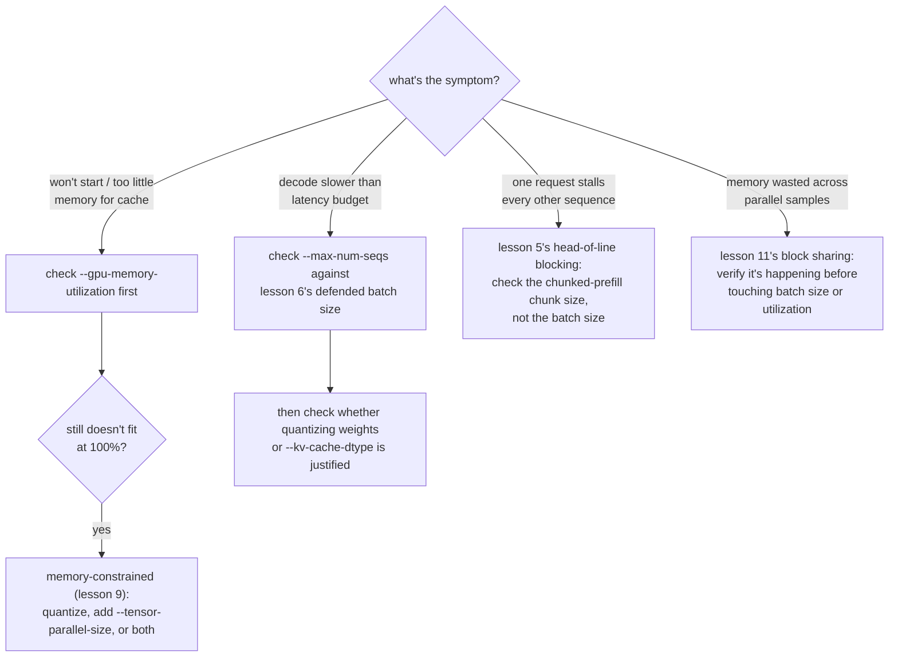

# पाठ 12. vLLM के ज़रूरी Tuning Knobs

**मिशन से संबंध:** यह चरण 4 का समापन है: असली requests का जवाब देता vLLM stack (पाठ 10) फिर भी असली workload जो भी लक्षण पैदा करे उसके विरुद्ध tune होना चाहता है, और इसका मतलब है यह जानना कि कोई लक्षण असल में इस workspace की किस अवधारणा की ओर लौटकर इशारा करता है।
**मुख्य स्रोत:** [दस्तावेज़: vLLM Documentation, vLLM Project](https://docs.vllm.ai/en/latest/)
**पूर्व-आवश्यकताएँ:** [पाठ 11](0011-pagedattention.md), [पाठ 2](0002-capacity-and-batch-size.md), [KV cache](../GLOSSARY.md)

## वार्म-अप

1. ▢ पाठ 2 का capacity सीमा वाला formula याददाश्त से लिखें।

जाँचें

`max concurrent sequences = (total memory − weights − overhead) / (bytes per token × context length)`।

2. ▢ पाठ 9 के अनुसार quantization के चुनाव का बचाव किन तीन संख्याओं से होना चाहिए?

जाँचें

वह memory का आँकड़ा जिसने quantization को ज़रूरी बनाया (या दिखाता है कि वह ज़रूरी नहीं था), चुनी गई scheme के लिए नापी गई accuracy की संख्या, और उस चरण के लिए असल में नापी गई speed की संख्या जो मायने रखता है।

## यह जानें

### एक flag जो "total memory" का मतलब बदल देता है

पाठ 2 का formula मानता है कि "total memory" वह सब है जिसके साथ server को काम करना है, पर vLLM default रूप से पूरा GPU नहीं माँगता: `--gpu-memory-utilization` तय करता है कि vLLM को weights, KV cache और अपने overhead के लिए GPU की memory का कितना हिस्सा इस्तेमाल करने की अनुमति है, default लगभग 0.9। 80 GB GPU पर इस default का मतलब है कि पाठ 2 के formula को असल में लगभग 72 GB "total memory" की तरह इस्तेमाल करना चाहिए, 80 GB नहीं। इस हिस्से को 1.0 की ओर बढ़ाने से cache को ज़्यादा जगह मिलती है, जिससे capacity सीमा बढ़ती है, पर उसी GPU को साझा करने वाली किसी और चीज़ (दूसरे processes, allocator का overhead, memory का अचानक उछाल) के लिए गुंजाइश घटती है, यानी capacity के बदले सुरक्षा margin का सौदा।

### एक flag तब के लिए जब weights ख़ुद कहीं नहीं समाते

Quantization (पाठ 7 से 9) उन weights का एक जवाब है जो समाते नहीं; `--tensor-parallel-size` दूसरा, स्वतंत्र जवाब है। वह model के weights को, और उन पर होने वाले compute को, कई GPUs में बाँट देता है, इसलिए 70B model जिसके fp16 weights को 140 GB चाहिए, दो 80 GB GPUs पर चल सकता है (`--tensor-parallel-size 2`) भले ही कोई अकेला GPU उसे न रख सके। यह model को quantization की तरह छोटा नहीं करता; यह उसे फैलाता है, और इसे quantization के साथ जोड़ा जा सकता है, उसकी जगह नहीं रखा जाता, जब quantize करने के बाद भी एक GPU की memory काफ़ी न हो।

### फ़ैसला लेने की प्रक्रिया: लक्षण को knob से मिलाएँ

चलते server को tune करना निदान है, अंदाज़ा नहीं। नीचे का हर लक्षण किसी ख़ास पाठ की अवधारणा की ओर इशारा करता है, आज़माने के लिए कोई बेतरतीब flag नहीं:

- **Server शुरू नहीं होता, या cache के लिए बहुत कम memory बताता है**: पहले `--gpu-memory-utilization` जाँचें; उसकी बनाई कृत्रिम सीमा GPU की असली मुफ़्त memory से कम हो सकती है। अगर 100% utilization पर भी weights नहीं समाते, तो यह पाठ 9 का memory-बाधित मामला है: quantize करें, `--tensor-parallel-size` जोड़ें, या दोनों।
- **Decode latency budget से धीमा है**: `--max-num-seqs` को पाठ 6 के बचाव किए गए batch size के विरुद्ध जाँचें, फिर जाँचें कि weights को (पाठ 7 से 9) या cache को (`--kv-cache-dtype`, पाठ 3) quantize करना वही है जिसे नापी गई संख्याएँ असल में सही ठहराती हैं।
- **एक request हर दूसरे sequence के tokens को रोक देती है**: यह पाठ 5 की head-of-line blocking है; chunked-prefill का chunk size जाँचें, batch size नहीं।
- **एक ही prompt के कई parallel samples में memory बरबाद दिखती है**: यह पाठ 11 की block sharing है; पहले batch-size या memory-utilization बदलने की ओर बढ़ने के बजाय जाँचें कि वह सचमुच हो रही है।

## अभ्यास

1. ▢ एक server "KV cache के लिए पर्याप्त memory नहीं" के साथ शुरू होने में फ़ेल हो जाता है, जबकि उसके 80 GB GPU पर सिर्फ़ 20 GB weights load हैं। सबसे पहले कौन-सा flag जाँचना है, और उसे बढ़ाने से क्या छोड़ना पड़ता है?

संकेत

पूछें कि vLLM को असल में बताया गया था कि वह GPU की memory का कितना हिस्सा इस्तेमाल कर सकता है।

जाँचें

`--gpu-memory-utilization`। लगभग 0.9 के default पर, 80 GB में से सिर्फ़ करीब 72 GB ही vLLM को मिलती है, इसलिए cache असली कमी से नहीं बल्कि एक कृत्रिम सीमा से भूखा हो सकता है। उसे 1.0 की ओर बढ़ाने से weights और cache के लिए GPU का ज़्यादा हिस्सा खुलता है, पर उस GPU पर किसी और चीज़ के लिए गुंजाइश घटती है, और अगर किसी और को भी memory चाहिए तो out-of-memory फ़ेल होने का जोखिम रहता है।

2. ▢ 70B model के fp16 weights (लगभग 140 GB) अकेले 80 GB GPU पर समाते ही नहीं, किसी भी KV cache पर विचार से पहले ही। Weights quantize करने के अलावा, इसे कौन-सा दूसरा vLLM flag सँभालता है, और वह quantization से कैसे अलग है?

जाँचें

`--tensor-parallel-size`, model को कई GPUs में बाँटने के लिए सेट किया जाता है (उदाहरण के लिए, दो 80 GB GPUs के लिए 2)। यह तंत्र के हिसाब से quantization से अलग है: quantization model को ख़ुद छोटा करता है, accuracy की क़ीमत पर; tensor parallelism उसी, बिना छोटे किए model के weights और compute को ज़्यादा GPUs की मिली-जुली memory में फैलाता है, accuracy की कोई क़ीमत नहीं, बस ज़्यादा GPUs चाहिए।

3. ▢ Server की decode latency ठीक है, पर बहुत लंबे prompt वाली एक ख़ास request की वजह से हर दूसरी चल रही request का अगला token देर से आता है। इस workspace का कौन-सा flag इस लक्षण को सँभालता है, और कौन-सा नहीं?

जाँचें

Chunked-prefill का chunk size इसे सँभालता है, क्योंकि यह पाठ 5 की head-of-line blocking है: एक अविभाज्य batch step में समेटा गया बड़ा prefill उस step को साझा करने वाले सबको देर करता है। `--max-num-seqs` इसे नहीं सँभालता; batch size की सीमा यह नियंत्रित करती है कि कितने sequences एक step साझा करें, यह नहीं कि किसी एक sequence के prefill काम का कितना हिस्सा एक अकेले step में आए।

4. ▢ `--gpu-memory-utilization` और `--tensor-parallel-size` के बारे में कौन-सा दावा सही है?

    - a) दोनों model का अपना memory footprint घटाते हैं, quantization की तरह
    - b) `--gpu-memory-utilization` तय करता है कि vLLM एक GPU का कितना इस्तेमाल कर सकता है; `--tensor-parallel-size` model को कई GPUs में फैलाता है
    - c) `--tensor-parallel-size` सिर्फ़ llama.cpp जैसे CPU serving stacks के लिए उपयोगी है
    - d) `--gpu-memory-utilization` बढ़ाने में कोई trade-off नहीं; उसे हमेशा 1.0 रखना चाहिए

जाँचें

**b)** हर flag ठीक यही करता है। (a) ग़लत है: कोई भी model को छोटा नहीं करता; एक अकेले GPU का इस्तेमाल-योग्य हिस्सा बाँधता है, दूसरा बिना छोटे किए model को GPUs में फैलाता है। (c) ग़लत है: tensor parallelism GPU multi-device serving की तकनीक है। (d) ग़लत है: उसे 1.0 की ओर बढ़ाने से उस GPU पर किसी और चीज़ को memory चाहिए तो उसकी गुंजाइश कम हो जाती है।

## असली दुनिया का अभ्यास

- [ ] vLLM के दस्तावेज़ों में `--gpu-memory-utilization` और `--tensor-parallel-size` ढूँढें और पढ़ें कि हर एक की default value और चेतावनियाँ क्या कहती हैं।
- [ ] अपने सोचे हुए किसी model और GPU संख्या के लिए, पाठ 1 के सादे अंकगणित से निकालें कि weights समाने के लिए tensor parallelism, quantization या दोनों की ज़रूरत पड़ेगी या नहीं।
- [ ] कल: अगर आपके पास चलता server है, तो `--gpu-memory-utilization` को जानबूझकर किसी छोटी संख्या (जैसे 0.5) पर घटाएँ और देखें कि capacity सीमा या startup के व्यवहार का क्या होता है।

## आगे बढ़ने के लिए

- [दस्तावेज़: vLLM Documentation, vLLM Project](https://docs.vllm.ai/en/latest/)
- [पेपर: "Efficient Memory Management for Large Language Model Serving with PagedAttention", Kwon et al., SOSP 2023](https://arxiv.org/abs/2309.06180)
- [संसाधन](../RESOURCES.md)

---

बात नहीं बन रही? ऊपर दिए मुख्य स्रोत को दोबारा पढ़ें, क्योंकि यह पाठ उसे संक्षिप्त करता है और समझ संक्षेप में ही रिसती है। जो शब्द फिसलन भरा लगे, उसके लिए [शब्दावली](../GLOSSARY.md) देखें।

अगर दिक़्क़त सामग्री की नहीं बल्कि पाठ की ही है, तो वह एक खोट है: [issue खोलें](https://github.com/TokenCemetery/teach/issues)।
