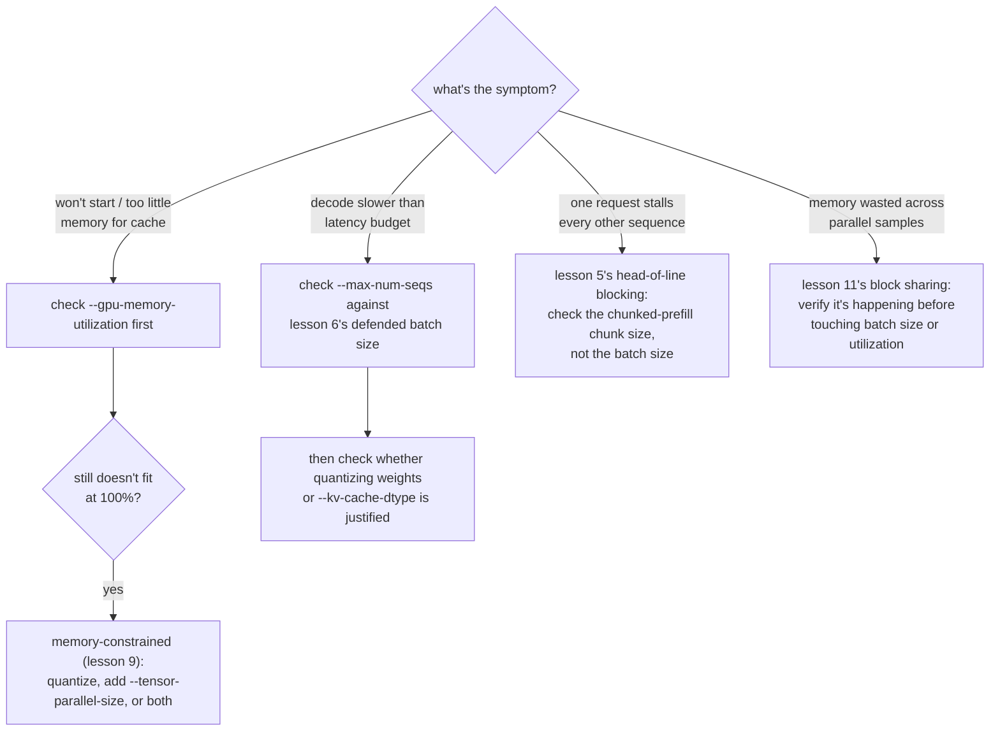

# Lição 12. Os parâmetros de ajuste do vLLM que importam

**Ligação com a missão:** Este é o capstone da etapa 4: uma stack vLLM respondendo a requisições reais (lição 10) ainda precisa ser ajustada contra qualquer sintoma que uma carga de trabalho real produza, e isso significa saber a qual dos conceitos deste workspace um dado sintoma realmente remete.
**Fonte principal:** [Documentação: vLLM Documentation, vLLM Project](https://docs.vllm.ai/en/latest/)
**Pré-requisitos:** [Lição 11](0011-pagedattention.md), [Lição 2](0002-capacity-and-batch-size.md), [KV cache](../GLOSSARY.md)

## Aquecimento

1. ▢ Escreva de memória a fórmula do teto de capacidade da lição 2.

Verificação

`max concurrent sequences = (total memory − weights − overhead) / (bytes per token × context length)`.

2. ▢ Com que três números a lição 9 diz que uma escolha de quantização precisa ser defendida?

Verificação

O número de memória que tornou a quantização necessária (ou mostra que não era), o número de acurácia medido para o esquema escolhido e o número de velocidade realmente medido para a fase que importa.

## Saiba isto

### Uma flag que muda o que "memória total" significa

A fórmula da lição 2 pressupõe que "memória total" é tudo com que o servidor tem para trabalhar, mas o vLLM não reivindica por padrão uma GPU inteira: `--gpu-memory-utilization` define a fração da memória de uma GPU que o vLLM pode usar para pesos, KV cache e o seu próprio overhead, com padrão de cerca de 0,9. Em uma GPU de 80 GB, esse padrão significa que cerca de 72 GB é a "memória total" que a fórmula da lição 2 deveria realmente usar, e não 80 GB. Subir essa fração em direção a 1,0 dá mais espaço ao cache, o que eleva o teto de capacidade, mas deixa menos folga para qualquer outra coisa que divida a GPU (outros processos, overhead do alocador, um pico de memória), trocando capacidade por margem de segurança.

### Uma flag para quando os próprios pesos não cabem em lugar nenhum

A quantização (lições 7 a 9) é uma resposta para pesos que não cabem; `--tensor-parallel-size` é outra, ortogonal. Ela divide os pesos de um modelo, e o compute sobre eles, entre várias GPUs, de modo que um modelo de 70B, cujos pesos em fp16 precisam de 140 GB, pode rodar em duas GPUs de 80 GB (`--tensor-parallel-size 2`), embora nenhuma das GPUs sozinha pudesse guardá-lo. Isso não encolhe o modelo como a quantização faz; espalha-o, e pode ser combinado com a quantização em vez de substituí-la, quando a memória de uma única GPU, mesmo depois de quantizar, ainda não basta.

### Um procedimento de decisão: associe o sintoma ao parâmetro

Ajustar um servidor em execução é diagnóstico, e não chute. Cada sintoma abaixo aponta para o conceito de uma lição específica, e não para uma flag aleatória a tentar:

- **O servidor não inicia, ou relata pouca memória para o cache**: verifique `--gpu-memory-utilization` primeiro; o teto artificial que ela define pode ser menor do que a memória livre real da GPU. Se nem 100% de utilização consegue acomodar os pesos, esse é o caso limitado por memória da lição 9: quantize, adicione `--tensor-parallel-size` ou os dois.
- **O decode é mais lento do que o orçamento de latência**: verifique `--max-num-seqs` contra o batch size defendido na lição 6 e depois verifique se quantizar os pesos (lições 7 a 9) ou o cache (`--kv-cache-dtype`, lição 3) é o que os números medidos de fato justificam.
- **Uma requisição trava os tokens de todas as outras sequências**: isso é o head-of-line blocking da lição 5; verifique o tamanho do chunk do chunked prefill, e não o batch size.
- **A memória parece desperdiçada entre muitas amostras paralelas do mesmo prompt**: isso é o compartilhamento de blocos da lição 11; verifique se ele está de fato acontecendo, em vez de recorrer primeiro a uma mudança no batch size ou na utilização de memória.

## Prática

1. ▢ Um servidor falha ao iniciar com "not enough memory for KV cache", embora a sua GPU de 80 GB tenha apenas 20 GB de pesos carregados. Qual flag é a primeira a verificar, e o que subi-la sacrifica?

Dica

Pergunte que fração da memória da GPU o vLLM realmente foi autorizado a usar.

Verificação

`--gpu-memory-utilization`. Com o padrão de cerca de 0,9, só cerca de 72 GB dos 80 GB estão disponíveis ao vLLM, então o cache pode estar sendo privado de memória por um teto artificial, e não por uma falta real. Subi-la em direção a 1,0 libera mais da GPU para pesos e cache, mas deixa menos folga para qualquer outra coisa nessa GPU, arriscando uma falha de falta de memória se algo mais também precisar de memória.

2. ▢ Os pesos em fp16 de um modelo de 70B (cerca de 140 GB) não cabem de jeito nenhum em uma única GPU de 80 GB, mesmo antes de considerar qualquer KV cache. Além de quantizar os pesos, que outra flag do vLLM trata disso, e como ela difere da quantização?

Verificação

`--tensor-parallel-size`, definida para dividir o modelo entre várias GPUs (por exemplo, 2 para duas GPUs de 80 GB). Ela difere da quantização no mecanismo: a quantização encolhe o próprio modelo, a um custo de acurácia; o paralelismo de tensor espalha os pesos e o compute do mesmo modelo, não encolhido, pela memória combinada de mais GPUs, sem custo de acurácia, ao custo de precisar de mais GPUs.

3. ▢ A latência de decode de um servidor está boa, mas uma requisição em particular, com um prompt muito longo, faz o próximo token de todas as outras requisições em andamento chegar atrasado. Qual flag deste workspace trata desse sintoma, e qual não trata?

Verificação

O tamanho do chunk do chunked prefill trata dele, já que isso é o head-of-line blocking da lição 5: um prefill grande incorporado a um passo de batch atômico atrasa todo mundo que divide esse passo. `--max-num-seqs` não trata; o teto de batch size controla quantas sequências dividem um passo, e não quanto do trabalho de prefill de uma única sequência cai em um único passo.

4. ▢ Qual afirmação é verdadeira sobre `--gpu-memory-utilization` e `--tensor-parallel-size`?

    - a) As duas reduzem a pegada de memória do próprio modelo, como a quantização faz
    - b) `--gpu-memory-utilization` define quanto de uma GPU o vLLM pode usar; `--tensor-parallel-size` espalha o modelo por várias GPUs
    - c) `--tensor-parallel-size` só é útil para stacks de serving em CPU como o llama.cpp
    - d) Subir `--gpu-memory-utilization` não tem trade-off; ela deve ser sempre definida como 1,0

Verificação

**b)** É exatamente isso que cada flag faz. (a) é falsa: nenhuma encolhe o modelo; uma limita a fração utilizável de uma única GPU, a outra espalha o modelo não encolhido por várias GPUs. (c) é falsa: o paralelismo de tensor é uma técnica de serving multi-dispositivo em GPU. (d) é falsa: subi-la em direção a 1,0 sacrifica folga para qualquer outra coisa que possa precisar de memória nessa GPU.

## Prática no mundo real

- [ ] Encontre `--gpu-memory-utilization` e `--tensor-parallel-size` na documentação do vLLM e leia o que dizem o valor padrão e os avisos de cada uma.
- [ ] Para um modelo e uma contagem de GPUs que você tenha em mente, calcule se o paralelismo de tensor, a quantização ou os dois seriam necessários para acomodar os pesos, usando a aritmética simples da lição 1.
- [ ] Amanhã: se você tiver um servidor em execução, reduza deliberadamente `--gpu-memory-utilization` para algo pequeno (como 0,5) e observe o que acontece com o teto de capacidade ou com o comportamento de inicialização.

## Para ir além

- [Documentação: vLLM Documentation, vLLM Project](https://docs.vllm.ai/en/latest/)
- [Artigo científico: "Efficient Memory Management for Large Language Model Serving with PagedAttention", Kwon et al., SOSP 2023](https://arxiv.org/abs/2309.06180)
- [Recursos](../RESOURCES.md)

---

Não ficou claro? Releia a fonte principal no topo, já que esta lição a comprime e é na compressão que o entendimento escapa. Consulte o [glossário](../GLOSSARY.md) para qualquer termo que pareceu escorregadio.

Se o problema é a lição em si, e não o material, isso é um defeito: [abra uma issue](https://github.com/TokenCemetery/teach/issues).
