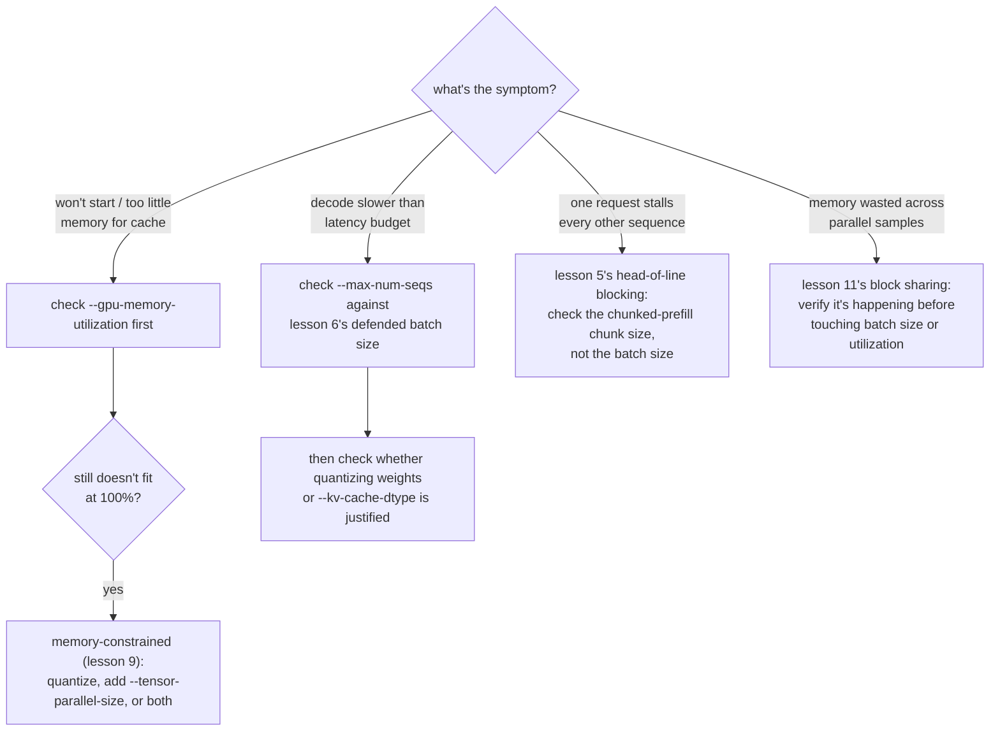

# Урок 12. Параметры настройки vLLM, которые важны

**Связь с целью курса:** Это итоговый урок этапа 4: стеку vLLM, отвечающему на реальные запросы (урок 10), всё равно нужна настройка под тот симптом, который выдаёт реальная нагрузка, а для этого нужно знать, к какому из понятий этого рабочего пространства на самом деле отсылает данный симптом.
**Первоисточник:** [Документация: vLLM Documentation, vLLM Project](https://docs.vllm.ai/en/latest/)
**Предварительные требования:** [Урок 11](0011-pagedattention.md), [Урок 2](0002-capacity-and-batch-size.md), [KV-кеш](../GLOSSARY.md)

## Разминка

1. ▢ Запишите по памяти формулу потолка ёмкости из урока 2.

Проверка

`max concurrent sequences = (total memory − weights − overhead) / (bytes per token × context length)`.

2. ▢ С какими тремя числами, по словам урока 9, нужно защищать выбор квантизации?

Проверка

Число по памяти, сделавшее квантизацию необходимой (или показывающее, что она не была нужна), число по точности, измеренное для выбранной схемы, и число по скорости, реально измеренное для важной фазы.

## Что нужно знать

### Флаг, меняющий смысл «общей памяти»

Формула из урока 2 предполагает, что «общая память» это всё, чем располагает сервер, но vLLM по умолчанию не занимает GPU целиком: `--gpu-memory-utilization` задаёт долю памяти GPU, которую vLLM разрешено использовать под веса, KV-кеш и собственные накладные расходы, по умолчанию около 0,9. На GPU в 80 ГБ это значение по умолчанию означает, что «общей памятью», которую на самом деле следует подставлять в формулу урока 2, будут примерно 72 ГБ, а не 80 ГБ. Увеличение этой доли к 1,0 даёт кешу больше места, что повышает потолок ёмкости, но оставляет меньше запаса для всего остального, что делит GPU (другие процессы, накладные расходы аллокатора, скачок памяти), то есть обменивает ёмкость на запас прочности.

### Флаг на случай, когда сами веса нигде не помещаются

Квантизация (уроки с 7 по 9) это один ответ на веса, которые не помещаются; `--tensor-parallel-size` это другой, ортогональный. Он разделяет веса модели и вычисления над ними между несколькими GPU, поэтому модель на 70B, веса которой в fp16 требуют 140 ГБ, может работать на двух GPU по 80 ГБ (`--tensor-parallel-size 2`), хотя ни один GPU в одиночку не вместил бы её. Это не сжимает модель, как квантизация; это распределяет её, и этот способ можно сочетать с квантизацией, а не заменять ею, когда памяти одного GPU, даже после квантизации, всё ещё недостаточно.

### Процедура выбора: сопоставьте симптом с параметром

Настройка работающего сервера это диагностика, а не угадывание. Каждый симптом ниже указывает на понятие из конкретного урока, а не на случайный флаг, который стоит попробовать:

- **Сервер не запускается или сообщает, что памяти под кеш слишком мало**: сначала проверьте `--gpu-memory-utilization`; заданный им искусственный потолок может быть ниже реальной свободной памяти GPU. Если даже 100% использования не вмещают веса, это случай ограничения по памяти из урока 9: квантизуйте, добавьте `--tensor-parallel-size` или сделайте и то и другое.
- **Декодирование медленнее бюджета задержки**: проверьте `--max-num-seqs` относительно размера батча, защищённого в уроке 6, затем проверьте, оправдывают ли измеренные числа квантизацию весов (уроки с 7 по 9) или кеша (`--kv-cache-dtype`, урок 3).
- **Один запрос задерживает токены каждой другой последовательности**: это блокировка головы очереди из урока 5; проверьте размер чанка чанкованного префилла, а не размер батча.
- **Память выглядит потраченной впустую на множестве параллельных сэмплов одного промпта**: это совместное использование блоков из урока 11; убедитесь, что оно действительно происходит, прежде чем тянуться к изменению размера батча или использования памяти.

## Практика

1. ▢ Сервер не запускается с ошибкой «not enough memory for KV cache», хотя на его GPU в 80 ГБ загружено всего 20 ГБ весов. Какой флаг нужно проверить первым и чем приходится платить за его увеличение?

Подсказка

Спросите себя, какую долю памяти GPU vLLM на самом деле разрешили использовать.

Проверка

`--gpu-memory-utilization`. При значении по умолчанию около 0,9 vLLM вообще доступно лишь около 72 ГБ из 80 ГБ, так что кеш может голодать из-за искусственного потолка, а не реальной нехватки. Увеличение к 1,0 освобождает больше GPU под веса и кеш, но оставляет меньше запаса для всего остального на этом GPU, рискуя ошибкой нехватки памяти, если память понадобится и чему-то ещё.

2. ▢ Веса модели на 70B в fp16 (около 140 ГБ) вообще не помещаются на один GPU в 80 ГБ, даже без учёта какого-либо KV-кеша. Помимо квантизации весов, какой ещё флаг vLLM решает эту задачу и чем он отличается от квантизации?

Проверка

`--tensor-parallel-size`, заданный так, чтобы разделить модель между несколькими GPU (например, 2 для двух GPU по 80 ГБ). Он отличается от квантизации механизмом: квантизация сжимает саму модель ценой точности; тензорный параллелизм распределяет веса и вычисления той же, несжатой модели по объединённой памяти большего числа GPU, без потери точности, но ценой потребности в большем числе GPU.

3. ▢ Задержка декодирования на сервере в порядке, но один конкретный запрос с очень длинным промптом приводит к тому, что следующий токен каждого другого запроса в работе приходит с опозданием. Какой флаг из этого рабочего пространства решает этот симптом, а какой нет?

Проверка

Решает размер чанка чанкованного префилла, поскольку это блокировка головы очереди из урока 5: большой префилл, свёрнутый в один атомарный шаг батча, задерживает всех, кто делит этот шаг. `--max-num-seqs` его не решает; предел размера батча управляет тем, сколько последовательностей делят шаг, а не тем, какая доля работы по префиллу любой одной последовательности попадает в один шаг.

4. ▢ Какое утверждение верно о `--gpu-memory-utilization` и `--tensor-parallel-size`?

    - a) Оба уменьшают собственный объём памяти модели, как квантизация
    - b) `--gpu-memory-utilization` задаёт, какую часть одного GPU может использовать vLLM; `--tensor-parallel-size` распределяет модель по нескольким GPU
    - c) `--tensor-parallel-size` полезен только для стеков обслуживания на CPU вроде llama.cpp
    - d) У увеличения `--gpu-memory-utilization` нет компромисса; его всегда следует ставить в 1,0

Проверка

**b)** Именно это и делает каждый флаг. (a) неверно: ни один не сжимает модель; один ограничивает используемую долю одного GPU, другой распределяет несжатую модель по GPU. (c) неверно: тензорный параллелизм это техника обслуживания на нескольких GPU. (d) неверно: увеличение к 1,0 обменивает запас для всего остального, что может нуждаться в памяти на этом GPU.

## Практика в реальной работе

- [ ] Найдите `--gpu-memory-utilization` и `--tensor-parallel-size` в документации vLLM и прочитайте, что говорят значение по умолчанию и предупреждения каждого из них.
- [ ] Для модели и числа GPU, которые у вас на уме, выясните, потребовались бы тензорный параллелизм, квантизация или оба, чтобы вообще поместить веса, используя простую арифметику из урока 1.
- [ ] Завтра: если у вас есть работающий сервер, намеренно снизьте `--gpu-memory-utilization` до небольшого значения (например, 0,5) и понаблюдайте, что происходит с потолком ёмкости или поведением при запуске.

## Что почитать дальше

- [Документация: vLLM Documentation, vLLM Project](https://docs.vllm.ai/en/latest/)
- [Научная статья: "Efficient Memory Management for Large Language Model Serving with PagedAttention", Kwon et al., SOSP 2023](https://arxiv.org/abs/2309.06180)
- [Ресурсы](../RESOURCES.md)

---

Не доходит? Перечитайте первоисточник в начале: этот урок его сжимает, а при сжатии понимание как раз и теряется. Загляните в [глоссарий](../GLOSSARY.md), если какой-то термин показался скользким.

Если неясен сам урок, а не материал, это дефект: [откройте issue](https://github.com/TokenCemetery/teach/issues).
