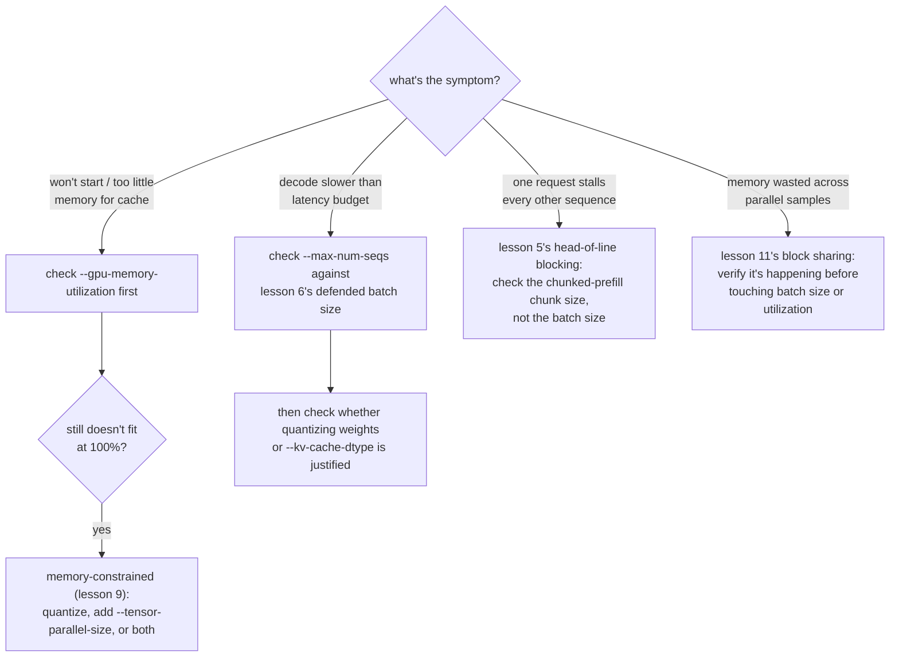

# 第 12 课：真正重要的 vLLM 调优参数

**使命关联:** 这是第 4 阶段的收官课：一套已经在响应真实请求的 vLLM 服务栈（第 10 课），仍然需要针对真实工作负载产生的各种症状来调优，这意味着要知道，某个症状究竟指回本工作区的哪个概念。
**主要来源:** [文档：vLLM Documentation，vLLM Project](https://docs.vllm.ai/en/latest/)
**前置知识:** [第 11 课](0011-pagedattention.md)、[第 2 课](0002-capacity-and-batch-size.md)、[KV 缓存](../GLOSSARY.md)

## 热身

1. ▢ 凭记忆写出第 2 课的容量上限公式。

检查

`max concurrent sequences = (total memory − weights − overhead) / (bytes per token × context length)`。

2. ▢ 第 9 课说，要为一个量化选择辩护，需要哪三个数字？

检查

让量化成为必要的那个内存数字（或者说明它并不必要的数字）、针对所选方案测得的精度数字，以及针对要紧的那个阶段实际测得的速度数字。

## 要点

### 一个改变“总内存”含义的参数

第 2 课的公式假定“总内存”就是服务器可用的一切，但 vLLM 默认并不会占用整块 GPU：`--gpu-memory-utilization` 设定的是 vLLM 可以用于权重、KV 缓存及其自身开销的 GPU 内存比例，默认约为 0.9。在一块 80 GB 的 GPU 上，这个默认值意味着第 2 课的公式实际应该使用的“总内存”大约是 72 GB，而不是 80 GB。把这个比例往 1.0 调高，会给缓存更多的空间，也就提高了容量上限，但给与它共用这块 GPU 的任何其他东西（其他进程、分配器开销、一次内存峰值）留下的余量更少，是在拿容量去换安全余量。

### 一个用于权重本身哪里都放不下的参数

量化（第 7 到 9 课）是应对放不下的权重的一种办法；`--tensor-parallel-size` 则是另一种，与它正交的办法。它把模型的权重，以及作用在它们之上的计算，切分到多块 GPU 上，所以一个 fp16 权重需要 140 GB 的 70B 模型，可以跨两块 80 GB 的 GPU 运行（`--tensor-parallel-size 2`），尽管单独哪一块 GPU 都放不下它。这并不像量化那样缩小模型；它是把模型摊开，而且当单块 GPU 的内存即使在量化之后仍然不够时，它可以与量化组合使用，而不是互相替代。

### 一个决策流程：把症状对应到参数

调优一台运行中的服务器是诊断，而不是瞎猜。下面每个症状，指向的都是某一课的某个具体概念，而不是随便试一个参数：

- **服务器启动不了，或报告缓存可用的内存太少**：先检查 `--gpu-memory-utilization`；它设定的人为上限，可能比 GPU 真实的空闲内存更低。如果连 100% 的利用率也放不下权重，那就是第 9 课内存受限的情形：量化、加上 `--tensor-parallel-size`，或者两者兼用。
- **解码比延迟预算慢**：先拿 `--max-num-seqs` 对照第 6 课被辩护的批大小，再检查量化权重（第 7 到 9 课）或量化缓存（`--kv-cache-dtype`，第 3 课），是否有实测数字作为依据。
- **一个请求拖住所有其他序列的 token**：那是第 5 课的队首阻塞；检查分块预填充的块大小，而不是批大小。
- **同一个提示词的许多并行样本之间，内存看起来被浪费了**：那是第 11 课的块共享；先确认它是否真的在发生，而不是一上来就去改批大小或内存利用率。

## 练习

1. ▢ 一台服务器启动失败，报“KV 缓存内存不足”，尽管它那块 80 GB 的 GPU 上只加载了 20 GB 的权重。第一个该检查的参数是什么，调高它要牺牲什么？

提示

问问 vLLM 实际被告知可以使用 GPU 内存的多大比例。

检查

`--gpu-memory-utilization`。在默认值约 0.9 下，80 GB 中只有大约 72 GB 可供 vLLM 使用，所以缓存可能是被一个人为的上限饿着了，而不是真的短缺。往 1.0 调高会给权重和缓存腾出更多的 GPU，但给这块 GPU 上的其他东西留下的余量更少，如果别的东西也需要内存，就有内存不足而失败的风险。

2. ▢ 一个 70B 模型的 fp16 权重（约 140 GB），在一块 80 GB 的 GPU 上根本放不下，甚至还没考虑任何 KV 缓存。除了量化权重之外，还有哪个 vLLM 参数能解决这个问题，它与量化有什么不同？

检查

`--tensor-parallel-size`，设置成把模型切分到多块 GPU 上（例如两块 80 GB 的 GPU 就设成 2）。它与量化在机制上不同：量化缩小模型本身，要付出精度代价；张量并行则把同一个、没有缩小的模型的权重和计算，摊到更多 GPU 的合并内存上，没有精度代价，代价是需要更多的 GPU。

3. ▢ 一台服务器的解码延迟没问题，但有一个提示词很长的请求，让所有其他正在处理的请求的下一个 token 都来晚了。本工作区的哪个参数能解决这个症状，哪个不能？

检查

分块预填充的块大小能解决，因为这是第 5 课的队首阻塞：一个大的预填充并进一个原子的批次步里，拖慢了所有共用这一步的人。`--max-num-seqs` 解决不了；批大小上限控制的是有多少序列共用一步，而不是任何一个序列的预填充工作有多少落在单独一步里。

4. ▢ 关于 `--gpu-memory-utilization` 和 `--tensor-parallel-size`，哪种说法是对的？

    - a) 二者都像量化那样，减少了模型自身的内存占用
    - b) `--gpu-memory-utilization` 设定 vLLM 可以使用一块 GPU 的多少；`--tensor-parallel-size` 把模型摊到多块 GPU 上
    - c) `--tensor-parallel-size` 只对 llama.cpp 这类 CPU 服务栈有用
    - d) 调高 `--gpu-memory-utilization` 没有任何代价；应该总是把它设成 1.0

检查

**b)** 这正是每个参数各自所做的事。(a) 是错的：二者都不缩小模型；一个限定单块 GPU 的可用比例，另一个把没有缩小的模型摊到多块 GPU 上。(c) 是错的：张量并行是一种 GPU 多设备服务技术。(d) 是错的：往 1.0 调高，是在拿那块 GPU 上其他可能需要内存的东西的余量去换。

## 实战练习

- [ ] 在 vLLM 的文档里找到 `--gpu-memory-utilization` 和 `--tensor-parallel-size`，读一读它们各自的默认值和警告是怎么说的。
- [ ] 针对你心里的某个模型和 GPU 数量，用第 1 课的朴素算术，算出要放下权重，需要张量并行、量化，还是两者都要。
- [ ] 明天：如果你有一台运行中的服务器，故意把 `--gpu-memory-utilization` 调低到一个很小的值（比如 0.5），观察容量上限或启动行为发生了什么。

## 延伸阅读

- [文档：vLLM Documentation，vLLM Project](https://docs.vllm.ai/en/latest/)
- [论文：“Efficient Memory Management for Large Language Model Serving with PagedAttention”，Kwon 等，SOSP 2023](https://arxiv.org/abs/2309.06180)
- [资源](../RESOURCES.md)

---

没学明白？请重读顶部的主要来源，因为本课是对它的压缩，而理解正是在压缩中流失的。如果有哪个术语觉得含糊，可以查看[术语表](../GLOSSARY.md)。

如果问题出在课程本身，而不是学习材料，那就是一个缺陷：[提交 issue](https://github.com/TokenCemetery/teach/issues)。
