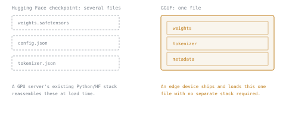

# 第 13 课：GGUF

**使命关联:** 本工作区在这里转向 CPU 和边缘：GGUF 是 llama.cpp 实际用来提供服务的格式，理解它打包了什么、如何加载，是第 5 阶段所有内容的地基。
**主要来源:** [仓库：llama.cpp，ggml-org](https://github.com/ggml-org/llama.cpp)
**前置知识:** [第 12 课](0012-vllm-tuning-knobs.md)、[KV 缓存](../GLOSSARY.md)

## 热身

1. ▢ 为什么量化模型的权重，加快的特别是解码？

检查

解码受内存带宽限制：每一步都要从内存里把权重读回来，更小的量化占用直接减少了这部分内存流量。

2. ▢ GPTQ 和 AWQ（第 7 课）在决定保护哪些权重免受量化误差时，关键的区别是什么？

检查

GPTQ 逐列量化，之后再纠正一层中剩余的、尚未量化的部分。AWQ 则事先在激活幅值上做校准，在量化之前就保护最敏感的通道。

## 要点

### 一个文件，而不是好几个

通过 Hugging Face 生态提供服务的模型，也就是 vLLM 所期望的形态，通常是好几个文件：权重本身、描述架构的 `config.json`、一个分词器文件，有时还有更多。**GGUF** 把这一切，权重、分词器，以及重建架构所需的元数据，打包进一个单一的二进制文件。在已经具备完整 Python 和 Hugging Face 技术栈的 GPU 服务器上，这种分离不是负担。在边缘设备上，目标往往是只发布一个文件，并用一个小而依赖很少的二进制程序来运行它，一个自成一体的单文件，正是这种部署所需要的。

### GGUF 有它自己的量化家族

GPTQ 和 AWQ（第 7 课）是面向 GPU 的方案，针对的是 GPU 内核如何反量化和相乘。GGUF 承载的则是 llama.cpp 自己的量化类型家族，名称像 `Q4_K_M` 或 `Q5_K_M`。解读这个名称：开头的数字是位宽（`Q4` 大致是每个权重 4 位）；`K` 标记这是一种 **k-quant** 类型，它把权重分成每组 256 个的超级块，其中每个子块各自带一个缩放因子，所以一个张量里的每个权重位宽相同，只有缩放因子在其内部变化；结尾的字母（`S`、`M` 或 `L`，小、中、大）选择一种在各个张量之间混用不同类型的配方，给发现更要紧的少数张量一个更高位的类型（在 `Q4_K_M` 中，一部分用 `Q6_K`，其余仍是 `Q4_K`，见[引入 k-quants 的拉取请求](https://github.com/ggml-org/llama.cpp/pull/1684)），在大小和质量之间做取舍，与第 8 课描述的 int8 对 int4 的取舍方式一样，只是在 llama.cpp 自己的方案之内，而不是 GPTQ 或 AWQ 的方案之内。

### 内存映射，而不是加载

因为 GGUF 把权重排布成操作系统可以直接读取的格式，所以 llama.cpp 可以对文件做**内存映射**（`mmap`），而不是像 Python 检查点加载器那样把它读进内存并反序列化。内存映射意味着，文件的页面只有在被访问到时才真正从磁盘读入，哪些页面保持驻留，则由操作系统自己的页缓存来管理，而不是进程一上来就全部占住。在有快速而充裕的系统内存作后盾的 GPU 服务器上，这点没那么要紧。在 CPU 和边缘硬件上，内存往往是最紧张的资源，避免急切地加载整个文件，让操作系统来决定保留什么，会在一台设备究竟能尝试运行多大的模型上，造成实实在在的差别。

## 练习

1. ▢ 为什么把权重、分词器和架构元数据打包进一个 GGUF 文件，对边缘部署比对已经运行着完整 Hugging Face 技术栈的 GPU 服务器更重要？

检查

边缘部署往往希望只发布一个文件，并用一个小而依赖很少的二进制程序来运行它，不需要另外安装 Python 或 Hugging Face 生态来把配置、分词器和权重文件重新组装起来。GPU 服务器已经具备那套生态，所以多文件的布局不会给它增加额外的负担。

2. ▢ 解读量化名称 `Q4_K_M`：每个部分是什么意思？

提示

分三部分来读：开头的数字、下划线后的字母，以及结尾的字母。

检查

`Q4` 大致是每个权重 4 位。`K` 标记一种 k-quant 类型：一个张量里的每个权重都是同一个位宽，在 256 个权重组成的超级块内部，每个子块有各自的缩放因子。`M` 选择中等配方（相对于 `S` 或 `L`），它在各个张量之间混用不同类型，给某些张量一个比其余更高位的类型。

3. ▢ 对 GGUF 文件做内存映射，让 llama.cpp 在启动时避免做什么，为什么这在 CPU/边缘硬件上比在 GPU 服务器上更要紧？

检查

它避免了在任何东西能运行之前，先急切地把整个文件读进内存并反序列化；取而代之的是，操作系统只在页面真正被访问到时才从磁盘读入，并通过它自己的页缓存来管理哪些页面保持驻留。这在 CPU/边缘硬件上更要紧，因为那里内存往往是最紧张的资源，急切地整体加载可能超出可用量，而 GPU 服务器的系统内存充裕，有富余。

4. ▢ 与 GPTQ 或 AWQ 相比，关于 GGUF 的 k-quant 家族，哪种说法是对的？

    - a) 它与 GPTQ 是同一种方案，只是为 llama.cpp 改了名
    - b) 它是 llama.cpp 自己的量化家族，有别于面向 GPU 的 GPTQ 和 AWQ 方案
    - c) 与 GPTQ 和 AWQ 不同，它只支持 4 位量化
    - d) 与 GPTQ 和 AWQ 一样，应用它需要 GPU

检查

**b)** GGUF 的 k-quant 类型是 llama.cpp 自己的家族，针对它自己如何反量化和计算而调校，与 GPTQ 和 AWQ 是分开的。(a) 是错的：不同的是机制，而不只是名称。(c) 是错的：这个家族涵盖多种位宽（`Q4`、`Q5`、`Q8` 等），而不只是 4 位。(d) 是错的：GGUF 及其量化类型，是专门为 CPU 和边缘服务而构建的。

## 实战练习

- [ ] 在模型库里找一个你熟悉的模型的 GGUF 检查点，读它的文件列表：注意它是单个文件，或者少数几个拆分的部分，而不是 HF 检查点所用的多文件布局。
- [ ] 看同一个检查点可用的各种量化变体（通常有好几个 `Q*_K_*` 选项），记下其中两个的文件大小差异。
- [ ] 明天：读一段 llama.cpp 文档中关于 `mmap` 的文字，记下有没有参数控制是否使用它，如果有，是哪个。

## 延伸阅读

- [仓库：llama.cpp，ggml-org](https://github.com/ggml-org/llama.cpp)
- [文档：“Optimizing inference”，Hugging Face Transformers](https://huggingface.co/docs/transformers/main/en/llm_optims)
- [资源](../RESOURCES.md)

---

没学明白？请重读顶部的主要来源，因为本课是对它的压缩，而理解正是在压缩中流失的。如果有哪个术语觉得含糊，可以查看[术语表](../GLOSSARY.md)。

如果问题出在课程本身，而不是学习材料，那就是一个缺陷：[提交 issue](https://github.com/TokenCemetery/teach/issues)。
