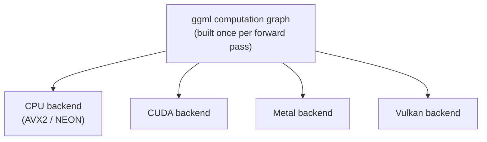

# Lección 14. La arquitectura de llama.cpp

**Vínculo con la misión:** Poner en marcha llama.cpp (la lección siguiente) significa entender primero qué se ejecuta realmente por debajo: una base de código construida para ejecutar el mismo modelo en la CPU de un teléfono, en la GPU de un portátil o en un servidor, que es un tipo de portabilidad distinto al que el diseño solo para GPU de vLLM nunca necesitó resolver.
**Fuente principal:** [Repo: llama.cpp, ggml-org](https://github.com/ggml-org/llama.cpp)
**Requisitos previos:** [Lección 13](0013-gguf.md), [KV cache](../GLOSSARY.md)

## Calentamiento

1. ▢ ¿Qué le permite evitar a llama.cpp al arrancar mapear en memoria un archivo GGUF?

Comprobación

Leer de forma anticipada todo el archivo en la RAM y deserializarlo por adelantado; en su lugar, el SO lee páginas del disco solo cuando se tocan, y gestiona lo que permanece residente.

2. ▢ ¿Por qué el decode está limitado por el ancho de banda de memoria y no por cómputo?

Comprobación

Cada paso de decode calcula solo un token nuevo, así que el tráfico de memoria necesario para volver a leer los pesos y la caché domina sobre la pequeña cantidad de cómputo nuevo por paso.

## Qué debes saber

### ggml: una biblioteca de tensores sin dependencias

llama.cpp está construido sobre **ggml**, una biblioteca de tensores en C escrita para no tener dependencias externas, ni siquiera se exige una biblioteca BLAS completa. Un cálculo, una pasada forward por el modelo, se representa como un grafo estático de operaciones de tensores, construido una vez y ejecutado después, en lugar de la ejecución eager operación por operación que usa PyTorch (y por tanto vLLM) por defecto. Esa representación en grafo es lo que permite a ggml separar "qué cálculo ejecutar" de "qué hardware lo ejecuta": el mismo grafo se puede entregar a distintos backends sin que el código a nivel de modelo cambie en absoluto.

### Una base de código, muchos backends

ggml admite varios **backends**, CPU (con instrucciones SIMD como AVX2 o NEON según el procesador), CUDA, Metal y Vulkan entre otros, todos implementando la misma interfaz de grafo. Esa es la razón arquitectónica por la que llama.cpp puede ejecutar el mismo archivo GGUF en la CPU ARM de un teléfono, en la GPU Metal de un Mac y en una Raspberry Pi, desde una sola base de código y sin un runtime de Python, mientras que el diseño de vLLM está construido específicamente en torno a CUDA y no puede ejecutarse en absoluto sin una GPU de NVIDIA. La arquitectura de ggml optimiza la portabilidad entre hardware, no el throughput bruto de GPU.

### Los threads ocupan el lugar que ocupaba el batching en una GPU

En un servidor de GPU, el batching de la lección 4 amortiza el costo del ancho de banda de memoria entre muchas secuencias concurrentes que comparten la misma GPU. Una CPU no tiene el equivalente de miles de núcleos paralelos de GPU entre los que agrupar solicitudes; en cambio, la palanca principal de llama.cpp son los **threads**, que reparten las multiplicaciones de matrices de una sola secuencia entre los propios núcleos de la CPU. El parámetro `--threads` controla cuántos threads de CPU se usan para esto, y el número que ayuda está acotado por el recuento de núcleos físicos de la CPU, no por cuántas solicitudes concurrentes se atienden como ocurría con `--max-num-seqs`. El threading acelera el propio cómputo de una secuencia; no es la misma palanca que el batching en GPU, que reparte el tráfico de memoria entre varias secuencias a la vez.

## Práctica

1. ▢ ¿Por qué ggml puede ejecutar el mismo modelo en la CPU de un teléfono, en la GPU Metal de un Mac y en una Raspberry Pi desde una sola base de código, cuando vLLM requiere específicamente una GPU de NVIDIA?

Comprobación

ggml representa el cálculo de un modelo como un grafo estático de operaciones de tensores, separado de qué backend lo ejecuta. Varios backends (CPU con SIMD, CUDA, Metal, Vulkan) implementan la misma interfaz de grafo, así que el código a nivel de modelo no cambia entre hardware. El diseño de vLLM está construido específicamente en torno a CUDA, sin una abstracción de backends equivalente que le permita apuntar a otro hardware.

2. ▢ ¿Qué controla realmente `--threads` en llama.cpp, y en qué se diferencia de lo que controla `--max-num-seqs` en vLLM?

Pista

Piensa si cada parámetro reparte el trabajo entre solicitudes concurrentes o entre los propios núcleos de una CPU.

Comprobación

`--threads` fija cuántos threads de CPU reparten las multiplicaciones de matrices de una sola secuencia entre los propios núcleos de la CPU, acotado por el recuento de núcleos físicos. `--max-num-seqs`, en cambio, limita cuántas secuencias concurrentes comparten un paso de lote en una GPU, amortizando entre ellas el costo del ancho de banda de memoria. Uno acelera el propio cómputo de una secuencia; el otro reparte el tráfico de memoria entre varias secuencias.

3. ▢ ¿Por qué ggml construye un grafo de cálculo estático en lugar de ejecutar las operaciones de forma eager, una a una, como hace PyTorch por defecto?

Comprobación

Construir el grafo una vez, separado de la ejecución, es lo que permite entregar el mismo grafo a distintos backends (CPU, CUDA, Metal, Vulkan) sin cambiar el código a nivel de modelo. La ejecución eager, operación por operación, ata más estrechamente el cálculo al backend que ejecuta cada operación según ocurre.

4. ▢ ¿Qué afirmación es verdadera de la arquitectura de ggml en comparación con la de vLLM?

    - a) Ambos requieren CUDA y no pueden ejecutarse en hardware solo de CPU
    - b) ggml separa el grafo de cálculo del backend que lo ejecuta, lo que permite que una base de código apunte a CPU, CUDA, Metal y Vulkan
    - c) ggml requiere una biblioteca BLAS completa y un runtime de Python para funcionar
    - d) El threading en llama.cpp cumple el mismo propósito que el batching en vLLM

Comprobación

**b)** Esa abstracción de backends es exactamente lo que permite a llama.cpp apuntar a hardware diverso desde una sola base de código. (a) es falsa: vLLM requiere CUDA, pero ggml explícitamente no. (c) es falsa: ggml está escrito para no tener dependencias externas, ni siquiera una biblioteca BLAS completa, y no necesita un runtime de Python. (d) es falsa: el threading reparte el propio cómputo de una secuencia entre núcleos de CPU; el batching amortiza el tráfico de memoria entre varias secuencias concurrentes, un mecanismo completamente distinto.

## Prácticas en el mundo real

- [ ] Encuentra en su documentación o repositorio la lista de backends que ggml o llama.cpp admiten actualmente, y anota cuáles se aplican al hardware al que tienes acceso.
- [ ] Encuentra el parámetro `--threads` en la documentación de llama.cpp y lee qué recomienda fijar respecto del recuento de núcleos físicos de una CPU.
- [ ] Mañana: lee un párrafo sobre cómo decide llama.cpp qué backend usar cuando hay más de uno disponible en la misma máquina (por ejemplo, un portátil con una CPU y una GPU Metal).

## Para profundizar

- [Repo: llama.cpp, ggml-org](https://github.com/ggml-org/llama.cpp)
- [Docs: "Optimizing inference", Hugging Face Transformers](https://huggingface.co/docs/transformers/main/en/llm_optims)
- [Recursos](../RESOURCES.md)

---

¿No termina de quedar claro? Vuelve a leer la fuente primaria de arriba, ya que esta lección la comprime y en la compresión es donde se escapa la comprensión. Consulta el [glosario](../GLOSSARY.md) por si algún término te resultó resbaladizo.

Si lo poco claro es la propia lección y no el material, eso es un defecto: [abre un issue](https://github.com/TokenCemetery/teach/issues).
