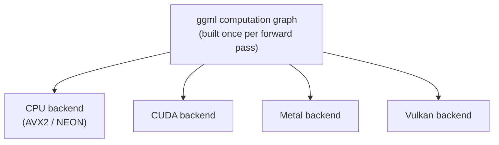

# Leçon 14. L'architecture de llama.cpp

**Lien avec la mission :** Mettre en place llama.cpp (la leçon suivante) exige de comprendre d'abord ce qui tourne réellement en dessous : une base de code conçue pour exécuter le même modèle sur le CPU d'un téléphone, le GPU d'un portable ou un serveur, ce qui est un autre genre de portabilité que celle que la conception vLLM, réservée au GPU, n'a jamais eu à résoudre.
**Source primaire :** [Dépôt : llama.cpp, ggml-org](https://github.com/ggml-org/llama.cpp)
**Prérequis :** [Leçon 13](0013-gguf.md), [KV cache](../GLOSSARY.md)

## Échauffement

1. ▢ Que permet à llama.cpp d'éviter de faire au démarrage la projection en mémoire d'un fichier GGUF ?

Vérifier

Lire avec empressement tout le fichier en RAM et le désérialiser d'avance ; à la place, l'OS ne lit les pages du disque qu'à mesure qu'elles sont touchées, et gère ce qui reste résident.

2. ▢ Pourquoi le decode est-il limité par la bande passante mémoire plutôt que par le calcul ?

Vérifier

Chaque étape de decode ne calcule qu'un seul nouveau token, donc le trafic mémoire nécessaire pour relire les poids et le cache domine la faible quantité de nouveau calcul par étape.

## À savoir

### ggml : une bibliothèque de tenseurs sans dépendances

llama.cpp repose sur **ggml**, une bibliothèque de tenseurs en C écrite pour n'avoir aucune dépendance externe, pas même une bibliothèque BLAS complète n'est requise. Un calcul, une passe avant dans le modèle, est représenté comme un graphe statique d'opérations sur des tenseurs, construit une fois puis exécuté, plutôt que l'exécution eager opération par opération que PyTorch (et donc vLLM) utilise par défaut. C'est cette représentation en graphe qui permet à ggml de séparer « quel calcul exécuter » de « quel matériel l'exécute » : le même graphe peut être confié à différents backends sans que le code au niveau du modèle ne change du tout.

### Une base de code, de nombreux backends

ggml prend en charge plusieurs **backends**, CPU (avec des instructions SIMD comme AVX2 ou NEON selon le processeur), CUDA, Metal et Vulkan entre autres, qui implémentent tous la même interface de graphe. C'est la raison architecturale pour laquelle llama.cpp peut exécuter le même fichier GGUF sur le CPU ARM d'un téléphone, le GPU Metal d'un Mac et un Raspberry Pi, à partir d'une seule base de code et sans runtime Python, là où la conception de vLLM est bâtie spécifiquement autour de CUDA et ne peut pas fonctionner du tout sans GPU NVIDIA. C'est la portabilité entre matériels, et non le débit GPU brut, que l'architecture de ggml optimise.

### Les threads prennent la place qu'occupait le batching sur un GPU

Sur un serveur GPU, le batching de la leçon 4 amortit le coût de bande passante mémoire entre de nombreuses séquences concurrentes qui partagent le même GPU. Un CPU n'a pas d'équivalent des milliers de cœurs GPU parallèles entre lesquels regrouper des requêtes ; à la place, le principal levier de llama.cpp, ce sont les **threads**, qui répartissent les multiplications matricielles d'une seule séquence entre les cœurs propres du CPU. L'option `--threads` contrôle le nombre de threads CPU utilisés pour cela, et le nombre qui aide est borné par le nombre de cœurs physiques du CPU, et non par le nombre de requêtes concurrentes servies comme l'était `--max-num-seqs`. Le multithreading accélère le calcul propre d'une séquence ; ce n'est pas le même levier que le batching GPU, qui répartit le trafic mémoire entre plusieurs séquences à la fois.

## Pratique

1. ▢ Pourquoi ggml peut-il exécuter le même modèle sur le CPU d'un téléphone, le GPU Metal d'un Mac et un Raspberry Pi à partir d'une seule base de code, alors que vLLM exige spécifiquement un GPU NVIDIA ?

Vérifier

ggml représente le calcul d'un modèle comme un graphe statique d'opérations sur des tenseurs, distinct du backend qui l'exécute. Plusieurs backends (CPU avec SIMD, CUDA, Metal, Vulkan) implémentent la même interface de graphe, donc le code au niveau du modèle ne change pas d'un matériel à l'autre. La conception de vLLM est bâtie spécifiquement autour de CUDA, sans abstraction de backend équivalente qui lui permettrait de cibler d'autres matériels.

2. ▢ Que contrôle réellement `--threads` dans llama.cpp, et en quoi est-ce différent de ce que contrôle `--max-num-seqs` dans vLLM ?

Indice

Demandez-vous si chaque option répartit le travail entre des requêtes concurrentes ou entre les cœurs propres d'un CPU.

Vérifier

`--threads` fixe le nombre de threads CPU qui répartissent les multiplications matricielles d'une seule séquence entre les cœurs propres du CPU, borné par le nombre de cœurs physiques. `--max-num-seqs` plafonne plutôt le nombre de séquences concurrentes qui partagent une étape de batch GPU, en amortissant entre elles le coût de bande passante mémoire. L'une accélère le calcul propre d'une séquence ; l'autre répartit le trafic mémoire entre plusieurs séquences.

3. ▢ Pourquoi ggml construit-il un graphe de calcul statique plutôt que d'exécuter les opérations de façon eager, une à la fois, comme le fait PyTorch par défaut ?

Vérifier

Construire le graphe une fois, séparément de l'exécution, est ce qui permet de confier le même graphe à différents backends (CPU, CUDA, Metal, Vulkan) sans changer le code au niveau du modèle. L'exécution eager, opération par opération, lie plus étroitement le calcul au backend qui exécute chaque opération au moment où elle se produit.

4. ▢ Laquelle de ces affirmations est vraie à propos de l'architecture de ggml par rapport à celle de vLLM ?

    - a) Les deux exigent CUDA et ne peuvent pas fonctionner sur du matériel uniquement CPU
    - b) ggml sépare le graphe de calcul du backend qui l'exécute, ce qui permet à une seule base de code de cibler CPU, CUDA, Metal et Vulkan
    - c) ggml exige une bibliothèque BLAS complète et un runtime Python pour fonctionner
    - d) Le multithreading dans llama.cpp sert le même but que le batching dans vLLM

Vérifier

**b)** Cette abstraction de backend est exactement ce qui permet à llama.cpp de cibler des matériels variés à partir d'une seule base de code. (a) est fausse : vLLM exige CUDA, mais ggml explicitement non. (c) est fausse : ggml est écrit pour n'avoir aucune dépendance externe, pas même une bibliothèque BLAS complète, et n'a besoin d'aucun runtime Python. (d) est fausse : le multithreading répartit le calcul propre d'une séquence entre les cœurs du CPU ; le batching amortit le trafic mémoire entre plusieurs séquences concurrentes, un mécanisme entièrement différent.

## Exercices en situation réelle

- [ ] Trouvez dans la documentation ou le dépôt la liste des backends que ggml ou llama.cpp prennent actuellement en charge, et notez lesquels s'appliquent au matériel auquel vous avez accès.
- [ ] Trouvez l'option `--threads` dans la documentation de llama.cpp et lisez la valeur qu'elle recommande par rapport au nombre de cœurs physiques d'un CPU.
- [ ] Demain : lisez un paragraphe sur la façon dont llama.cpp décide quel backend utiliser quand plusieurs sont disponibles sur la même machine (par exemple, un portable avec à la fois un CPU et un GPU Metal).

## Pour aller plus loin

- [Dépôt : llama.cpp, ggml-org](https://github.com/ggml-org/llama.cpp)
- [Doc : "Optimizing inference", Hugging Face Transformers](https://huggingface.co/docs/transformers/main/en/llm_optims)
- [Ressources](../RESOURCES.md)

---

Ça ne passe pas ? Relisez la source primaire en haut de page, car cette leçon la condense et c'est dans la condensation que la compréhension s'échappe. Consultez le [glossaire](../GLOSSARY.md) pour tout terme qui vous a paru glissant.

Si c'est la leçon elle-même qui n'est pas claire plutôt que la matière, c'est un défaut : [ouvrez une issue](https://github.com/TokenCemetery/teach/issues).
