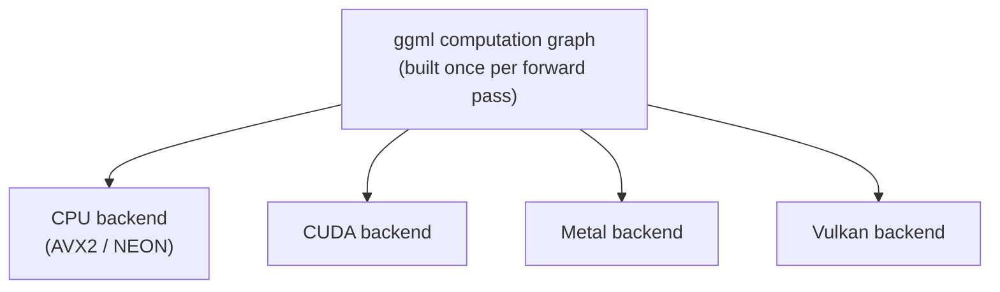

# पाठ 14. llama.cpp का Architecture

**मिशन से संबंध:** llama.cpp खड़ा करने (अगला पाठ) का मतलब है पहले यह समझना कि उसके नीचे असल में क्या चल रहा है: ऐसा codebase जो एक ही model को फ़ोन के CPU, laptop के GPU या server पर चलाने के लिए बना है, जो एक अलग तरह की portability है, जिसे हल करने की vLLM के सिर्फ़-GPU design को कभी ज़रूरत नहीं पड़ी।
**मुख्य स्रोत:** [Repo: llama.cpp, ggml-org](https://github.com/ggml-org/llama.cpp)
**पूर्व-आवश्यकताएँ:** [पाठ 13](0013-gguf.md), [KV cache](../GLOSSARY.md)

## वार्म-अप

1. ▢ GGUF file को memory-map करना llama.cpp को startup पर क्या करने से बचने देता है?

जाँचें

पूरी file को उत्सुकता से RAM में पढ़ना और पहले से deserialize करना; इसके बजाय OS pages को disk से सिर्फ़ तब पढ़ता है जब उन्हें छुआ जाए, और क्या resident रहे यह सँभालता है।

2. ▢ Decode compute-bound के बजाय memory-bandwidth bound क्यों है?

जाँचें

हर decode step सिर्फ़ एक नया token compute करता है, इसलिए weights और cache वापस पढ़ने के लिए ज़रूरी memory traffic हर step के थोड़े-से नए compute पर हावी रहता है।

## यह जानें

### ggml: बिना dependencies की tensor library

llama.cpp **ggml** पर बना है, जो C में लिखी tensor library है और जिसकी कोई बाहरी dependencies नहीं हैं, पूरी BLAS library भी ज़रूरी नहीं। Computation, यानी model से होकर forward pass, tensor operations के एक static graph के रूप में दर्शाया जाता है, जो एक बार बनता है और फिर चलता है, बजाय उस operation-दर-operation eager execution के जो PyTorch (और इसलिए vLLM) default रूप से इस्तेमाल करता है। यही graph representation ggml को "कौन-सा computation चलाना है" को "उसे कौन-सा hardware चलाता है" से अलग करने देता है: वही graph अलग backends को दिया जा सकता है और model-स्तर के code में कुछ नहीं बदलता।

### एक codebase, कई backends

ggml कई **backends** support करता है, CPU (processor के हिसाब से AVX2 या NEON जैसे SIMD instructions इस्तेमाल करते हुए), CUDA, Metal और Vulkan सहित और भी, सब वही graph interface लागू करते हैं। यही वह architecture संबंधी कारण है कि llama.cpp एक ही GGUF file को फ़ोन के ARM CPU, Mac के Metal GPU और Raspberry Pi पर चला सकता है, एक ही codebase से, बिना किसी Python runtime के, जबकि vLLM का design ख़ासकर CUDA के आसपास बना है और NVIDIA GPU के बिना चल ही नहीं सकता। ggml का architecture कच्चे GPU throughput के लिए नहीं, hardware के पार portability के लिए optimize करता है।

### GPU पर batching की जगह threads लेते हैं

GPU server पर, पाठ 4 की batching memory-bandwidth की लागत को एक ही GPU साझा करने वाले कई concurrent sequences में बाँट देती है। CPU के पास requests को batch करने के लिए हज़ारों parallel GPU cores जैसा कुछ नहीं होता; इसके बजाय llama.cpp का मुख्य उपाय **threads** हैं, जो एक अकेले sequence के matrix multiplies को CPU के अपने cores में बाँटते हैं। `--threads` flag नियंत्रित करता है कि इसके लिए कितने CPU threads इस्तेमाल हों, और जो संख्या मदद करती है वह CPU के physical core count से बँधी है, न कि इससे कि कितनी concurrent requests serve हो रही हैं जैसा `--max-num-seqs` के साथ था। Threading एक sequence के अपने compute को तेज़ करती है; यह वही उपाय नहीं है जो GPU batching है, जो memory traffic को एक साथ कई sequences में फैलाती है।

## अभ्यास

1. ▢ ggml एक ही model को फ़ोन के CPU, Mac के Metal GPU और Raspberry Pi पर एक ही codebase से क्यों चला सकता है, जबकि vLLM को ख़ासकर NVIDIA GPU चाहिए?

जाँचें

ggml model के computation को tensor operations के static graph के रूप में दर्शाता है, इससे अलग कि उसे कौन-सा backend चलाता है। कई backends (SIMD वाला CPU, CUDA, Metal, Vulkan) वही graph interface लागू करते हैं, इसलिए model-स्तर का code hardware के पार नहीं बदलता। vLLM का design ख़ासकर CUDA के आसपास बना है, उसके पास ऐसा कोई समकक्ष backend abstraction नहीं जो उसे दूसरे hardware को लक्ष्य करने दे।

2. ▢ llama.cpp में `--threads` असल में क्या नियंत्रित करता है, और यह vLLM में `--max-num-seqs` जो नियंत्रित करता है उससे कैसे अलग है?

संकेत

सोचें कि हर flag काम को concurrent requests में फैला रहा है या CPU के अपने cores में।

जाँचें

`--threads` तय करता है कि कितने CPU threads एक अकेले sequence के matrix multiplies को CPU के अपने cores में बाँटें, physical core count से बँधा हुआ। `--max-num-seqs` इसके बजाय सीमित करता है कि कितने concurrent sequences एक GPU batch step साझा करें, और उनमें memory-bandwidth की लागत बाँटता है। एक एक sequence के अपने compute को तेज़ करता है; दूसरा memory traffic को कई sequences में फैलाता है।

3. ▢ ggml static computation graph क्यों बनाता है, operations को eager रूप से एक-एक करके चलाने के बजाय, जैसा PyTorch default रूप से करता है?

जाँचें

Graph को एक बार, execution से अलग, बनाना ही वही graph अलग backends (CPU, CUDA, Metal, Vulkan) को बिना model-स्तर का code बदले देने देता है। Eager, operation-दर-operation execution computation को उस backend से ज़्यादा कसकर बाँध देता है जो हर operation को होते समय चला रहा हो।

4. ▢ vLLM की तुलना में ggml के architecture के बारे में कौन-सा दावा सही है?

    - a) दोनों को CUDA चाहिए और वे सिर्फ़-CPU hardware पर नहीं चल सकते
    - b) ggml computation graph को उसे चलाने वाले backend से अलग करता है, जिससे एक codebase CPU, CUDA, Metal और Vulkan को लक्ष्य कर सकता है
    - c) ggml को चलने के लिए पूरी BLAS library और Python runtime चाहिए
    - d) llama.cpp में threading वही उद्देश्य पूरा करती है जो vLLM में batching

जाँचें

**b)** वही backend abstraction llama.cpp को एक codebase से विविध hardware को लक्ष्य करने देता है। (a) ग़लत है: vLLM को CUDA चाहिए, पर ggml को साफ़ तौर पर नहीं। (c) ग़लत है: ggml बिना किसी बाहरी dependency के लिखा गया है, पूरी BLAS library भी नहीं, और उसे Python runtime नहीं चाहिए। (d) ग़लत है: threading एक sequence के अपने compute को CPU cores में बाँटती है; batching memory traffic को कई concurrent sequences में फैलाती है, जो बिल्कुल अलग तंत्र है।

## असली दुनिया का अभ्यास

- [ ] ggml या llama.cpp के दस्तावेज़ों या repository में वे backends की सूची ढूँढें जो वह अभी support करता है, और नोट करें कि उनमें से कौन-से उस hardware पर लागू होते हैं जिस तक आपकी पहुँच है।
- [ ] llama.cpp के दस्तावेज़ों में `--threads` flag ढूँढें और पढ़ें कि CPU के physical core count के मुक़ाबले उसे कितना सेट करने की सिफ़ारिश है।
- [ ] कल: एक अनुच्छेद पढ़ें कि एक ही machine पर एक से ज़्यादा backend उपलब्ध हों (उदाहरण के लिए, CPU और Metal GPU दोनों वाला laptop) तो llama.cpp कैसे तय करता है कि कौन-सा इस्तेमाल करे।

## आगे बढ़ने के लिए

- [Repo: llama.cpp, ggml-org](https://github.com/ggml-org/llama.cpp)
- [दस्तावेज़: "Optimizing inference", Hugging Face Transformers](https://huggingface.co/docs/transformers/main/en/llm_optims)
- [संसाधन](../RESOURCES.md)

---

बात नहीं बन रही? ऊपर दिए मुख्य स्रोत को दोबारा पढ़ें, क्योंकि यह पाठ उसे संक्षिप्त करता है और समझ संक्षेप में ही रिसती है। जो शब्द फिसलन भरा लगे, उसके लिए [शब्दावली](../GLOSSARY.md) देखें।

अगर दिक़्क़त सामग्री की नहीं बल्कि पाठ की ही है, तो वह एक खोट है: [issue खोलें](https://github.com/TokenCemetery/teach/issues)।
