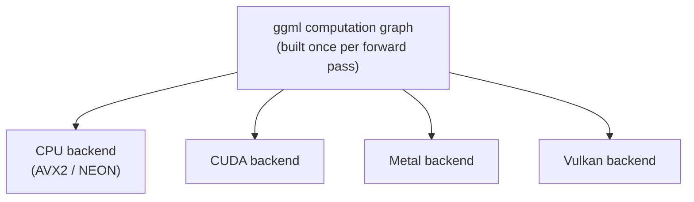

# Lição 14. A arquitetura do llama.cpp

**Ligação com a missão:** Colocar o llama.cpp no ar (a próxima lição) significa entender antes o que realmente roda por baixo: uma base de código construída para rodar o mesmo modelo na CPU de um celular, na GPU de um laptop ou em um servidor, que é um tipo de portabilidade diferente daquele que o design só de GPU do vLLM nunca precisou resolver.
**Fonte principal:** [Repositório: llama.cpp, ggml-org](https://github.com/ggml-org/llama.cpp)
**Pré-requisitos:** [Lição 13](0013-gguf.md), [KV cache](../GLOSSARY.md)

## Aquecimento

1. ▢ O que mapear em memória um arquivo GGUF permite ao llama.cpp evitar na inicialização?

Verificação

Ler ansiosamente o arquivo inteiro para a RAM e desserializá-lo de antemão; em vez disso, o SO lê páginas do disco só conforme elas são tocadas, gerenciando o que fica residente.

2. ▢ Por que o decode é limitado pela largura de banda de memória e não por compute?

Verificação

Cada passo de decode calcula apenas um novo token, então o tráfego de memória necessário para ler de volta os pesos e o cache domina a pequena quantidade de compute novo por passo.

## Saiba isto

### ggml: uma biblioteca de tensores sem dependências

O llama.cpp é construído sobre o **ggml**, uma biblioteca de tensores em C escrita para não ter dependências externas, nem mesmo uma biblioteca BLAS completa é exigida. Uma computação, uma passada forward pelo modelo, é representada como um grafo estático de operações de tensor, construído uma vez e depois executado, em vez da execução eager, operação por operação, que o PyTorch (e portanto o vLLM) usa por padrão. Essa representação em grafo é o que permite ao ggml separar "qual computação rodar" de "qual hardware a roda": o mesmo grafo pode ser entregue a backends diferentes sem que o código em nível de modelo mude em nada.

### Uma base de código, vários backends

O ggml suporta vários **backends**, CPU (usando instruções SIMD como AVX2 ou NEON, dependendo do processador), CUDA, Metal e Vulkan, entre outros, todos implementando a mesma interface de grafo. Essa é a razão arquitetural de o llama.cpp conseguir rodar o mesmo arquivo GGUF na CPU ARM de um celular, na GPU Metal de um Mac e em um Raspberry Pi, a partir de uma base de código, sem exigir runtime de Python, enquanto o design do vLLM é construído especificamente em torno do CUDA e não consegue rodar sem uma GPU NVIDIA. A portabilidade entre hardwares, e não o throughput bruto de GPU, é o que a arquitetura do ggml otimiza.

### Threads ocupam o lugar que o batching tinha na GPU

Em um servidor de GPU, o batching da lição 4 amortiza o custo de largura de banda de memória entre muitas sequências concorrentes que dividem a mesma GPU. Uma CPU não tem equivalente a milhares de cores de GPU paralelos entre os quais agrupar requisições; em vez disso, a principal alavanca do llama.cpp são as **threads**, dividindo as multiplicações de matrizes de uma única sequência entre os próprios cores da CPU. A flag `--threads` controla quantas threads de CPU são usadas para isso, e o número que ajuda é limitado pela contagem de cores físicos da CPU, e não por quantas requisições concorrentes estão sendo servidas, como era o caso de `--max-num-seqs`. O threading acelera o compute de uma única sequência; não é a mesma alavanca que o batching em GPU, que espalha o tráfego de memória por várias sequências ao mesmo tempo.

## Prática

1. ▢ Por que o ggml consegue rodar o mesmo modelo na CPU de um celular, na GPU Metal de um Mac e em um Raspberry Pi a partir de uma base de código, quando o vLLM exige especificamente uma GPU NVIDIA?

Verificação

O ggml representa a computação de um modelo como um grafo estático de operações de tensor, separado de qual backend o executa. Vários backends (CPU com SIMD, CUDA, Metal, Vulkan) implementam a mesma interface de grafo, então o código em nível de modelo não muda entre hardwares. O design do vLLM é construído especificamente em torno do CUDA, sem uma abstração de backend equivalente que lhe permita mirar outro hardware.

2. ▢ O que `--threads` realmente controla no llama.cpp, e como isso difere do que `--max-num-seqs` controla no vLLM?

Dica

Pense se cada flag está espalhando trabalho entre requisições concorrentes ou entre os próprios cores de uma CPU.

Verificação

`--threads` define quantas threads de CPU dividem as multiplicações de matrizes de uma única sequência entre os próprios cores da CPU, limitado pela contagem de cores físicos. `--max-num-seqs`, em vez disso, limita quantas sequências concorrentes dividem um passo de batch da GPU, amortizando entre elas o custo de largura de banda de memória. Uma acelera o compute de uma única sequência; a outra espalha o tráfego de memória por várias sequências.

3. ▢ Por que o ggml constrói um grafo de computação estático em vez de executar as operações de forma eager, uma por vez, como o PyTorch faz por padrão?

Verificação

Construir o grafo uma vez, separado da execução, é o que permite entregar o mesmo grafo a backends diferentes (CPU, CUDA, Metal, Vulkan) sem mudar o código em nível de modelo. A execução eager, operação por operação, amarra a computação mais de perto a qualquer backend que esteja rodando cada operação no momento em que ela acontece.

4. ▢ Qual afirmação é verdadeira sobre a arquitetura do ggml em comparação com a do vLLM?

    - a) Os dois exigem CUDA e não conseguem rodar em hardware só de CPU
    - b) O ggml separa o grafo de computação do backend que o executa, permitindo que uma base de código mire CPU, CUDA, Metal e Vulkan
    - c) O ggml exige uma biblioteca BLAS completa e um runtime de Python para funcionar
    - d) O threading no llama.cpp serve ao mesmo propósito que o batching no vLLM

Verificação

**b)** Essa abstração de backends é exatamente o que permite ao llama.cpp mirar hardwares diversos a partir de uma base de código. (a) é falsa: o vLLM exige CUDA, mas o ggml explicitamente não. (c) é falsa: o ggml é escrito para não ter dependências externas, nem mesmo uma biblioteca BLAS completa, e não precisa de runtime de Python. (d) é falsa: o threading divide o compute de uma única sequência entre cores de CPU; o batching amortiza o tráfego de memória entre várias sequências concorrentes, um mecanismo completamente diferente.

## Prática no mundo real

- [ ] Encontre na documentação ou no repositório a lista de backends que o ggml ou o llama.cpp suportam atualmente e anote quais se aplicam a hardware a que você tem acesso.
- [ ] Encontre a flag `--threads` na documentação do llama.cpp e leia o que ela recomenda definir em relação à contagem de cores físicos de uma CPU.
- [ ] Amanhã: leia um parágrafo sobre como o llama.cpp decide qual backend usar quando mais de um está disponível na mesma máquina (por exemplo, um laptop com uma CPU e uma GPU Metal).

## Para ir além

- [Repositório: llama.cpp, ggml-org](https://github.com/ggml-org/llama.cpp)
- [Documentação: "Optimizing inference", Hugging Face Transformers](https://huggingface.co/docs/transformers/main/en/llm_optims)
- [Recursos](../RESOURCES.md)

---

Não ficou claro? Releia a fonte principal no topo, já que esta lição a comprime e é na compressão que o entendimento escapa. Consulte o [glossário](../GLOSSARY.md) para qualquer termo que pareceu escorregadio.

Se o problema é a lição em si, e não o material, isso é um defeito: [abra uma issue](https://github.com/TokenCemetery/teach/issues).
