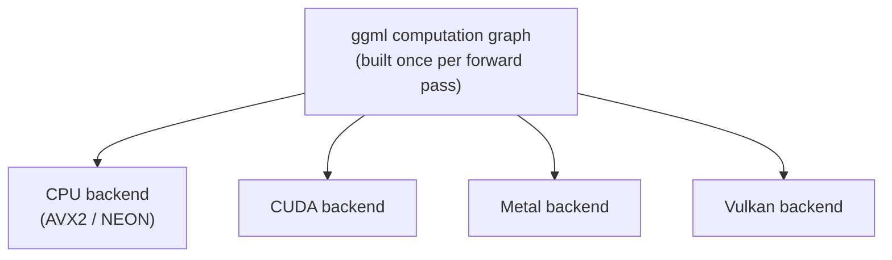

# Урок 14. Архитектура llama.cpp

**Связь с целью курса:** Запуск llama.cpp (следующий урок) означает сначала понять, что на самом деле работает под ним: кодовую базу, построенную так, чтобы запускать одну и ту же модель на CPU телефона, GPU ноутбука или сервере, а это другой вид переносимости, чем тот, что когда-либо приходилось решать дизайну vLLM только для GPU.
**Первоисточник:** [Репозиторий: llama.cpp, ggml-org](https://github.com/ggml-org/llama.cpp)
**Предварительные требования:** [Урок 13](0013-gguf.md), [KV-кеш](../GLOSSARY.md)

## Разминка

1. ▢ Чего отображение файла GGUF в память позволяет llama.cpp избежать при запуске?

Проверка

Жадного чтения всего файла в RAM и десериализации заранее; вместо этого ОС читает страницы с диска только по мере обращения к ним, управляя тем, что остаётся резидентным.

2. ▢ Почему декодирование ограничено пропускной способностью памяти, а не вычислениями?

Проверка

Каждый шаг декодирования вычисляет только один новый токен, поэтому обмен с памятью, нужный для чтения весов и кеша обратно, доминирует над малым объёмом новых вычислений на шаг.

## Что нужно знать

### ggml: тензорная библиотека без зависимостей

llama.cpp построен на **ggml**, тензорной библиотеке на C, написанной так, чтобы не иметь внешних зависимостей, не требуется даже полная библиотека BLAS. Вычисление, то есть прямой проход через модель, представлено статическим графом тензорных операций, построенным один раз и затем выполняемым, а не пооперационным нетерпеливым исполнением (eager execution), которое PyTorch (а значит, и vLLM) использует по умолчанию. Именно такое представление графом позволяет ggml отделить «какое вычисление запускать» от «какое оборудование его запускает»: один и тот же граф можно передать разным бэкендам без какого-либо изменения кода на уровне модели.

### Одна кодовая база, много бэкендов

ggml поддерживает несколько **бэкендов**: CPU (использующий SIMD-инструкции вроде AVX2 или NEON в зависимости от процессора), CUDA, Metal и Vulkan, среди прочих, и все они реализуют один и тот же интерфейс графа. Это архитектурная причина, по которой llama.cpp может запускать один и тот же файл GGUF на ARM CPU телефона, GPU Metal на Mac и Raspberry Pi, из одной кодовой базы и без среды выполнения Python, тогда как дизайн vLLM построен именно вокруг CUDA и вообще не может работать без GPU NVIDIA. Архитектура ggml оптимизирует переносимость между оборудованием, а не сырую пропускную способность GPU.

### Потоки занимают место, которое на GPU занимал батчинг

На GPU-сервере батчинг из урока 4 распределяет стоимость пропускной способности памяти по многим одновременным последовательностям, делящим один и тот же GPU. У CPU нет эквивалента тысяч параллельных ядер GPU, по которым можно разбить запросы в батч; вместо этого главный рычаг llama.cpp это **потоки**, разделяющие матричные умножения одной последовательности между собственными ядрами CPU. Флаг `--threads` управляет тем, сколько потоков CPU для этого используется, а число, которое помогает, ограничено числом физических ядер CPU, а не тем, сколько одновременных запросов обслуживается, как это было у `--max-num-seqs`. Многопоточность ускоряет вычисления одной последовательности; это не тот же рычаг, что батчинг на GPU, который распределяет обмен с памятью сразу между несколькими последовательностями.

## Практика

1. ▢ Почему ggml может запускать одну и ту же модель на CPU телефона, GPU Metal на Mac и Raspberry Pi из одной кодовой базы, тогда как vLLM требует именно GPU NVIDIA?

Проверка

ggml представляет вычисление модели статическим графом тензорных операций, отдельным от того, какой бэкенд его выполняет. Несколько бэкендов (CPU с SIMD, CUDA, Metal, Vulkan) реализуют один и тот же интерфейс графа, поэтому код на уровне модели не меняется между оборудованием. Дизайн vLLM построен именно вокруг CUDA, без эквивалентной абстракции бэкендов, позволяющей ему нацеливаться на другое оборудование.

2. ▢ Чем на самом деле управляет `--threads` в llama.cpp и чем это отличается от того, чем управляет `--max-num-seqs` в vLLM?

Подсказка

Подумайте о том, распределяет ли каждый флаг работу между одновременными запросами или между собственными ядрами CPU.

Проверка

`--threads` задаёт, сколько потоков CPU делят матричные умножения одной последовательности между собственными ядрами CPU, ограниченное числом физических ядер. `--max-num-seqs` же ограничивает, сколько одновременных последовательностей делят шаг батча на GPU, распределяя между ними стоимость пропускной способности памяти. Один ускоряет вычисления одной последовательности; другой распределяет обмен с памятью между несколькими последовательностями.

3. ▢ Почему ggml строит статический граф вычислений, а не выполняет операции нетерпеливо, по одной, как это по умолчанию делает PyTorch?

Проверка

Построение графа один раз, отдельно от исполнения, позволяет передать один и тот же граф разным бэкендам (CPU, CUDA, Metal, Vulkan) без изменения кода на уровне модели. Нетерпеливое пооперационное исполнение теснее привязывает вычисление к тому бэкенду, который выполняет каждую операцию по мере её возникновения.

4. ▢ Какое утверждение верно об архитектуре ggml по сравнению с vLLM?

    - a) Обоим требуется CUDA, и они не могут работать на оборудовании только с CPU
    - b) ggml отделяет граф вычислений от бэкенда, который его выполняет, позволяя одной кодовой базе нацеливаться на CPU, CUDA, Metal и Vulkan
    - c) Для работы ggml требуются полная библиотека BLAS и среда выполнения Python
    - d) Многопоточность в llama.cpp служит той же цели, что и батчинг в vLLM

Проверка

**b)** Именно эта абстракция бэкендов и позволяет llama.cpp нацеливаться на разнообразное оборудование из одной кодовой базы. (a) неверно: vLLM требует CUDA, а ggml явно нет. (c) неверно: ggml написан так, чтобы не иметь внешних зависимостей, не нужна даже полная библиотека BLAS, и среда выполнения Python не нужна. (d) неверно: многопоточность делит вычисления одной последовательности между ядрами CPU; батчинг распределяет обмен с памятью между несколькими одновременными последовательностями, это совершенно другой механизм.

## Практика в реальной работе

- [ ] Найдите в документации или репозитории список бэкендов, которые ggml или llama.cpp поддерживают сейчас, и отметьте, какие из них относятся к оборудованию, к которому у вас есть доступ.
- [ ] Найдите флаг `--threads` в документации llama.cpp и прочитайте, какое значение она рекомендует относительно числа физических ядер CPU.
- [ ] Завтра: прочитайте один абзац о том, как llama.cpp решает, какой бэкенд использовать, когда на одной машине доступно больше одного (например, ноутбук и с CPU, и с GPU Metal).

## Что почитать дальше

- [Репозиторий: llama.cpp, ggml-org](https://github.com/ggml-org/llama.cpp)
- [Документация: "Optimizing inference", Hugging Face Transformers](https://huggingface.co/docs/transformers/main/en/llm_optims)
- [Ресурсы](../RESOURCES.md)

---

Не доходит? Перечитайте первоисточник в начале: этот урок его сжимает, а при сжатии понимание как раз и теряется. Загляните в [глоссарий](../GLOSSARY.md), если какой-то термин показался скользким.

Если неясен сам урок, а не материал, это дефект: [откройте issue](https://github.com/TokenCemetery/teach/issues).
