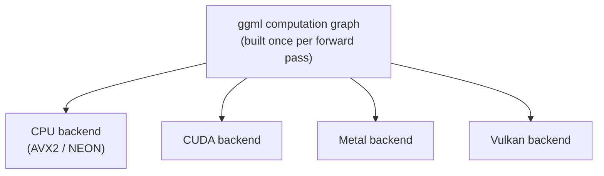

# 第 14 课：llama.cpp 的架构

**使命关联:** 要搭起 llama.cpp（下一课），首先要理解它底层实际运行的是什么：这是一套为了让同一个模型能在手机的 CPU、笔记本的 GPU 或服务器上运行而构建的代码库，这种可移植性，与只针对 GPU 的 vLLM 设计从未需要解决的那种截然不同。
**主要来源:** [仓库：llama.cpp，ggml-org](https://github.com/ggml-org/llama.cpp)
**前置知识:** [第 13 课](0013-gguf.md)、[KV 缓存](../GLOSSARY.md)

## 热身

1. ▢ 对 GGUF 文件做内存映射，让 llama.cpp 在启动时避免做什么？

检查

避免了一上来就急切地把整个文件读进内存并反序列化；取而代之的是，操作系统只在页面被访问到时才从磁盘读入，并管理哪些页面保持驻留。

2. ▢ 为什么解码受内存带宽限制，而不是受算力限制？

检查

每个解码步只算一个新 token，所以读回权重和缓存所需的内存流量，压过了每步少量的新计算。

## 要点

### ggml：一个没有依赖的张量库

llama.cpp 建立在 **ggml** 之上，这是一个被写成没有任何外部依赖的 C 语言张量库，甚至不需要一个完整的 BLAS 库。一次计算，也就是通过模型的一次前向计算，被表示为一张由张量操作组成的静态图，构建一次然后执行，而不是 PyTorch（因而也是 vLLM）默认所用的一个操作接一个操作的即时执行。正是这种图的表示，让 ggml 能把“运行什么计算”与“由什么硬件来跑”分开：同一张图可以交给不同的后端，而模型层面的代码完全不用改。

### 一套代码，多个后端

ggml 支持多个**后端**，包括 CPU（根据处理器使用 AVX2 或 NEON 这类 SIMD 指令）、CUDA、Metal 和 Vulkan 等，它们都实现同样的图接口。这就是 llama.cpp 能在手机的 ARM CPU、Mac 的 Metal GPU 和树莓派上运行同一个 GGUF 文件，只用一套代码，也不需要 Python 运行时的架构原因，而 vLLM 的设计是专门围绕 CUDA 构建的，没有 NVIDIA GPU 就完全无法运行。ggml 的架构优化的，是跨硬件的可移植性，而不是 GPU 的原始吞吐量。

### 线程取代了批处理在 GPU 上的位置

在 GPU 服务器上，第 4 课的批处理在共用同一块 GPU 的许多并发序列之间，分摊内存带宽开销。CPU 没有数以千计的并行 GPU 核心可以让请求批在一起；llama.cpp 的主要杠杆是**线程**，把单个序列的矩阵乘法分到 CPU 自己的各个核上。`--threads` 参数控制为此使用多少个 CPU 线程，而有帮助的数量受 CPU 物理核数的限制，不像 `--max-num-seqs` 那样取决于正在服务多少个并发请求。线程加快的是单个序列自己的计算；它与 GPU 批处理不是同一个杠杆，后者是同时在多个序列之间分摊内存流量。

## 练习

1. ▢ 为什么 ggml 能用一套代码，在手机的 CPU、Mac 的 Metal GPU 和树莓派上运行同一个模型，而 vLLM 却专门要求 NVIDIA GPU？

检查

ggml 把模型的计算表示为一张由张量操作组成的静态图，与由哪个后端来执行它分开。多个后端（带 SIMD 的 CPU、CUDA、Metal、Vulkan）实现同样的图接口，所以模型层面的代码不会随硬件而变。vLLM 的设计是专门围绕 CUDA 构建的，没有类似的后端抽象让它面向其他硬件。

2. ▢ `--threads` 在 llama.cpp 里实际控制什么，这与 `--max-num-seqs` 在 vLLM 里控制的有什么不同？

提示

想想每个参数，分摊工作的对象是并发的请求，还是 CPU 自己的各个核。

检查

`--threads` 设定有多少个 CPU 线程，把单个序列的矩阵乘法分到 CPU 自己的各个核上，受物理核数限制。`--max-num-seqs` 则限制有多少个并发序列共用一个 GPU 批次步，在它们之间分摊内存带宽开销。一个加快单个序列自己的计算；另一个在多个序列之间分摊内存流量。

3. ▢ 为什么 ggml 构建一张静态计算图，而不是像 PyTorch 默认那样，即时地一次执行一个操作？

检查

先构建一次图，与执行分开，才能让同一张图交给不同的后端（CPU、CUDA、Metal、Vulkan），而不用改动模型层面的代码。即时的、一个操作接一个操作的执行，则把计算与正在逐个执行操作的任何后端绑得更紧。

4. ▢ 与 vLLM 的架构相比，关于 ggml 的架构，哪种说法是对的？

    - a) 二者都需要 CUDA，无法在纯 CPU 的硬件上运行
    - b) ggml 把计算图与执行它的后端分开，使一套代码可以面向 CPU、CUDA、Metal 和 Vulkan
    - c) ggml 需要一个完整的 BLAS 库和 Python 运行时才能运行
    - d) llama.cpp 里的线程与 vLLM 里的批处理起的是同样的作用

检查

**b)** 这种后端抽象，正是让 llama.cpp 能用一套代码面向各种不同硬件的原因。(a) 是错的：vLLM 需要 CUDA，而 ggml 明确不需要。(c) 是错的：ggml 被写成没有任何外部依赖，甚至不需要完整的 BLAS 库，也不需要 Python 运行时。(d) 是错的：线程把单个序列自己的计算分到各个 CPU 核上；批处理则在多个并发序列之间分摊内存流量，是完全不同的机制。

## 实战练习

- [ ] 在文档或仓库里找到 ggml 或 llama.cpp 目前支持的后端列表，记下其中哪些适用于你能用到的硬件。
- [ ] 在 llama.cpp 的文档里找到 `--threads` 参数，读一读它建议相对于 CPU 物理核数设成多少。
- [ ] 明天：读一段关于当同一台机器上有不止一个后端可用时（例如一台同时有 CPU 和 Metal GPU 的笔记本），llama.cpp 如何决定使用哪个后端的文字。

## 延伸阅读

- [仓库：llama.cpp，ggml-org](https://github.com/ggml-org/llama.cpp)
- [文档：“Optimizing inference”，Hugging Face Transformers](https://huggingface.co/docs/transformers/main/en/llm_optims)
- [资源](../RESOURCES.md)

---

没学明白？请重读顶部的主要来源，因为本课是对它的压缩，而理解正是在压缩中流失的。如果有哪个术语觉得含糊，可以查看[术语表](../GLOSSARY.md)。

如果问题出在课程本身，而不是学习材料，那就是一个缺陷：[提交 issue](https://github.com/TokenCemetery/teach/issues)。
