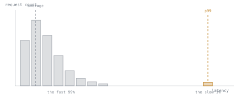

# 第 16 课：p99 延迟的测量方法

**使命关联:** 本工作区的使命，是为 p99 延迟预算辩护，而被辩护的数字必须来自一次做得正确的测量；本课讲的就是“做得正确”是什么意思，之后第 17 课才把这个数字与前面的每个选择联系起来。
**主要来源:** [文档：vLLM Documentation，vLLM Project](https://docs.vllm.ai/en/latest/)
**前置知识:** [第 15 课](0015-what-changes-off-gpu.md)、[KV 缓存](../GLOSSARY.md)

## 热身

1. ▢ 为什么预填充一步就占去了一个请求最终缓存占用的大部分，而解码则慢慢加上其余的部分？

检查

预填充在一次前向计算中处理整个提示词，把每个提示词 token 的键和值一起算出并缓存。解码每步生成一个输出 token，所以缓存每步只增长一个 token 的量。

2. ▢ 在连续批处理中，是什么导致一个被接纳的大请求，拖住了与它共用批次步的所有其他序列？

检查

一个批次步是原子的：共用它的每个序列一起前进，所以并进一步里的大预填充，会延迟所有其他序列的下一个 token，直到这一步完成。这就是队首阻塞。

## 要点

### 为什么看 p99，而不是平均值

延迟分布的 **p99** 是 99% 的被测请求都不超过的那个值；只有最慢的 1% 比它更慢。平均值看起来可能很好，却掩盖了真实的问题：比如第 5 课的队首阻塞，只会打到那一小部分运气不好、与大预填充共用一步的请求，所以在成千上万个本来就很快的请求上，它几乎拉不动平均值，却能让那倒霉的 1% 慢得离谱。一个靠平均值来辩护的延迟预算，恰好会漏掉本工作区在第 2 阶段花力气讲清楚的那种失败模式。

### 哪一种延迟，要分开测量

对 LLM 服务器来说，“请求延迟”不是一个数字；它至少要拆成**首 token 延迟（TTFT）**，由预填充主导，以及 **token 间延迟（ITL）**，有时也叫每输出 token 的时间，由解码主导。它们的行为不同（第 3 课），受不同的杠杆影响（TTFT 受批处理和调度影响，ITL 受批大小和量化影响），所以把它们合并成一个混合数字，就看不清一个糟糕的 p99 究竟指向哪个杠杆。一个值得辩护的预算，要把 p99 TTFT 和 p99 ITL（或者端到端总延迟的 p99，当它确实是工作负载真正关心的东西时）作为分开的数字点名，而不是把两种不同的东西取一个平均。

### 怎样的 p99 测量才值得信任

p99 是对罕见事件的估计，按定义只是样本中最差的 1%，所以它需要足够多的样本才有意义：从 20 个请求算出的 p99，实际上报告的是单个请求（20 个里第 1 百分位最差的，接近最大值，而不是稳定的尾部估计），而稳定的估计通常需要几百到几千个样本。产生这些样本的负载也必须与真实的工作负载相像：真实的并发（不能低到批处理和调度行为从未真正受到压力），以及真实的提示词与输出长度的混合（第 4 课的静态批处理浪费和第 5 课的队首阻塞，都取决于请求长度的差异，而请求长度一致的基准测试永远暴露不出这一点）。在不真实的负载下测得的 p99，是一个关于并非正在服务的那个工作负载的真实数字。

## 练习

1. ▢ 一台服务器的平均请求延迟看起来没问题，但用户偶尔反映有请求花的时间远超预期。这种模式说明问题会出现在延迟分布的什么位置，为什么平均值可能没抓到它？

检查

这说明是尾部问题，类似第 5 课的队首阻塞，只影响一小部分请求。在许多大多不受影响的请求上取平均，即使这一小部分慢得离谱，平均值也几乎不动，这恰恰就是为什么需要 p99（或类似的高百分位）才能看到它。

2. ▢ 为什么 TTFT 和 token 间延迟应该作为分开的 p99 数字来测量和报告，而不是合并成一个“平均请求延迟”数字？

检查

TTFT 由预填充主导，受调度和分块影响；token 间延迟由解码主导，受批大小和量化影响。一个混合的数字说不清一个糟糕的结果究竟指向哪个杠杆，而且改善其中一个可能让混合的平均值动起来，却看不出另一个是否变差了。

3. ▢ 一个团队从 20 个测量的请求算出一个 p99 延迟数字。这个数字可信吗？为什么可信或不可信？

提示

想想第 99 百分位，实际上描述的是这 20 个请求中的几个。

检查

不可靠。只有 20 个样本时，第 99 百分位接近于只是在报告样本中最慢的那一个请求，而不是对真实尾部的稳定估计。可信的 p99 需要大得多的样本，通常是几百到几千个请求，才能把“恰好是哪些请求落进了最差的 1%”带来的噪声平均掉。

4. ▢ 一个基准测试使用的请求，提示词和输出长度都相同、整齐划一，来测量 p99 延迟。为什么这可能低估了请求长度各异的生产工作负载实际会看到的 p99？

检查

第 4 课和第 5 课都表明，请求长度的差异，才是造成损害尾部延迟的失败模式的原因：静态批处理的浪费随请求长度之间的差距而增大，而队首阻塞是由较小的请求之间到来一个异常大的预填充触发的。长度一致的基准测试永远产生不了这种差异，所以它永远触及不到真实工作负载的尾部延迟实际所来自的那些条件。

5. ▢ 关于一个站得住脚的 p99 延迟测量，哪种说法是对的？

    - a) 任意规模的一次基准测试运行就足够了，只要它报告了一个 p99 数字
    - b) 它应该在真实的并发和请求长度差异下测量，并分别报告 TTFT 和 token 间延迟
    - c) 平均值和 p99 总是一起变化，所以测一个就够了
    - d) p99 只对 CPU/边缘服务要紧，对 GPU 服务不要紧

检查

**b)** 负载的真实性，以及把 TTFT 与 token 间延迟分开，二者都是这个数字能指向可以据以行动的东西所必需的。(a) 是错的：样本太少会让 p99 不稳定，第 3 题已经说明了这一点。(c) 是错的：平均值可能恰好掩盖了 p99 存在的目的所要抓住的尾部行为。(d) 是错的：尾部延迟及其测量，对任何服务栈，无论 GPU 还是 CPU，都要紧。

## 实战练习

- [ ] 找到你的服务栈的基准测试工具（vLLM 自带 `benchmark_serving.py`），读一读它默认报告哪些百分位，以及它使用什么样的请求长度分布。
- [ ] 针对你心里的某个工作负载，写下真实的提示词/输出长度分布会是什么样，以及一个使用统一长度的基准测试，会不会漏掉它的什么东西。
- [ ] 明天：如果你有一台运行中的服务器，对它运行一次至少几百个请求的基准测试，分别记下报告的 p99 TTFT 和 p99 token 间延迟。

## 延伸阅读

- [文档：vLLM Documentation，vLLM Project](https://docs.vllm.ai/en/latest/)
- [文章：“How continuous batching enables 23x throughput in LLM inference while reducing p50 latency”，Anyscale](https://www.anyscale.com/blog/continuous-batching-llm-inference)
- [资源](../RESOURCES.md)

---

没学明白？请重读顶部的主要来源，因为本课是对它的压缩，而理解正是在压缩中流失的。如果有哪个术语觉得含糊，可以查看[术语表](../GLOSSARY.md)。

如果问题出在课程本身，而不是学习材料，那就是一个缺陷：[提交 issue](https://github.com/TokenCemetery/teach/issues)。
