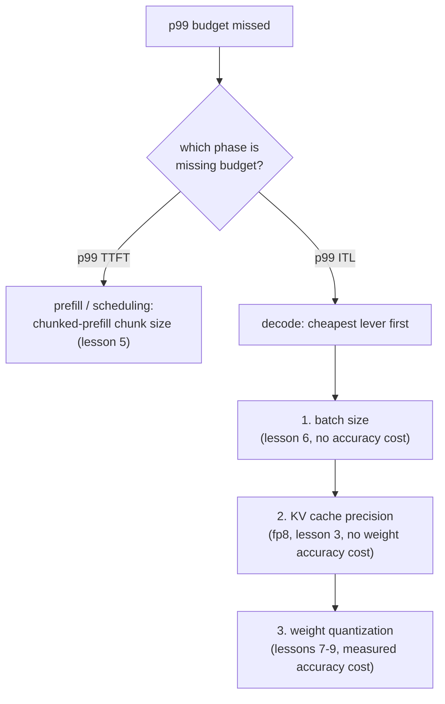

# Lección 17. Defender un presupuesto de latencia de extremo a extremo

**Vínculo con la misión:** Esta lección cierra la etapa 6, el presupuesto de latencia que las etapas 7 a 14 amplían después: citar y defender un presupuesto de latencia p99 de extremo a extremo significa diagnosticar un incumplimiento recorriendo hacia atrás la caché, el batching y la cuantización en el orden correcto, y defender la corrección con las cifras que cada una de esas lecciones enseñó a medir.
**Fuente principal:** [Docs: vLLM Documentation, vLLM Project](https://docs.vllm.ai/en/latest/)
**Requisitos previos:** [Lección 16](0016-p99-latency-methodology.md), [Lección 9](0009-picking-a-quantization-scheme.md), [Lección 2](0002-capacity-and-batch-size.md), [KV cache](../GLOSSARY.md)

## Calentamiento

1. ▢ Escribe de memoria la fórmula del techo de capacidad de la lección 2.

Comprobación

`max concurrent sequences = (total memory − weights − overhead) / (bytes per token × context length)`.

2. ▢ ¿Con qué tres cifras dice la lección 9 que hay que defender una elección de cuantización?

Comprobación

La cifra de memoria que hizo necesaria la cuantización (o muestra que no lo era), la cifra de precisión medida para el esquema elegido y la cifra de velocidad realmente medida para la fase que importa.

## Qué debes saber

### El diagnóstico sigue a la fase, y luego a la palanca

Un presupuesto de p99 incumplido es un síntoma, no un diagnóstico. La primera división es qué fase incumple el presupuesto: el p99 del TTFT apunta al prefill y al scheduling (el head-of-line blocking de la lección 5, el tamaño de chunk del chunked prefill), mientras que el p99 de la latencia entre tokens apunta al decode (el tamaño de lote de la lección 6, la precisión de la caché de la lección 3, la cuantización de pesos de las lecciones 7 a 9). Revisar las palancas de la fase equivocada desperdicia esfuerzo: ajustar el tamaño de chunk no hace nada por un problema de ITL limitado por el decode, y reducir el lote no hace nada por un problema de TTFT causado por un prefill grande que detiene la cola.

Una vez identificada la fase, el orden de las palancas sigue al costo: primero la solución más barata que no cuesta precisión (el tamaño de lote, ya que la lección 6 ya mostró cómo calcular el mayor lote que permite un presupuesto), luego un cambio de precisión de la caché (la KV cache en fp8 de la lección 3, que no cuesta precisión de pesos), y luego la cuantización de pesos (lecciones 7 a 9, que sí cuesta precisión medida y solo debe usarse cuando las palancas más baratas se han agotado o son insuficientes).

### Una cadena resuelta

Un servidor que sirve un modelo de 13B en una GPU de 80 GB mide, con un benchmark realista de 2,000 solicitudes (lección 16), un p99 del TTFT cómodamente dentro del presupuesto y un p99 de latencia entre tokens de 80 ms frente a un presupuesto de 50 ms. Que el TTFT esté bien descarta los problemas de scheduling de la lección 5; este es un problema de ITL, de la fase de decode. El equipo revisa primero el tamaño de lote: ya está en la cifra que defendería la lección 6 para esta carga de trabajo, así que reducirlo más costaría throughput que la carga de trabajo necesita. A continuación, cuantizan los pesos a int8 (lección 7), lo que baja la ITL a 65 ms, midiendo la diferencia de precisión frente al modelo sin cuantizar como exige la lección 9. Aún por encima del presupuesto, sopesan dos opciones restantes: bajar más el tamaño de lote (sin costo de precisión, pero con costo de throughput) o cuantizar a int4 con AWQ (libera más tiempo de decode, con un costo de precisión adicional medido). El marco de la lección 9 lo decide: la opción que cierre la brecha restante sin pagar más de lo que el presupuesto realmente necesita. Si un tamaño de lote menor sigue cumpliendo la concurrencia requerida por la carga de trabajo, esa es la solución más barata; solo si no la cumple se paga el costo de precisión adicional de int4.

### Qué tiene que citar la defensa final

Una configuración que ya cumple su presupuesto de p99 no está defendida hasta que nombra tres cosas: las propias **cifras de p99 medidas**, a partir de una muestra lo bastante grande y realista para ser fiable (lección 16); el **razonamiento de memoria y de tamaño de lote** detrás del techo de capacidad y del tamaño de lote en que se asentó la configuración (lecciones 2 y 6); y la **cifra de precisión** medida para la cuantización que se haya aplicado, si hubo alguna, para llegar hasta ahí (lección 9). Una configuración que alcanza su objetivo de latencia por suerte, sin ninguna de estas tres cosas escrita, está tan indefensa como una que no lo alcanza.

## Práctica

1. ▢ El p99 de latencia entre tokens de un servidor es de 80 ms frente a un presupuesto de 50 ms, mientras que el p99 del TTFT está cómodamente dentro del presupuesto. Nombra las dos primeras cosas que vale la pena revisar, en orden, y por qué en ese orden.

Comprobación

Primero, el tamaño de lote frente a la cifra defendida en la lección 6: la ITL es una cifra de la fase de decode y sensible al tamaño de lote, y ajustar el tamaño de lote no cuesta nada de precisión, lo que lo convierte en la palanca más barata que revisar. Segundo, la cuantización de pesos (lecciones 7 a 9), ya que el decode está limitado por el ancho de banda de memoria y una huella de pesos menor reduce directamente la latencia por paso, a un costo de precisión medido que solo se paga una vez revisada la palanca gratuita. Que el TTFT esté bien descarta revisar primero el chunked prefill o el scheduling, ya que esas son las palancas del lado del TTFT de la lección 5.

2. ▢ Tras cuantizar a int8, el p99 de la ITL baja a 65 ms, aún por encima del presupuesto de 50 ms. El equipo está decidiendo entre reducir más el tamaño de lote o cuantizar a int4. ¿Qué dice el marco de la lección 9 que debería decidir entre ellos?

Comprobación

La opción que cierre la brecha restante sin pagar más de lo que necesita el presupuesto. Si un tamaño de lote menor sigue cumpliendo la concurrencia requerida por la carga de trabajo y baja del presupuesto de 50 ms, esa es la mejor opción, ya que no cuesta más precisión. Solo si un lote menor no puede bajar del presupuesto, o no puede hacerlo sin caer por debajo de la concurrencia que exige la carga de trabajo, queda justificado el costo de precisión adicional medido de int4.

3. ▢ El equipo se decide por la cuantización int8 con un tamaño de lote que mantiene la concurrencia donde la necesita la carga de trabajo, y consigue un p99 de ITL de 48 ms y un p99 de TTFT de 210 ms, ambos medidos con 2,000 solicitudes con una distribución de longitudes de prompt que coincide con el tráfico de producción. ¿Qué tres cosas necesita citar su defensa final?

Comprobación

Las propias cifras de p99 medidas, a partir de una muestra lo bastante grande y de forma realista para fiarse de ella (lección 16). El razonamiento de memoria y de tamaño de lote detrás de la configuración elegida, que vincule el tamaño de lote con el techo de capacidad de la lección 2 y con la cifra defendida en la lección 6. La cifra de precisión medida para el checkpoint int8 frente al modelo sin cuantizar (lección 9), que muestre que el paso de cuantización se comprobó y no se dio por gratis.

4. ▢ ¿Qué afirmación es verdadera del diagnóstico de un presupuesto de latencia p99 incumplido de extremo a extremo?

    - a) Se puede cambiar cualquier parámetro al azar hasta que mejore la cifra medida
    - b) El orden de diagnóstico sigue qué fase incumple el presupuesto, y luego qué palanca señala la mecánica de esa fase, la más barata primero
    - c) Una sola ejecución de benchmark es evidencia suficiente para defender un cambio de configuración
    - d) La cuantización debería ser siempre lo primero que se prueba, sin importar qué fase incumple el presupuesto

Comprobación

**b)** Primero la fase (TTFT frente a ITL), y luego la palanca más barata que implica la mecánica de esa fase, es el orden que siguió la cadena resuelta de esta lección. (a) es falsa: trastear sin dirección no es diagnosticar y desperdicia esfuerzo en las palancas de la fase equivocada. (c) es falsa: la lección 16 exige suficientes muestras y una varianza realista de longitud de solicitud para que un p99 sea fiable siquiera. (d) es falsa: la cuantización cuesta precisión medida y debe usarse después de palancas más baratas y sin costo de precisión como el tamaño de lote, no antes de comprobar si bastan.

## Prácticas en el mundo real

- [ ] Para una carga de trabajo que tengas en mente, o una real que estés sirviendo, recorre de extremo a extremo el orden de diagnóstico de esta lección: identifica qué fase (si alguna) incumple el presupuesto, revisa primero la palanca más barata y anota las tres cosas que tendría que citar tu defensa final.
- [ ] Si has estado construyendo un despliegue real a lo largo de las lecciones de este espacio de trabajo, reúne su p99 de TTFT y su p99 de ITL realmente medidos, con un benchmark dimensionado y con la forma que describe la lección 16, y compáralos con un presupuesto de latencia que defenderías.
- [ ] Mañana: vuelve a la misión de este espacio de trabajo en `README.md` y confirma, con tus propias palabras, que ya puedes hacer lo que describe: poner en marcha un stack de serving y defender el presupuesto de latencia que produce.

## Para profundizar

- [Docs: vLLM Documentation, vLLM Project](https://docs.vllm.ai/en/latest/)
- [Article: "Transformer Inference Arithmetic", Kipply](https://kipp.ly/transformer-inference-arithmetic/)
- [Recursos](../RESOURCES.md)

---

¿No termina de quedar claro? Vuelve a leer la fuente primaria de arriba, ya que esta lección la comprime y en la compresión es donde se escapa la comprensión. Consulta el [glosario](../GLOSSARY.md) por si algún término te resultó resbaladizo.

Si lo poco claro es la propia lección y no el material, eso es un defecto: [abre un issue](https://github.com/TokenCemetery/teach/issues).
