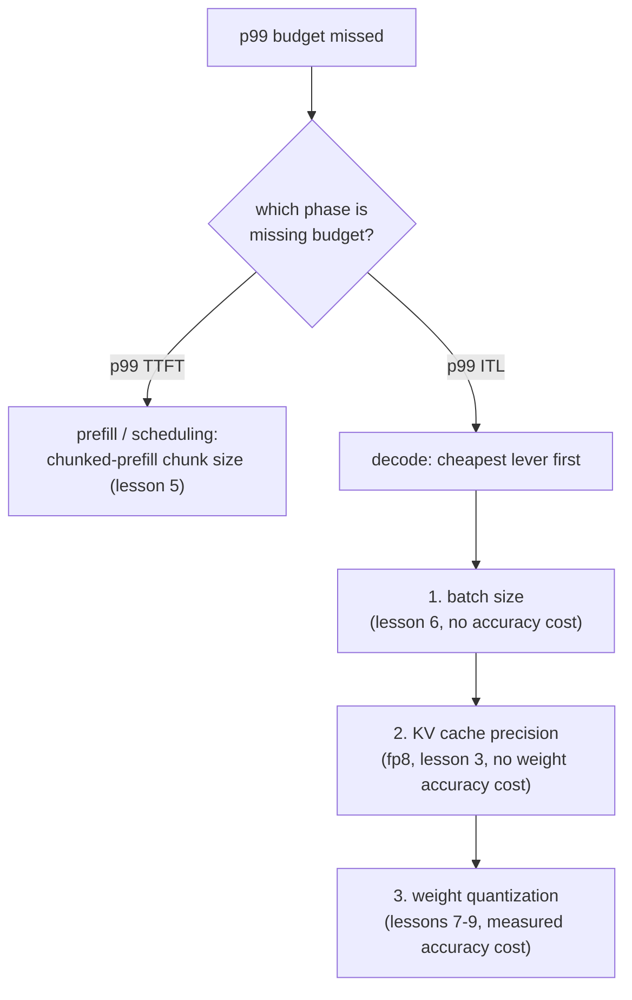

# Leçon 17. Défendre un budget de latence de bout en bout

**Lien avec la mission :** C'est la dernière leçon de la mission : annoncer et défendre de bout en bout un budget de latence p99, c'est diagnostiquer un dépassement en remontant le cache, le batching et la quantification dans le bon ordre, et défendre le correctif avec les chiffres que chacune de ces leçons a appris à mesurer.
**Source primaire :** [Doc : vLLM Documentation, vLLM Project](https://docs.vllm.ai/en/latest/)
**Prérequis :** [Leçon 16](0016-p99-latency-methodology.md), [Leçon 9](0009-picking-a-quantization-scheme.md), [Leçon 2](0002-capacity-and-batch-size.md), [KV cache](../GLOSSARY.md)

## Échauffement

1. ▢ Écrivez de mémoire la formule du plafond de capacité de la leçon 2.

Vérifier

`max concurrent sequences = (total memory − weights − overhead) / (bytes per token × context length)`.

2. ▢ Avec quels trois chiffres la leçon 9 dit-elle qu'un choix de quantification doit être défendu ?

Vérifier

Le chiffre de mémoire qui a rendu la quantification nécessaire (ou qui montre qu'elle ne l'était pas), le chiffre de précision mesuré pour le schéma choisi, et le chiffre de vitesse réellement mesuré pour la phase qui compte.

## À savoir

### Le diagnostic suit la phase, puis le levier

Un budget p99 manqué est un symptôme, pas un diagnostic. La première distinction porte sur la phase qui dépasse le budget : le p99 du TTFT désigne le prefill et l'ordonnancement (le head-of-line blocking de la leçon 5, la taille de morceau du chunked prefill), tandis que le p99 de la latence inter-token désigne le decode (la taille de batch de la leçon 6, la précision du cache de la leçon 3, la quantification des poids des leçons 7 à 9). Vérifier les leviers de la mauvaise phase fait perdre de l'effort : régler la taille de morceau ne fait rien pour un problème d'ITL lié au decode, et réduire le batch ne fait rien pour un problème de TTFT causé par un gros prefill qui bloque la file.

Une fois la phase identifiée, l'ordre des leviers suit le coût : le correctif le moins cher qui ne coûte pas de précision vient en premier (la taille de batch, puisque la leçon 6 a déjà montré comment calculer le plus grand batch qu'un budget permet), puis un changement de précision du cache (le KV cache fp8 de la leçon 3, qui ne coûte aucune précision de poids), puis la quantification des poids (leçons 7 à 9, qui coûte bien de la précision mesurée et ne doit être employée qu'une fois les leviers moins chers épuisés ou insuffisants).

### Une chaîne illustrée

Un serveur qui sert un modèle 13B sur un GPU de 80 GB mesure, à partir d'un benchmark réaliste de 2 000 requêtes (leçon 16), un p99 du TTFT confortablement sous le budget et un p99 de la latence inter-token de 80 ms face à un budget de 50 ms. Le TTFT étant correct, cela exclut les problèmes d'ordonnancement de la leçon 5 ; c'est un problème de la phase de decode, d'ITL. L'équipe vérifie d'abord la taille de batch : elle est déjà au chiffre que la leçon 6 défendrait pour cette charge de travail, donc la réduire encore coûterait du débit dont la charge de travail a besoin. Ensuite, elle quantifie les poids en int8 (leçon 7), ce qui abaisse l'ITL à 65 ms, en mesurant l'écart de précision par rapport au modèle non quantifié comme l'exige la leçon 9. Toujours au-dessus du budget, elle pèse deux options restantes : réduire encore la taille de batch (sans coût de précision, mais au prix du débit) ou quantifier en int4 avec AWQ (libère plus de temps de decode, au prix d'un coût de précision mesuré supplémentaire). Le cadre de la leçon 9 tranche : celle des deux options qui comble l'écart restant sans payer plus que ce dont le budget a réellement besoin. Si une taille de batch plus petite satisfait encore la concurrence requise par la charge de travail, c'est le correctif le moins cher ; ce n'est que si ce n'est pas le cas que le coût de précision supplémentaire de int4 est payé.

### Ce que la défense finale doit citer

Une configuration qui respecte maintenant son budget p99 n'est pas encore défendue tant qu'elle ne nomme pas trois éléments : les **chiffres p99 mesurés** eux-mêmes, à partir d'un échantillon assez grand et réaliste pour être digne de confiance (leçon 16) ; le **raisonnement sur la mémoire et la taille de batch** derrière le plafond de capacité et la taille de batch sur lesquels la configuration s'est arrêtée (leçons 2 et 6) ; et le **chiffre de précision** mesuré pour la quantification éventuellement appliquée pour y arriver (leçon 9). Une configuration qui atteint sa cible de latence par chance, sans aucun de ces trois éléments consignés, est aussi peu défendue que celle qui la manque.

## Pratique

1. ▢ Le p99 de la latence inter-token d'un serveur est de 80 ms face à un budget de 50 ms, tandis que le p99 du TTFT est confortablement sous le budget. Nommez les deux premières choses qui valent la peine d'être vérifiées, dans l'ordre, et pourquoi dans cet ordre.

Vérifier

D'abord, la taille de batch par rapport au chiffre défendu à la leçon 6 : l'ITL est un chiffre de la phase de decode, sensible à la taille de batch, et ajuster la taille de batch ne coûte rien en précision, ce qui en fait le levier le moins cher à vérifier. Ensuite, la quantification des poids (leçons 7 à 9), puisque le decode est limité par la bande passante mémoire et qu'une empreinte de poids plus petite réduit directement la latence par étape, au prix d'une précision mesurée qui n'est payée qu'une fois le levier gratuit vérifié. Le TTFT étant correct, il n'y a pas lieu de vérifier d'abord le chunked prefill ou l'ordonnancement, puisque ce sont les leviers côté TTFT de la leçon 5.

2. ▢ Après la quantification en int8, le p99 de l'ITL tombe à 65 ms, toujours au-dessus du budget de 50 ms. L'équipe hésite entre réduire encore la taille de batch ou quantifier en int4. Que dit le cadre de la leçon 9 sur ce qui doit trancher entre les deux ?

Vérifier

Celle des deux options qui comble l'écart restant sans payer plus que ce dont le budget a besoin. Si une taille de batch plus petite satisfait encore la concurrence requise par la charge de travail et passe sous le budget de 50 ms, c'est le meilleur choix, puisqu'il ne coûte aucune précision supplémentaire. Ce n'est que si un batch plus petit ne peut pas passer sous le budget, ou ne le peut pas sans descendre sous la concurrence qu'exige la charge de travail, que le coût de précision mesuré supplémentaire de int4 devient justifié.

3. ▢ L'équipe s'arrête sur la quantification int8 avec une taille de batch qui maintient la concurrence là où la charge de travail en a besoin, obtenant un p99 de l'ITL de 48 ms et un p99 du TTFT de 210 ms, tous deux mesurés sur 2 000 requêtes avec une distribution de longueurs de prompt qui correspond au trafic de production. Quels trois éléments sa défense finale doit-elle citer ?

Vérifier

Les chiffres p99 mesurés eux-mêmes, à partir d'un échantillon assez grand et de forme assez réaliste pour qu'on lui fasse confiance (leçon 16). Le raisonnement sur la mémoire et la taille de batch derrière la configuration choisie, qui relie la taille de batch au plafond de capacité de la leçon 2 et au chiffre défendu à la leçon 6. Le chiffre de précision mesuré pour le checkpoint int8 par rapport au modèle non quantifié (leçon 9), qui montre que l'étape de quantification a été vérifiée, et non supposée gratuite.

4. ▢ Laquelle de ces affirmations est vraie à propos du diagnostic de bout en bout d'un budget de latence p99 manqué ?

    - a) N'importe quelle option peut être changée au hasard jusqu'à ce que le chiffre mesuré s'améliore
    - b) L'ordre du diagnostic suit la phase qui dépasse le budget, puis le levier que la mécanique de cette phase désigne, le moins cher d'abord
    - c) Une seule exécution de benchmark suffit comme preuve pour défendre un changement de configuration
    - d) La quantification devrait toujours être la première chose essayée, quelle que soit la phase qui dépasse le budget

Vérifier

**b)** La phase d'abord (TTFT contre ITL), puis le levier le moins cher que la mécanique de cette phase met en cause, c'est l'ordre qu'a suivi la chaîne illustrée de cette leçon. (a) est fausse : tâtonner sans direction n'est pas du diagnostic et fait perdre de l'effort sur les leviers de la mauvaise phase. (c) est fausse : la leçon 16 exige assez d'échantillons et une variance de longueur de requêtes réaliste pour qu'un p99 soit digne de confiance. (d) est fausse : la quantification coûte de la précision mesurée et doit être employée après des leviers moins chers et sans coût de précision comme la taille de batch, et non avant d'avoir vérifié s'ils suffisent.

## Exercices en situation réelle

- [ ] Pour une charge de travail que vous avez en tête, ou une vraie que vous servez, parcourez de bout en bout l'ordre de diagnostic de cette leçon : identifiez quelle phase (si l'une d'elles) dépasse le budget, vérifiez d'abord le levier le moins cher, et écrivez les trois éléments que votre défense finale devrait citer.
- [ ] Si vous avez construit un vrai déploiement tout au long des leçons de cet espace de travail, rassemblez son p99 du TTFT et son p99 de l'ITL réellement mesurés, à partir d'un benchmark dimensionné et façonné comme le décrit la leçon 16, et comparez-les à un budget de latence que vous défendriez.
- [ ] Demain : relisez la mission de cet espace de travail dans `README.md` et confirmez, avec vos propres mots, que vous pouvez maintenant faire ce qu'elle décrit : mettre en place une pile de serving et défendre le budget de latence qu'elle produit.

## Pour aller plus loin

- [Doc : vLLM Documentation, vLLM Project](https://docs.vllm.ai/en/latest/)
- [Billet : "Transformer Inference Arithmetic", Kipply](https://kipp.ly/transformer-inference-arithmetic/)
- [Ressources](../RESOURCES.md)

---

Ça ne passe pas ? Relisez la source primaire en haut de page, car cette leçon la condense et c'est dans la condensation que la compréhension s'échappe. Consultez le [glossaire](../GLOSSARY.md) pour tout terme qui vous a paru glissant.

Si c'est la leçon elle-même qui n'est pas claire plutôt que la matière, c'est un défaut : [ouvrez une issue](https://github.com/TokenCemetery/teach/issues).
