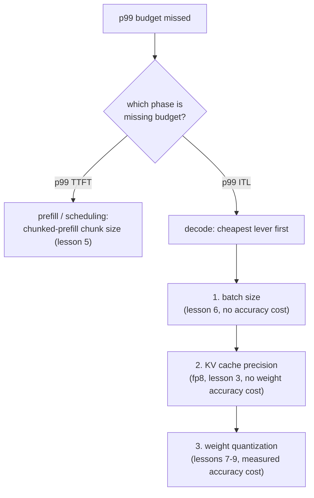

# पाठ 17. Latency Budget का शुरू से अंत तक बचाव

**मिशन से संबंध:** यह पाठ चरण 6 पूरा करता है, यानी latency budget, जिसे चरण 7 से 14 आगे बढ़ाते हैं: p99 latency budget को शुरू से अंत तक बताने और उसका बचाव करने का मतलब है चूक का निदान करना, cache, batching और quantization से सही क्रम में वापस गुज़रकर, और सुधार का बचाव उन संख्याओं से करना जिन्हें नापना इनमें से हर पाठ ने सिखाया।
**मुख्य स्रोत:** [दस्तावेज़: vLLM Documentation, vLLM Project](https://docs.vllm.ai/en/latest/)
**पूर्व-आवश्यकताएँ:** [पाठ 16](0016-p99-latency-methodology.md), [पाठ 9](0009-picking-a-quantization-scheme.md), [पाठ 2](0002-capacity-and-batch-size.md), [KV cache](../GLOSSARY.md)

## वार्म-अप

1. ▢ पाठ 2 का capacity सीमा वाला formula याददाश्त से लिखें।

जाँचें

`max concurrent sequences = (total memory − weights − overhead) / (bytes per token × context length)`।

2. ▢ पाठ 9 के अनुसार quantization के चुनाव का बचाव किन तीन संख्याओं से होना चाहिए?

जाँचें

वह memory का आँकड़ा जिसने quantization को ज़रूरी बनाया (या दिखाता है कि वह ज़रूरी नहीं था), चुनी गई scheme के लिए नापी गई accuracy की संख्या, और उस चरण के लिए असल में नापी गई speed की संख्या जो मायने रखता है।

## यह जानें

### निदान पहले चरण का पीछा करता है, फिर उपाय का

चूका हुआ p99 budget लक्षण है, निदान नहीं। पहला बँटवारा यह है कि कौन-सा चरण budget चूक रहा है: p99 TTFT prefill और scheduling की ओर इशारा करता है (पाठ 5 की head-of-line blocking, chunked prefill का chunk size), जबकि p99 inter-token latency decode की ओर (पाठ 6 का batch size, पाठ 3 की cache precision, पाठ 7 से 9 की weight quantization)। ग़लत चरण के उपाय जाँचना मेहनत बरबाद करता है: chunk size tune करने से decode-bound ITL समस्या का कुछ नहीं बनता, और batch घटाने से बड़े prefill के queue रोकने से पैदा हुई TTFT समस्या का कुछ नहीं बनता।

चरण पहचान लिए जाने के बाद, उपायों का क्रम लागत का पीछा करता है: सबसे सस्ता सुधार जिसकी accuracy की क़ीमत नहीं, पहले आता है (batch size, क्योंकि पाठ 6 पहले दिखा चुका है कि budget जितना सबसे बड़ा batch अनुमति देता है उसे कैसे निकालें), फिर cache-precision का बदलाव (पाठ 3 का fp8 KV cache, जिसकी weight accuracy की कोई क़ीमत नहीं), फिर weight quantization (पाठ 7 से 9, जिसकी नापी गई accuracy की क़ीमत है और जिस तक तभी पहुँचना चाहिए जब सस्ते उपाय ख़त्म हो चुके हों या काफ़ी न हों)।

### एक हल की हुई कड़ी

एक 80 GB GPU पर 13B model serve करने वाला server, 2,000 requests के यथार्थवादी benchmark (पाठ 16) से, budget के काफ़ी नीचे p99 TTFT और 50 ms budget के विरुद्ध 80 ms की p99 inter-token latency नापता है। TTFT ठीक होना पाठ 5 की scheduling समस्याओं को ख़ारिज करता है; यह decode-चरण की, ITL की समस्या है। Team पहले batch size जाँचती है: वह पहले से उस आँकड़े पर है जिसका बचाव पाठ 6 इस workload के लिए करता, इसलिए उसे और घटाने से वह throughput जाता जो workload को चाहिए। फिर वे weights को int8 में quantize करते हैं (पाठ 7), जो ITL को 65 ms तक घटाता है, और पाठ 9 की माँग के अनुसार unquantized model के मुक़ाबले accuracy का फ़र्क़ नापते हैं। अब भी budget से ऊपर होने पर, वे दो बचे विकल्प तौलते हैं: batch size और घटाना (accuracy की कोई क़ीमत नहीं, पर throughput की क़ीमत) या AWQ के साथ int4 पर quantize करना (decode का और समय मुक्त करता है, एक और, नापी गई accuracy की क़ीमत पर)। पाठ 9 का ढाँचा तय करता है: जो भी विकल्प बचे अंतर को इससे ज़्यादा चुकाए बिना पाटे जितना budget को असल में चाहिए। अगर छोटा batch size अब भी workload की ज़रूरी concurrency पूरी करता है, तो वही सस्ता सुधार है; सिर्फ़ तब जब वह न करे, int4 की अतिरिक्त accuracy की क़ीमत चुकाई जाती है।

### अंतिम बचाव को क्या गिनाना है

अपना p99 budget अब पूरा करने वाली configuration का बचाव तब तक नहीं हुआ है जब तक वह तीन चीज़ों के नाम न ले: ख़ुद **नापे गए p99 आँकड़े**, इतने बड़े और यथार्थवादी नमूने से जो भरोसे लायक़ हो (पाठ 16); उस capacity सीमा और batch size के पीछे का **memory और batch-size का तर्क** जिस पर configuration टिकी (पाठ 2 और 6); और वहाँ पहुँचने के लिए जो भी quantization, अगर कोई, लगाई गई उसके लिए नापी गई **accuracy की संख्या** (पाठ 9)। जो configuration इन तीनों में से कुछ भी लिखे बिना क़िस्मत से अपना latency लक्ष्य पा लेती है, वह उतनी ही बिना बचाव की है जितनी वह जो उसे चूक जाती है।

## अभ्यास

1. ▢ Server की p99 inter-token latency 50 ms budget के विरुद्ध 80 ms है, जबकि p99 TTFT budget के काफ़ी नीचे है। जाँचने लायक़ पहली दो चीज़ें, क्रम से, बताएँ, और उसी क्रम में क्यों।

जाँचें

पहले, batch size पाठ 6 के बचाव किए गए आँकड़े के विरुद्ध: ITL decode-चरण की, batch-size-संवेदनशील संख्या है, और batch size बदलने में accuracy की कोई क़ीमत नहीं, इसलिए यही जाँचने के लिए सबसे सस्ता उपाय है। दूसरे, weight quantization (पाठ 7 से 9), क्योंकि decode memory-bandwidth bound है और छोटा weight footprint प्रति-step latency को सीधे घटाता है, नापी गई accuracy की क़ीमत पर जो तभी चुकाई जाती है जब मुफ़्त उपाय जाँच लिया गया हो। TTFT ठीक होना chunked-prefill या scheduling को पहले जाँचने को ख़ारिज करता है, क्योंकि वे पाठ 5 के TTFT-पक्ष के उपाय हैं।

2. ▢ int8 में quantize करने के बाद, p99 ITL घटकर 65 ms हो जाती है, जो अब भी 50 ms budget से ऊपर है। Team तय कर रही है कि batch size और घटाए या int4 पर quantize करे। पाठ 9 का ढाँचा कहता है कि इनमें से चुनाव किससे तय होना चाहिए?

जाँचें

जो भी विकल्प बचे अंतर को इससे ज़्यादा चुकाए बिना पाटे जितना budget को चाहिए। अगर छोटा batch size अब भी workload की ज़रूरी concurrency पूरी करता है और 50 ms budget पार कर देता है, तो वही बेहतर चुनाव है, क्योंकि उसकी कोई और accuracy की क़ीमत नहीं। सिर्फ़ तब जब छोटा batch budget पार न कर पाए, या workload की ज़रूरी concurrency से नीचे गिरे बिना न कर पाए, तभी int4 की अतिरिक्त, नापी गई accuracy की क़ीमत सही ठहरती है।

3. ▢ Team int8 quantization पर टिकती है, ऐसे batch size के साथ जो concurrency वहाँ रखता है जहाँ workload को चाहिए, और 2,000 requests से, production traffic से मेल खाते prompt-length distribution के साथ नापी गई p99 ITL 48 ms और p99 TTFT 210 ms पाती है। उनके अंतिम बचाव को कौन-सी तीन चीज़ें गिनानी चाहिए?

जाँचें

ख़ुद नापे गए p99 आँकड़े, इतने बड़े और यथार्थवादी आकार के नमूने से जिस पर भरोसा हो (पाठ 16)। चुनी गई configuration के पीछे का memory और batch-size का तर्क, batch size को पाठ 2 की capacity सीमा और पाठ 6 के बचाव किए गए आँकड़े से जोड़ते हुए। Unquantized model के मुक़ाबले int8 checkpoint के लिए नापी गई accuracy की संख्या (पाठ 9), जो दिखाए कि quantization के कदम को जाँचा गया, मुफ़्त नहीं माना गया।

4. ▢ चूके हुए p99 latency budget का शुरू से अंत तक निदान करने के बारे में कौन-सा दावा सही है?

    - a) कोई भी flag बेतरतीब बदला जा सकता है जब तक नापी गई संख्या सुधर न जाए
    - b) निदान का क्रम इसका पीछा करता है कि कौन-सा चरण budget चूक रहा है, फिर उस चरण की कार्यप्रणाली किस उपाय की ओर इशारा करती है, सबसे सस्ता पहले
    - c) configuration में बदलाव का बचाव करने के लिए एक अकेली benchmark run काफ़ी सबूत है
    - d) चरण कोई भी budget चूक रहा हो, quantization ही सबसे पहले आज़माना चाहिए

जाँचें

**b)** पहले चरण (TTFT बनाम ITL), फिर उस चरण की कार्यप्रणाली जिस सबसे सस्ते उपाय को फँसाती है, यही वह क्रम है जो इस पाठ की हल की हुई कड़ी ने अपनाया। (a) ग़लत है: दिशाहीन छेड़छाड़ निदान नहीं है और ग़लत चरण के उपायों पर मेहनत बरबाद करती है। (c) ग़लत है: पाठ 16 माँगता है कि p99 को भरोसेमंद होने के लिए पर्याप्त नमूने और यथार्थवादी request-length variance हो। (d) ग़लत है: quantization की नापी गई accuracy की क़ीमत है और उस तक सस्ते, accuracy-मुक्त उपायों जैसे batch size के बाद पहुँचना चाहिए, यह जाँचे बिना कि वे काफ़ी हैं या नहीं।

## असली दुनिया का अभ्यास

- [ ] अपने सोचे हुए किसी workload के लिए, या ऐसे असली के लिए जो आप serve कर रहे हैं, इस पाठ के निदान क्रम को शुरू से अंत तक चलाएँ: पहचानें कि कौन-सा चरण (अगर कोई) budget चूक रहा है, सबसे सस्ता उपाय पहले जाँचें, और लिखें कि आपके अंतिम बचाव को कौन-सी तीन चीज़ें गिनानी होंगी।
- [ ] अगर आप इस workspace के पाठों में एक असली deployment बना रहे हैं, तो उसका असली नापा हुआ p99 TTFT और p99 ITL जुटाएँ, ऐसे benchmark से जो पाठ 16 के बताए आकार और बनावट का हो, और उन्हें ऐसे latency budget से मिलाएँ जिसका आप बचाव करेंगे।
- [ ] कल: `README.md` में इस workspace का मिशन फिर देखें और अपने शब्दों में पुष्टि करें कि अब आप वह कर सकते हैं जो वह बताता है: serving stack खड़ा करना और उससे निकलने वाले latency budget का बचाव करना।

## आगे बढ़ने के लिए

- [दस्तावेज़: vLLM Documentation, vLLM Project](https://docs.vllm.ai/en/latest/)
- [लेख: "Transformer Inference Arithmetic", Kipply](https://kipp.ly/transformer-inference-arithmetic/)
- [संसाधन](../RESOURCES.md)

---

बात नहीं बन रही? ऊपर दिए मुख्य स्रोत को दोबारा पढ़ें, क्योंकि यह पाठ उसे संक्षिप्त करता है और समझ संक्षेप में ही रिसती है। जो शब्द फिसलन भरा लगे, उसके लिए [शब्दावली](../GLOSSARY.md) देखें।

अगर दिक़्क़त सामग्री की नहीं बल्कि पाठ की ही है, तो वह एक खोट है: [issue खोलें](https://github.com/TokenCemetery/teach/issues)।
