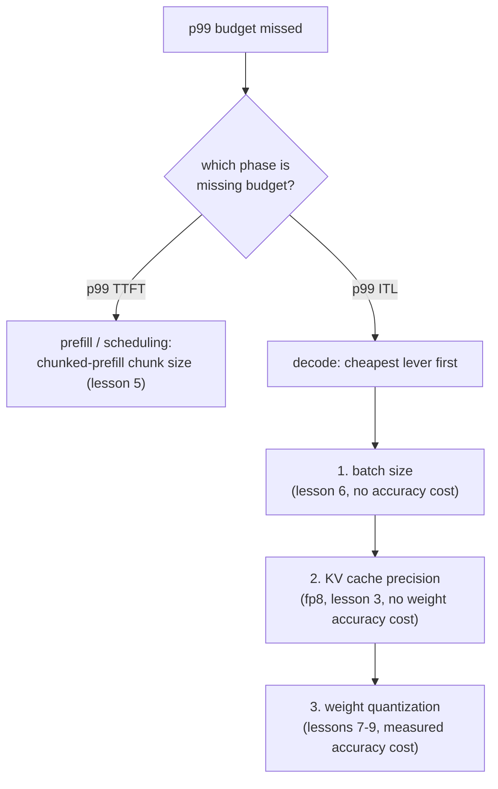

# Lição 17. Defendendo um orçamento de latência de ponta a ponta

**Ligação com a missão:** Esta lição fecha a etapa 6, o orçamento de latência que as etapas 7 a 14 depois ampliam: citar e defender um orçamento de latência p99 de ponta a ponta significa diagnosticar uma falha voltando por cache, batching e quantização na ordem certa, e defender a correção com os números que cada uma dessas lições ensinou a medir.
**Fonte principal:** [Documentação: vLLM Documentation, vLLM Project](https://docs.vllm.ai/en/latest/)
**Pré-requisitos:** [Lição 16](0016-p99-latency-methodology.md), [Lição 9](0009-picking-a-quantization-scheme.md), [Lição 2](0002-capacity-and-batch-size.md), [KV cache](../GLOSSARY.md)

## Aquecimento

1. ▢ Escreva de memória a fórmula do teto de capacidade da lição 2.

Verificação

`max concurrent sequences = (total memory − weights − overhead) / (bytes per token × context length)`.

2. ▢ Com que três números a lição 9 diz que uma escolha de quantização precisa ser defendida?

Verificação

O número de memória que tornou a quantização necessária (ou mostra que não era), o número de acurácia medido para o esquema escolhido e o número de velocidade realmente medido para a fase que importa.

## Saiba isto

### O diagnóstico segue a fase, depois a alavanca

Um orçamento de p99 estourado é um sintoma, e não um diagnóstico. A primeira divisão é qual fase está estourando o orçamento: o p99 do TTFT aponta para o prefill e o scheduling (o head-of-line blocking da lição 5, o tamanho do chunk do chunked prefill), enquanto o p99 da latência entre tokens aponta para o decode (o batch size da lição 6, a precisão do cache da lição 3, a quantização de pesos das lições 7 a 9). Verificar as alavancas da fase errada desperdiça esforço: ajustar o tamanho do chunk não faz nada por um problema de ITL limitado pelo decode, e reduzir o batch não faz nada por um problema de TTFT causado por um prefill grande travando a fila.

Uma vez identificada a fase, a ordem das alavancas segue o custo: a correção mais barata que não custa acurácia vem primeiro (o batch size, já que a lição 6 mostrou como calcular o maior batch que um orçamento permite), depois uma mudança de precisão do cache (o KV cache em fp8 da lição 3, que não custa acurácia dos pesos), depois a quantização de pesos (lições 7 a 9, que custa acurácia medida e só deve ser buscada quando as alavancas mais baratas estiverem esgotadas ou forem insuficientes).

### Uma cadeia resolvida

Um servidor que serve um modelo de 13B em uma GPU de 80 GB mede, a partir de um benchmark realista de 2.000 requisições (lição 16), um p99 do TTFT confortavelmente abaixo do orçamento e uma latência entre tokens p99 de 80 ms contra um orçamento de 50 ms. O TTFT estar bem descarta os problemas de scheduling da lição 5; este é um problema de fase de decode, de ITL. A equipe verifica primeiro o batch size: ele já está no valor que a lição 6 defenderia para esta carga de trabalho, então reduzi-lo ainda mais custaria throughput de que a carga de trabalho precisa. Em seguida, eles quantizam os pesos para int8 (lição 7), o que baixa a ITL para 65 ms, medindo a variação de acurácia em relação ao modelo não quantizado, como a lição 9 exige. Ainda acima do orçamento, eles pesam duas opções restantes: reduzir mais o batch size (sem custo de acurácia, mas custa throughput) ou quantizar para int4 com AWQ (libera mais tempo de decode, a um custo adicional de acurácia, medido). O framework da lição 9 decide: a opção que fechar a lacuna restante sem pagar por mais do que o orçamento realmente precisa. Se um batch size menor ainda atende à concorrência exigida pela carga de trabalho, essa é a correção mais barata; só se não atender é que o custo adicional de acurácia do int4 é pago.

### O que a defesa final precisa citar

Uma configuração que agora cumpre o seu orçamento de p99 ainda não está defendida até que nomeie três coisas: os **números de p99 medidos** em si, de uma amostra grande e realista o bastante para ser confiável (lição 16); o **raciocínio de memória e de batch size** por trás do teto de capacidade e do batch size em que a configuração se fixou (lições 2 e 6); e o **número de acurácia** medido para qualquer quantização que, se houve, tenha sido aplicada para chegar lá (lição 9). Uma configuração que atinge a sua meta de latência por sorte, sem nenhuma dessas três coisas anotada, está tão indefesa quanto uma que a perde.

## Prática

1. ▢ A latência entre tokens p99 de um servidor é de 80 ms contra um orçamento de 50 ms, enquanto o p99 do TTFT está confortavelmente abaixo do orçamento. Nomeie as duas primeiras coisas que vale verificar, em ordem, e por que nessa ordem.

Verificação

Primeiro, o batch size contra o valor defendido na lição 6: a ITL é um número de fase de decode, sensível ao batch size, e ajustar o batch size não custa nada em acurácia, o que o torna a alavanca mais barata a verificar. Segundo, a quantização de pesos (lições 7 a 9), já que o decode é limitado pela largura de banda de memória e uma pegada de pesos menor reduz diretamente a latência por passo, a um custo de acurácia medido que só é pago depois de a alavanca gratuita ter sido verificada. O TTFT estar bem descarta verificar primeiro o chunked prefill ou o scheduling, já que essas são as alavancas do lado do TTFT da lição 5.

2. ▢ Depois de quantizar para int8, a ITL p99 cai para 65 ms, ainda acima do orçamento de 50 ms. A equipe está decidindo entre reduzir mais o batch size ou quantizar para int4. O que o framework da lição 9 diz que deve decidir entre eles?

Verificação

A opção que fechar a lacuna restante sem pagar por mais do que o orçamento precisa. Se um batch size menor ainda atende à concorrência exigida pela carga de trabalho e fica abaixo do orçamento de 50 ms, essa é a melhor escolha, já que não custa mais acurácia. Só se um batch menor não conseguir ficar abaixo do orçamento, ou não conseguir sem cair abaixo da concorrência que a carga de trabalho exige, é que o custo adicional, medido, de acurácia do int4 se justifica.

3. ▢ A equipe se fixa em quantização int8 com um batch size que mantém a concorrência onde a carga de trabalho precisa, atingindo uma ITL p99 de 48 ms e um TTFT p99 de 210 ms, ambos medidos a partir de 2.000 requisições com uma distribuição de comprimentos de prompt que corresponde ao tráfego de produção. Que três coisas a defesa final deles precisa citar?

Verificação

Os números de p99 medidos em si, de uma amostra grande e com formato realista o bastante para ser confiável (lição 16). O raciocínio de memória e de batch size por trás da configuração escolhida, ligando o batch size ao teto de capacidade da lição 2 e ao valor defendido na lição 6. O número de acurácia medido para o checkpoint int8 contra o modelo não quantizado (lição 9), mostrando que o passo de quantização foi verificado, e não presumido gratuito.

4. ▢ Qual afirmação é verdadeira sobre diagnosticar de ponta a ponta um orçamento de latência p99 estourado?

    - a) Qualquer flag pode ser mudada ao acaso até o número medido melhorar
    - b) A ordem de diagnóstico segue qual fase está estourando o orçamento, depois qual alavanca a mecânica dessa fase aponta, a mais barata primeiro
    - c) Uma única execução de benchmark é evidência suficiente para defender uma mudança de configuração
    - d) A quantização deve ser sempre a primeira coisa tentada, independentemente de qual fase está estourando o orçamento

Verificação

**b)** Fase primeiro (TTFT versus ITL), depois a alavanca mais barata que a mecânica dessa fase implica, é a ordem que a cadeia resolvida desta lição seguiu. (a) é falsa: mexer sem direção não é diagnóstico e desperdiça esforço nas alavancas da fase errada. (c) é falsa: a lição 16 exige amostras suficientes e variância realista de comprimento de requisição para que um p99 seja confiável. (d) é falsa: a quantização custa acurácia medida e deve ser buscada depois de alavancas mais baratas e sem custo de acurácia, como o batch size, e não antes de verificar se elas bastam.

## Prática no mundo real

- [ ] Para uma carga de trabalho que você tenha em mente, ou uma real que você esteja servindo, percorra de ponta a ponta a ordem de diagnóstico desta lição: identifique qual fase (se alguma) está estourando o orçamento, verifique primeiro a alavanca mais barata e escreva as três coisas que a sua defesa final precisaria citar.
- [ ] Se você vem construindo um deployment real ao longo das lições deste workspace, reúna os seus p99 do TTFT e p99 da ITL realmente medidos, a partir de um benchmark dimensionado e formatado como a lição 16 descreve, e confira-os contra um orçamento de latência que você defenderia.
- [ ] Amanhã: revisite a missão deste workspace no `README.md` e confirme, com as suas próprias palavras, que agora você consegue fazer o que ela descreve: montar uma stack de serving e defender o orçamento de latência que ela produz.

## Para ir além

- [Documentação: vLLM Documentation, vLLM Project](https://docs.vllm.ai/en/latest/)
- [Artigo: "Transformer Inference Arithmetic", Kipply](https://kipp.ly/transformer-inference-arithmetic/)
- [Recursos](../RESOURCES.md)

---

Não ficou claro? Releia a fonte principal no topo, já que esta lição a comprime e é na compressão que o entendimento escapa. Consulte o [glossário](../GLOSSARY.md) para qualquer termo que pareceu escorregadio.

Se o problema é a lição em si, e não o material, isso é um defeito: [abra uma issue](https://github.com/TokenCemetery/teach/issues).
