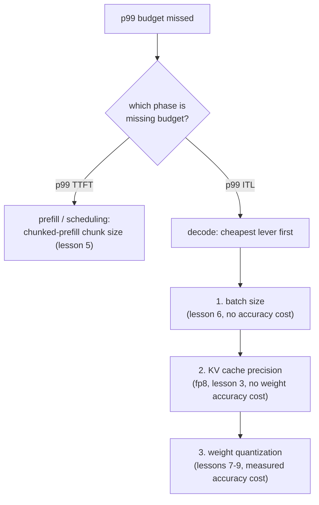

# Урок 17. Обоснование бюджета задержки от начала до конца

**Связь с целью курса:** Это заключительный урок цели курса: назвать и защитить бюджет задержки p99 от начала до конца значит диагностировать промах, возвращаясь через кеш, батчинг и квантизацию в правильном порядке, и защитить исправление числами, которые каждый из этих уроков учил измерять.
**Первоисточник:** [Документация: vLLM Documentation, vLLM Project](https://docs.vllm.ai/en/latest/)
**Предварительные требования:** [Урок 16](0016-p99-latency-methodology.md), [Урок 9](0009-picking-a-quantization-scheme.md), [Урок 2](0002-capacity-and-batch-size.md), [KV-кеш](../GLOSSARY.md)

## Разминка

1. ▢ Запишите по памяти формулу потолка ёмкости из урока 2.

Проверка

`max concurrent sequences = (total memory − weights − overhead) / (bytes per token × context length)`.

2. ▢ С какими тремя числами, по словам урока 9, нужно защищать выбор квантизации?

Проверка

Число по памяти, сделавшее квантизацию необходимой (или показывающее, что она не была нужна), число по точности, измеренное для выбранной схемы, и число по скорости, реально измеренное для важной фазы.

## Что нужно знать

### Диагностика идёт сначала по фазе, затем по рычагу

Нарушенный бюджет p99 это симптом, а не диагноз. Первое разделение: какая фаза выходит за бюджет. p99 TTFT указывает на префилл и планирование (блокировка головы очереди из урока 5, размер чанка чанкованного префилла), а p99 задержки между токенами указывает на декодирование (размер батча из урока 6, точность кеша из урока 3, квантизация весов из уроков с 7 по 9). Проверка рычагов не той фазы впустую тратит усилия: настройка размера чанка ничего не даёт при проблеме ITL, упирающейся в декодирование, а уменьшение батча ничего не даёт при проблеме TTFT, вызванной тем, что большой префилл останавливает очередь.

Когда фаза определена, порядок рычагов следует стоимости: сначала самое дешёвое исправление, не стоящее точности (размер батча, поскольку урок 6 уже показал, как вычислить наибольший батч, который допускает бюджет), затем смена точности кеша (KV-кеш в fp8 из урока 3, не стоящий точности весов), затем квантизация весов (уроки с 7 по 9, стоящая измеренной точности, к которой следует прибегать лишь после того, как более дешёвые рычаги исчерпаны или недостаточны).

### Разобранная цепочка

Сервер, обслуживающий модель на 13B на одном GPU в 80 ГБ, измеряет по реалистичному бенчмарку из 2000 запросов (урок 16) p99 TTFT с запасом в рамках бюджета и p99 задержки между токенами 80 мс при бюджете 50 мс. То, что с TTFT всё в порядке, исключает проблемы планирования из урока 5; это проблема фазы декодирования, проблема ITL. Команда сначала проверяет размер батча: он уже равен значению, которое урок 6 защищал бы для этой нагрузки, так что дальнейшее его уменьшение стоило бы пропускной способности, нужной нагрузке. Далее они квантизуют веса до int8 (урок 7), что снижает ITL до 65 мс, измеряя разницу точности относительно неквантизованной модели, как требует урок 9. Всё ещё выше бюджета, они взвешивают два оставшихся варианта: ещё уменьшить размер батча (без потери точности, но ценой пропускной способности) или квантизовать до int4 с AWQ (освобождает ещё больше времени декодирования ценой дальнейшей измеренной потери точности). Решает схема из урока 9: тот вариант, который закрывает оставшийся разрыв, не платя больше, чем действительно нужно бюджету. Если меньший размер батча всё ещё обеспечивает нужную нагрузке конкурентность, это более дешёвое исправление; только если нет, платится дальнейшая потеря точности int4.

### На что должна ссылаться итоговая защита

Конфигурация, которая теперь укладывается в бюджет p99, ещё не защищена, пока не названы три вещи: сами **измеренные значения p99**, из выборки, достаточно крупной и реалистичной, чтобы ей можно было доверять (урок 16); **рассуждения о памяти и размере батча**, стоящие за потолком ёмкости и размером батча, на которых остановилась конфигурация (уроки 2 и 6); и **число по точности**, измеренное для той квантизации, если она применялась, которая к этому привела (урок 9). Конфигурация, достигшая цели по задержке случайно, без записи ни одной из этих трёх вещей, защищена ровно настолько же, насколько и та, что цель не достигла.

## Практика

1. ▢ P99 задержки между токенами сервера равен 80 мс при бюджете 50 мс, тогда как p99 TTFT с запасом в рамках бюджета. Назовите две первые вещи, которые стоит проверить, по порядку, и почему в таком порядке.

Проверка

Сначала размер батча относительно значения, защищённого в уроке 6: ITL это число фазы декодирования, чувствительное к размеру батча, а подстройка размера батча ничего не стоит по точности, что делает её самым дешёвым рычагом для проверки. Затем квантизация весов (уроки с 7 по 9), поскольку декодирование ограничено пропускной способностью памяти, а меньший объём весов напрямую снижает задержку на шаг, ценой измеренной точности, которая платится лишь после проверки бесплатного рычага. То, что с TTFT всё в порядке, исключает проверку сначала чанкованного префилла или планирования, поскольку это рычаги стороны TTFT из урока 5.

2. ▢ После квантизации до int8 p99 ITL падает до 65 мс, всё ещё выше бюджета 50 мс. Команда выбирает между дальнейшим уменьшением размера батча и квантизацией до int4. Что, по схеме урока 9, должно решать между ними?

Проверка

Тот вариант, который закрывает оставшийся разрыв, не платя больше, чем нужно бюджету. Если меньший размер батча всё ещё обеспечивает нужную нагрузке конкурентность и укладывается в бюджет 50 мс, это лучший выбор, поскольку он не стоит дальнейшей точности. Только если меньший батч не может уложиться в бюджет или не может сделать этого, не опустившись ниже конкурентности, которая нужна нагрузке, дальнейшая измеренная потеря точности int4 становится оправданной.

3. ▢ Команда останавливается на квантизации int8 с размером батча, сохраняющим конкурентность на уровне, нужном нагрузке, достигая p99 ITL 48 мс и p99 TTFT 210 мс, оба измерены по 2000 запросам с распределением длин промптов, соответствующим продакшен-трафику. На какие три вещи должна ссылаться их итоговая защита?

Проверка

На сами измеренные значения p99, из выборки, достаточно крупной и реалистичной по форме, чтобы ей доверять (урок 16). На рассуждения о памяти и размере батча, стоящие за выбранной конфигурацией, связывающие размер батча с потолком ёмкости из урока 2 и защищённым значением из урока 6. На число по точности, измеренное для чекпоинта int8 относительно неквантизованной модели (урок 9), показывающее, что шаг квантизации проверили, а не сочли бесплатным.

4. ▢ Какое утверждение верно о диагностике нарушенного бюджета задержки p99 от начала до конца?

    - a) Любой флаг можно менять наугад, пока измеренное число не улучшится
    - b) Порядок диагностики следует тому, какая фаза выходит за бюджет, затем тому, на какой рычаг указывает механика этой фазы, начиная с самого дешёвого
    - c) Одного прогона бенчмарка достаточно как свидетельства, чтобы защитить изменение конфигурации
    - d) Квантизацию всегда следует пробовать первой, независимо от того, какая фаза выходит за бюджет

Проверка

**b)** Сначала фаза (TTFT или ITL), затем самый дешёвый рычаг, на который указывает механика этой фазы, это порядок, которому следовала разобранная цепочка урока. (a) неверно: бесцельное ковыряние это не диагностика, и оно тратит усилия на рычаги не той фазы. (c) неверно: урок 16 требует достаточного числа выборок и реалистичного разброса длин запросов, чтобы p99 вообще можно было доверять. (d) неверно: квантизация стоит измеренной точности, и к ней следует прибегать после более дешёвых, не стоящих точности рычагов вроде размера батча, а не до проверки, достаточно ли их.

## Практика в реальной работе

- [ ] Для нагрузки, которая у вас на уме, или реальной, которую вы обслуживаете, пройдите порядок диагностики этого урока от начала до конца: определите, какая фаза (если какая-то) выходит за бюджет, сначала проверьте самый дешёвый рычаг и запишите три вещи, на которые должна ссылаться ваша итоговая защита.
- [ ] Если вы строили реальное развёртывание на протяжении уроков этого рабочего пространства, соберите его реальные измеренные p99 TTFT и p99 ITL, из бенчмарка с размером и формой, как описывает урок 16, и сверьте их с бюджетом задержки, который вы стали бы защищать.
- [ ] Завтра: вернитесь к цели этого рабочего пространства в `README.md` и подтвердите своими словами, что теперь можете то, что она описывает: поднять стек обслуживания и защитить бюджет задержки, который он даёт.

## Что почитать дальше

- [Документация: vLLM Documentation, vLLM Project](https://docs.vllm.ai/en/latest/)
- [Статья: "Transformer Inference Arithmetic", Kipply](https://kipp.ly/transformer-inference-arithmetic/)
- [Ресурсы](../RESOURCES.md)

---

Не доходит? Перечитайте первоисточник в начале: этот урок его сжимает, а при сжатии понимание как раз и теряется. Загляните в [глоссарий](../GLOSSARY.md), если какой-то термин показался скользким.

Если неясен сам урок, а не материал, это дефект: [откройте issue](https://github.com/TokenCemetery/teach/issues).
