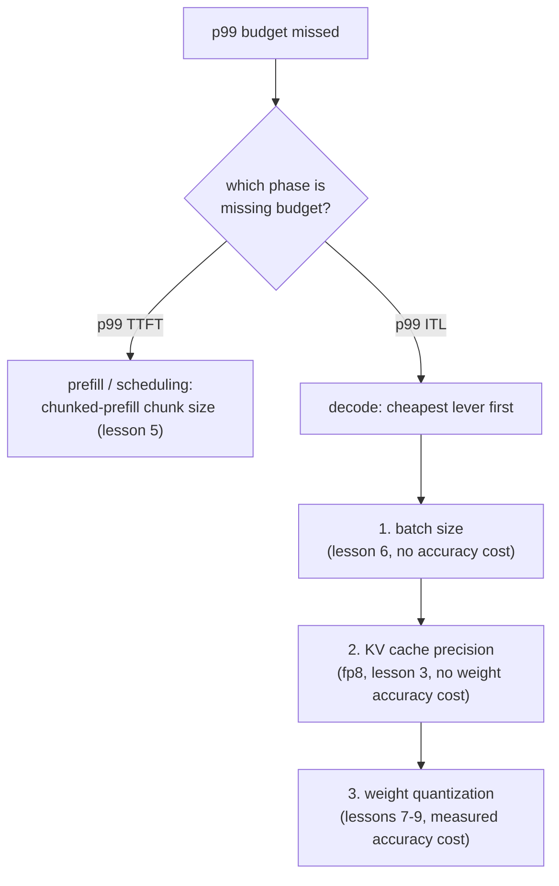

# 第 17 课：端到端地为延迟预算辩护

**使命关联:** 本课结束第 6 阶段，即延迟预算，第 7 到 14 阶段会在此基础上继续扩展：端到端地给出并辩护 p99 延迟预算，意味着按正确的顺序，回头走过缓存、批处理和量化来诊断一次未达标，并用这些课各自教你如何度量的数字，为修复辩护。
**主要来源:** [文档：vLLM Documentation，vLLM Project](https://docs.vllm.ai/en/latest/)
**前置知识:** [第 16 课](0016-p99-latency-methodology.md)、[第 9 课](0009-picking-a-quantization-scheme.md)、[第 2 课](0002-capacity-and-batch-size.md)、[KV 缓存](../GLOSSARY.md)

## 热身

1. ▢ 凭记忆写出第 2 课的容量上限公式。

检查

`max concurrent sequences = (total memory − weights − overhead) / (bytes per token × context length)`。

2. ▢ 第 9 课说，要为一个量化选择辩护，需要哪三个数字？

检查

让量化成为必要的那个内存数字（或者说明它并不必要的数字）、针对所选方案测得的精度数字，以及针对要紧的那个阶段实际测得的速度数字。

## 要点

### 诊断先看阶段，再看杠杆

未达标的 p99 预算是一个症状，不是诊断。第一步要分的是，哪个阶段超出了预算：p99 TTFT 指向预填充和调度（第 5 课的队首阻塞、分块预填充的块大小），而 p99 token 间延迟指向解码（第 6 课的批大小、第 3 课的缓存精度、第 7 到 9 课的权重量化）。查错了阶段的杠杆是白费力气：调块大小，对受解码限制的 ITL 问题没有任何作用；缩小批次，对由大预填充拖住队列所造成的 TTFT 问题也没有任何作用。

一旦确定了阶段，杠杆的顺序就按成本来排：不损失精度的最便宜的修复排在最前面（批大小，因为第 6 课已经展示了如何算出预算所允许的最大批次），然后是缓存精度的改变（第 3 课的 fp8 KV 缓存，不损失权重精度），最后是权重量化（第 7 到 9 课，它确实要付出实测的精度代价，所以只有在更便宜的杠杆用尽或不够用时才去动它）。

### 一条算例链

一台在单块 80 GB GPU 上服务 13B 模型的服务器，用真实的 2000 个请求的基准测试（第 16 课）测得：p99 TTFT 轻松低于预算，p99 token 间延迟是 80 ms，而预算是 50 ms。TTFT 没问题，就排除了第 5 课的调度问题；这是一个解码阶段的 ITL 问题。团队先检查批大小：它已经处在第 6 课会为这个工作负载辩护的那个数字上，所以再缩小它，就会损失工作负载所需的吞吐量。接下来，他们把权重量化到 int8（第 7 课），把 ITL 降到 65 ms，并按第 9 课的要求，对照未量化的模型测量精度变化量。仍然超出预算，他们权衡剩下的两个选项：进一步缩小批大小（没有精度代价，但损失吞吐量），或者用 AWQ 量化到 int4（腾出更多解码时间，代价是进一步的、实测的精度损失）。第 9 课的框架来裁决：哪个选项能在不付出超出预算实际所需的代价的前提下，补上剩下的差距。如果更小的批大小仍然满足工作负载所需的并发，那就是更便宜的修复；只有它不满足时，才去付 int4 进一步的精度代价。

### 最终的辩护必须引用什么

一套现在达到了 p99 预算的配置，在点出三样东西之前，还谈不上被辩护：**实测的 p99 数字**本身，来自一个足够大、足够真实、值得信任的样本（第 16 课）；配置最终落在的任何容量上限和批大小背后的**内存与批大小的推理**（第 2 和第 6 课）；以及为达到这一步而应用的任何量化所对应的**实测精度数字**（如果有的话）（第 9 课）。一套配置如果靠运气达到了延迟目标，却没有写下这三者中的任何一个，那它和没达标的配置一样，同样是没有被辩护的。

## 练习

1. ▢ 一台服务器的 p99 token 间延迟是 80 ms，而预算是 50 ms，p99 TTFT 则轻松低于预算。说出头两件值得检查的事，按顺序，并说明为什么按这个顺序。

检查

第一，拿批大小对照第 6 课被辩护的数字：ITL 是一个解码阶段、对批大小敏感的数字，而调整批大小在精度上不花任何代价，使它成为最便宜的杠杆。第二，权重量化（第 7 到 9 课），因为解码受内存带宽限制，更小的权重占用直接降低每步延迟，代价是实测的精度损失，只有在检查过免费的杠杆之后才去付。TTFT 没问题，就排除了先去查分块预填充或调度，因为那些是第 5 课中 TTFT 一侧的杠杆。

2. ▢ 量化到 int8 之后，p99 ITL 降到 65 ms，仍然高于 50 ms 的预算。团队在进一步缩小批大小与量化到 int4 之间犹豫。按第 9 课的框架，该由什么来决定二者之间的选择？

检查

哪个选项能在不付出超出预算所需的代价的前提下，补上剩下的差距。如果更小的批大小仍然满足工作负载所需的并发，并且能达到 50 ms 的预算，那就是更好的选择，因为它不再花任何精度。只有更小的批次达不到预算，或者要达到就得降到工作负载要求的并发以下时，int4 进一步的、实测的精度代价才变得有理由。

3. ▢ 团队最终选定了 int8 量化，配上一个让并发保持在工作负载所需水平的批大小，实现了 48 ms 的 p99 ITL 和 210 ms 的 p99 TTFT，二者都是用 2000 个请求测得的，提示词长度分布与生产流量相符。他们最终的辩护需要引用哪三样东西？

检查

实测的 p99 数字本身，来自一个足够大、形状足够真实、值得信任的样本（第 16 课）。所选配置背后的内存与批大小的推理，把批大小与第 2 课的容量上限和第 6 课被辩护的数字联系起来。针对 int8 检查点，相对于未量化的模型测得的精度数字（第 9 课），说明量化这一步是检查过的，而不是假定它免费。

4. ▢ 关于端到端地诊断一次未达标的 p99 延迟预算，哪种说法是对的？

    - a) 可以随机改任何参数，直到测得的数字有所改善
    - b) 诊断的顺序是：先看哪个阶段超出了预算，再看该阶段的机制指向哪个杠杆，最便宜的优先
    - c) 一次基准测试运行就足以为一个配置的改动辩护
    - d) 无论哪个阶段超出了预算，都应该总是先试量化

检查

**b)** 先看阶段（TTFT 还是 ITL），再看该阶段的机制所涉及的最便宜的杠杆，这就是本课的算例链所遵循的顺序。(a) 是错的：漫无目的地乱调不是诊断，只会把力气浪费在查错阶段的杠杆上。(c) 是错的：第 16 课要求有足够的样本和真实的请求长度差异，p99 才值得信任。(d) 是错的：量化要付出实测的精度代价，应该在批大小这类更便宜、不损失精度的杠杆之后才去动它，而不是在检查它们够不够用之前。

## 实战练习

- [ ] 针对你心里的某个工作负载，或者你正在服务的一个真实工作负载，把本课的诊断顺序端到端走一遍：找出哪个阶段（如果有的话）超出了预算，先检查最便宜的杠杆，并写下你最终的辩护需要引用的三样东西。
- [ ] 如果你一直在随着本工作区的各课构建一个真实的部署，就收集它实际测得的 p99 TTFT 和 p99 ITL，来自一个按第 16 课所描述的规模和形状做的基准测试，并对照一个你愿意辩护的延迟预算检查它们。
- [ ] 明天：重读本工作区 `README.md` 里的使命，用你自己的话确认，你现在能够做到它所描述的事：搭起一套服务栈，并为它产生的延迟预算辩护。

## 延伸阅读

- [文档：vLLM Documentation，vLLM Project](https://docs.vllm.ai/en/latest/)
- [文章：“Transformer Inference Arithmetic”，Kipply](https://kipp.ly/transformer-inference-arithmetic/)
- [资源](../RESOURCES.md)

---

没学明白？请重读顶部的主要来源，因为本课是对它的压缩，而理解正是在压缩中流失的。如果有哪个术语觉得含糊，可以查看[术语表](../GLOSSARY.md)。

如果问题出在课程本身，而不是学习材料，那就是一个缺陷：[提交 issue](https://github.com/TokenCemetery/teach/issues)。
