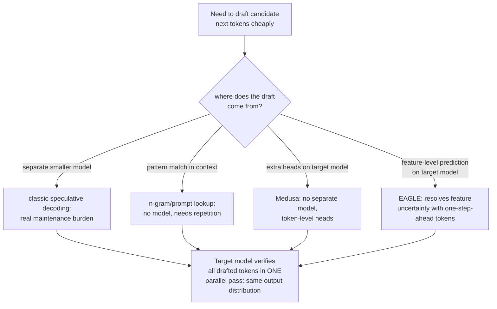

# Lección 18. Speculative decoding

**Vínculo con la misión:** La etapa 1 estableció por qué generar un token a la vez es costoso: cada paso vuelve a cargar de la memoria los pesos completos del modelo, y la aritmética en sí es barata en comparación. El **speculative decoding** es la principal palanca de latencia que este arco nunca mencionó, y explota exactamente ese desequilibrio: verificar varios tokens conjeturados en una pasada cuesta aproximadamente lo que cuesta normalmente generar un token, así que una conjetura correcta es throughput extra casi gratis.
**Fuente principal:** [Paper: "Fast Inference from Transformers via Speculative Decoding", Leviathan et al., 2022](https://arxiv.org/abs/2211.17192)
**Requisitos previos:** [Lección 1](0001-the-kv-cache.md), [Lección 6](0006-throughput-latency-tradeoff.md)

## Calentamiento

1. ▢ ¿Por qué decodificar un token a la vez vuelve a cargar de la memoria los pesos completos del modelo en cada paso?

Comprobación

Cada token nuevo depende de la salida del anterior, así que el modelo tiene que ejecutar su pasada forward completa otra vez para cada token, moviendo sus parámetros de la memoria a la unidad de cómputo cada vez, en lugar de poder agrupar ese movimiento de memoria entre varios pasos.

2. ▢ ¿Cómo intercambia el tamaño de lote throughput por latencia por token?

Comprobación

Un lote mayor permite amortizar el mismo costo de carga de pesos entre más solicitudes concurrentes, lo que aumenta el throughput total, pero los tokens de cada solicitud individual pueden tardar más en llegar, ya que el lote tiene que procesarse junto, lo que aumenta la latencia por token de cualquier solicitud que contenga.

## Qué debes saber

### Verificar K tokens en paralelo cuesta aproximadamente lo que cuesta generar un token

El decode está **limitado por el ancho de banda de memoria**: el costo dominante de un paso de generación es mover los pesos del modelo de la memoria a la unidad de cómputo, no la aritmética matricial en sí, que es comparativamente barata. Esto significa que puntuar varias posiciones candidatas del siguiente token en una pasada forward, comprobando si una secuencia entera de conjeturas era correcta, cuesta aproximadamente lo mismo que puntuar solo una, ya que se cargan los mismos pesos en ambos casos. El **speculative decoding** explota esto directamente: un **modelo borrador** pequeño y barato propone varios tokens por adelantado, y el **modelo objetivo** grande los verifica todos en una única pasada paralela, en lugar de generarlos él mismo uno a uno.

### La salida es exacta, no aproximada

El propio planteamiento del paper es específico en que esto no es un compromiso de calidad: su método de muestreo hace más rápida la decodificación exacta del modelo grande, sin cambiar en absoluto la distribución de salida. Siempre que la conjetura del modelo borrador coincide con lo que el modelo objetivo habría muestreado de todos modos, se acepta; siempre que no, un paso de remuestreo correctivo produce el mismo resultado que habría producido el modelo objetivo solo en esa posición. La salida de extremo a extremo es demostrablemente idéntica a ejecutar el modelo objetivo por sí solo, token a token; solo cambia el costo en tiempo real, ya que la costosa pasada forward del propio modelo objetivo puede ahora verificar varios tokens del borrador en lugar de producir solo uno.

### El borrador no tiene por qué venir de un modelo totalmente aparte

Un modelo borrador (una versión más pequeña y barata del modelo objetivo) es el diseño original, pero conlleva un costo operativo real: adquirir y mantener un segundo modelo entero, que siga siendo compatible a medida que cambia el modelo objetivo, es una carga en sí misma. El borrador por **n-gramas** (prompt-lookup) esquiva esto al no usar ningún modelo: busca un tramo del prompt o del contexto generado que coincida con los últimos tokens, y especula con que lo que siguió a ese tramo antes volverá a seguirlo. Esto funciona bien específicamente cuando una tarea implica repetición real (editar código, referirse a un documento largo) y no compra nada cuando no hay repetición que explotar, pero no necesita modelo, ni entrenamiento, ni ningún mantenimiento.

### Medusa y EAGLE redactan a partir del propio modelo objetivo en lugar de uno aparte

**Medusa** elimina la carga del modelo borrador separado de otra manera: en lugar de un segundo modelo entero, añade cabezas de decodificación adicionales directamente al modelo objetivo, cada una prediciendo en paralelo una de las siguientes posiciones de token a partir de la misma pasada forward, sin ningún modelo separado que adquirir o mantener sincronizado. **EAGLE** lo refina aún más: observó que predecir al nivel de las características internas del propio modelo (sus representaciones ocultas) es más tratable que predecir directamente tokens en bruto, pero que la predicción a nivel de características por sí sola conlleva una incertidumbre real; EAGLE resuelve esa incertidumbre incorporando además la secuencia de tokens adelantada un paso de tiempo, y sus propios resultados reportados (una aceleración de latencia de 2.7x a 3.5x, y aproximadamente el doble de throughput en un modelo de 70B) confirman explícitamente que esto ocurre manteniendo la misma distribución de salida que habría producido el modelo objetivo solo.

### Cada variante hace el mismo intercambio en un lugar distinto

El speculative decoding con modelo borrador, el borrador por n-gramas, Medusa y EAGLE aceptan todos cierta fracción de verificación desperdiciada (una conjetura rechazada cuesta un poco de trabajo extra sin beneficio) a cambio de una oportunidad real de generar varios tokens por pasada forward costosa en lugar de uno. Lo único que difiere entre ellos es de dónde viene realmente el borrador: un modelo separado más pequeño, la coincidencia de patrones en el contexto existente, cabezas adicionales en el mismo modelo o un predictor a nivel de características sobre el mismo modelo corregido con tokens adelantados un paso. Ninguna cambia lo que se genera; todas cambian cuántas de las pasadas forward realmente costosas del modelo objetivo hacen falta para generarlo.

## Práctica

1. ▢ ¿Por qué verificar 4 tokens candidatos en una pasada forward cuesta aproximadamente lo mismo que generar un solo token normalmente, y no 4 veces más?

Pista

Considera qué domina en primer lugar el costo de un paso de decodificación.

Comprobación

El decode está limitado por el ancho de banda de memoria: el costo dominante es mover los pesos del modelo desde la memoria, lo que ocurre una vez sin importar cuántas posiciones candidatas se puntúen en esa misma pasada. Puntuar 4 posiciones en lugar de 1 añade una cantidad comparativamente pequeña de aritmética extra sobre un costo de movimiento de memoria que se iba a pagar de todos modos.

2. ▢ Un equipo teme que el speculative decoding intercambie calidad de salida por velocidad, ya que implica que un modelo más pequeño y menos capaz conjetura tokens. ¿Es acertada esta preocupación?

Comprobación

No. El método del paper está diseñado específicamente para que la distribución de salida final sea idéntica a ejecutar el modelo objetivo solo; una conjetura correcta del borrador se acepta, y una incorrecta se corrige mediante remuestreo, así que el resultado final coincide con lo que habría producido el modelo objetivo por sí solo, sin compromiso de calidad, solo con un cambio de latencia.

3. ▢ ¿Por qué el borrador por n-gramas (prompt-lookup) podría encajar mejor en una tarea de edición de código que en una escritura creativa abierta?

Comprobación

El borrador por n-gramas especula con que un tramo que coincide con los últimos tokens irá seguido de lo que lo siguió antes en otra parte del contexto; la edición de código y las tareas repetitivas similares tienen mucha más repetición literal de este tipo que explotar que la escritura creativa abierta, donde el borrador por n-gramas rara vez encontraría un tramo coincidente a partir del cual especular.

4. ▢ ¿Qué problema concreto resuelve Medusa respecto del enfoque original de modelo borrador, y qué añade EAGLE sobre el enfoque de Medusa?

Comprobación

Medusa elimina la carga de adquirir y mantener un modelo borrador separado, añadiendo en su lugar cabezas de decodificación adicionales directamente al modelo objetivo. EAGLE mejora aún más la precisión de la predicción redactando al nivel de las características internas del modelo en lugar de los tokens en bruto, y resuelve la incertidumbre adicional que trae la predicción a nivel de características incorporando también la secuencia de tokens adelantada un paso de tiempo.

5. ▢ ¿Qué afirmación describe correctamente lo que es común al speculative decoding con modelo borrador, n-gramas, Medusa y EAGLE?

    - a) Cada variante intercambia algo de calidad de salida por velocidad adicional, en cantidades distintas
    - b) Todas redactan tokens candidatos de forma barata, desde fuentes distintas, y luego dejan que el modelo objetivo los verifique en una pasada paralela que cuesta aproximadamente lo que cuesta generar un token, conservando la distribución de salida exacta que produciría el modelo objetivo solo
    - c) Solo el enfoque original de modelo borrador conserva la distribución de salida exacta; las variantes más nuevas son aproximaciones
    - d) El borrador por n-gramas requiere entrenar una pequeña red neuronal con las propias salidas del modelo objetivo

Comprobación

**b)** Ese es el mecanismo y la garantía compartidos por todas las variantes que cubre esta lección. (a) es falsa: toda variante conserva la distribución de salida exacta del modelo objetivo; ninguna intercambia calidad por velocidad. (c) es falsa: Medusa y EAGLE reportan explícitamente coincidir con la distribución de salida del modelo objetivo, igual que el enfoque original. (d) es falsa: el borrador por n-gramas no necesita ningún modelo ni entrenamiento, solo coincidencia de patrones con el contexto existente.

## Prácticas en el mundo real

- [ ] Para un stack de serving al que tengas acceso (vLLM u otro), comprueba si admite speculative decoding y, de ser así, qué variante (modelo borrador, n-gramas/prompt-lookup o un método basado en cabezas).
- [ ] Para una carga de trabajo que conozcas, juzga si tiene suficiente repetición literal (código, documentos estructurados) para que el borrador por n-gramas ayude, o si encajaría mejor un modelo borrador o un método basado en cabezas.
- [ ] Mañana: lee completa la sección de la fuente primaria sobre la tasa de aceptación, y anota qué determina con qué frecuencia se aceptan realmente las conjeturas del modelo borrador, y cómo esa tasa de aceptación se traduce en una aceleración real.

## Para profundizar

- [Paper: "Fast Inference from Transformers via Speculative Decoding", Leviathan et al., 2022](https://arxiv.org/abs/2211.17192)
- [Paper: "Medusa: Simple LLM Inference Acceleration Framework with Multiple Decoding Heads", Cai et al., 2024](https://arxiv.org/abs/2401.10774)
- [Paper: "EAGLE: Speculative Sampling Requires Rethinking Feature Uncertainty", Li et al., 2024](https://arxiv.org/abs/2401.15077)
- [Recursos](../RESOURCES.md)

---

¿No termina de quedar claro? Vuelve a leer la fuente primaria de arriba, ya que esta lección la comprime y en la compresión es donde se escapa la comprensión. Consulta el [glosario](../GLOSSARY.md) por si algún término te resultó resbaladizo.

Si lo poco claro es la propia lección y no el material, eso es un defecto: [abre un issue](https://github.com/TokenCemetery/teach/issues).
