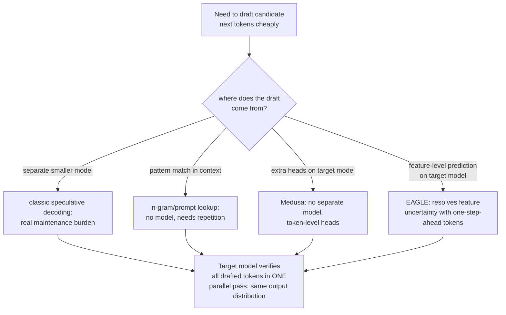

# Leçon 18. Décodage spéculatif

**Lien avec la mission :** L'étape 1 a établi pourquoi générer un token à la fois est coûteux : chaque étape recharge depuis la mémoire tous les poids du modèle, et l'arithmétique elle-même est bon marché en comparaison. Le **décodage spéculatif** est le principal levier de latence que ce parcours n'avait jamais mentionné, et il exploite exactement ce déséquilibre : vérifier plusieurs tokens devinés en une passe coûte à peu près ce que coûte normalement la génération d'un seul token, si bien qu'une bonne supposition est du débit supplémentaire presque gratuit.
**Source primaire :** [Article : "Fast Inference from Transformers via Speculative Decoding", Leviathan et al., 2022](https://arxiv.org/abs/2211.17192)
**Prérequis :** [Leçon 1](0001-the-kv-cache.md), [Leçon 6](0006-throughput-latency-tradeoff.md)

## Échauffement

1. ▢ Pourquoi décoder un token à la fois recharge-t-il tous les poids du modèle depuis la mémoire à chaque étape ?

Vérifier

Chaque nouveau token dépend de la sortie du précédent, donc le modèle doit refaire sa passe avant complète pour chaque token, en déplaçant chaque fois ses paramètres de la mémoire vers l'unité de calcul, au lieu de pouvoir regrouper ce déplacement mémoire sur plusieurs étapes.

2. ▢ Comment la taille de batch échange-t-elle le débit contre la latence par token ?

Vérifier

Un batch plus grand permet d'amortir le même coût de chargement des poids sur davantage de requêtes concurrentes, ce qui augmente le débit total, mais les tokens de chaque requête individuelle peuvent mettre plus de temps à arriver puisque le batch doit être traité ensemble, ce qui augmente la latence par token pour chacune de ses requêtes.

## À savoir

### Vérifier K tokens en parallèle coûte à peu près ce que coûte la génération d'un token

Le décodage est **limité par la bande passante mémoire** : le coût dominant d'une étape de génération est le déplacement des poids du modèle de la mémoire vers l'unité de calcul, et non l'arithmétique matricielle elle-même, qui est comparativement bon marché. Cela signifie que scorer plusieurs positions candidates du token suivant en une seule passe avant, c'est-à-dire vérifier si toute une suite de suppositions était juste, coûte à peu près la même chose que d'en scorer une seule, puisque les mêmes poids sont chargés dans les deux cas. Le **décodage spéculatif** exploite cela directement : un petit **draft model** peu coûteux propose plusieurs tokens à l'avance, et le grand **modèle cible** les vérifie tous en une seule passe parallèle, au lieu de les générer lui-même un par un.

### La sortie est exacte, pas approchée

Le cadrage même de l'article est précis : ce n'est pas un compromis sur la qualité, car sa méthode d'échantillonnage rend plus rapide le décodage exact du grand modèle, sans changer du tout la distribution de sortie. Chaque fois que la supposition du draft model correspond à ce que le modèle cible aurait de toute façon échantillonné, elle est acceptée ; chaque fois qu'elle ne correspond pas, une étape de rééchantillonnage correctif produit le même résultat que le modèle cible seul aurait produit à cette position. La sortie de bout en bout est démontrablement identique à l'exécution du modèle cible seul, token par token ; seul le coût en temps réel change, puisque la propre passe avant coûteuse du modèle cible peut désormais vérifier plusieurs tokens du brouillon au lieu d'en produire un seul.

### Le brouillon ne doit pas forcément venir d'un modèle entièrement séparé

Un draft model (une version plus petite et moins coûteuse du modèle cible) est la conception d'origine, mais il s'accompagne d'un vrai coût opérationnel : acquérir et maintenir un second modèle entier, le garder compatible quand le modèle cible change, est une charge en soi. Le brouillon par **n-grammes** (prompt-lookup) contourne cela en n'utilisant aucun modèle : il cherche dans le prompt ou le contexte généré existant un tronçon qui correspond aux derniers tokens, et spécule que ce qui suivait ce tronçon auparavant le suivra de nouveau. Cela fonctionne bien précisément quand une tâche comporte une vraie répétition (édition de code, référence à un long document) et n'apporte rien quand il n'y a aucune répétition à exploiter, mais cela n'exige aucun modèle, aucun entraînement et aucune maintenance.

### Medusa et EAGLE font leur brouillon à partir du modèle cible lui-même plutôt que d'un modèle séparé

**Medusa** supprime la charge du draft model séparé d'une autre manière : au lieu d'un second modèle entier, il ajoute des têtes de décodage supplémentaires directement sur le modèle cible, chacune prédisant en parallèle l'une des positions de token suivantes à partir de la même passe avant, sans aucun modèle séparé à acquérir ou à garder synchronisé. **EAGLE** affine cela davantage : il a observé que prédire au niveau des propres features internes du modèle (ses représentations cachées) est plus abordable que prédire directement des tokens bruts, mais que la prédiction au niveau des features comporte à elle seule une vraie incertitude ; EAGLE résout cette incertitude en injectant aussi la séquence de tokens avancée d'un pas de temps, et ses propres résultats rapportés (une accélération de latence de 2.7x à 3.5x, un débit à peu près doublé sur un modèle 70B) confirment explicitement que cela se fait en maintenant la même distribution de sortie que le modèle cible seul aurait produite.

### Chaque variante fait le même échange à un endroit différent

Le décodage spéculatif à draft model, le brouillon par n-grammes, Medusa et EAGLE acceptent tous une certaine fraction de vérification gaspillée (une supposition rejetée coûte un peu de travail supplémentaire sans bénéfice) en échange d'une vraie chance de générer plusieurs tokens par passe avant coûteuse au lieu d'un seul. Ce qui les différencie, c'est seulement l'origine du brouillon : un modèle séparé plus petit, la recherche de motifs dans le contexte existant, des têtes supplémentaires sur le même modèle, ou un prédicteur au niveau des features sur le même modèle corrigé par des tokens avancés d'un pas. Aucune ne change ce qui est généré ; toutes changent le nombre de passes avant réellement coûteuses du modèle cible qu'il faut pour le générer.

## Pratique

1. ▢ Pourquoi vérifier 4 tokens candidats en une seule passe avant coûte-t-il à peu près la même chose que générer un seul token normalement, plutôt que 4 fois plus ?

Indice

Demandez-vous ce qui domine réellement le coût d'une étape de décodage au départ.

Vérifier

Le décodage est limité par la bande passante mémoire : le coût dominant est le déplacement des poids du modèle depuis la mémoire, qui a lieu une seule fois quel que soit le nombre de positions candidates scorées dans cette même passe. Scorer 4 positions au lieu d'une ajoute une quantité d'arithmétique comparativement faible par-dessus un coût de déplacement mémoire qui allait être payé dans les deux cas.

2. ▢ Une équipe craint que le décodage spéculatif n'échange la qualité de sortie contre la vitesse, puisqu'il fait deviner des tokens à un modèle plus petit et moins capable. Cette crainte est-elle fondée ?

Vérifier

Non. La méthode de l'article est conçue précisément pour que la distribution de sortie finale soit identique à l'exécution du modèle cible seul ; une bonne supposition du brouillon est acceptée, et une mauvaise est corrigée par rééchantillonnage, si bien que le résultat final correspond à ce que le modèle cible aurait produit par lui-même, sans compromis sur la qualité, seulement un changement de latence.

3. ▢ Pourquoi le brouillon par n-grammes (prompt-lookup) pourrait-il mieux convenir à une tâche d'édition de code qu'à de l'écriture créative libre ?

Vérifier

Le brouillon par n-grammes spécule qu'un tronçon qui correspond aux derniers tokens sera suivi de ce qui le suivait auparavant ailleurs dans le contexte ; l'édition de code et les tâches répétitives similaires comportent bien plus de ce type de répétition littérale à exploiter que l'écriture créative libre, où le brouillon par n-grammes trouverait rarement un tronçon correspondant à partir duquel spéculer.

4. ▢ Quel problème précis Medusa résout-il par rapport à l'approche d'origine à draft model, et qu'ajoute EAGLE à l'approche de Medusa ?

Vérifier

Medusa supprime la charge d'acquérir et de maintenir un draft model séparé, en ajoutant plutôt des têtes de décodage supplémentaires directement sur le modèle cible. EAGLE améliore encore la précision de prédiction en faisant le brouillon au niveau des features internes du modèle plutôt que des tokens bruts, en résolvant l'incertitude supplémentaire qu'apporte la prédiction au niveau des features par l'ajout de la séquence de tokens avancée d'un pas de temps.

5. ▢ Quelle affirmation décrit correctement ce que le décodage spéculatif à draft model, par n-grammes, Medusa et EAGLE ont en commun ?

    - a) Chaque variante échange un peu de qualité de sortie contre de la vitesse supplémentaire, en quantités différentes
    - b) Toutes rédigent à bas coût des tokens candidats, à partir de sources différentes, puis laissent le modèle cible les vérifier en une seule passe parallèle qui coûte à peu près ce que coûte la génération d'un token, en préservant la distribution de sortie exacte que le modèle cible seul produirait
    - c) Seule l'approche d'origine à draft model préserve la distribution de sortie exacte ; les variantes plus récentes sont des approximations
    - d) Le brouillon par n-grammes exige d'entraîner un petit réseau de neurones sur les propres sorties du modèle cible

Vérifier

**b)** C'est le mécanisme et la garantie partagés par chaque variante que couvre cette leçon. (a) est fausse : chaque variante préserve la distribution de sortie exacte du modèle cible ; aucune n'échange de la qualité contre de la vitesse. (c) est fausse : Medusa et EAGLE rapportent tous deux explicitement correspondre à la distribution de sortie du modèle cible, comme l'approche d'origine. (d) est fausse : le brouillon par n-grammes n'exige ni modèle ni entraînement, seulement de la recherche de motifs dans le contexte existant.

## Exercices en situation réelle

- [ ] Pour une pile de serving à laquelle vous avez accès (vLLM ou autre), vérifiez si elle prend en charge le décodage spéculatif, et si oui, quelle variante (draft model, n-grammes/prompt-lookup, ou méthode à têtes).
- [ ] Pour une charge de travail que vous connaissez, jugez si elle comporte assez de répétition littérale (code, documents structurés) pour que le brouillon par n-grammes aide, ou si un draft model ou une méthode à têtes conviendrait mieux.
- [ ] Demain : lisez en entier la section de la source primaire sur le taux d'acceptation, et notez ce qui détermine la fréquence à laquelle les suppositions du draft model sont réellement acceptées, et comment ce taux d'acceptation se traduit en accélération réelle.

## Pour aller plus loin

- [Article : "Fast Inference from Transformers via Speculative Decoding", Leviathan et al., 2022](https://arxiv.org/abs/2211.17192)
- [Article : "Medusa: Simple LLM Inference Acceleration Framework with Multiple Decoding Heads", Cai et al., 2024](https://arxiv.org/abs/2401.10774)
- [Article : "EAGLE: Speculative Sampling Requires Rethinking Feature Uncertainty", Li et al., 2024](https://arxiv.org/abs/2401.15077)
- [Ressources](../RESOURCES.md)

---

Ça ne passe pas ? Relisez la source primaire en haut de page, car cette leçon la condense et c'est dans la condensation que la compréhension s'échappe. Consultez le [glossaire](../GLOSSARY.md) pour tout terme qui vous a paru glissant.

Si c'est la leçon elle-même qui n'est pas claire plutôt que la matière, c'est un défaut : [ouvrez une issue](https://github.com/TokenCemetery/teach/issues).
